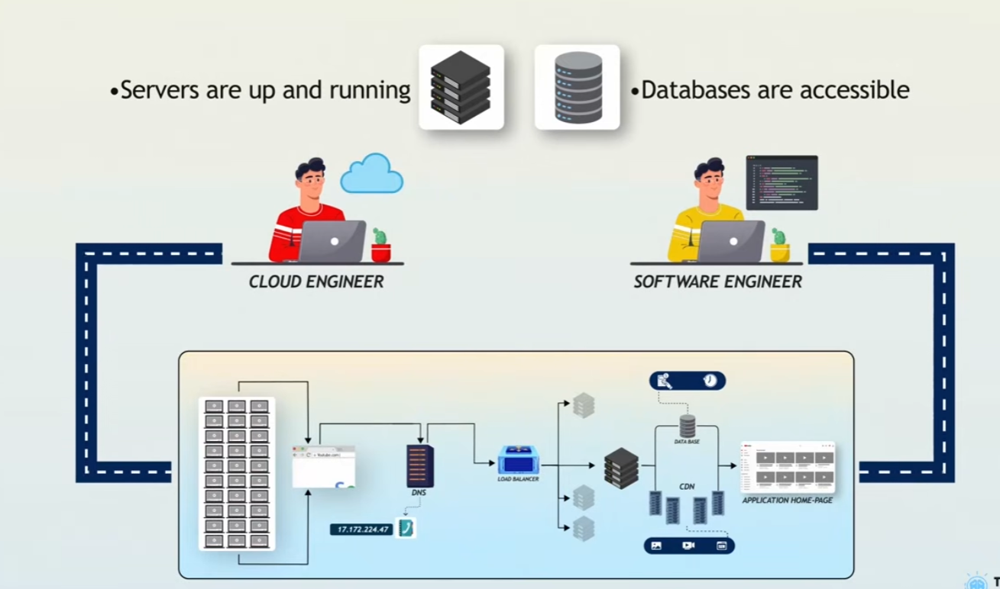

# Browser Mein URL Likhne Ke Baad Kya Hota Hai?

## Maqsad aur source

Yeh notes learner ki di hui video summary aur saath share ki gayi architecture picture ko tafseel se samjhate hain. Yeh poori video ka verify kiya hua transcript nahin hain. Simplified request flow ko wazeh karne ke liye mazeed technical explanations shamil hain.

Video: https://www.youtube.com/watch?v=_x1GskHtJxo

## 1. Pooray process ka khaka

Jab aap browser mein `https://www.youtube.com/` likh kar Enter dabate hain, browser ko service ka address maloom karna, connection banana, content mangwana aur response screen par dikhana hota hai. Is kaam mein mukhtalif systems mil kar hissa lete hain.

**Bunyadi tarteeb:** Naam ka address maloom karo → secure connection banao → request bhejo → request process karo → content wapas bhejo → page screen par dikhao.

Page ek second se bhi kam waqt mein nazar aana shuru ho sakta hai, lekin yeh guarantee nahin. Network ki halat, server ki processing aur content ki miktar loading time par asar dalti hain. Shuru ka page nazar aane ke baad bhi video download ya stream hoti rehti hai.

## 2. URL: woh address jo aap likhte hain

**Kya hai:** URL ka poora naam Uniform Resource Locator hai. Yeh kisi resource ki pehchan karta hai aur batata hai ke us tak kis tareeqay se pohanchna hai.

Misal: `https://www.example.com/videos`

| Hissa | Matlab |
|---|---|
| `https` | Scheme jo secure connection par HTTP istemal karne ko zahir karti hai |
| `www.example.com` | Hostname jis se service ko locate kiya jata hai |
| `/videos` | Path jo mangay gaye resource ki pehchan karta hai |

**Kyun zaroori hai:** Browser ko destination ke saath yeh bhi maloom hona chahiye ke kaunsa resource chahiye.

## 3. DNS: destination ka address maloom karna

**Kya hai:** DNS ka poora naam Domain Name System hai. Yeh hostname ko IP address jaisi maloomat mein resolve karta hai. A record mein IPv4 address aur AAAA record mein IPv6 address hota hai.

**Kyun zaroori hai:** Insan ke liye naam yaad rakhna asaan hai, jabke network communication mein IP addresses istemal hote hain.

**Kaise kaam karta hai:** Browser ya operating system ke cache mein pehle se jawab mojood ho sakta hai. Agar jawab nahin milta to system DNS resolver se poochta hai. Resolver apne cache se jawab de sakta hai ya jawab hasil karne ke liye doosray DNS servers se query kar sakta hai.

**Rozmarrah misal:** Aap phone book mein kisi shakhs ka naam dekh kar us ka phone number talash karte hain.

**Yaad rakhein:** DNS address ki maloomat deta hai. Webpage ka baqi traffic DNS ke andar se ho kar nahin guzarta. DNS application server ke bajaye CDN ya load balancer se mutalliq address bhi de sakta hai. Ek hostname ke multiple addresses ho sakte hain aur location ya waqt ke mutabiq jawab badal sakta hai.

## 4. Secure connection aur HTTP request

**Kya hai:** Browser service ke saath connection banata hai aur HTTP requests aur responses ka tabadla karta hai.

**Kyun zaroori hai:** Connection data bhejne aur hasil karne ka rasta deta hai. HTTPS safar ke dauran data ko parhne ya tabdeel karne se bachata hai aur certificates ke zariye service ki pehchan verify karne mein madad deta hai.

**Kaise kaam karta hai:** Bohat se connections mein pehle TCP aur phir TLS istemal hota hai. HTTP/3 mein UDP par QUIC istemal hota hai aur TLS protocol ke andar shamil hota hai. Pehle se bana hua connection dobara bhi istemal ho sakta hai.

Is ke baad browser page ki request bhej sakta hai:

```http
GET / HTTP/1.1
Host: www.example.com
```

Yeh HTTP/1.1 ki samjhane wali misal hai; YouTube ke asal traffic ki recording nahin. Asal request mein mazeed maloomat hoti hai, jis mein session ki pehchan ke liye cookies bhi shamil ho sakti hain.

## 5. Load balancer: requests ko taqseem karna

**Kya hai:** Load balancer aane walay traffic ko backend servers ke darmiyan taqseem karta hai.

**Kyun zaroori hai:** Kaam taqseem karne se ek server par hadd se zyada bojh nahin parta. Agar koi server unhealthy ho jaye to service ki availability barqarar rakhne mein madad milti hai.

**Kaise kaam karta hai:** Load balancer backend servers ki health check karta hai aur configured routing aur balancing rules ke mutabiq munasib server chunta hai. Traffic zaroori nahin ke bilkul barabar taqseem ho; servers ki capacity ya mojooda workload mukhtalif ho sakta hai.

**Misal:** Ek service teen application servers par chal rahi hai. Agar ek server health checks mein fail ho jaye to load balancer nayi requests baqi sehatmand servers ki taraf bhej sakta hai.

**Rozmarrah misal:** Traffic officer gariyon ko khali ya dastiyab lanes ki taraf bhejta hai.

**Yaad rakhein:** Load balancing kaam taqseem karti hai. Servers ki tadaad barhana ya kam karna scaling hai. Dono aapas mein mutalliq hain, lekin alag functions hain.

## 6. Application server: code aur logic chalana

**Kya hai:** Application server woh code chalata hai jo request handle karta hai aur application ke rules lagu karta hai.

**Kyun zaroori hai:** Personalized aur interactive pages ke liye faislay aur data processing darkar hoti hai.

**Kaise kaam karta hai:** Application session validate kar sakti hai, permissions check kar sakti hai, database ya cache se data le sakti hai aur HTML ya JSON jaisa structured data wapas bhej sakti hai.

**Misal:** Video service aap ke account aur preferences ki madad se subscriptions ya recommendations tayyar kar sakti hai. Yeh samjhane ki misal hai; YouTube ke exact internal implementation ki tasdeeq shuda tafseel nahin.

**Yaad rakhein:** Server hamesha poora nazar aane wala page khud nahin banata. Browser mein chalne wali JavaScript mazeed data mangwa kar interface ke hissay bana ya update kar sakti hai.

## 7. Database: application ka data mehfooz rakhna

**Kya hai:** Database data ko store aur organize karta hai taa ke application usay hasil ya tabdeel kar sake.

**Kyun zaroori hai:** Account ki maloomat, subscriptions aur activity ko ek request khatam hone ke baad bhi mehfooz rehna hota hai.

**Kaise kaam karta hai:** Application database ko queries ya doosray operations bhejti hai. Hasil honay walay nataij se response tayyar karti hai.

**Misalein:** User profiles, subscription relationships, video metadata aur watch-history records.

**Yaad rakhein:** Database mein metadata ho sakta hai jabke video files alag object storage mein rakhi ja sakti hain. Cache se jawab milne par har request ko database query ki zaroorat nahin hoti. Browser aam tor par application ya API se baat karta hai; private database se seedha connection nahin banata.

## 8. CDN: content ko user ke qareeb se deliver karna

**Kya hai:** CDN ka poora naam Content Delivery Network hai. Yeh mukhtalif locations par mojood servers ka network hai jo network ke lihaz se user ke qareeb se content deliver karta hai.

**Kyun zaroori hai:** Chhota delivery rasta aur cached copies latency kam kar sakti hain, origin server ka load ghata sakti hain aur bohat se users tak content pohanchana asaan bana sakti hain.

**Kaise kaam karta hai:** CDN image, script ya video segment ki cached copy serve kar sakta hai. Agar content cache mein nahin hai to configuration ke mutabiq origin ya kisi doosray cache se hasil kar sakta hai.

**Misal:** Chicago mein video dekhne walay user ko door ke origin ke bajaye qareebi CDN location se video segments mil sakte hain.

**Yaad rakhein:** Geography ke lihaz se sab se qareeb location hamesha behtareen network route nahin hoti. CDN sirf media tak mehdood nahin; HTML, CSS, JavaScript aur kuch dynamic content bhi deliver kar sakta hai. Private personalized content ke liye munasib access aur caching controls darkar hote hain.

## 9. Browser: result screen par dikhana

Browser HTML ko samajhta hai, CSS apply karta hai, JavaScript chalata hai aur mazeed resources ki requests bhejta hai. Yeh interface draw karta hai aur mazeed data aane par usay update karta rehta hai.

Video playback mein aam tor par media segments ki bohat si requests hoti hain. Playback shuru karne se pehle poori video download karna zaroori nahin hota.

## 10. Tamam components ko saath samjhein

1. Aap URL likhte hain.
2. Browser DNS ke zariye hostname resolve karta hai; mumkin ho to cache ka jawab istemal karta hai.
3. Destination tak secure connection banata hai ya mojooda connection dobara istemal karta hai.
4. HTTP request bhejta hai.
5. CDN cached content de sakta hai ya request origin ki taraf bhej sakta hai.
6. Load balancer sehatmand application server chun sakta hai.
7. Application apna logic chalati hai aur zaroorat par database ya cache se data leti hai.
8. Response browser ko wapas milta hai aur browser page render karta hai.
9. Mazeed requests images, scripts, data aur video segments hasil karti hain; aksar CDN ke zariye.

**Architecture ki wazahat:** Yeh ek aam model hai. CDN aksar origin infrastructure ke samnay hota hai. Media requests alag hostnames aur rastay istemal kar sakti hain. DNS, load balancing, database aur CDN koi ek lazmi chain nahin jis se har request ko guzarna ho. Share ki gayi picture ek conceptual overview hai.

## 11. Cloud engineer aur software engineer




| Role | Aam zimmedariyan |
|---|---|
| Cloud engineer | Infrastructure, networking, compute, load balancing, access controls, monitoring, automation, capacity aur reliability |
| Software engineer | Application code, APIs, business logic, database access, testing aur application performance |
| Mushtarka kaam | Security, troubleshooting, deployment, availability, performance aur cost management |

Zimmedariyan overlap kar sakti hain aur har organization mein mukhtalif ho sakti hain. DevOps, SRE, network, database aur security teams bhi hissa le sakti hain.

## 12. Quick revision

| Component | Kis bunyadi sawal ka jawab deta hai? |
|---|---|
| DNS | Is hostname tak kis address par pohanch sakte hain? |
| HTTPS | HTTP data ko mehfooz tareeqay se kaise exchange karein? |
| Load balancer | Yeh traffic kaunsa backend handle kare? |
| Application server | Is request ke liye application ko kya karna chahiye? |
| Database | Kaunsi mehfooz ki gayi maloomat chahiye? |
| CDN | Kya content qareebi location se behtar tareeqay se deliver ho sakta hai? |
| Browser | Yeh content screen par kaisa nazar aaye aur kaise kaam kare? |

## 13. Revision ke sawalat aur jawab

**1. DNS kyun chahiye?** Insanon ke samajhne walay hostnames ko service tak pohanchne ki maloomat, jaise IP addresses, mein resolve karne ke liye.

**2. Kya har request ko nayi DNS lookup chahiye?** Nahin. Cached DNS answers aur dobara istemal honay walay connections baar baar lookup ki zaroorat kam kar sakte hain.

**3. Agar ek application server fail ho jaye to kya hota hai?** Sahi configure hua load balancer unhealthy server ko naya traffic bhejna rok sakta hai. Jo requests pehle se chal rahi hon woh phir bhi fail ho sakti hain.

**4. Application server aur database mein kya farq hai?** Application server logic chalata hai; database data store aur retrieve karta hai.

**5. CDN performance kaise behtar karta hai?** User ke qareeb se cached content de sakta hai aur origin tak jane wali requests kam kar sakta hai.

**6. Kya CDN aur load balancer ek hi cheez hain?** Nahin. CDN mukhtalif locations se content delivery karta hai; load balancer backend servers ke darmiyan traffic taqseem karta hai. Dono saath kaam kar sakte hain.

**7. Video shuru hone se pehle page kyun nazar aa sakta hai?** Interface aur video media alag resources hain. In ki requests aur loading times bhi alag hote hain.

**8. Kya tamam steps ek second se kam waqt mein mukammal hona lazmi hain?** Nahin. Waqt caching, connection reuse, network ki halat, server processing aur resource size par depend karta hai.


