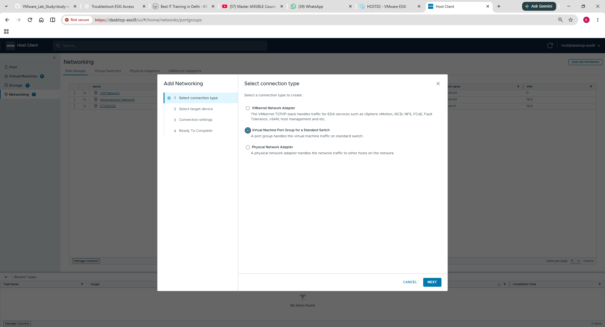
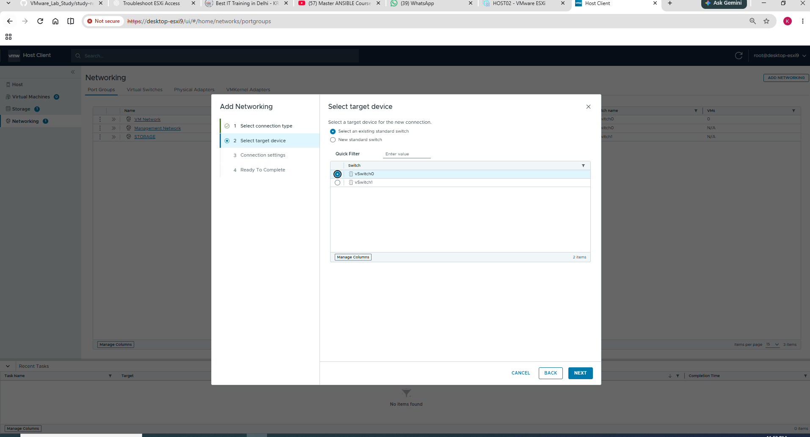
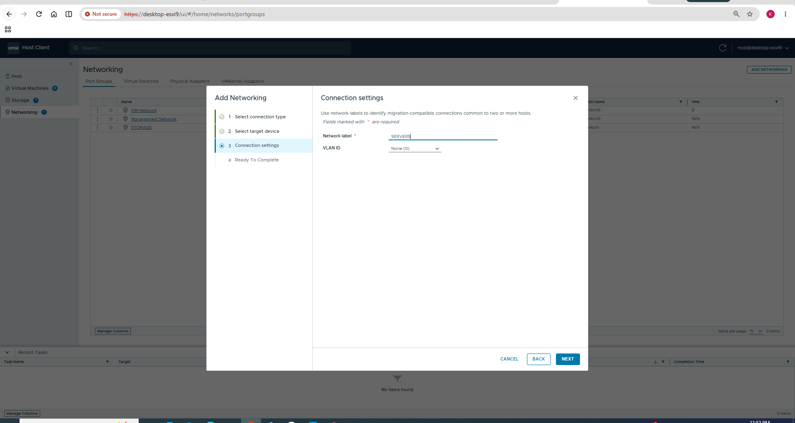
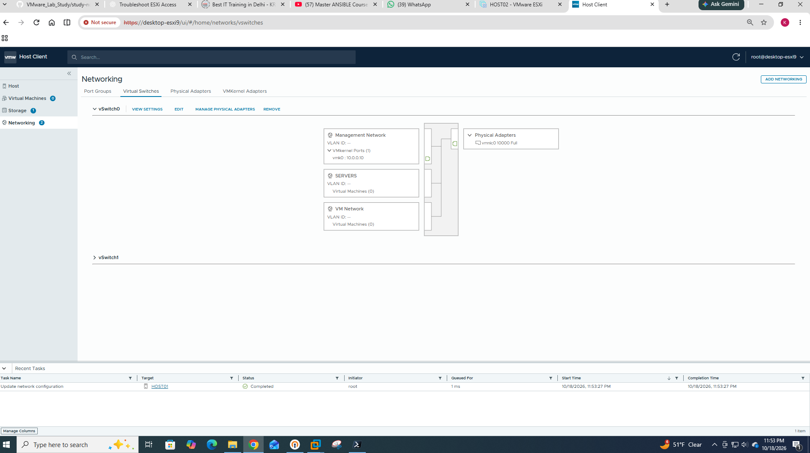

# Chapter 02 — Port Groups

## Concept and lab connection

A port group is a connection and policy grouping on a switch. A VM port group accepts guest vNIC connections; a VMkernel interface serves the ESXi host. The `SERVERS` label makes the purpose readable, but a label alone neither creates a VLAN nor isolates traffic.

The recorded practical selected a VM port group, chose `vSwitch0`, entered `SERVERS` with VLAN None (0), and confirmed creation. It showed zero attached VMs. Therefore creation is evidenced; guest-to-guest or guest-to-LAN connectivity is not. The same group can later be selected in a VM’s Network Adapter settings, followed by guest IP and actual connectivity checks.

**Checkpoint:** Creating `SERVERS` did not create another ESXi host IP and did not configure a guest operating system.

> **Safety:** Viewing pages and using read-only commands is safe. Changing management uplinks, port groups, VLANs, or vmk0 IP may cut off remote access. Have ESXi console access and a rollback plan before changes.

## Learning objectives
Explain VM port groups and VMkernel port groups, VLAN IDs, and how a guest selects its logical network.

## What is a port group?
A **port group** defines common connection and policy settings for a set of virtual switch ports. Guest VMs connect via a **virtual-machine port group**. ESXi management and services connect via **VMkernel interfaces** associated with a VMkernel port group.

| Seen in your screenshot | Role | Evidence |
|---|---|---|
| Management Network | VMkernel networking for host services | Has `vmk0`, IP `10.0.0.10` |
| VM Network | Virtual machine attachment network | Displays `Virtual Machines (0)` |

### VLAN explanation
VLANs split a physical or virtual Ethernet domain logically. On a standard switch port group, **VLAN ID 0** generally indicates untagged traffic; **1–4094** configure VLAN tagging (with platform-specific reserved behavior); **4095** is a special guest VLAN trunking mode used only in specific designs. Your screenshot shows `VLAN ID: --`, **not enough evidence to assert a specific configured VLAN ID**. Open Port Groups to inspect the actual field before stating it is 0.

## Examples (not applied to your host)
The conceptual path is: endpoint interface → port group → standard switch → suitable uplink when the destination is external. The screenshots establish the captured objects; the outer Workstation mapping requires separate verification.

## Lab — Read-only inspection
1. Networking → **Port groups**.
2. Capture name, virtual switch, VLAN ID, and associated VMkernel/VM details.
3. Select each port group and record policy settings without editing.
4. When later adding a VM, identify which port group its Network Adapter selects.

## Output interpretation
- **Port group name** is an administrator label, not a DNS name.
- **VLAN ID** sets how traffic is tagged or untagged at a port group; the upstream network must be compatible.
- **0 VMs** only means no guest VM is attached; it does not indicate that the network is faulty.


## Questions
1. What is the difference between `Management Network` and `VM Network`?
2. What can happen if a management VLAN is changed incorrectly?
3. Why should we not infer VLAN ID from a `--` display?


---
## Completed practical lab — Create a SERVERS VM port group
The teacher's PDF (page 4) distinguishes a VM port group from a VMkernel port group. In this lab, we created a **VM port group** for guest VMs; we did not assign an additional IP address to the ESXi host.

### Step 1 — Select the connection type

Select **Virtual Machine Port Group for a Standard Switch**, rather than VMkernel adapter. **Why:** We want a logical attachment point for future virtual-machine vNICs.

### Step 2 — Select the target switch

Choose **existing standard switch → vSwitch0**. This keeps the future server VMs on the general VM network switch, not on the dedicated storage `vSwitch1`.

### Step 3 — Configure the label and VLAN

**Network label:** `SERVERS`. **VLAN:** `None (0)`, untagged in this setup. A different port-group name does **not** by itself isolate the traffic. If `SERVERS` and `VM Network` both use the same untagged Layer-2 network, they can belong to the same broadcast domain depending on policies and upstream connectivity.

### Step 4 — Confirm creation

The topology now shows **Management Network**, **SERVERS**, and **VM Network** on `vSwitch0`; the recent task reports `Update network configuration — Completed`. `SERVERS` has **0 connected VMs**, so guest connectivity has not yet been tested.

```sh
esxcli network vswitch standard portgroup list
```
**Why run it:** Verify the port-group names and standard switches from ESXi Shell. **How to interpret:** Look for a `SERVERS` entry associated with `vSwitch0`; this is an expected check, **not a command output we captured**.
