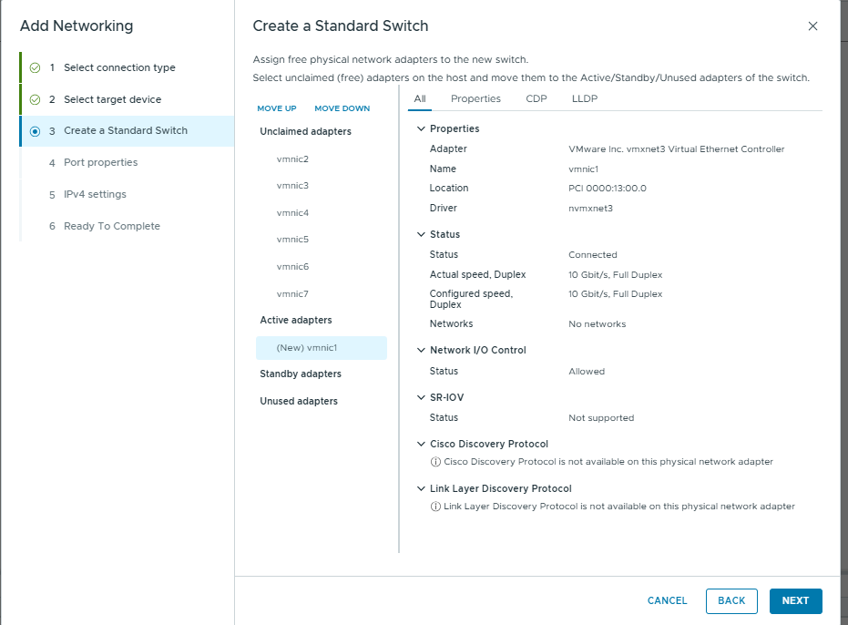
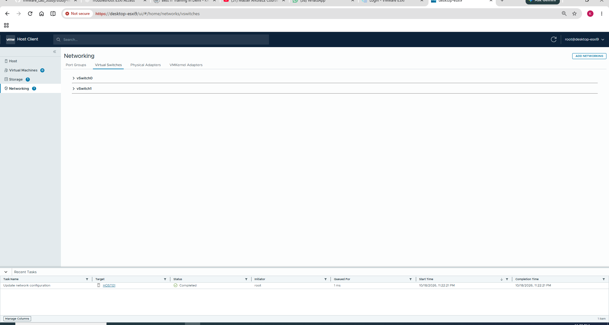
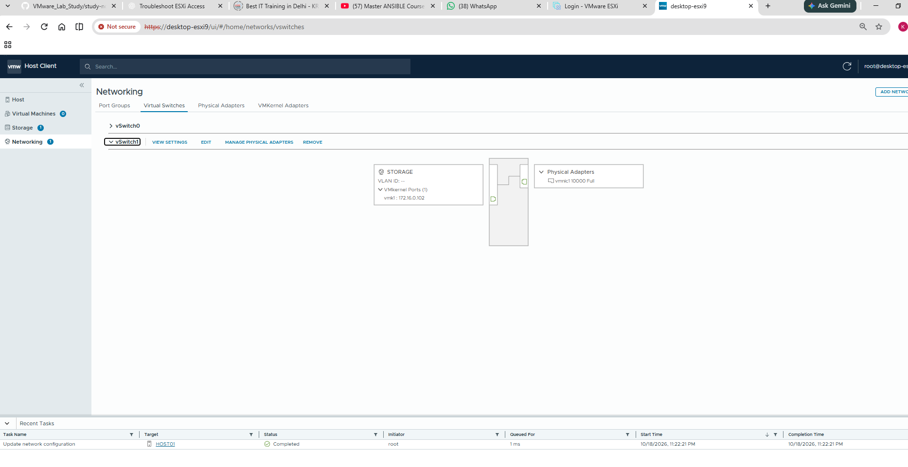
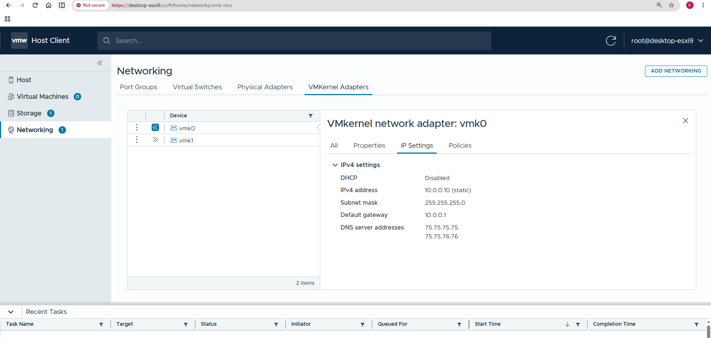

# Chapter 04 — VMkernel Adapters

## Concept and lab connection

A VMkernel adapter is an IP interface of the ESXi host. Management, vMotion and IP storage are examples of functions that can use appropriate host networking. vMotion is a function using VMkernel networking, not another name for the adapter. Creating an interface does not automatically enable every service or connect a datastore.

The recorded storage wizard created `vSwitch1` with `STORAGE`, `vmk1`, address `172.16.0.102/16`, VLAN None (0), and MTU 1500. At that stage `vmnic1` was its uplink. Service checkboxes were not selected in the captured properties. This is a completed network configuration record, not a completed NFS/iSCSI storage lab.

A same-subnet endpoint can be tested without inventing a new default gateway. A different subnet needs a valid route. The later management settings show `vmk0` at `10.0.0.10/24` and gateway `10.0.0.1`; these management values should not be replaced just because a storage interface was added.

**Checkpoint:** MTU 9000 requires an end-to-end design and test. Keeping 1500 was a valid baseline; a larger number alone does not prove faster storage.

> **Safety:** Viewing pages and using read-only commands is safe. Changing management uplinks, port groups, VLANs, or vmk0 IP may cut off remote access. Have ESXi console access and a rollback plan before changes.

## Learning objectives
Understand `vmk` interfaces, host management traffic, addressing and the default gateway.

## What is a VMkernel adapter?
A **VMkernel network adapter** is an IP-enabled network interface used by the ESXi host itself for services such as management, vMotion, certain storage networks, and other VMkernel services when configured. It is **not** a virtual NIC inside a guest VM.

**Confirmed here:** `vmk0` belongs to the `Management Network` port group and shows `10.0.0.10` on `desktop-esxi9`. The later management screenshot confirms vmk0 mask/gateway; the storage walkthrough below confirms vmk1. Enabled services still require their own evidence.

The conceptual path is: endpoint interface → port group → standard switch → suitable uplink when the destination is external. The screenshots establish the captured objects; the outer Workstation mapping requires separate verification.

## GUI lab (read-only)
1. Networking → **VMkernel adapters**.
2. Select `vmk0`; document IP, subnet/prefix, TCP/IP stack, and enabled services.
3. If viewable, note host default gateway and DNS settings in host networking configuration.
4. Capture screenshots, redact sensitive infrastructure data before publication.

## Optional ESXi commands
```sh
esxcli network ip interface list
esxcli network ip interface ipv4 get
esxcli network ip route ipv4 list
esxcli network ip dns server list
```
**Why:** list interfaces, IPv4 addresses, routes and DNS servers respectively. **How to interpret:** `vmk0` is a host interface; `10.0.0.10` is its IP; a default route `0.0.0.0/0` sends off-subnet traffic via a gateway (example only, verify actual output). No output has yet been collected for this host.


## Questions
1. How does a VMkernel adapter differ from a guest vNIC?
2. What service can use vmk0?
3. Why is the gateway important for off-subnet management?


---
## Completed practical lab — Dedicated STORAGE vSwitch1 and VMkernel interface
The teacher's page 4 describes VMkernel ports as ESXi host interfaces that can be used for services including NFS and iSCSI. The following screenshots document **network setup only**; no storage server or datastore connection has been proven.

### Step 1 — Choose a VMkernel Network Adapter

A VMkernel adapter provides an **IP endpoint for the ESXi host**, unlike a VM port group intended for guest NICs.

### Step 2 — Create a new standard switch with a free uplink


`vmnic1` was moved to the new switch as its **Active** uplink. A single `vmnic` cannot be the active uplink on two separate standard switches simultaneously; that is why it was first removed from `vSwitch0`.

### Step 3 — Configure the VMkernel port properties

| UI setting | Captured value | Why it matters |
|---|---|---|
| Network label | `STORAGE` | Identifies purpose |
| VLAN | None (0) | Untagged; by itself does not ensure isolation |
| MTU | `1500` (get from switch) | Suitable initial default unless jumbo frames are validated end-to-end |
| TCP/IP stack | Default | Uses the default VMkernel TCP/IP stack |
| Enabled service boxes | Not checked in screenshot | Does not demonstrate vMotion, vSAN or NFS/iSCSI datastore configuration |

**Production note:** MTU 9000 can be used for jumbo frames, but only after checking the full path (VMkernel interface, vSwitch, virtualization layer, switches and storage endpoint). Do **not** raise one device's MTU in isolation.

### Step 4 — Static IPv4 settings

**Address:** `172.16.0.102`; **mask:** `255.255.0.0` (`/16`); **default gateway override:** unchecked. The shown `10.0.0.1` gateway belongs to the existing network configuration and should not be casually replaced with an unverified storage gateway. Storage endpoint connectivity still needs testing.

### Step 5 — Verify the result


The resulting topology shows `vSwitch1 → STORAGE → vmk1 (172.16.0.102)` with uplink `vmnic1` reporting `10000 Full`. This confirms configuration **on the host**, not successful storage I/O.

```sh
esxcli network vswitch standard list
esxcli network ip interface list
esxcli network ip interface ipv4 get
esxcli network nic list
```
**What these check:** virtual switches/uplinks, VMkernel interfaces and MTU, assigned IPv4 addresses, and NIC link states respectively. Treat any sample values in your notes as examples until you capture your real output.

## Later management settings

The captured vmk0 settings show static 10.0.0.10, mask 255.255.255.0, gateway 10.0.0.1 and DNS 75.75.75.75 / 75.75.76.76. These are historical configured values, not evidence of successful external DNS queries.


