# Active Directory Domain Services (AD DS) - Complete Book-Based Study Notes

**Language:** English  
**Source:** Uploaded lecture PDF, `09 Active Directory Domain Service (ADDS)(3).pdf`, 22 pages.  
**Scope:** Every agenda topic, substantive bullet, table entry and technical diagram is addressed below. Repeated chapter-divider slides are mapped rather than reproduced. This is an expanded explanation, not a verbatim transcription or a completed lab report.

**Labels used:**
- **Book topic:** Material covered by the lecture.
- **Clarification:** A correction or qualification needed to avoid a misleading interpretation.
- **Additional explanation:** Supporting knowledge and examples beyond the lecture.

## Contents

1. [Page-by-page coverage](#1-page-by-page-coverage)
2. [AD DS foundations](#2-ad-ds-foundations)
3. [Database, partitions and paths](#3-database-partitions-and-paths)
4. [Kerberos authentication](#4-kerberos-authentication)
5. [Directory objects](#5-directory-objects)
6. [Purposes of AD DS](#6-purposes-of-ad-ds)
7. [Features and limitations](#7-features-and-limitations)
8. [Logical and physical structure](#8-logical-and-physical-structure)
9. [All five FSMO roles](#9-all-five-fsmo-roles)
10. [Schema versions](#10-schema-versions)
11. [Installation requirements](#11-installation-requirements)
12. [An integrated example](#12-an-integrated-example)
13. [Read-only checks for a future lab](#13-read-only-checks-for-a-future-lab)
14. [Correction register](#14-correction-register)
15. [Revision questions and answers](#15-revision-questions-and-answers)
16. [Glossary](#16-glossary)
17. [Repository placement and learning status](#17-repository-placement-and-learning-status)
18. [References](#18-references)

## 1. Page-by-page coverage

Page numbers refer to PDF page position, starting at 1.

| PDF page(s) | Source content | Covered here |
| --- | --- | --- |
| 1 | Agenda: AD DS, database/partitions, authentication, objects, purposes, features, structure, FSMO, schema versions, installation | Sections 2-11 |
| 2 | AD DS chapter divider and management-console illustration | Section 2; console tools explained in section 13 |
| 3 | Definition, introduction in 2000, KCC, eight functions | Section 2 |
| 4 | Database/partitions divider | Section 3 |
| 5 | NTDS.DIT; four partition categories; default paths; ADSI Edit | Section 3 |
| 6 | Authentication divider | Section 4 |
| 7 | Kerberos, DNS/AD/client diagram, AS/TGS/resource-server diagram | Section 4, including diagram corrections |
| 8 | Objects divider | Section 5 |
| 9 | Definition, attributes, all nine listed object categories | Section 5 |
| 10 | Purpose divider | Section 6 |
| 11 | All nine purposes | Section 6 |
| 12 | Features divider | Section 7 |
| 13 | All seven features | Section 7 |
| 14 | Structure divider | Section 8 |
| 15 | Domain, tree, forest, OU; site and DC | Section 8 |
| 16 | FSMO divider and decorative shapes | Section 9; shapes contain no additional technical instructions |
| 17 | Forest-wide FSMO roles | Section 9 |
| 18 | Domain-wide FSMO roles and transfer/seizure note | Section 9 |
| 19 | Schema-version divider | Section 10 |
| 20 | Schema definition and entire historical version table; heading mistakenly says FSMO | Section 10 |
| 21 | Installation-requirements divider | Section 11 |
| 22 | All prerequisites, example IP, 250 MB/200 MB/50 MB figures | Section 11, with historical-sizing clarification |

Repeated Windows Server labels, decorative artwork and repeated console images introduce the chapters; they do not add separate procedures. This illustrated edition embeds original lecture slides and newly drawn educational diagrams. Original slides retain the source wording; consult the corrections before relying on them. The new diagrams are conceptual illustrations, not screenshots of a completed lab.

## 2. AD DS foundations

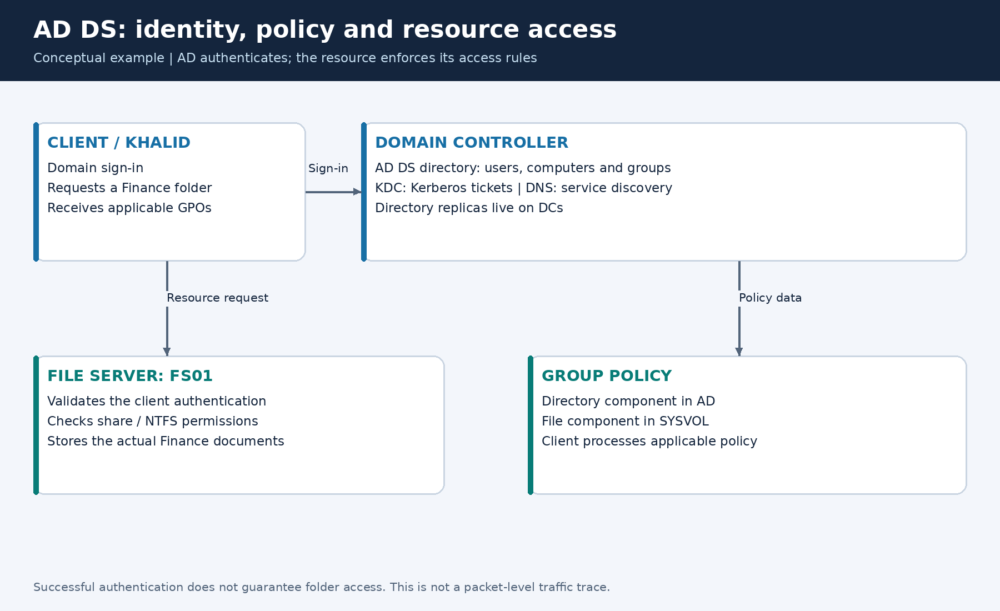

*New educational diagram; see IMAGES_AND_SOURCES.md for provenance.*

**Book topic - pages 2-3.**

### 2.1 What is AD DS?

**Active Directory Domain Services is Microsoft's directory service for organizing [identities](md/ADDS_Identities.md) and [resources](md/ADDS_Resources.md) in a [domain environment](md/ADDS_Domain_Environment.md).**

A directory is an organized collection of [object](md/ADDS_Objects_Attributes_and_Relationships_English.md) and their [attributes](md/ADDS_Objects_Attributes_and_Relationships_English.md). AD DS stores identities such as users, computers and groups, together with [relationships](md/ADDS_Objects_Attributes_and_Relationships_English.md) and security information. Administrators use it to manage access and resources centrally.

A **Domain Controller (DC)** is a Windows Server that has been promoted to run AD DS. Installing the AD DS role alone does not finish promotion.

**Example:** Khalid has a domain account. He can sign in to permitted domain computers without administrators creating a separate local account on each computer.

### 2.1 What is AD DS?

**Active Directory Domain Services (AD DS) is Microsoft’s directory service that helps organize and centrally manage [identities](md/ADDS_Domain_Environment.md) and [resources](md/ADDS_Domain_Environment.md) in a [domain environment](md/ADDS_Domain_Environment.md).**

A directory is an organized collection of [objects](md/ADDS_Objects_Attributes_and_Relationships_English.md) and their [attributes](md/ADDS_Objects_Attributes_and_Relationships_English.md). AD DS stores objects such as users, computers, and groups, along with their [relationships](md/ADDS_Objects_Attributes_and_Relationships_English.md) and security information. Administrators use this information to manage accounts, access, and resources centrally.

A **Domain Controller (DC)** is a Windows Server that has been **configured, or promoted, to provide a domain’s directory and authentication services through AD DS**. Installing the AD DS role alone does not make the server a Domain Controller; promotion must also be completed.

**Example:** Khalid has a domain account. He can use that account to sign in to domain computers where he has permission. Administrators do not need to create a separate local account for Khalid on each computer.

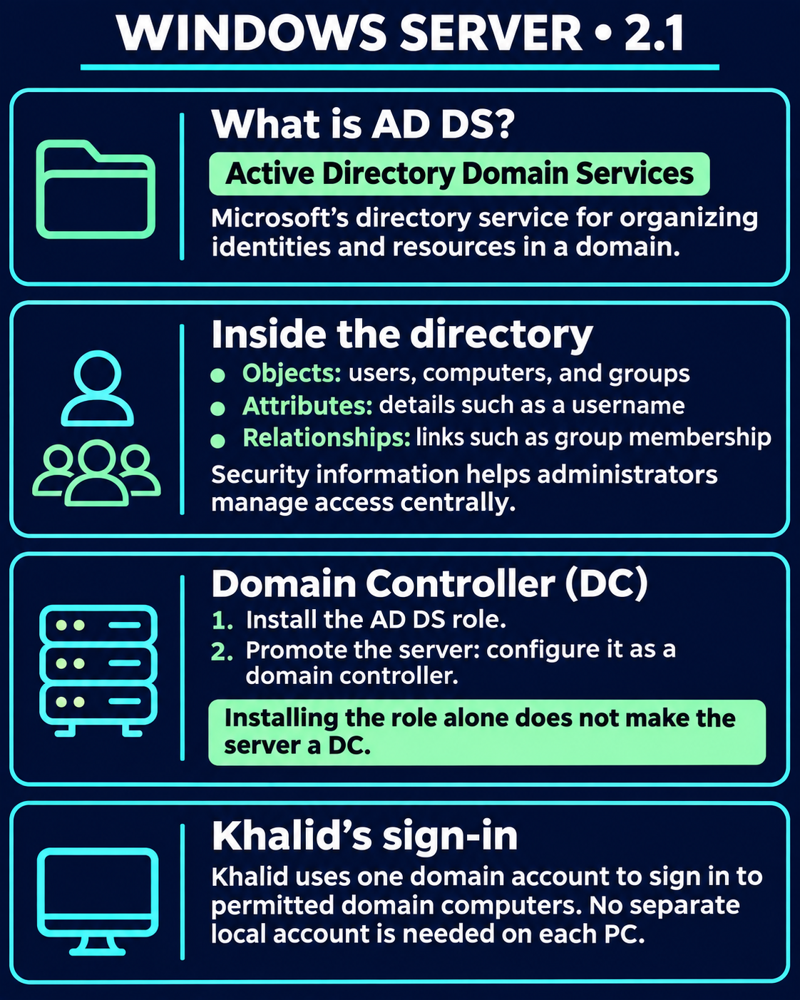

### 2.2 History and hierarchy

Microsoft introduced Active Directory with **Windows 2000 Server**. Modern AD DS evolved from that directory platform.

AD DS is hierarchical because a [**forest**](md/ADDS_Forest.md) contains one or more **domains**, and [**organizational units (OUs)**](md/ADDS_Forest.md) can be created within domains to organize objects such as users, computers, and groups. OUs can also contain other OUs.

The phrase **“hierarchical directory database”** describes this structured organization of directory information. It does not mean a shared folder containing ordinary documents.

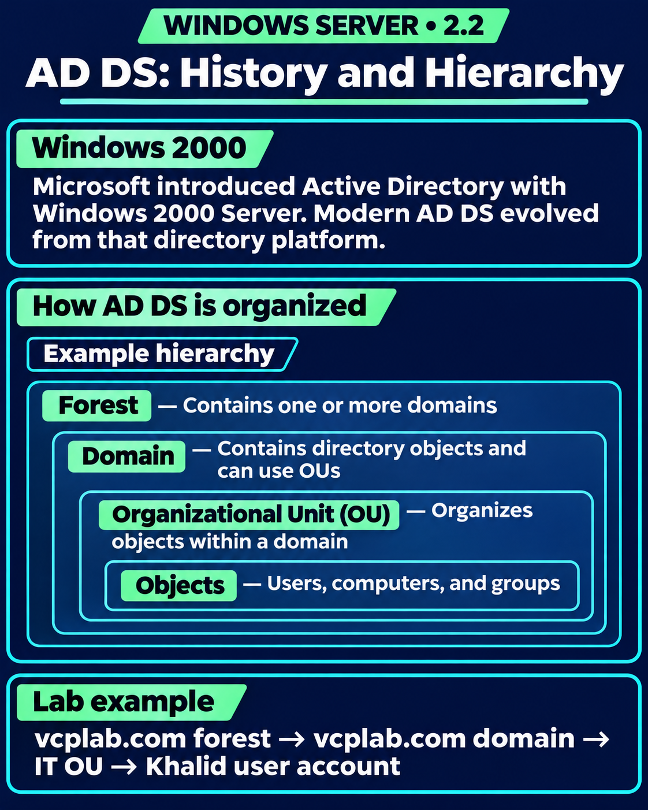

### 2.3 Every function listed in the book

| Book function | Explanation | Example or qualification |
| --- | --- | --- |
| User and group management | Create and manage identities and group memberships | Put Khalid in a Finance access group |
| Authentication and authorization | Establish identity and supply identity/group information used in access decisions | DC authenticates; the file server checks access permissions |
| Centralized management | Administer many objects through common tools | Active Directory Users and Computers |
| Domain services | Maintain domain identity information and serve logon/directory requests | A DC handles domain authentication |
| Trusts | Permit authentication paths between domains/forests | A trusted-domain user can be considered for access |
| Group Policy | Manage supported user/computer settings through GPOs | Lock a workstation after the configured inactivity period |
| DNS integration | Locate DCs and services using DNS records | Clients query service records to discover a DC |
| Replication | Copy relevant directory changes among DCs | A new user becomes available on other replicas |

**Clarification - authorization:** AD DS is not the component that directly opens every folder. It provides identities and security information. A resource server or application evaluates its permissions and other rules. Successful authentication does not guarantee access.

**Clarification - trusts:** A trust does not automatically grant permission to every resource. Trust direction, authentication restrictions and resource permissions still matter.

**Clarification - Group Policy:** GPOs can be linked to sites, domains and OUs. Scope, inheritance and filtering determine which settings apply. Not every GPO applies to every computer.

### 2.4 What does the KCC do?
KCC stands for Knowledge Consistency Checker. It is a built-in component of AD DS that creates and maintains the replication topology. This [topology](/00_Networking_Foundations/Network_Topology/Network_Topology_Poster.png) defines which domain controllers (DCs) obtain directory changes from which other DCs.

The KCC creates connection objects as needed. Each connection object identifies the source DC from which the destination DC pulls changes. For example, if DC02 has an inbound replication connection from DC01, then DC02 pulls changes from DC01. The KCC creates the connection; AD DS replication transfers the changes.

Multi-master replication: Many routine directory updates can be made on any writable DC. For example, if you change a user’s department on DC01, that change can replicate to the other DCs. A Read-Only Domain Controller (RODC) holds a read-only copy of the directory and does not originate directory updates.

Replication is not always immediate. DNS or network connectivity problems can interrupt replication. Between sites, the site-link schedule also determines when replication can occur.

Replication improves availability, but it does not replace backups. If a user account is accidentally deleted, that deletion can also replicate to other DCs.

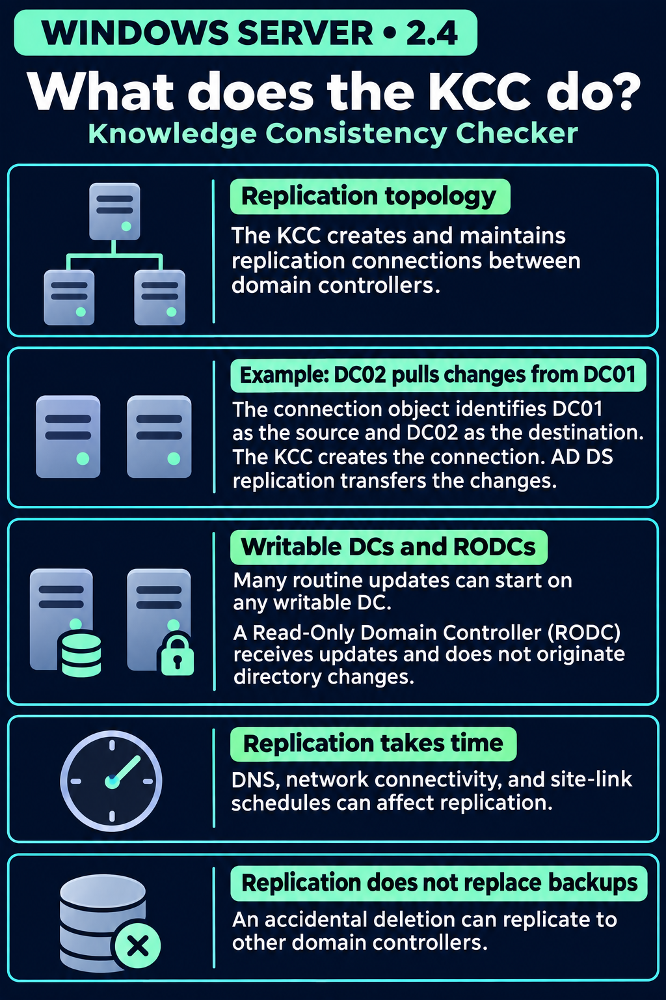

## 3. Database, partitions and paths

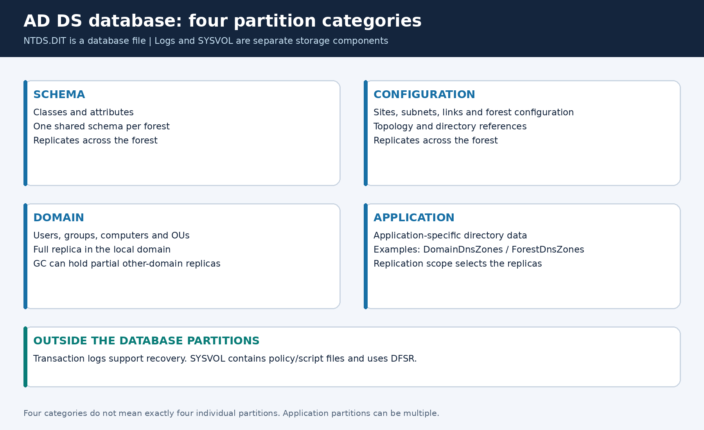

*New educational diagram; see IMAGES_AND_SOURCES.md for provenance.*

**Book topic - pages 4-5.**

### 3.1 NTDS.DIT

**NTDS.DIT is the main AD DS database file on a Domain Controller.** It stores directory objects such as users, computers, and groups, along with their attributes and relationships. The local AD DS database uses **Microsoft’s Extensible Storage Engine (ESE)**.

**NTDS** is historically associated with **Windows NT Directory Services**. **DIT stands for Directory Information Tree.** For your studies, remember the exact filename: **`ntds.dit`**.

**Default location:** `C:\Windows\NTDS\ntds.dit`

A different database location can be selected during Domain Controller promotion.

**This is a security-sensitive database.** It contains directory information and protected credential-related data. It should not be manually edited like an ordinary document, and simply copying the file should not be considered a complete backup.

Use **AD DS-aware backup tools and supported procedures** for backup and recovery.

### 3.2 Four categories of directory partitions — not always exactly four partitions

A **directory partition**, also called a **naming context**, is a logical portion of directory data with its own replication scope. Its data replicates to the Domain Controllers (DCs) that hold a replica of that partition.

AD DS has four categories of directory partitions:

| Category | Main contents | Typical replication scope |
| --- | --- | --- |
| **Schema** | Definitions of object classes and attributes | All DCs in the forest |
| **Configuration** | Forest configuration, sites, subnets, site links, and replication topology information | All DCs in the forest |
| **Domain** | Objects belonging to a particular domain, such as users, computers, groups, and OUs | All DCs in that domain |
| **Application** | Application-specific directory data, such as AD-integrated DNS data | DCs selected/enlisted to hold a replica of that partition |

**Full replica versus writable replica:** Every DC holds a full replica of its own domain partition. Updates can be made on a writable DC. A **Read-Only Domain Controller (RODC)** holds a read-only replica, with restrictions on the replication of passwords and other secret attributes. Therefore, “full replica” does not mean that every DC holds all credentials or accepts updates.

**Global Catalog clarification:** In addition to a full replica of its own domain, a Global Catalog (GC) holds **partial, read-only replicas** of the forest’s other domains. “Partial” means that only selected attributes of those domains’ objects are included. Being a GC does not make an RODC writable.

**Four categories does not mean exactly four partitions:** A DC can host multiple application partitions. For example, AD-integrated DNS can use `DomainDnsZones` and `ForestDnsZones` as two separate application partitions.

**Example:** A DNS-server DC in a single-domain forest that hosts the schema, configuration, and domain partitions, together with `DomainDnsZones` and `ForestDnsZones`, hosts five directory partitions. This is only an example; not every DC necessarily hosts five partitions.

**Remember:** These are logical partitions within the directory database, not disk partitions such as `C:` or `D:`.

### 3.3 Schema partition — the directory’s rules

The **schema partition** stores definitions of objects and their attributes in AD DS. It defines the directory’s structure.

The schema determines:

- **Object [classes](md/ADDS_Class.md):** Which types of objects can be created, such as users, computers, or groups.
- **Attributes:** Which attributes are allowed for each object class, such as a user’s display name and department.
- **Required and optional attributes:** Which attributes are mandatory and which are optional.
- **Structural rules:** Rules governing object-class inheritance and where objects can be placed within the directory.

**Example:** The user-class definition specifies which attributes a user object can have. Khalid’s actual user object and the value of his department attribute are stored in the domain partition.

**Lecture clarification:** Describing the schema as a “template” can help explain the concept. However, saying that the schema displays the database in “form format” is incorrect. The schema defines the allowed data structure; displaying graphical forms is the responsibility of management tools.

**Each forest has one shared schema**, with a replica on every Domain Controller in the forest.

The schema can be **extended** when necessary, such as by adding new object classes or attributes for an application. This requires appropriate permissions and supported procedures. Schema changes originate on the **Schema Master** DC and then replicate to the other DCs in the forest.

**Remember:** A schema extension is a forest-wide change. Plan and test it carefully; not every administrator has permission to modify the schema.

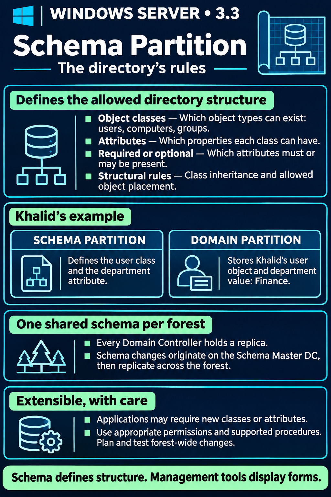

### 3.4 Configuration partition — organizing the forest

The **configuration partition** stores the forest’s directory configuration. It includes:

- **Sites:** AD sites representing network locations and connectivity.
- **Subnet mappings:** Associations between IP subnets and AD sites.
- **Site links:** Cost, schedule, and interval settings for replication between sites.
- **Server and DC topology objects:** Server objects, NTDS Settings, and replication connection objects.
- **Naming-context references:** References identifying the forest’s directory partitions and their locations.

**Every Domain Controller in the forest holds a replica of the configuration partition**, allowing DCs to use the forest’s shared configuration.

**Example:** Mapping the Chicago clients’ IP subnet to the **Chicago site** helps clients identify their AD site and locate a suitable, usually local, Domain Controller. Sites and site-link settings also help the KCC build the intersite replication topology.

**Remember:** Subnet mappings help identify a client’s site; site links model connectivity and timing for replication planning. They are related, but they are not the same setting.

### 3.5 Domain partition — the domain’s objects

The **domain partition** stores directory objects belonging to a particular domain. These include users, groups, computer accounts, OUs, and related objects.

**Example:** In the `ad.example.com` domain, Khalid’s user account and the Finance OU are stored in that domain’s domain partition.

**Lecture clarification:** Saying that the domain partition “never replicates to other domains” is not entirely accurate. It is important to distinguish full domain replication from Global Catalog replication:

- **Full replica of its own domain:** Every DC holds a full replica of its own domain partition. A writable DC accepts updates; an RODC holds a read-only replica with restrictions on the replication of secret attributes.
- **Partial replicas of other domains:** A Global Catalog (GC) holds partial, read-only replicas of the domain partitions belonging to other domains in the forest.
- **Meaning of partial:** All objects from those other domains are included, but only selected attributes of each object are stored.
- **The GC’s own domain:** A writable GC holds a full, writable replica of its own domain. An RODC can also be a GC, but becoming a GC does not make it writable.
- **Domains remain separate:** GC replication does not merge all domains into one shared, writable domain partition.

**Remember:** The domain partition is only one part of the AD DS database. The schema and configuration partitions are also part of that database, and a DC can host additional application partitions.

The domain partition is one part of AD data; schema and configuration information are also AD database contents.

### 3.6 Application partitions

**Application directory partitions** were introduced in Windows Server 2003. They store application-specific directory data, such as AD-integrated DNS zones and records.

Their advantage is that the data does not have to replicate to every DC in the forest or domain. Replication can be limited to DCs **enlisted** to hold a replica of that partition.

**Enlisted** means that a DC is configured to hold a replica of an application partition and participate in its replication.

Two common application partitions used by AD-integrated DNS are:

| Application partition | Typical replication scope |
| --- | --- |
| **DomainDnsZones** | DNS-server DCs in the same domain that are enlisted in this partition |
| **ForestDnsZones** | DNS-server DCs throughout the forest that are enlisted in this partition |

**Example:** If a DNS zone’s replication scope is set to “all DNS servers running on domain controllers in this domain,” the zone is typically stored in `DomainDnsZones`. Selecting the forest-wide DNS-server scope typically stores the zone in `ForestDnsZones`.

**Custom application partitions** can also be created to manage data and replication scope according to an application’s requirements.

**Global Catalog clarification:** Application partition data is not included in the Global Catalog simply because a server is a GC. A GC server holds a replica of an application partition only when it is also enlisted in that partition. This replica is separate from the GC’s partial domain data.

Application partitions can be created and removed using supported tools and procedures.

**Remember:** Deleting an entire application partition can also remove the DNS or other application data stored within it. This is different from **unenlisting** a single DC, which removes that DC from the partition’s replica set. Partition deletion is not routine cleanup; verify dependencies, backups, and impact first.

### 3.7 Default paths and their contents

The AD DS database, transaction logs, and SYSVOL serve different purposes. The common default locations below assume that Windows is installed in `C:\Windows`.

| Item | Common default location or tool | Purpose |
| --- | --- | --- |
| **AD DS database** | `C:\Windows\NTDS\ntds.dit` | Stores directory objects, attributes, and related information |
| **AD transaction logs** | `C:\Windows\NTDS\` | Record ESE database changes and support consistency and recovery |
| **SYSVOL** | `C:\Windows\SYSVOL\` | Holds replicated content, including Group Policy file components and domain logon scripts |
| **ADSI Edit** | `adsiedit.msc` | An advanced management tool for viewing and editing directory objects and naming contexts |

**ADSI Edit clarification:** ADSI Edit is not a database file or storage location. It is a management tool for inspecting and modifying the directory.

**Storage clarification:** Transaction logs and SYSVOL are not directory partitions inside `ntds.dit`. They are separate files and folders.

#### The two components of a GPO

A **Group Policy Object (GPO)** has two related components:

1. **Group Policy Container (GPC):** The directory component stored in the AD DS domain partition. It contains metadata such as GPO properties and version information.
2. **Group Policy Template (GPT):** The file component stored in SYSVOL. It contains policy-setting files and related content.

**Replication difference:** The GPC replicates through AD DS replication. In modern domains, the GPT and other SYSVOL content replicate through **DFS Replication (DFSR)**. These are two separate replication mechanisms.

**Paths can be customized:** During Domain Controller promotion, alternative supported locations can be selected for the database, transaction logs, and SYSVOL. Therefore, not every DC necessarily uses the default paths.

**Remember:** Do not manually edit or move database files. Make changes through ADSI Edit only when you understand their impact and are following a supported procedure; incorrect changes can affect the directory and its applications.

## 4. Kerberos authentication

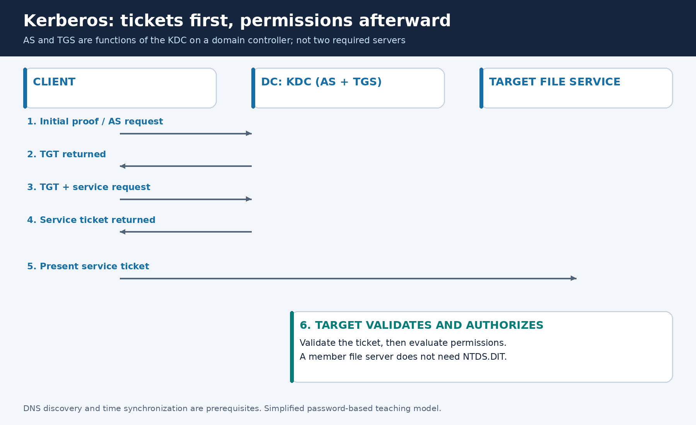

*New educational diagram; see IMAGES_AND_SOURCES.md for provenance.*

**Book topic - pages 6-7.**

### 4.1 What Kerberos does

**Kerberos** is the primary authentication protocol in AD DS domain environments. It uses **tickets** to let a client prove its identity to a service without sending the user’s password to every service.

**Example:** Khalid signs in with a domain account. When he accesses a file-server service, the client can obtain and present a Kerberos ticket for that service. Khalid does not need to provide his password to the file server.

#### KDC, AS, and TGS

In AD DS, the **Key Distribution Center (KDC)** runs on a Domain Controller. It has two logical functions:

| Function | Full name | Main purpose |
| --- | --- | --- |
| **AS** | Authentication Service | Handles the initial authentication exchange and issues a Ticket-Granting Ticket (TGT) |
| **TGS** | Ticket-Granting Service | Uses the TGT to issue a service ticket for a particular service |

**Lecture clarification:** The diagram may use the terms “Authentication Server” and “Ticket Granting Server.” In AD DS, understand these as logical functions of the KDC; they do not require two separate Windows servers.

The diagram’s **“Real Server”** means the server hosting the service that the client wants to access. **Target server**, **resource server**, or **application server** is a clearer term.

**Remember:** Kerberos authentication verifies identity. Access to a resource also depends on that resource’s permissions and authorization checks. Not every Windows sign-in or connection necessarily uses Kerberos.

### 4.2 Kerberos authentication mein components ke roles

Har component ka kaam alag hai. DNS discovery mein madad karta hai, KDC tickets issue karta hai, aur target service authentication ke baad access permissions evaluate karti hai.

| Component | Kaam |
| --- | --- |
| **Client** | User ya kisi doosray security principal ki taraf se tickets request karta hai aur target service ko service ticket pesh karta hai |
| **DNS** | Domain Controllers ko locate karne aur target server ke naam ko IP address mein resolve karne mein madad karta hai |
| **KDC: Authentication Service (AS)** | Initial authentication exchange handle karta hai aur successful authentication par Ticket-Granting Ticket (TGT) aur client–TGS session key provide karta hai |
| **KDC: Ticket-Granting Service (TGS)** | Valid TGT aur mutalliq authenticator ki bunyaad par requested service ke liye service ticket aur client–service session key provide karta hai |
| **Target service** | Service ticket aur mutalliq authenticator validate karke client ki pehchan verify karti hai |
| **Resource/application authorization** | Authenticated identity, group information, permissions aur applicable rules ki bunyaad par decide karti hai ke kaun se operations allowed hain |

**Security principal** aisi identity hoti hai jisay authenticate kiya ja sakta hai aur permissions di ja sakti hain, jaise user, computer ya service account.

**DNS ki wazahat:** DNS ticket issue nahin karta aur user authenticate nahin karta. Yeh client ko munasib DC aur target server dhoondne mein madad deta hai.

**Target service ki wazahat:** Sirf ticket receive karna kaafi nahin; service ticket ke saath mutalliq authenticator bhi validate karti hai. Yeh checks client ko apni pehchan prove karne mein madad dete hain.

**Yaad rakhein:** Authentication ka sawal hai, “Aap kaun hain?” Authorization ka sawal hai, “Aap ko kya karne ki ijazat hai?” Successful authentication har resource ki permission nahin deti.

### 4.3 Password-based authentication ki misal — step-by-step

Yeh misal assume karti hai ke Khalid online domain sign-in kar raha hai, munasib DC available hai aur file service Kerberos support karti hai.

1. **Sign-in shuru hota hai:** Khalid domain-joined computer par apna domain username aur password enter karta hai.

2. **DC locate hota hai:** Client DNS aur domain-discovery information ki madad se munasib Domain Controller dhoondta hai.

3. **Initial authentication hoti hai:** Client, DC ke KDC ki **Authentication Service (AS)** ke saath exchange karta hai. Aam password-based pre-authentication mein client password se derive ki gayi key ka ilm prove karta hai; plain-text password DC ko nahin bhejta.

4. **TGT milta hai:** Successful authentication par KDC client ko **Ticket-Granting Ticket (TGT)** aur protected response mein **client–TGS session key** provide karta hai. Client TGT ke encrypted contents khud nahin parhta; usay baad mein TGS ko pesh karta hai.

5. **Service ticket request hoti hai:** File service access karne ke liye client, KDC ki **Ticket-Granting Service (TGS)** ko TGT aur mutalliq authenticator pesh karta hai. Request mein **Service Principal Name (SPN)** target service ki pehchan karta hai.

6. **Service ticket milta hai:** Request validate honay par KDC, requested service ke liye **service ticket** aur protected response mein **client–service session key** provide karta hai.

7. **Client service se connect karta hai:** Client, file service ko service ticket aur client–service session key se protected naya authenticator pesh karta hai.

8. **Service identity verify karti hai:** File service ticket aur authenticator validate karke client ki pehchan verify karti hai. Mutual authentication request honay par service bhi client ko apni pehchan ka saboot deti hai.

9. **Permissions check hoti hain:** File server authenticated identity, group information, share permissions, NTFS permissions aur doosray applicable rules evaluate karta hai.

10. **Access allow ya deny hota hai:** Khalid sirf woh operations kar sakta hai jin ki authorization checks ijazat deti hain. Successful Kerberos authentication har file ki access guarantee nahin karti.

**Yaad rakhein:** TGT, service tickets hasil karne ke liye hota hai. Service ticket, kisi khaas service ke samnay authenticate karne ke liye hota hai.

**Model ki had:** Yeh beginner explanation hai; har Kerberos message ki poori technical tafseel nahin. Cached logon, pehle se available tickets, smart cards aur Windows Hello for Business jaisay mechanisms initial authentication ka flow badal sakte hain.

This is a beginner model, not a full description of every Kerberos message. Smart cards, Windows Hello and other mechanisms can change the initial credential exchange.

### 4.4 The difference between a TGT and a service ticket

In Kerberos, a **Ticket-Granting Ticket (TGT)** and a **service ticket** serve different purposes:

| Ticket | What is it used for? | Who receives it? |
| --- | --- | --- |
| **TGT** | Obtaining service tickets from the KDC’s Ticket-Granting Service | The **TGS** |
| **Service ticket** | Authenticating to a particular service | The **target service**, such as a file service |

**Example:** Khalid’s client presents its TGT to the TGS to obtain a ticket for the file service. It then presents the resulting service ticket to the file service. The file service does not receive the TGT.

**A ticket alone is not enough:** The client also presents an **authenticator** protected using the relevant session key. The receiving service validates it.

**A ticket does not grant unlimited permissions.** Its validity, intended service identity, and authorization information matter. Even after successful authentication, the resource server checks permissions and applicable rules.

**Remember:** A TGT is used to obtain a service ticket; a service ticket is used to authenticate to the target service; resource permissions determine which access is allowed.

### 4.5 Source diagram ki durusti

Lecture ke diagram mein authentication server aur resource server, dono ke neeche `NTDS.DIT` ya domain-partition ke labels dikhaye gaye hain. Is se yeh ghalat fehmi ho sakti hai ke har resource server apni local AD DS database rakhta hai.

**Aam member file/application server ko local AD DS `ntds.dit` database ki zaroorat nahin hoti.** Domain ki directory aur account information, Domain Controllers par store hoti hai.

Kerberos authentication mein target service:

- Apne service account se associated key ki madad se service ticket ke encrypted contents validate karti hai.
- Ticket se hasil honay wali client–service session key ki madad se accompanying authenticator validate karti hai.
- Authentication ke baad permissions aur applicable authorization rules evaluate karti hai.

**Zaroori farq:** Har service-ticket validation ke liye poori AD database resource server par copy nahin hoti. Kuch scenarios mein additional validation ya doosray operations ke liye resource server ko DC se communication ki zaroorat ho sakti hai.

**Exception:** Agar koi server DC bhi ho aur resource service bhi host karta ho, to us par AD DS database ho sakti hai. Lekin aam member resource server ko DC samajhna durust nahin.

#### Diagram mein DNS aur network components

Diagram mein DNS, AD, switch aur multiple clients discovery aur network connectivity ko samjhate hain.

- **DNS:** Munasib DC locate karne aur server names ko IP addresses mein resolve karne mein madad karta hai.
- **DC/KDC:** Kerberos authentication exchanges handle karta aur tickets issue karta hai.
- **Switch:** Network devices ke darmiyan traffic forward karta hai.
- **Client:** DC/KDC aur target service se zaroorat ke mutabiq communicate karta hai.

**Yaad rakhein:** DNS authentication traffic ka gateway nahin hai. Naam resolve honay ke baad client, DC/KDC ya target service se seedha network communication kar sakta hai; har login packet DNS server se nahin guzarta.

### 4.6 Dependencies and exceptions

Having a domain account alone is not enough for Kerberos authentication. DNS, time synchronization, service identities, and network connectivity must also be configured correctly.

| Dependency | Why is it necessary? |
| --- | --- |
| **DNS configuration** | Helps the client locate a suitable Domain Controller and resolve the target server’s name |
| **Time synchronization** | The clocks on the client, DC, and target server must remain within the allowed clock-skew limit |
| **Service Principal Names (SPNs)** | Identify the requested service and associate it with the correct service account; missing, duplicate, or incorrect SPNs can cause authentication problems |
| **Network and firewall rules** | Allow the connectivity required for DNS, Kerberos, and application traffic |

**Time clarification:** Clocks do not have to match to the exact second, but their difference must remain within the configured tolerance. Different timezone displays alone do not mean that the actual system clocks are incorrectly synchronized.

#### Exceptions and important distinctions

- **Not every Windows sign-in uses Kerberos:** Some scenarios use NTLM, local-account authentication, or other mechanisms. A successful sign-in alone does not prove that Kerberos was used.
- **NTLM fallback is not guaranteed:** A connection does not necessarily switch to NTLM when Kerberos fails. Applications, policies, and security configurations can restrict fallback.
- **Cached interactive logon:** If information from a previous domain sign-in is cached locally and policy permits it, a user may sign in to the computer even when a DC is unavailable. This is not live DC authentication and does not guarantee access to all domain resources.
- **Single sign-on (SSO):** Reduces the need to enter credentials repeatedly for supported services. Not every application necessarily supports SSO.
- **Authorization is still required:** SSO or successful Kerberos authentication does not bypass resource permissions. Each resource evaluates its applicable access rules.

**Remember:** A successful sign-in, successful Kerberos authentication, and access to a resource are three related but distinct outcomes.

## 5. Directory objects

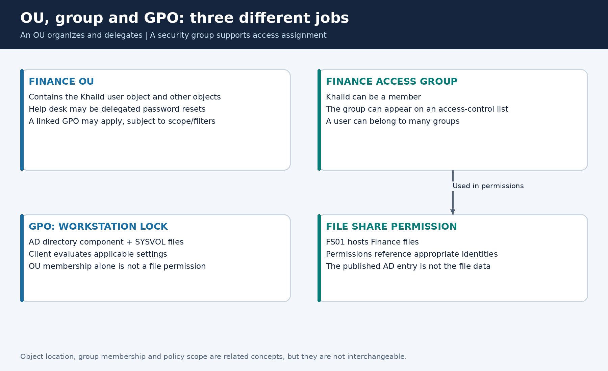

*New educational diagram; see IMAGES_AND_SOURCES.md for provenance.*

**Book topic - pages 8-9.**

An **object** is an identifiable directory entry. An **attribute** describes it.

Example user attributes can include display name, sign-in name and department. An object has an identity and a location in the directory.

The source lists all of the following:

| Source category | Explanation and important distinction |
| --- | --- |
| Users | User identities used for sign-in and access control |
| Groups | Collections used for security permissions or distribution purposes |
| Computers | Computer accounts representing joined machines; separate from their human users |
| Domain controllers | DC computer accounts plus associated server/NTDS Settings and related directory objects |
| Organizational Units | Containers inside a domain used for organization, GPO scope and delegation |
| Shared folders | Published directory entries can describe network shares; the actual files remain on storage/file servers |
| Printers | Published print-queue objects can help users discover printers; the physical printer is not stored in AD |
| Sites | Configuration objects representing network locality |
| Group Policy | GPO directory objects plus associated SYSVOL content; not entirely stored in NTDS.DIT |

### 5.1 The difference between an OU and a group

An **Organizational Unit (OU)** and a **security group** serve different purposes. An OU helps organize directory objects, delegate administration, and define the scope of Group Policy. A security group brings identities together to simplify permission assignments.

| Aspect | Organizational Unit (OU) | Security group |
| --- | --- | --- |
| **Main purpose** | Object organization, administrative delegation, and Group Policy scope | Grouping identities to assign permissions and user rights |
| **Relationship to objects** | An object resides in one parent container or OU within the directory | A user or computer can belong to multiple groups |
| **Group Policy** | A GPO can be linked directly to an OU | A GPO cannot be linked directly to a group; a security group can be used for filtering |
| **Resource permissions** | Being in an OU alone does not grant file-share access | A security group can be assigned file-share and NTFS permissions |

**Example:** Khalid’s user object is in the `Finance` OU. A GPO linked to that OU may apply to his user account if scope and filtering permit it. To grant access to Finance files, Khalid can be added to the `Finance-Share-Read` security group, which has been assigned the required permissions.

**One parent, multiple memberships:** Khalid’s user object resides in one parent container or OU at a time, but he can belong to multiple security groups.

**OU moves and permissions:** Moving a user into the Finance OU does not automatically grant file-share permissions. The move can change applicable GPOs and inherited directory permissions; resource access is evaluated separately.

**The default Users container:** The default AD DS `Users` container is not an OU. A GPO cannot be linked directly to it. However, applicable policies inherited from the domain or site can still affect objects within it.

**Remember:** An OU determines where an object is organized in the directory; security-group membership helps with permission assignment.

### 5.2 Names and identifiers used in AD

An account in AD DS can be represented by different names and identifiers. Each format serves a different purpose.

| Name / identifier | Example | Meaning |
| --- | --- | --- |
| **UPN (User Principal Name)** | `khalid@ad.example.com` | The user’s sign-in name; its email-like format does not mean that a mailbox exists |
| **Down-level logon name** | `LAB\khalid` | The NetBIOS domain name followed by the user’s `sAMAccountName` |
| **Distinguished Name (DN)** | `CN=Khalid,OU=Finance,DC=ad,DC=example,DC=com` | The object’s complete name and location within the directory hierarchy |
| **SID (Security Identifier)** | `S-1-5-21-111111111-222222222-333333333-1105` | Identifies a security principal in Windows access control; this is a fictional example |

#### UPN and down-level logon

`khalid@ad.example.com` and `LAB\khalid` can be two sign-in formats for the same user account.

- **UPN:** Consists of a username and a UPN suffix. The UPN suffix can be configured to differ from the domain’s DNS name.
- **Down-level logon:** Uses the `DOMAIN\username` format. In this example, `LAB` is the domain’s NetBIOS name, and `khalid` is the account’s `sAMAccountName`.

**Remember:** A UPN that looks like an email address does not prove that the account has an email mailbox.

#### Understanding a Distinguished Name

In `CN=Khalid,OU=Finance,DC=ad,DC=example,DC=com`:

- **CN=Khalid:** The object’s Common Name.
- **OU=Finance:** The parent Organizational Unit.
- **DC=ad,DC=example,DC=com:** The components of the domain name `ad.example.com`.

**In a DN, `DC` means Domain Component**, not a Domain Controller server.

Renaming an object or moving it to another OU can change its DN.

#### Understanding a SID

A domain account’s SID generally consists of a **domain SID + Relative Identifier (RID)**. The RID uniquely identifies that security principal within the domain.

Renaming a user or moving the account to another OU within the same domain normally does not change its SID. However, deleting the account and creating a new account with the same name produces a different SID.

**Remember:** Sign-in names are used to access an account, the DN describes its directory location, and the SID represents its security identity in Windows permissions.

## 6. Purposes of AD DS

**Book topic — pages 10–11.** This section explains the nine purposes listed in the notes.

The main purpose of AD DS is to centrally manage identities and directory information in a domain environment. It supports authentication, access control, administration, and applications. Some capabilities require additional services or integration tools.

| Purpose | Meaning | Example |
| --- | --- | --- |
| **Centralized authentication and authorization support** | Supporting authentication and access decisions through shared domain identities and group information | A DC authenticates the user; a file server checks access based on the user’s identity and permissions |
| **User and resource management** | Maintaining directory objects, their attributes, and relationships | Disabling a departing employee’s account and reviewing their group memberships |
| **Security and access control** | Managing access through identities, groups, permissions, and policies | Restricting access to the Finance share to approved security groups |
| **Scalability and delegation** | Expanding the directory as needed and assigning responsibility for specific administrative tasks | Allowing the help desk to reset passwords only for users in the Finance OU |
| **Directory-based resource discovery** | Finding resources through published directory information | Locating a published printer or an application directory entry |
| **Trust relationships and federation support** | Supporting cross-domain authentication through AD DS trusts and integrating identity systems through separate federation services | Authenticating a user from a trusted domain or supporting application sign-in through a service such as AD FS |
| **Availability through replication** | Maintaining replicas of directory data on multiple DCs | Another healthy DC handles appropriate domain requests when one DC is unavailable |
| **Cloud and hybrid integration** | Integrating on-premises identities with cloud identity services through additional components and tools | Synchronizing selected identities with Microsoft Entra ID |
| **Directory services for applications** | Allowing applications to query or use directory identities and information | An LDAP-aware business application queries user or group information |

### 6.1 Authentication versus authorization

**Authentication** verifies the identity of a user or another principal. **Authorization** determines what that identity is allowed to do.

AD DS provides identities and group information, but a DC does not directly decide permissions for every resource. The file server or application enforces its applicable permissions and rules.

**Remember:** A successful domain sign-in does not guarantee access to every resource.

### 6.2 Trusts versus federation

**AD DS trusts** and **federation** are not two names for the same thing.

- **AD DS trust:** Provides an authentication path between domains or forests.
- **Federation:** Supports sign-in through trust between identity systems and applications, using tokens or assertions.
- **AD FS:** Active Directory Federation Services is a separate Windows Server role/service. Installing AD DS alone does not deploy AD FS.

**Remember:** A trust does not automatically grant resource permissions. Authentication restrictions and resource authorization still apply.

### 6.3 Cloud and hybrid integration

**Microsoft Entra ID** is not a cloud-hosted writable replica of the AD DS `ntds.dit` database. They are different identity services.

Hybrid integration requires an appropriate architecture, supported synchronization tools, and configuration. Installing AD DS alone does not automatically synchronize identities to the cloud.

### 6.4 Delegation and least privilege

**Delegation** means granting an administrator or support team permission to perform specific administrative tasks on specific objects.

**Example:** Allowing the help desk to reset passwords for users in the Finance OU is not the same as granting Domain Admin rights across the entire domain.

Under the principle of **least privilege**, grant only the permissions necessary for the assigned task.

### 6.5 Limits of replication and availability

Multiple healthy DCs reduce dependency on a single server. However, availability also requires functioning DNS, connectivity, replication, and an appropriate failure-domain design.

**Replication does not replace backups.** Incorrect changes or accidental deletions can also replicate. Similarly, adding another DC does not automatically replicate or protect the files on a separate file server.

## 7. Features and limitations

**Book topic - pages 12-13. All seven listed features are explained.**

### 7.1 Administration through Group Policy

**Group Policy Objects (GPOs)** help administrators centrally manage supported user and computer settings. They can configure security settings, scripts, and certain software deployment tasks.

| Use | Example |
| --- | --- |
| **Security settings** | Configuring account-lockout policies or Windows Firewall settings |
| **User and computer settings** | Managing screen-lock settings or Control Panel access |
| **Scripts** | Configuring computer startup/shutdown or user logon/logoff scripts |
| **Software deployment** | Assigning or publishing supported Windows Installer (`.msi`) packages |

**GPO scope:** GPOs can be linked to sites, domains, and OUs. Applicable settings affect users or computers; inheritance, security filtering, and other processing rules determine which GPOs take effect.

**Processing clarification:** Domain Controllers provide policy information and files, but the client computer’s Group Policy components process and apply the applicable settings.

**Software deployment limitations:** Group Policy Software Installation is useful for certain supported deployment scenarios, but it does not manage every application, installer format, or update workflow. It should not be considered a universal replacement for every application-management system.

**Remember:** Creating a GPO alone is not enough; correct linking, scope, permissions, and successful client processing are also necessary.

### 7.2 Renaming a DC or domain

**Domain Controller renaming** and **domain renaming** are separate operations. They have different prerequisites, dependencies, and application limitations.

| Operation | What changes? | Example |
| --- | --- | --- |
| **DC rename** | The computer/host name of a particular Domain Controller | `DC01.ad.example.com` to `DC02.ad.example.com` |
| **Domain rename** | The AD domain’s DNS name and/or NetBIOS name | `ad.example.com` to `corp.example.com` |

#### Domain Controller rename

Renaming a DC should not be treated as a simple standalone-PC rename. A Domain Controller is integrated with DNS records, replication, and other services.

Before renaming it, review these dependencies:

- DNS records and name resolution.
- Replication health.
- Certificates and service identities.
- Applications, scripts, and monitoring tools that use the old hostname.
- Additional roles installed on the server and whether they support renaming.

**Clarification:** Renaming a DC does not change the AD domain’s name.

#### Domain rename

Renaming a domain is a specialized infrastructure project. It can affect Domain Controllers, domain members, DNS, Group Policy, and applications that depend on domain names.

Not every application or additional server role supports domain renaming. Therefore, the availability of an AD DS rename mechanism does not guarantee compatibility across the entire environment.

**Example:** If an application uses the old domain name in its configuration, it may require configuration updates or additional remediation after the domain is renamed.

**Remember:** Before either operation, review current Microsoft and application-vendor guidance, prepare backups and a recovery plan, and perform testing. Do not treat DC or domain renaming as routine naming cleanup.

### 7.3 Integrated security with Kerberos

**Kerberos** supports authentication in AD DS domain environments and **single sign-on (SSO)** for supported services. Using tickets, a user can authenticate without repeatedly providing their password to every service.

**Example:** Khalid signs in with a domain account. If the file service supports Kerberos and integrated authentication, he can authenticate to that service without entering his password again.

**Integrated security** means that an application can use the domain’s identity and authentication facilities. However, not every application necessarily uses Kerberos or SSO; appropriate support and configuration are required.

#### What is still necessary alongside Kerberos?

- **Resource permissions:** After authentication, the file server or application still evaluates access rules.
- **Secure configuration:** DNS, SPNs, time synchronization, and service-account configuration must be correct.
- **Least privilege:** Users, administrators, and service accounts should receive only the permissions they need.
- **Other security controls:** Updates, firewall rules, monitoring, and credential protection are also necessary.

**Clarification:** Using Kerberos authentication does not automatically encrypt all application network traffic. Protecting data also requires appropriate security settings for the application and protocol.

**Remember:** Kerberos helps verify identity; SSO reduces repeated prompts; permissions determine what is allowed. The presence of Kerberos alone does not automatically make the entire environment secure.

### 7.4 Installing or uninstalling AD DS

**Installing the AD DS role**, **promoting** a server, and **demoting** it are separate operations.

| Operation | What happens? |
| --- | --- |
| **AD DS role installation** | Installs the required AD DS components; the server does not become a DC yet |
| **Promotion** | Configures the server as a Domain Controller |
| **Demotion** | Removes the server’s Domain Controller status through a supported procedure |
| **Role removal** | Removes the installed AD DS role components after demotion |

#### Planning before demotion

Before demoting a DC, review the following:

- **DNS:** Ensure that clients and other servers can use an available DNS service.
- **Replication:** Verify directory replication health and confirm that necessary changes have reached other DCs.
- **FSMO roles:** If the DC holds FSMO roles, transfer them to an appropriate DC before planned removal.
- **Global Catalog and remaining DCs:** Ensure that other available DCs can provide the required authentication and directory services.
- **Dependencies:** Plan alternatives for applications, scripts, and clients that use this DC directly.

#### Removing the last DC

**Demoting the last DC in a domain removes that AD domain.** If it is also the last domain in the forest, the forest is removed as well. Do not treat this operation like removing an additional DC.

**Deleting a DC’s virtual machine is not demotion.** Simply deleting the VM can leave behind the DC’s metadata, DNS records, and replication references in the directory. If a DC is permanently lost, supported recovery and metadata-cleanup procedures may be necessary.

**Remember:** For planned removal, review dependencies first, then complete a supported demotion. Uninstalling the AD DS role or deleting the VM is not a replacement for demotion.

### 7.5 Cross-forest trust

A **forest trust** can provide an authentication path between two AD DS forests, provided that prerequisites, connectivity, and security policies permit it.

It allows users from one forest to be granted access to resources in another forest. However, actual access also requires appropriate permissions and authentication settings.

| Aspect | Explanation |
| --- | --- |
| **Authentication path** | Provides a way to authenticate an identity from the other forest |
| **Trust direction** | Can be one-way or two-way; the direction determines which forest’s identities can authenticate for access in the other forest |
| **Resource permissions** | Resource administrators must assign the required permissions separately |
| **Authentication scope** | Forest-wide or selective authentication settings can allow or restrict authentication |
| **Forest boundaries** | Both forests retain their separate directory databases, schemas, and administration |

**Example:** Forest A trusts Forest B. In this one-way relationship, users from Forest B can be granted access to resources in Forest A if authentication restrictions and resource permissions permit it. This does not automatically give users from Forest A access to Forest B.

**Selective authentication clarification:** With this configuration, users from the trusted forest need additional permission to authenticate to specified computers or services. Resource permissions are still checked separately.

**What does a trust not do?**

- It does not merge the two forests into one forest.
- It does not establish AD DS database replication between the forests.
- It does not automatically grant users permissions to files, folders, or applications.

**Remember:** A trust provides an authentication path; authentication restrictions and resource permissions determine whether access is possible and allowed.

### 7.6 Site-to-site replication

**Site-to-site replication**, also called **intersite replication**, replicates directory changes between Domain Controllers in different AD sites.

The lecture describes it as “faster,” but intersite replication is not inherently faster than **intrasite replication**, which occurs within the same site.

| Aspect | Intrasite replication | Intersite replication |
| --- | --- | --- |
| **Where does it occur?** | Between DCs within the same AD site | Between DCs in different AD sites |
| **Typical design** | Distributing changes quickly over good connectivity | Managing replication according to site links and available connectivity |
| **Timing** | Change notifications generally help initiate replication promptly | Usually follows the site-link schedule and interval; configuration can change this behavior |

#### Effects of site-link settings

- **Cost:** Helps the KCC choose preferred routes for the replication topology. A lower cost does not necessarily mean higher bandwidth or faster transfers.
- **Schedule:** Determines when replication is permitted over the link.
- **Replication interval:** Determines the time between periodic replication attempts within the permitted schedule.
- **Actual connectivity:** Bandwidth, latency, packet loss, and network availability affect how quickly changes arrive.

**Example:** Chicago and Dallas are separate AD sites. If their site link has a long replication interval, changes may take time to reach the other site even when the network connection is fast.

**Convergence** means that relevant changes have reached the appropriate DC replicas through replication.

**Remember:** The purpose of intersite replication is not speed alone, but an appropriate topology and controlled replication between sites. Actual timing depends on configuration, replication health, and network connectivity.

### 7.7 Extensible schema

The AD DS schema is **extensible**. This means that new **object classes** and **attributes** can be added to meet application requirements.

**Example:** If an application needs to store additional information about user objects, a new attribute can be defined through a supported schema extension. Not every additional requirement needs a schema extension; review existing attributes and application guidance first.

#### Forest-wide impact

The schema is shared throughout the forest. Schema changes originate on the **Schema Master** DC and then replicate to the other DCs in the forest.

Therefore, a schema extension is a **forest-wide change**, not a local configuration change affecting only one server or OU.

#### Deletion versus defunct status

Schema class and attribute definitions cannot be freely deleted like ordinary user or group objects.

Some eligible definitions can be marked **defunct** under supported conditions and restrictions. This means making the definition inactive; it is not equivalent to deleting it from the database or completely reversing the extension.

**Not every definition can be marked defunct.** Dependencies and schema rules can restrict this operation.

#### Preparation before making changes

- Follow the application/vendor’s supported schema-extension procedure.
- Verify the required permissions and availability of the Schema Master.
- Validate the changes in an appropriate test environment first.
- Review replication health, backups, and recovery planning.
- Document the changes and their expected impact.

**Remember:** Having a backup does not make a schema extension a simple “undo” operation. Perform schema changes with planning, testing, and controlled change management.

## 8. Logical and physical structure

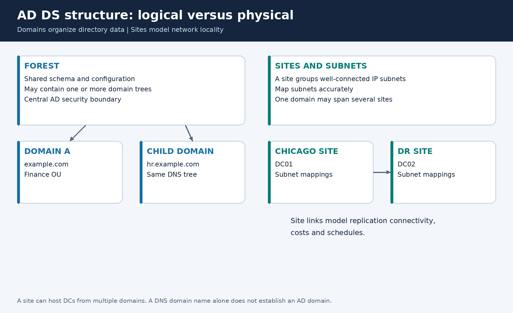

*New educational diagram; see IMAGES_AND_SOURCES.md for provenance.*

**Book topic - pages 14-15.**

### 8.1 Logical components

The **logical structure** of AD DS describes how domains and objects are organized within the directory. This is separate from physical servers and network locations.

| Component | Meaning | Example |
| --- | --- | --- |
| **Domain** | A logical unit within a forest that has its own domain directory partition; provides a scope for identities, administration, and full domain replication | `ad.example.com` |
| **Tree** | A group of one or more AD domains that share a contiguous DNS namespace | `example.com` and its child domain `hr.example.com` |
| **Forest** | One or more AD domains that share a common schema, configuration, and Global Catalog structure | A forest can contain multiple domain trees |
| **Organizational Unit (OU)** | A container within a domain for organizing objects, delegating administration, and linking GPOs | Finance OU |

#### Domains and trees

A **contiguous DNS namespace** means that domain names follow a parent-child naming hierarchy.

**Example:** `hr.example.com` can be a child domain of `example.com`. However, creating a DNS subdomain alone does not make it an AD child domain; it must be deployed as an AD DS domain.

A tree can contain just one domain.

#### Forests and multiple trees

A forest can also contain just one domain. If it contains multiple trees, they can use different DNS namespaces while sharing the forest’s schema and configuration.

**Example:** `example.com` and `example.net` can be two separate domain trees within the same forest.

#### OU scope

An OU belongs to one domain. It can organize users, computers, groups, and other OUs. An OU cannot contain multiple domains.

#### Security boundary clarification

**The forest is the fundamental AD DS security boundary.** A domain provides a scope for administration and replication, but it does not guarantee complete security isolation from highly privileged administrators in other domains within the same forest.

**Remember:** The forest is the highest-level logical structure; it contains domain trees and domains. Within domains, OUs help organize objects.

### 8.2 DNS namespace

A **DNS namespace** organizes names into a hierarchy. In `dc01.ad.example.com`:

| Part | Meaning |
| --- | --- |
| **`com`** | The top-level domain (TLD) |
| **`example.com`** | A domain beneath the `.com` top-level domain |
| **`ad.example.com`** | A subdomain of `example.com` |
| **`dc01`** | The host label in this example |

The complete name, **`dc01.ad.example.com`**, identifies the host within the DNS hierarchy. Its fully qualified form can be written as `dc01.ad.example.com.` with a trailing dot representing the DNS root.

**DNS versus AD DS:** The existence of a DNS domain name does not prove that an AD DS domain exists. DNS organizes names and provides name resolution; AD DS manages directory objects, identities, and domain services.

**Example:** Creating a DNS zone named `ad.example.com` alone does not create an AD DS domain. The AD DS domain must be deployed separately.

**Remember:** DNS and AD DS are related but different systems. AD DS uses DNS to help clients locate Domain Controllers and services.

### 8.3 Physical components

The **physical structure** of AD DS describes how Domain Controllers and network subnets are arranged into sites and how replication between sites is organized.

Sites, subnets, and site links are directory objects that represent the actual network topology.

| Component | Meaning |
| --- | --- |
| **Site** | A logical group of one or more IP subnets that generally share reliable, well-connected network connectivity |
| **Subnet** | An AD object representing an IP network prefix that is associated with a site |
| **Site link** | A logical relationship that models replication connectivity between sites; it includes settings such as cost, schedule, and interval |
| **Domain Controller (DC)** | A physical or virtual server that hosts replicas of directory partitions and provides domain services |

#### Sites and geographical locations

A site often corresponds to an office, branch, or data-center location, but it is not simply a city name. Site design depends on actual network connectivity and service-location requirements.

**Example:** Mapping the Chicago office’s IP subnet to the Chicago AD site helps clients identify their site and locate a suitable DC.

#### Importance of subnet mapping

Correct subnet-to-site mapping supports site-aware DC discovery. Missing or incorrect mappings can cause a client to locate a DC in another site instead of the intended local DC.

**Clarification:** Creating a subnet object in AD does not create an actual network subnet or configure routers. It associates an existing IP network with an AD site.

#### Relationship between domains and sites

- A domain’s DCs can be distributed across multiple sites.
- A site can contain DCs from multiple domains.
- Site boundaries and domain boundaries do not have to match.

**Site-link clarification:** A site link does not create an actual network cable, VPN, or router connection. It models available connectivity for AD replication planning.

**Remember:** Logical structure asks, “How are directory objects and identities organized?” Physical structure asks, “Where are DCs and clients located on the network, and how will replication occur between sites?”

## 9. All five FSMO roles

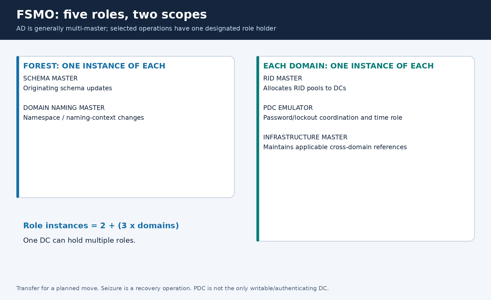

*New educational diagram; see IMAGES_AND_SOURCES.md for provenance.*

**Book topic - pages 16-18.**

**FSMO = Flexible Single Master Operations.**

AD DS is generally multi-master, but specific operations use one designated role holder to avoid conflicts. A single DC can hold multiple FSMO roles.

| Scope | Role | Main responsibility |
| --- | --- | --- |
| Forest | Schema Master | Originating changes to the forest schema |
| Forest | Domain Naming Master | Control changes to domain/naming-context namespace |
| Domain | RID Master | Allocate RID pools to DCs |
| Domain | PDC Emulator | Password/lockout coordination, time hierarchy and preferred administrative functions |
| Domain | Infrastructure Master | Maintain cross-domain object references where applicable |

Two roles per forest plus three per domain means **2 + (3 x number of domains)** role instances. A three-domain forest has 11 instances, not necessarily 11 separate servers.

### 9.1 Schema Master

The **Schema Master** is a **forest-wide FSMO role**. Each forest has only one holder of this role.

Schema changes originate on the writable DC holding the role. These changes then replicate to the other DCs in the forest through schema-partition replication.

#### Main responsibility

The Schema Master provides a single-master point for schema updates. These updates can include adding new object classes or attributes and modifying existing definitions through supported procedures.

**Example:** If an application installation requires a new directory attribute, the schema extension requires an available Schema Master and appropriate permissions.

**Permissions clarification:** Holding the Schema Master role does not automatically give a user permission to modify the schema. The account performing the operation must also have the required permissions.

#### Deletion and defunct handling

The lecture’s reference to deleting schema classes and attributes is misleading. Normal deletion of `classSchema` and `attributeSchema` definitions is not allowed.

- **Add/modify:** Adding or modifying definitions according to supported schema rules.
- **Defunct:** Marking certain eligible definitions as inactive, subject to restrictions.
- **Delete:** Removing a definition from the directory; this should not be treated as a normal schema-management operation.

**Marking a definition as defunct is not equivalent to deletion or a complete rollback.**

**Remember:** The Schema Master is the single-master point where changes originate; it is not the only DC holding a copy of the schema. Every DC in the forest holds a replica of the schema partition.

### 9.2 Domain Naming Master

The **Domain Naming Master** is a **forest-wide FSMO role**. Each forest has only one holder of this role.

It coordinates changes involving the addition or removal of domains and application directory partitions, also called application naming contexts. It helps prevent conflicting entries in the forest’s directory namespace and keeps naming-context references consistent.

#### Main responsibilities

- Handling namespace changes associated with adding a new AD domain to the forest.
- Handling namespace changes associated with removing a domain.
- Participating in operations that add or remove application directory partitions.
- Handling single-master updates related to naming-context references in the configuration partition’s **Partitions container**.

**Example:** Deploying a new child domain named `hr.example.com` in an existing forest requires an available Domain Naming Master and appropriate permissions.

#### Domain rename clarification

The lecture mentions domain renaming. The availability of the Domain Naming Master is one part of a supported domain-rename workflow, but this role alone does not make the rename safe or supported.

Domain renaming also requires reviewing DNS, replication, domain members, installed applications, and vendor support.

**Important distinction:** The Domain Naming Master is not a replacement for a DNS server. Creating ordinary DNS records or resolving hostnames is not the responsibility of this FSMO role.

**Remember:** The Domain Naming Master coordinates domain and partition changes in the forest’s directory namespace; it does not manage every user account name or DNS record.

### 9.3 RID Master

The **RID Master** is a **domain-wide FSMO role**. Each domain has only one holder of this role.

It allocates pools of **Relative Identifiers (RIDs)** to writable Domain Controllers. When a writable DC creates a new security principal, it uses a RID from its available pool.

Examples of **security principals** include user accounts, computer accounts, and security groups.

#### Relationship between a SID and a RID

A domain security principal’s **Security Identifier (SID)** is formed by appending its RID to the domain SID:

**Principal SID = Domain SID + RID**

**Fictional example:**

- **Domain SID:** `S-1-5-21-111111111-222222222-333333333`
- **RID:** `1105`
- **Principal SID:** `S-1-5-21-111111111-222222222-333333333-1105`

The domain SID identifies the domain; the RID uniquely identifies the security principal within that domain.

#### How are RIDs allocated?

The RID Master does not issue an individual RID for every user-creation request. It allocates pools to DCs, which then use RIDs from those pools.

**Example:** If DC01 has a usable RID pool, it can assign a RID when creating a new user without immediately contacting the RID Master for each request.

#### What happens if the RID Master is unavailable?

- Writable DCs can continue creating new security principals while they have usable RIDs remaining in their pools.
- If a DC exhausts its usable pool and cannot obtain another one, creating new security principals on that DC can fail.
- Existing users’ authentication does not necessarily stop simply because the RID Master is unavailable.
- Not every directory object needs a RID; for example, an OU is not a security principal.

**Remember:** The RID Master allocates pools; a writable DC uses a RID from its pool to create a new security principal.

### 9.4 PDC Emulator

The **PDC Emulator (Primary Domain Controller Emulator)** is a **domain-wide FSMO role**. Each domain has only one holder of this role.

It has special responsibilities in password-change coordination, authentication checks, account lockout, domain time synchronization, and certain administrative operations.

| Function | Explanation |
| --- | --- |
| **Password updates** | Receives password changes made on other writable DCs through preferential replication |
| **Failed-password verification** | If password verification fails on another DC, the normal behavior is to check the latest password with the PDC Emulator before rejecting the request |
| **Account lockout** | Plays a central coordination role in domain account-lockout processing |
| **Time synchronization** | Acts as a special reference point in the Windows domain time hierarchy |
| **Group Policy administration** | Is the default or preferred DC for Group Policy management tools |
| **Historical compatibility** | Was designed to support the PDC expectations of older Windows NT environments |

#### Password changes and authentication

**Other writable DCs can also accept password changes.** The PDC Emulator is not the domain’s only writable DC or authentication server.

**Example:** Khalid’s password was changed on DC01. If DC02 has not yet received the update and considers the new password incorrect, checking the latest password with the PDC Emulator can help prevent an authentication failure.

This behavior depends on appropriate connectivity and the latest password information being available on the PDC.

#### Time synchronization

In the normal AD domain time hierarchy, the **PDC Emulator in the forest-root domain** is the top-level reference. It should be configured with an appropriate, reliable upstream time source.

Not every computer needs to obtain time directly from the forest-root PDC. Domain members and other DCs generally follow the domain time hierarchy.

**Remember:** Each domain has its own PDC Emulator, but the forest-root domain’s PDC Emulator sits at the top of the normal forest-wide time hierarchy.

#### Group Policy clarification

Group Policy management tools generally use the PDC Emulator as their default or preferred administrative target, but other writable DCs can also accept GPO changes.

The client computer’s Group Policy components process and apply applicable policies. The PDC Emulator does not directly apply settings to every client.

#### Historical compatibility

Windows NT PDC compatibility explains the history of this role. It does not mean that only the PDC Emulator is writable in a modern domain or that obsolete Windows NT clients should be deployed.

**Remember:** The PDC Emulator is important for password coordination, lockout processing, the time hierarchy, and administrative consistency; not all domain authentication depends exclusively on this DC.

### 9.5 Infrastructure Master

The **Infrastructure Master** is a **domain-wide FSMO role**. Each domain has only one holder of this role.

Its traditional responsibility is to update **references to objects in other domains** within its own domain when a referenced object’s name or other relevant identity information changes.

**Example:** A group in Domain A contains a user from Domain B. If that user is renamed in Domain B, the Infrastructure Master helps keep the cross-domain reference information updated.

**Clarification:** It maintains the reference; it does not copy the other domain’s complete user object into its own domain.

#### Effect of Global Catalog placement

In a traditional configuration where some DCs in a domain are Global Catalog (GC) servers and others are not, the Infrastructure Master should generally be placed on a **non-GC DC**.

However, if **all DCs in the domain are GC servers**, they all hold the relevant cross-domain information. In this situation, placing the Infrastructure Master on a GC is not a problem.

#### Effect of AD Recycle Bin

If **AD Recycle Bin is enabled** in the forest, each DC is responsible for updating its cross-domain object references. In this situation, the Infrastructure Master’s traditional reference-update tasks are no longer required.

The role should still remain assigned to a **valid DC**.

#### Limits of this role

The Infrastructure Master:

- Is not responsible for replicating all directory objects.
- Does not centrally update every user’s attributes.
- Does not independently determine permissions associated with cross-domain group membership.
- Does not establish database synchronization between forests.

**Remember:** The Infrastructure Master’s practical workload depends on forest design, GC placement, and AD Recycle Bin configuration. Its core concept is maintaining consistency of cross-domain references.

### 9.6 Transfer versus seizure

There are two ways to move a FSMO role to another DC: **transfer** and **seizure**. They are used in different situations.

| Operation | Appropriate situation | Main distinction |
| --- | --- | --- |
| **Transfer** | The current role holder is available and cooperative; a planned migration or maintenance operation | Responsibility is handed over to another DC through normal coordination |
| **Seizure** | Transfer from the current holder is not possible and recovery of the role is necessary | The role is assigned to another DC without the previous holder’s cooperation |

#### When should you transfer a role?

For planned DC replacement, maintenance, or decommissioning, **transfer is the preferred approach** when the current role holder is available.

**Example:** If DC01 is healthy but scheduled for retirement, its FSMO roles can be transferred to an appropriate DC02.

#### When should you seize a role?

Seizure is a recovery operation. Consider it when transfer is not possible, restoring the current holder in time is not feasible, and the role’s availability is operationally necessary.

**Example:** The role holder has permanently failed, and supported recovery planning requires assigning its role to another healthy writable DC.

**Seizure is not routine failover for a brief outage.** Assess the failure, the urgency of the role, and recovery options first.

#### FSMO management tools

| Tool | Relevant roles |
| --- | --- |
| **Active Directory Users and Computers** | RID Master, PDC Emulator, and Infrastructure Master |
| **Active Directory Domains and Trusts** | Domain Naming Master |
| **Active Directory Schema snap-in** | Schema Master |
| **PowerShell** | FSMO role transfer/seizure with the required module and permissions |
| **ntdsutil** | FSMO role transfer/seizure through supported procedures |

**Clarification:** The GUI consoles are used for normal role transfers. Seizure uses supported tools such as PowerShell or `ntdsutil`.

#### Returning the previous role holder

After a seizure, do not reconnect the previous holder to the network without planning. Follow role-specific Microsoft recovery guidance and plan metadata cleanup, demotion, or rebuilding where required.

After a RID Master seizure, recovery requirements concerning RID allocation and preventing duplicate security identifiers are particularly important.

#### Effect of an unavailable role

An unavailable FSMO role does not necessarily stop all logons immediately. The impact depends on the role, available RID pools, cached information, topology, and outage duration.

**Remember:** Use transfer for a planned move and seizure for necessary recovery. Seizure commands are intentionally omitted from this section because their use should depend on the actual environment and recovery assessment.

## 10. Schema versions

**Book topic - pages 19-20.**

The page-20 heading says FSMO roles, but its contents concern schema versions.

The schema version is recorded in the schema naming context's **objectVersion** attribute. It identifies a schema level, not the OS of every DC.

### 10.1 Entire source table, normalized

| Windows Server release in the source | Schema objectVersion |
| --- | --- |
| Windows Server 2025 | 91 |
| Windows Server 2022 | 88 |
| Windows Server 2019 | 88 |
| Windows Server 2016 | 87 |
| Windows Server 2012 R2 | 69 |
| Windows Server 2012 | 56 |
| Windows Server 2008 R2 | 47 |
| Windows Server 2008 RTM | 44 |
| Windows Server 2003 R2 | 31 |
| Windows Server 2003 RTM, SP1 and SP2 | 30 |
| Windows 2000 Server | 13 |

These are historical mappings, not a recommendation to deploy unsupported versions.

### 10.2 Three different version concepts

| Concept | Describes |
| --- | --- |
| DC operating-system version | Windows release installed on a particular DC |
| Schema version | Forest-wide class/attribute schema level |
| Domain/forest functional level | AD capabilities and permitted DC OS combinations |

A newer schema can coexist with older supported DCs where the compatibility rules permit it. “Schema 91” does not mean every DC is Windows Server 2025.

Windows Server 2019 and 2022 use the Windows Server 2016 functional level as their newest level. Windows Server 2025 introduces a 2025 functional level. Choose levels from the actual DC compatibility matrix, not the schema table.

## 11. Installation requirements

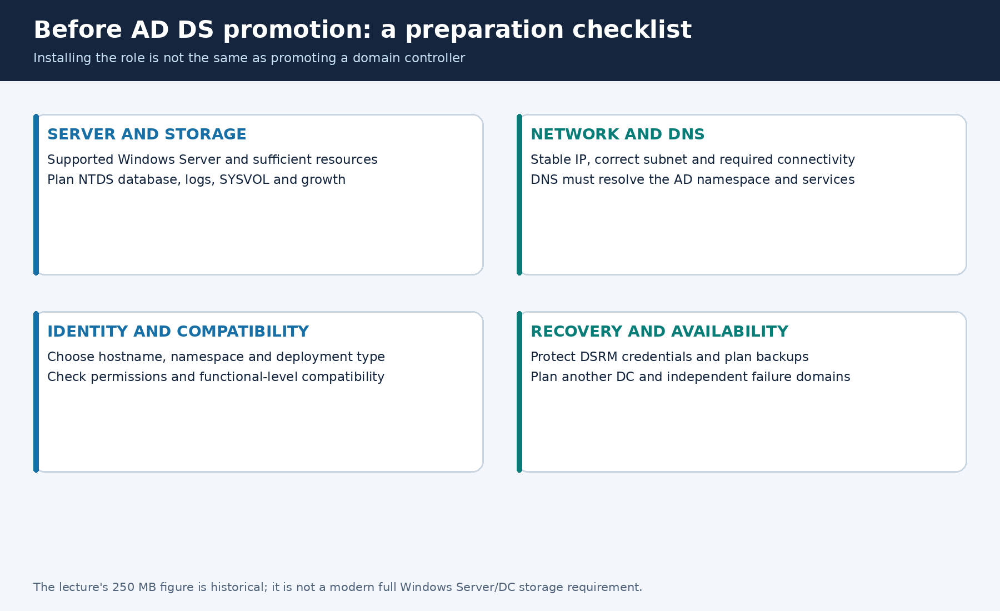

*New educational diagram; see IMAGES_AND_SOURCES.md for provenance.*

**Book topic - pages 21-22. Every listed prerequisite is addressed.**

| Source prerequisite | Explanation |
| --- | --- |
| Windows Server OS | Use a supported Windows Server release for the DC role |
| Administrator rights | Required credentials depend on new forest, new domain or additional DC |
| Static IP, example 192.168.0.111/24 | Provide stable addressing and correct network configuration |
| Unique domain name | Plan a suitable DNS namespace and avoid naming conflicts |
| DNS server | Ensure AD-capable name/service discovery; DNS can be installed during promotion |
| DSRM password | Set a protected Directory Services Restore Mode recovery password |
| Forest functional level | Select a level compatible with all relevant DCs and the design |
| Domain functional level | Select a compatible domain capability level |
| 250 MB minimum: 200 MB database + 50 MB logs | Historical figure; not a valid total size for a modern Windows Server DC |

### 11.1 OS and hardware sizing

**Clarification:** The 250 MB figure is not enough for a modern server installation or a realistic DC. Account for the OS, updates, paging, directory database, transaction logs, SYSVOL, monitoring and growth. Current Windows Server documentation gives an OS storage minimum measured in gigabytes; minimum installation requirements are not production recommendations.

Use current requirements for the exact OS and deployment option. On a small learning host, start with a modest isolated lab and avoid running more VMs than the host can support. No universal CPU/RAM/disk allocation fits every AD deployment.

### 11.2 Permissions

Creating a new forest requires appropriate local administrative credentials. Adding a domain or DC has different domain/forest permission requirements, and schema preparation can require additional privileges.

Do not equate local Administrator, Domain Admin and Enterprise Admin. They have different scope.

### 11.3 Addressing

The source address `192.168.0.111/24` means IP `192.168.0.111`, subnet mask `255.255.255.0`.

It is an example, not an instruction to use that address on your network. Plan IP, prefix, gateway where required, DNS server settings and subnet reachability.

### 11.4 DNS and naming

Clients and DCs must use DNS services that can resolve the AD namespace and service records. Public DNS alone cannot normally resolve private AD records. External resolution can be provided through appropriately configured forwarding.

For a new lab, use a namespace you control or an appropriate reserved example namespace in documentation. The earlier learner lab used VCPLAB.com; this note does not establish ownership of that public domain.

### 11.5 DSRM

Directory Services Restore Mode is a recovery mode for AD DS maintenance/recovery. Its password is distinct from normal domain-account use. Record it securely; do not put passwords in a public repository or command history.

### 11.6 Functional levels

Choose based on DC compatibility and required features. Domain functional level cannot be below forest functional level.

For Windows Server 2025 DCs in an existing domain, Microsoft documents at least the Windows Server 2016 functional level requirement. Raising to the 2025 level requires compatible DCs throughout the affected scope. Plan and verify rather than guessing.

### 11.7 Additional preparation checklist

**Additional explanation:**
1. Confirm server identity, hostname and intended role.
2. Verify network, DNS and time.
3. Plan whether this is a new forest, child domain or additional DC.
4. Plan database/log/SYSVOL storage on supported volumes.
5. Apply updates and required security configuration.
6. Keep firewall protection enabled with required role rules.
7. Plan another DC and independent failure domains when availability matters.
8. Plan supported system-state/forest recovery backups and test recovery.
9. Keep the lab isolated from an existing production domain.
10. Capture configuration evidence before and after promotion.

The lecture supplies prerequisites rather than a complete installation walkthrough. Do not mistake these notes for evidence that promotion has already been performed.

## 12. An integrated example

**Additional explanation - hypothetical, not a completed environment.**

An organization uses `ad.example.com`, DC01 and DC02, a Finance OU, Khalid's user account and a file server FS01.

| Step | Component responsible |
| --- | --- |
| Client discovers a DC | DNS and domain discovery |
| Khalid proves identity and obtains tickets | Client and DC's KDC |
| Khalid requests Finance files | Client and FS01 |
| Access permission is evaluated | FS01 using identities/groups and access rules |
| Help desk resets a Finance password | Delegated permissions on the appropriate objects |
| Password/user changes propagate | AD replication |
| Desktop lock setting applies | Client Group Policy processing |
| Policy files replicate | SYSVOL/DFSR |
| A forest schema update is authorized/performed | Appropriate permissions and Schema Master |

If DC01 fails, DC02 can provide suitable domain services when DNS, replication and connectivity are healthy. FS01 remains responsible for its files. Losing FS01 is not solved merely by adding another DC.

## 13. Read-only checks for a future lab

**Additional explanation.** These do not install AD DS. Run only in a suitable AD environment with the tools and read permissions available. No outputs below are claimed as observed from your servers.

### 13.1 Useful consoles

| Tool | Purpose |
| --- | --- |
| `dsa.msc` | AD Users and Computers |
| `dssite.msc` | AD Sites and Services |
| `domain.msc` | AD Domains and Trusts |
| `gpmc.msc` | Group Policy Management |
| `adsiedit.msc` | Advanced directory inspection; do not edit casually |
| DNS Manager | DNS zones and records |

### 13.2 Inspect domain, forest and DCs

~~~powershell
Import-Module ActiveDirectory

Get-ADDomain |
    Select-Object DNSRoot, DomainMode, PDCEmulator, RIDMaster, InfrastructureMaster

Get-ADForest |
    Select-Object RootDomain, ForestMode, SchemaMaster, DomainNamingMaster

Get-ADDomainController -Filter * |
    Select-Object HostName, Site, IsGlobalCatalog, IsReadOnly
~~~

### 13.3 Inspect schema version

~~~powershell
$rootDse = Get-ADRootDSE
Get-ADObject -Identity $rootDse.schemaNamingContext -Properties objectVersion |
    Select-Object DistinguishedName, objectVersion
~~~

This reads schema metadata. It does not extend the schema.

### 13.4 Inspect role holders and replication

~~~powershell
netdom query fsmo
repadmin /replsummary
repadmin /showrepl
~~~

Availability of netdom/repadmin depends on installed management tools. Review failures with topology, DNS and events; do not immediately force changes.

### 13.5 Observe current Kerberos tickets

~~~powershell
klist
~~~

Output is session-specific. Ticket visibility depends on how you signed in and which services you accessed. Do not publish tickets, secrets or unnecessary identity details.

## 14. Correction register

| Source wording or diagram | Correct interpretation |
| --- | --- |
| KCC is the replication service | KCC builds/maintains topology; AD replication transfers directory changes |
| Four partitions | Four categories; actual partition count can exceed four |
| Schema displays the database as forms | Schema defines object/attribute structure |
| Domain data never crosses domains | Full domain replication is domain-scoped; GC carries partial other-domain replicas |
| Resource server has NTDS.DIT | Normal member resource servers do not need it |
| AS and TGS as separate servers | Logical KDC functions; separate machines are not required |
| AD determines every resource access | Resource/application checks enforce permissions using identity information |
| Site-to-site replication is faster | Not inherently; costs, schedules and bandwidth affect intersite replication |
| Schema Master deletes definitions | Normal schema-definition deletion is disallowed; supported defunct handling differs |
| PDC is password-change master | Other writable DCs accept changes; PDC has special coordination responsibilities |
| PDC processes all GPO updates | Clients process policy; PDC is a preferred administrative target |
| Schema version equals server OS | Schema, OS version and functional levels are separate |
| 250 MB sufficient for installation | Historical sizing, not modern full DC/OS requirements |
| ADSI Edit listed alongside paths | It is a management tool, not a database path |

These corrections preserve the lecture's topics while improving technical precision.

## 15. Revision questions and answers

**1. What is AD DS?**  
A directory service organizing identities/resources and supporting domain authentication and administration.

**2. What is a DC?**  
A server promoted to host AD DS and provide domain services.

**3. Is installing the role enough?**  
No. Promotion/configuration must also complete.

**4. When was Active Directory introduced?**  
With Windows 2000.

**5. What does KCC do?**  
Build and maintain replication topology.

**6. Where is the directory database?**  
By default, in `C:\Windows\NTDS\ntds.dit`.

**7. What are the four partition categories?**  
Schema, configuration, domain and application.

**8. Does that mean exactly four partitions?**  
No. Multiple application partitions and GC replicas complicate the actual count.

**9. What does schema define?**  
Allowed object classes, attributes and related structural rules.

**10. What does configuration contain?**  
Forest-wide configuration including sites, subnets and replication topology information.

**11. What does a GC add?**  
Partial replicas of other domains' domain objects for forest-wide lookup and related functions.

**12. Is SYSVOL inside NTDS.DIT?**  
No. It is replicated filesystem content.

**13. Are AS and TGS necessarily separate servers?**  
No. They are KDC functions on DCs.

**14. Does a file server normally keep NTDS.DIT?**  
No. A member file server is not a DC.

**15. Does a Kerberos ticket grant every permission?**  
No. The service still authorizes operations.

**16. How do OU and group differ?**  
OU supports organization/delegation/policy scope; security groups support permission assignment.

**17. Does a published share object contain the actual documents?**  
No. Files remain on the file server/storage.

**18. Does a trust automatically grant access?**  
No. Authentication paths and resource permissions are distinct.

**19. Is AD FS the same as AD DS?**  
No. Federation is a separate service/concept.

**20. How many FSMO roles exist in one domain forest?**  
Five instances: two forest-wide and three domain-wide.

**21. What does RID Master allocate?**  
RID pools used by DCs when creating security principals.

**22. Is the PDC the only writable DC?**  
No. Ordinary writable DCs support multi-master updates.

**23. Transfer or seize for a planned move?**  
Transfer while the existing role holder is available.

**24. Which schema versions correspond to 2019/2022 and 2025?**  
88 and 91 respectively.

**25. Does schema 91 prove all DCs are 2025?**  
No. Check DC OS and functional-level compatibility separately.

**26. Is 250 MB a modern DC disk allocation?**  
No. Plan the OS and all workload/storage requirements.

**27. What is DSRM used for?**  
Directory-services recovery/maintenance scenarios.

**28. Why is DNS important?**  
Clients need to locate DCs and services through appropriate DNS records.

**29. Is replication a backup?**  
No. Undesired changes can replicate.

**30. Why have two DCs?**  
To reduce dependency on one server, provided DNS, replication, connectivity and failure-domain design also work.

## 16. Glossary

| Term | Meaning |
| --- | --- |
| AD DS | Active Directory Domain Services |
| DC | Domain Controller; in a DN, DC instead means domain component |
| NTDS.DIT | AD directory database file |
| ESE | Extensible Storage Engine |
| Naming context | Directory partition |
| KCC | Knowledge Consistency Checker |
| KDC | Key Distribution Center |
| AS | Authentication Service |
| TGS | Ticket-Granting Service |
| TGT | Ticket-Granting Ticket |
| SPN | Service Principal Name |
| GC | Global Catalog |
| OU | Organizational Unit |
| GPO | Group Policy Object |
| SYSVOL | Shared replicated directory containing policy/script files |
| DFSR | Distributed File System Replication |
| FSMO | Flexible Single Master Operations |
| RID | Relative Identifier |
| SID | Security Identifier |
| PDC Emulator | Primary Domain Controller Emulator role |
| DSRM | Directory Services Restore Mode |
| UPN | User Principal Name |
| LDAP | Lightweight Directory Access Protocol; not the database filename |
| AD FS | Active Directory Federation Services |
| RODC | Read-Only Domain Controller |

## 17. References

The uploaded lecture is the primary source for coverage and topic order. The following Microsoft references support the added explanations and corrections. Documentation was checked during preparation; consult current requirements before a deployment.

1. [AD replication concepts](https://learn.microsoft.com/en-us/windows-server/identity/ad-ds/get-started/replication/active-directory-replication-concepts) - KCC, sites and GC.
2. [Naming contexts and directory partitions](https://learn.microsoft.com/en-us/windows/win32/ad/naming-contexts-and-partitions) - partition concepts.
3. [Kerberos authentication overview](https://learn.microsoft.com/en-au/windows-server/security/kerberos/kerberos-authentication-overview) - KDC and tickets.
4. [Kerberos protocol exchanges](https://learn.microsoft.com/en-us/openspecs/windows_protocols/ms-kile/b4af186e-b2ff-43f9-b18e-eedb366abf13) - AS/TGS/application exchanges.
5. [FSMO roles](https://learn.microsoft.com/en-us/windows-server/identity/ad-ds/manage/understand-fsmo-roles) - role scopes and responsibilities.
6. [FSMO details and qualifications](https://learn.microsoft.com/en-us/troubleshoot/windows-server/active-directory/fsmo-roles) - cross-domain reference and role behavior.
7. [Active Directory schema specification](https://learn.microsoft.com/en-us/openspecs/windows_protocols/ms-adts/5859bab0-f545-4db6-80c6-9798b484b3d8) - schema objects and defunct handling.
8. [Find schema version](https://learn.microsoft.com/en-us/windows-server/identity/ad-ds/deploy/find-active-directory-schema) - objectVersion mappings.
9. [Install AD DS](https://learn.microsoft.com/en-us/windows-server/identity/ad-ds/deploy/install-active-directory-domain-services--level-100-) - deployment options and prerequisites.
10. [AD DS functional levels](https://learn.microsoft.com/windows-server/identity/ad-ds/active-directory-functional-levels) - DC/version compatibility.
11. [Raise functional levels](https://learn.microsoft.com/en-us/windows-server/identity/ad-ds/plan/raise-domain-forest-functional-levels) - preparation and compatibility.
12. [Windows Server hardware requirements](https://learn.microsoft.com/en-us/windows-server/get-started/hardware-requirements) - modern OS sizing context.

## Appendix - Original lecture visuals

These are high-resolution renders of the supplied lecture pages, not new Microsoft screenshots. They preserve source errors discussed in the correction register, especially on pages 7, 13, 17, 18 and 22.

### PDF page 3 - ADDS Foundations

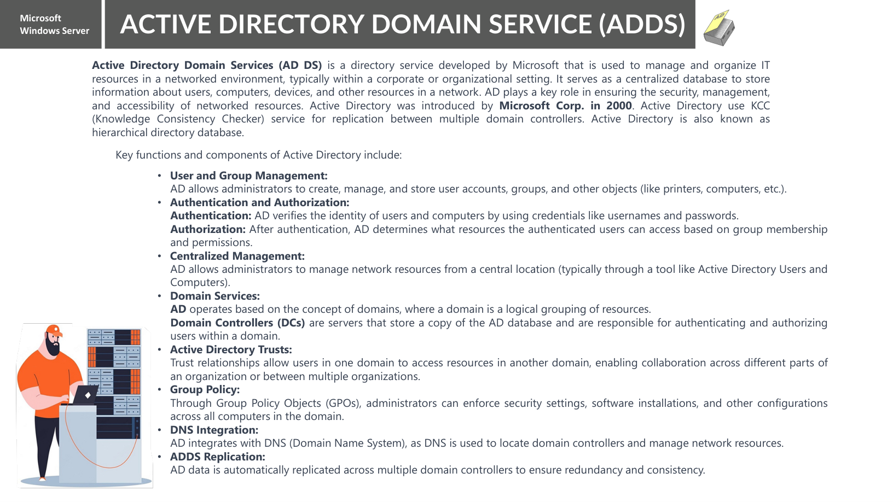

### PDF page 5 - Database and Partitions

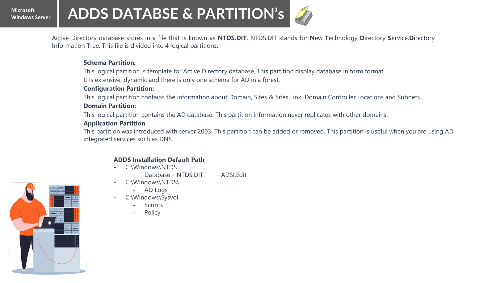

### PDF page 7 - Authentication

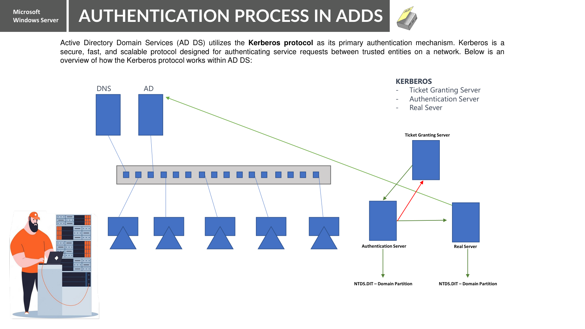

### PDF page 9 - Objects

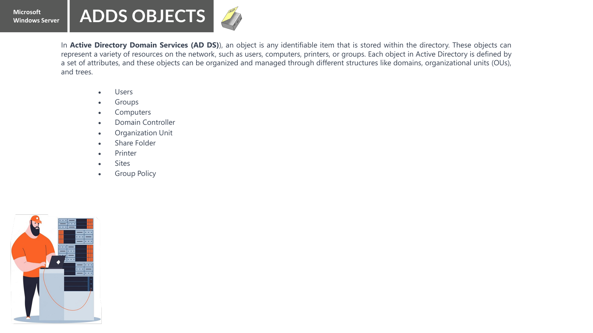

### PDF page 11 - Purposes

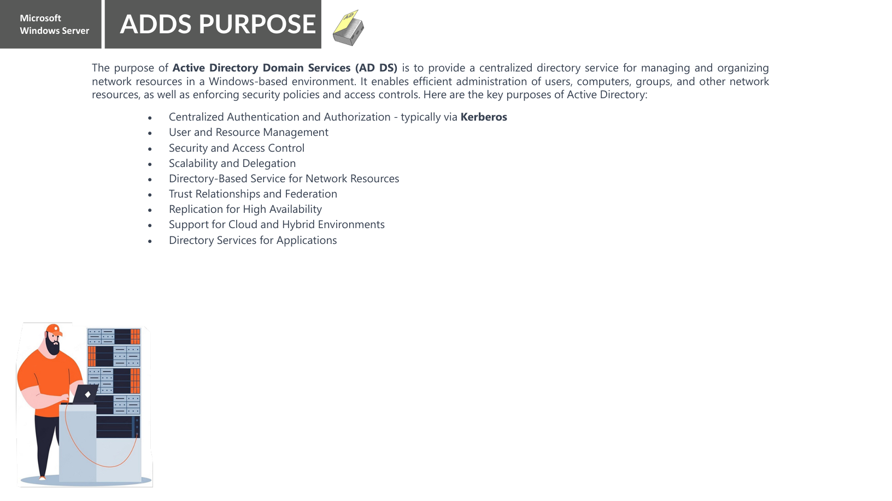

### PDF page 13 - Features

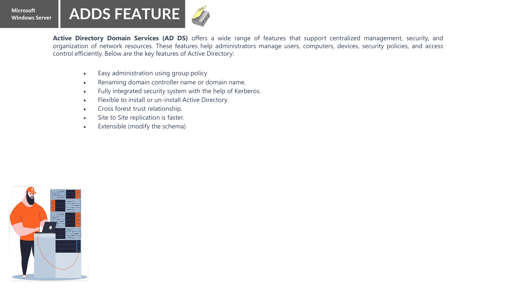

### PDF page 15 - Structure

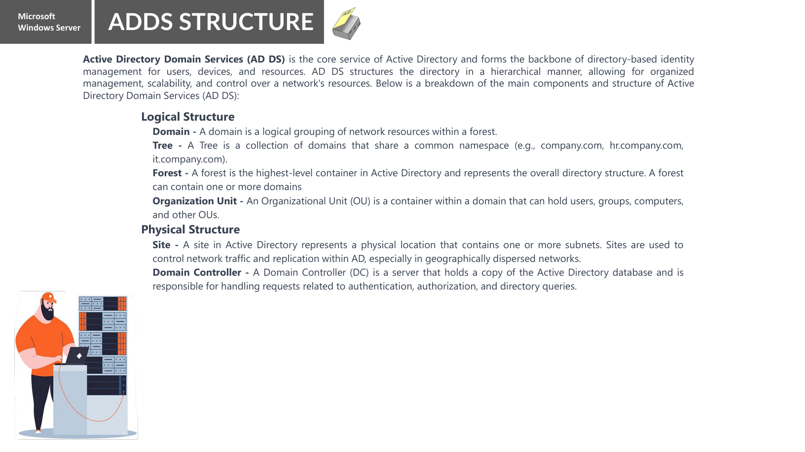

### PDF page 17 - FSMO Forest

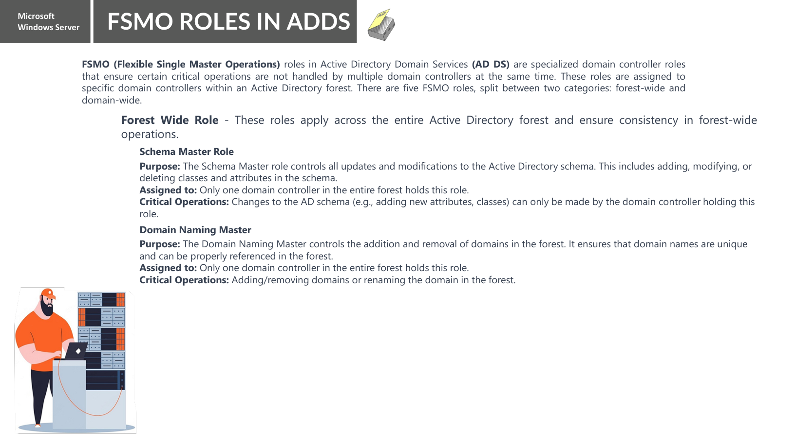

### PDF page 18 - FSMO Domain

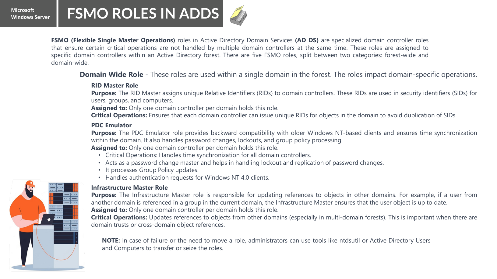

### PDF page 20 - Schema Versions

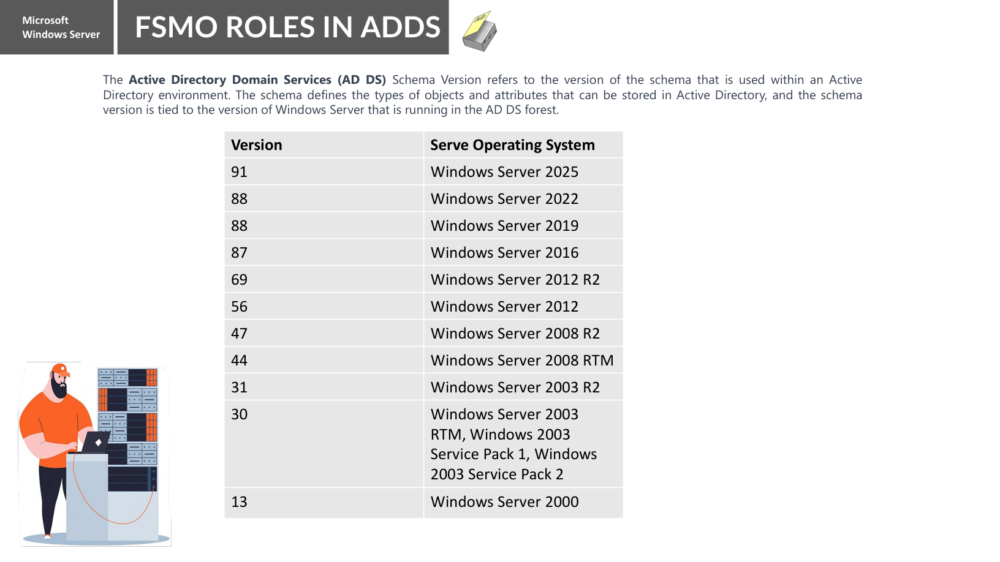

### PDF page 22 - Installation Requirements

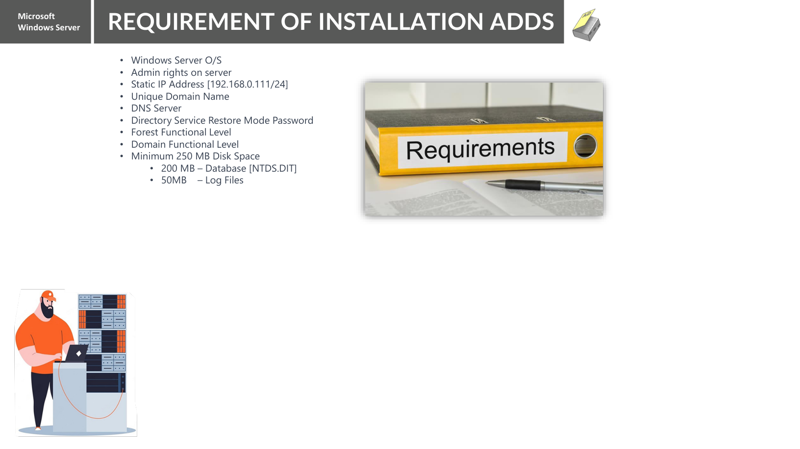

[Image provenance / Tasaveer ki tafseel](IMAGES_AND_SOURCES.md) | [README](README.md)
