# Active Directory Domain Services (AD DS) - Kitab Par Mabni Mukammal Study Notes

**Zaban:** Roman Urdu  
**Source:** Upload ki gayi lecture PDF, `09 Active Directory Domain Service (ADDS)(3).pdf`, 22 pages.  
**Daira-e-kaar:** Agenda ka har topic, asal maloomat wala har bullet, table ki har entry aur technical diagram ki wazahat neeche di gayi hai. Baar baar aane wali chapter-divider slides ko map kiya gaya hai, dobara tasveer ki surat mein nahin banaya gaya. Yeh tafseeli explanation hai; lafz-ba-lafz transcript ya completed lab report nahin.

**Istemaal honay walay labels:**

- **Kitab ka topic:** Lecture mein cover ki gayi maloomat.
- **Wazahat / durusti:** Aisi correction ya shart jo ghalat samajh se bachane ke liye zaroori hai.
- **Mazeed wazahat:** Lecture ke ilawa samajhne mein madad dene wali maloomat aur misalein.

## Fehrist

1. [Har page ki coverage](#1-har-page-ki-coverage)
2. [AD DS ki bunyaad](#2-ad-ds-ki-bunyaad)
3. [Database partitions aur paths](#3-database-partitions-aur-paths)
4. [Kerberos authentication](#4-kerberos-authentication)
5. [Directory objects](#5-directory-objects)
6. [AD DS ke maqasid](#6-ad-ds-ke-maqasid)
7. [Features aur un-ki-hudood](#7-features-aur-un-ki-hudood)
8. [Logical aur physical structure](#8-logical-aur-physical-structure)
9. [Tamam paanch FSMO roles](#9-tamam-paanch-fsmo-roles)
10. [Schema versions](#10-schema-versions)
11. [Installation ki zarooriyat](#11-installation-ki-zarooriyat)
12. [Tamam concepts ki mushtarka misal](#12-tamam-concepts-ki-mushtarka-misal)
13. [Mustaqbil ke lab ke liye read-only checks](#13-mustaqbil-ke-lab-ke-liye-read-only-checks)
14. [Corrections ka register](#14-corrections-ka-register)
15. [Revision sawalat aur jawab](#15-revision-sawalat-aur-jawab)
16. [Istilahaat ki fehrist](#16-istilahaat-ki-fehrist)
17. [Repo mein jagah aur learning status](#17-repo-mein-jagah-aur-learning-status)
18. [References](#18-references)

## 1. Har page ki coverage

Page numbers PDF mein page ki position ko zahir karte hain; ginti 1 se shuru hoti hai.

| PDF page(s) | Source mein kya hai? | Yahan kahan cover hai? |
| --- | --- | --- |
| 1 | Agenda: AD DS, database/partitions, authentication, objects, maqasid, features, structure, FSMO, schema versions, installation | Sections 2-11 |
| 2 | AD DS chapter divider aur management-console ki picture | Section 2; console tools section 13 mein |
| 3 | Definition, 2000 mein ta'aruf, KCC, aath functions | Section 2 |
| 4 | Database/partitions divider | Section 3 |
| 5 | NTDS.DIT; partition ki chaar categories; default paths; ADSI Edit | Section 3 |
| 6 | Authentication divider | Section 4 |
| 7 | Kerberos, DNS/AD/client diagram, AS/TGS/resource-server diagram | Section 4, diagram ki corrections ke saath |
| 8 | Objects divider | Section 5 |
| 9 | Definition, attributes aur tamam nau object categories | Section 5 |
| 10 | Maqsad ka divider | Section 6 |
| 11 | Tamam nau maqasid | Section 6 |
| 12 | Features divider | Section 7 |
| 13 | Tamam saat features | Section 7 |
| 14 | Structure divider | Section 8 |
| 15 | Domain, tree, forest, OU; site aur DC | Section 8 |
| 16 | FSMO divider aur sajawati shapes | Section 9; shapes mein mazeed technical instructions nahin |
| 17 | Forest-wide FSMO roles | Section 9 |
| 18 | Domain-wide FSMO roles aur transfer/seizure ka note | Section 9 |
| 19 | Schema-version divider | Section 10 |
| 20 | Schema definition aur poori historical version table; heading mein ghalti se FSMO likha hai | Section 10 |
| 21 | Installation-requirements divider | Section 11 |
| 22 | Tamam prerequisites, example IP, 250 MB/200 MB/50 MB figures | Section 11, purani sizing ki wazahat ke saath |

Repeated Windows Server labels, sajawati artwork aur repeated console pictures chapters ka ta'aruf karwati hain; yeh alag procedures add nahin kartin. Is illustrated edition mein lecture ki asal slides aur naye educational diagrams shamil hain. Asal slides ke alfaaz barqarar hain; unhen use karte waqt corrections zaroor dekhein. Naye diagrams conceptual misalein hain, completed lab ke screenshots nahin.

## 2. AD DS ki bunyaad

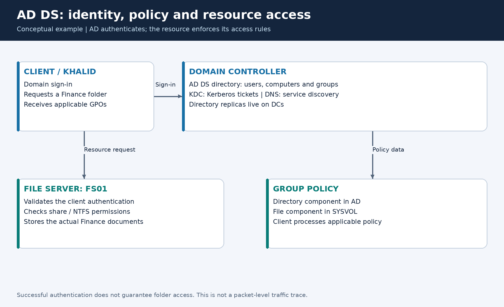

*Naya educational diagram; source ki tafseel IMAGES_AND_SOURCES.md mein hai.*

**Kitab ka topic - pages 2-3.**

### 2.1 AD DS kya hai?

**Active Directory Domain Services Microsoft ki directory service hai jo [domain environment](md/ADDS_Domain_Environment.md) mein [identities](md/ADDS_Identities.md) aur [resources](md/ADDS_Resources.md) ko organize karti hai.**

Directory [objects](md/ADDS_Objects_Attributes_and_Relationships_Roman_Urdu.md) aur un ke [attributes](md/ADDS_Objects_Attributes_and_Relationships_Roman_Urdu.md) ka tarteeb diya hua collection hoti hai. AD DS users, computers aur groups jaisi identities, un ke [relationships](md/ADDS_Objects_Attributes_and_Relationships_Roman_Urdu.md) aur security information store karta hai. Administrators is se access aur resources ko centrally manage karte hain.

**Domain Controller (DC)** woh Windows Server hai jisay AD DS chalane ke liye promote kiya gaya ho. Sirf AD DS role install kar dena promotion ko mukammal nahin karta.

**Misal:** Khalid ka domain account hai. Woh ijazat walay domain computers par sign in kar sakta hai, baghair is ke ke administrator har computer par us ka alag local account banaye.

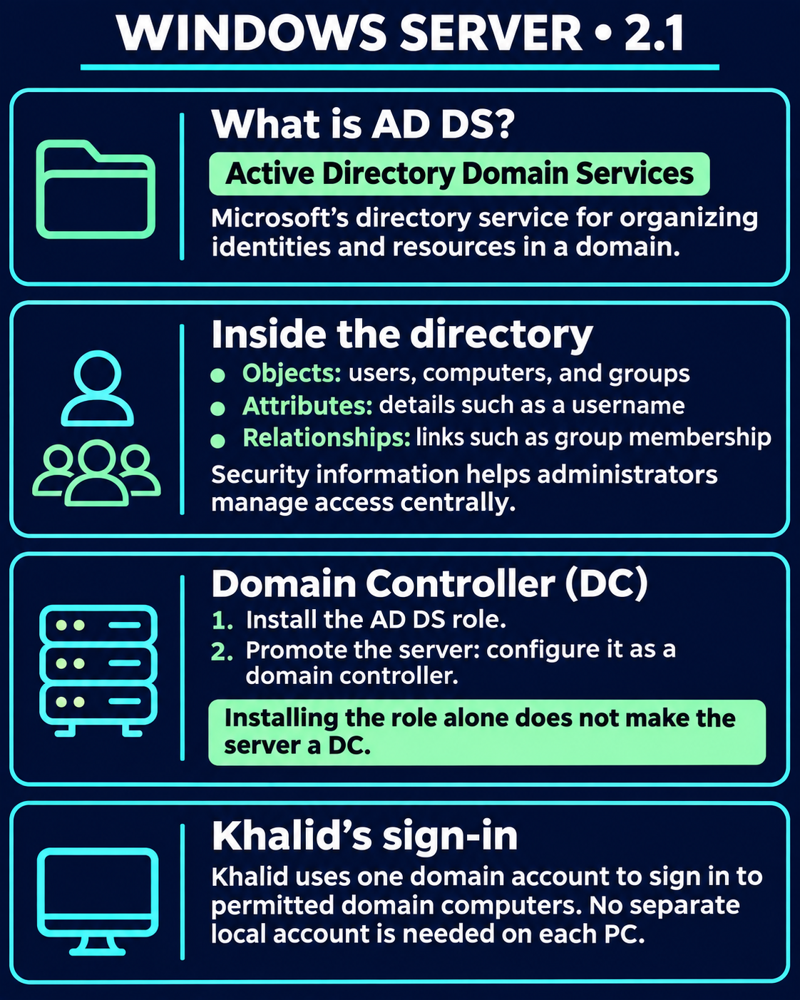

### 2.2 Tareekh aur hierarchy

Lecture mein Active Directory ka ta'aruf **Windows 2000** ke saath bataya gaya hai, jo durust hai. Modern AD DS isi directory platform ki taraqqi yafta surat hai.

AD DS hierarchical hai kyun ke [forest](md/ADDS_Forest.md) mein domains hote hain, aur domains ke andar [OUs](md/ADDS_Forest.md) bana kar users, computers aur groups jaise objects organize kiye ja sakte hain.

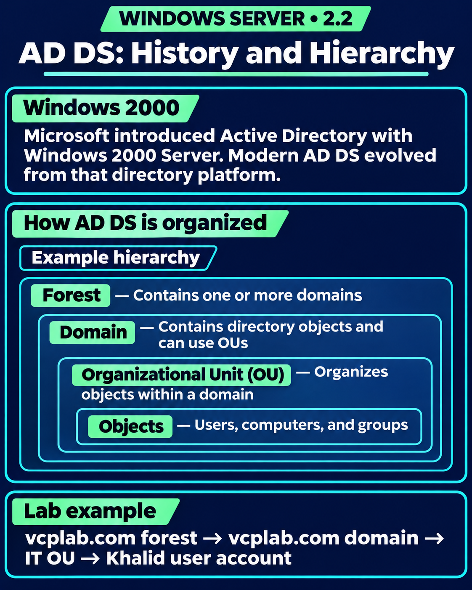

### 2.3 Kitab mein diye gaye tamam functions

| Kitab ka function | Wazahat | Misal ya zaroori shart |
| --- | --- | --- |
| User aur group management | Identities aur group memberships banana/manage karna | Khalid ko Finance access group mein add karna |
| Authentication aur authorization | Pehchan tasdeeq karna aur access decisions ke liye identity/group information dena | DC authenticate karta hai; file server permissions check karta hai |
| Centralized management | Mushtarka tools se bohat se objects manage karna | Active Directory Users and Computers |
| Domain services | Domain identities ki information rakhna aur logon/directory requests handle karna | DC domain authentication handle karta hai |
| Trusts | Domains/forests ke darmiyan authentication ka rasta dena | Trusted domain ke user ko access ke liye consider kiya ja sakta hai |
| Group Policy | GPOs se supported user/computer settings manage karna | Configured inactivity ke baad workstation lock karna |
| DNS integration | DNS records se DCs aur services locate karna | Clients service records query karke DC dhoondte hain |
| Replication | Mutalliq directory changes DCs ke darmiyan copy karna | Naya user doosray replicas par dastiyab ho jata hai |

**Wazahat / durusti - authorization:** AD DS woh component nahin jo seedha har folder kholta hai. Yeh identities aur security information deta hai. Resource server ya application apni permissions aur doosray rules evaluate karti hai. Authentication successful hona access ki guarantee nahin.

**Wazahat / durusti - trusts:** Trust apne aap har resource ki permission nahin deta. Trust ki direction, authentication restrictions aur resource permissions ab bhi aham hain.

**Wazahat / durusti - Group Policy:** GPOs sites, domains aur OUs se link ho sakte hain. Scope, inheritance aur filtering decide karte hain ke kaunsi settings apply hongi. Har GPO har computer par apply nahin hota.

### 2.4 KCC kya karta hai?
KCC = Knowledge Consistency Checker. Yeh AD DS ka built-in component hai jo replication topology banata aur maintain karta hai. Replication topology batati hai ke kaun se Domain Controllers (DCs) ek doosre se directory changes hasil karte hain.

KCC zaroorat ke mutabiq connection objects banata hai. Har connection object destination DC ko batata hai ke woh kis source DC se changes pull karega. Misal ke taur par, agar DC02 ke paas DC01 se inbound replication ka connection hai, to DC02, DC01 se changes pull karta hai. KCC connection banata hai; changes transfer karna AD DS replication ka kaam hai.

Multi-master replication: Bohat se aam directory updates kisi bhi writable DC par kiye ja sakte hain. Misal ke taur par, agar aap DC01 par kisi user ka department change karein, to woh update replication ke zariye doosre DCs tak pohanch sakta hai. RODC (Read-Only Domain Controller) directory ki read-only copy rakhta hai; directory updates us par originate nahin hote.

Replication foran hona zaroori nahin. DNS ya network connectivity ki problems replication mein rukawat daal sakti hain. Alag sites ke darmiyan site-link schedule bhi tay karta hai ke replication kab ho sakti hai.

Replication availability behtar karti hai, lekin backup ka badal nahin hai. Agar koi user account ghalti se delete ho jaye, to woh deletion bhi doosre DCs tak replicate ho sakti hai.

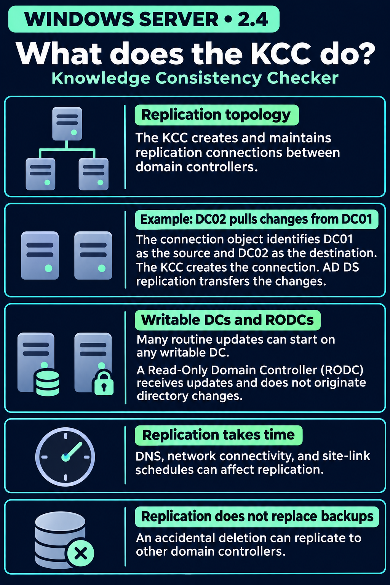

## 3. Database partitions aur paths

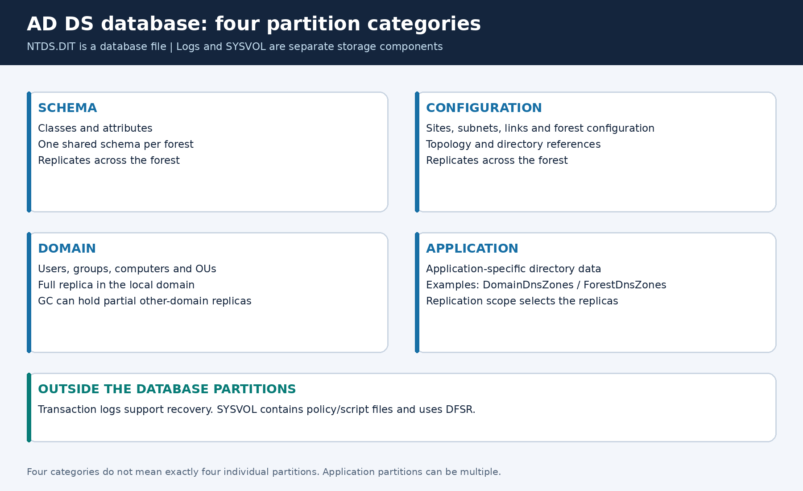

*Naya educational diagram; source ki tafseel IMAGES_AND_SOURCES.md mein hai.*

**Kitab ka topic - pages 4-5.**

### 3.1 NTDS.DIT

AD DS ki database file **NTDS.DIT** hai. Lecture NTDS ko “New Technology Directory Service” aur DIT ko “Directory Information Tree” ke taur par expand karta hai. Isay terminology samjhein; exact filename yaad rakhein.

Database Microsoft ka Extensible Storage Engine (ESE) use karta hai. Is mein directory information aur protected credential-related data hota hai. Yeh security-sensitive hai; aam document ki tarah be-fikri se copy ya edit karne wali file nahin.

### 3.2 Partition ki chaar categories; hamesha sirf chaar partitions nahin

**Directory partition**, jisay naming context bhi kehte hain, directory data ka logical unit hai jiska apna replication scope hota hai.

Lecture chaar categories deta hai:

| Category | Bunyadi contents | Aam replication scope |
| --- | --- | --- |
| Schema | Object classes aur attributes ki definitions | Forest ke tamam DCs |
| Configuration | Forest configuration, sites, subnets, site links aur service/topology information | Forest ke tamam DCs |
| Domain | Kisi khaas domain ke objects | Usi domain ke DCs; neeche Global Catalog ki wazahat dekhein |
| Application | Application-specific directory data, jaise AD-integrated DNS data | Scope ke mutabiq selected/enlisted DC replicas |

**Wazahat / durusti:** Ek DC multiple application partitions host kar sakta hai. Is liye “chaar types” ka matlab nahin ke database mein hamesha exactly chaar individual partitions hon.

### 3.3 Schema partition - directory ke rules

Schema define karta hai:

- Kaunsi object classes ho sakti hain, jaise user ya computer.
- In objects ke kaun se attributes ho sakte hain.
- Required/optional attributes aur mutalliq structural rules.

Lecture isay template kehta hai aur batata hai ke yeh database ko form format mein display karta hai. Behtar explanation yeh hai ke schema allowed structure define karta hai; yeh graphical forms render karne ka feature nahin.

Har forest mein ek mushtarka schema hota hai. Isay controlled conditions mein extend kiya ja sakta hai; har administrator apni marzi se nahin badal sakta. Schema extension poore forest par asar dalti hai.

### 3.4 Configuration partition - forest ki tarteeb

Is mein forest ki directory configuration hoti hai: sites, subnet mappings, site links, server/DC topology objects aur naming contexts ke references.

**Misal:** Chicago clients ke subnet ko Chicago site se map karna AD ko munasib services aur replication arrangement choose karne mein madad deta hai.

### 3.5 Domain partition - domain ke objects

Is mein domain ke users, groups, computer accounts, OUs aur mutalliq objects hote hain.

Lecture kehta hai ke yeh “doosray domains ke saath kabhi replicate nahin hota.” Is mein wazahat zaroori hai:

- Full domain replica aam tor par usi domain ke DCs ko jata hai.
- **Global Catalog (GC)** doosray domains ke domain partitions ke partial, read-only replicas rakh sakta hai: un ke tamam objects, lekin attributes ka selected subset.
- Writable GC apne local domain ka normal full replica bhi rakhta hai.
- Is ka matlab tamam domains ko ek writable domain database mein merge karna nahin.

Domain partition AD data ka ek hissa hai; schema aur configuration information bhi AD database ka hissa hain.

### 3.6 Application partitions

Lecture in ka ta'aruf Windows Server 2003 se batata hai aur DNS jaisi AD-integrated applications mein in ka istemal samjhata hai.

DNS ki aam misalein **DomainDnsZones** aur **ForestDnsZones** hain. Un ke replication scopes mukhtalif hain. Custom application partitions bhi mumkin hain.

Munasib supported procedures se inhen create aur remove kiya ja sakta hai. Partition remove karne se useful application data bhi remove ho sakta hai; yeh routine cleanup nahin.

### 3.7 Default paths aur un ke contents

| Lecture ka item | Aam default location | Matlab |
| --- | --- | --- |
| Database | `C:\Windows\NTDS\ntds.dit` | Directory database |
| AD transaction logs | `C:\Windows\NTDS\` | Database consistency/recovery ke ESE transaction logs |
| SYSVOL | `C:\Windows\SYSVOL\` | Replicated files, jaise policy templates aur scripts |
| ADSI Edit | Management tool, `adsiedit.msc` se khulta hai | Directory objects aur naming contexts view/edit karta hai |

**Wazahat / durusti:** ADSI Edit database file ya installation path nahin. Logs aur SYSVOL, NTDS.DIT ke andar partitions nahin hain.

GPO ke do hissay hote hain:

1. AD mein directory component.
2. SYSVOL mein file component.

Modern SYSVOL replication, DFS Replication (DFSR) use karti hai jo AD database replication se alag hai. Promotion ke waqt paths customize ho sakte hain. Database files ko haath se edit na karein aur ADSI Edit mein tajriban directory changes na karein.

## 4. Kerberos authentication

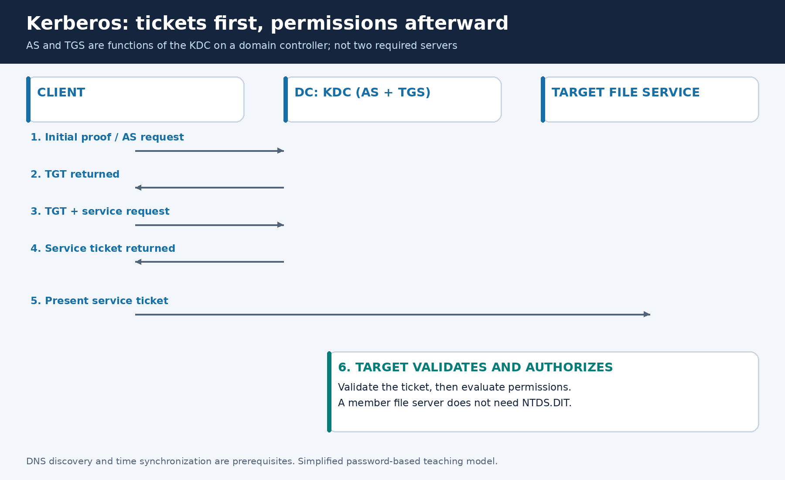

*Naya educational diagram; source ki tafseel IMAGES_AND_SOURCES.md mein hai.*

**Kitab ka topic - pages 6-7.**

### 4.1 Kerberos ka kaam

Kerberos, AD DS ka primary domain authentication mechanism hai. Tickets ki madad se client services ko apni pehchan prove karta hai, baghair har service ko user ka password bheje.

Lecture ke diagram mein Authentication Server, Ticket Granting Server aur “Real Server” diye gaye hain.

**Wazahat / durusti:** AS aur TGS, DC par **Key Distribution Center (KDC)** ke logical functions hain. In ke liye do alag Windows servers lazmi nahin. “Real Server” ko **target/resource/application server** kehna behtar hai.

### 4.2 Durust roles

| Component | Kaam |
| --- | --- |
| Client | User ya doosray principal ki taraf se kaam karta hai |
| DNS | Domain controllers aur services dhoondne mein madad karta hai |
| KDC: Authentication Service (AS) | Shuru ka ticket-granting-ticket exchange handle karta hai |
| KDC: Ticket-Granting Service (TGS) | Khaas services ke tickets issue karta hai |
| Target service | Service ticket receive karke client authenticate karti hai |
| Resource/application authorization | Decide karti hai ke authenticated identity kaun se operations kar sakti hai |

### 4.3 Password-based misal step-by-step

1. Khalid domain client par sign in karta hai.
2. Client DNS aur domain-location information se munasib DC dhoondta hai.
3. Client KDC ke saath AS exchange karta hai. Aam password-based pre-authentication mein credentials se nikli key ka ilm prove karta hai; DC ko plain-text password nahin bhejta.
4. KDC **Ticket-Granting Ticket (TGT)** aur mutalliq client session information issue karta hai.
5. File service tak access ke liye client apna TGT use karke service ticket mangta hai. Request mein **Service Principal Name (SPN)** service ki pehchan karta hai.
6. KDC munasib **service ticket** issue karta hai.
7. Client ticket file service ko pesh karta hai.
8. Service authentication information validate karti hai.
9. File server share/NTFS permissions aur doosray applicable rules evaluate karta hai.
10. Access tabhi successful hota hai jab mutalliq authorization checks ijazat dein.

Yeh beginner model hai; har Kerberos message ki poori technical tafseel nahin. Smart cards, Windows Hello aur doosray mechanisms shuru ka credential exchange badal sakte hain.

### 4.4 TGT aur service ticket ka farq

| Ticket | Kis liye? |
| --- | --- |
| TGT | KDC se service tickets mangne ke liye |
| Service ticket | Kisi khaas service ke samnay authenticate karne ke liye |

Ticket be-hadd permission nahin. Is ki validity, service identity aur authorization context aham hain.

### 4.5 Source diagram ki durusti

Source authentication server aur resource server dono ke neeche NTDS.DIT/domain-partition labels dikhata hai.

Aam member file/application server ko **local NTDS.DIT database ki zaroorat nahin hoti**. Woh service ki key se Kerberos ticket validate kar sakta hai. AD mutalliq domain account information DCs par rakhta hai.

Diagram DNS, AD, switch aur multiple clients bhi dikhata hai. Yeh discovery aur network connectivity ko samjhate hain; DNS aisa gateway nahin jis se baad ka har login packet guzarta ho.

### 4.6 Dependencies aur exceptions

**Mazeed wazahat:**

- Sahi DNS configuration clients ko DCs aur services dhoondne mein madad deti hai.
- Kerberos validation ke liye time munasib had tak synchronized hona chahiye.
- SPNs ko intended service ki sahi pehchan deni chahiye.
- Firewalls ko zaroori protocols allow karne chahiye.
- Kuch Windows scenarios NTLM ya doosray mechanisms use karte hain. Har successful Windows login ko Kerberos use honay ka saboot na samjhein.
- Cached interactive logon, DC unavailable honay par bhi sign-in allow kar sakta hai; is se tamam live domain services ki access sabit nahin hoti.
- Single sign-on baar baar prompts kam karta hai, lekin authorization checks khatam nahin karta.

## 5. Directory objects

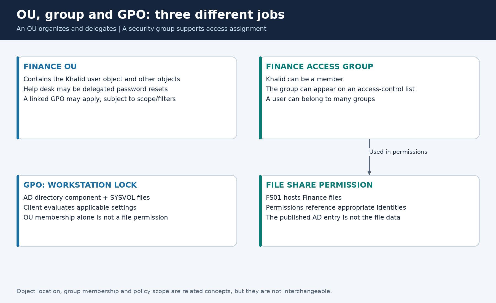

*Naya educational diagram; source ki tafseel IMAGES_AND_SOURCES.md mein hai.*

**Kitab ka topic - pages 8-9.**

**Object** directory ki identifiable entry hai. **Attribute** usay describe karta hai.

User ke example attributes display name, sign-in name aur department ho sakte hain. Object ki directory mein identity aur location hoti hai.

Source mein yeh tamam categories hain:

| Source category | Wazahat aur zaroori farq |
| --- | --- |
| Users | Sign-in aur access control ki user identities |
| Groups | Security permissions ya distribution ke liye collections |
| Computers | Joined machines ke computer accounts; insan users se alag |
| Domain controllers | DC computer accounts aur mutalliq server/NTDS Settings aur doosray directory objects |
| Organizational Units | Domain ke andar organization, GPO scope aur delegation ke containers |
| Shared folders | Published directory entries network shares describe kar sakti hain; asal files storage/file servers par hoti hain |
| Printers | Published print-queue objects printer discovery mein madad karte hain; physical printer AD mein store nahin hota |
| Sites | Network locality ko represent karne walay configuration objects |
| Group Policy | GPO directory objects aur mutalliq SYSVOL content; tamam content NTDS.DIT mein nahin |

### 5.1 OU aur group ka farq

- **OU:** Objects organize karna, administration delegate karna aur linked GPOs ka scope tay karna.
- **Security group:** Permission assignment ke liye identities jama karna.
- User multiple groups ka member ho sakta hai, lekin ek waqt mein ek parent container/OU mein hota hai.
- User ko OU mein move karne se file share ki permission khud-ba-khud nahin milti.
- Users naam ka container lazman OU nahin hota.

### 5.2 AD mein istemal honay walay naam

**Mazeed wazahat:**

| Naam | Misal | Matlab |
| --- | --- | --- |
| UPN | `khalid@ad.example.com` | User Principal Name; sign-in name, mailbox honay ka saboot nahin |
| Down-level logon | `LAB\khalid` | NetBIOS domain name aur account name |
| Distinguished Name | `CN=Khalid,OU=Finance,DC=ad,DC=example,DC=com` | Directory location/naam |
| SID | Domain SID aur object ka RID | Windows access control ki security identity |

DN mein “DC=” ka matlab **domain component** hai, domain-controller server nahin.

## 6. AD DS ke maqasid

**Kitab ka topic - pages 10-11. Tamam nau maqasid cover hain.**

| Maqsad | Matlab | Misal |
| --- | --- | --- |
| Centralized authentication aur authorization support | Mushtarka identities aur group information | Domain sign-in ke baad file-server permission checks |
| User aur resource management | Directory entries aur relationships maintain karna | Job chhorne walay employee ka account disable karna |
| Security aur access control | Identities, permissions aur policies use karna | Finance share ko approved groups tak mehdood rakhna |
| Scalability aur delegation | Directory ko barhana aur mehdood administration taqseem karna | Help desk ko ek OU mein password resets ki ijazat |
| Resources ke liye directory-based service | Directory se information discover karna | Published printer ya application directory entry dhoondna |
| Trust relationships aur federation | Munasib mechanisms se identity environments jorna | Cross-domain authentication ya alag federation service |
| High availability ke liye replication | Directory replicas maintain karna | Outage mein doosra DC munasib requests ka jawab de |
| Cloud aur hybrid support | Additional components se cloud identity/services ke saath integration | Selected identities Microsoft Entra ID se synchronize karna |
| Applications ke liye directory services | Applications ko directory identities/information query ya use karne dena | LDAP-aware business application |

**Wazahat / durusti - federation:** AD DS trusts aur federation ek hi cheez ke do naam nahin. AD FS alag role/service hai. Federation aam tor par identity systems ke darmiyan trust aur tokens/assertions use karti hai.

**Wazahat / durusti - cloud:** Microsoft Entra ID sirf NTDS.DIT ka cloud par hosted writable replica nahin. Hybrid integration ko design aur munasib tools chahiye.

**Wazahat / durusti - delegation:** Sirf task ke liye darkar permissions dein. Finance mein password resets delegate karna Domain Admin rights dene ke barabar nahin.

## 7. Features aur un-ki-hudood

**Kitab ka topic - pages 12-13. Tamam saat features samjhaye gaye hain.**

### 7.1 Group Policy se administration

GPOs supported settings, scripts aur kuch software deployment mechanisms ko centralize karte hain. Windows Installer package deployment ek misal hai; GPO har application-management system ka universal replacement nahin.

Computer/user clients applicable policy process karte hain. GPO ki location, filters aur precedence result par asar dalte hain.

### 7.2 DC ya domain ka naam badalna

Lecture dono ko mumkin features mein shamil karta hai. Yeh alag operations hain jinki prerequisites aur application limitations mukhtalif hain.

Dependencies check kiye baghair DC rename ko aam standalone PC rename jaisa na samjhein. Domain rename ek specialized project hai; environment ki applications isay support na bhi karti hon. Plan aur validate karein; isay routine naam ki safai na samjhein.

### 7.3 Kerberos ke saath integrated security

Kerberos domain authentication aur single sign-on support karta hai. Permissions, secure configuration aur doosray controls ab bhi chahiye; Kerberos ki mojoodgi poora environment khud-ba-khud secure nahin banati.

### 7.4 AD DS install ya uninstall karna

Server ko promote karne se DC banta hai; supported demotion us ki DC wali haisiyat remove karti hai. Demotion planning mein DNS, replication, role holders aur baqi DCs ka hona shamil hai.

Aakhri DC remove karne se domain bhi remove ho sakta hai. DC VM delete karna supported demotion ke barabar nahin.

### 7.5 Cross-forest trust

Prerequisites aur policy ki ijazat ho to forest trust forests ke darmiyan authentication ka rasta de sakta hai. Trust merger, database replication relationship ya khud-ba-khud file permission nahin.

### 7.6 Site-to-site replication

Lecture site-to-site replication ko faster kehta hai.

**Wazahat / durusti:** Intersite replication link cost, schedule aur bandwidth ko madde nazar rakh kar design hoti hai; yeh fitratan intrasite replication se tez nahin. Achhi connectivity wali site ke andar change notification aam tor par jaldi convergence mein madad karti hai. Asal timing configuration aur connectivity par depend karti hai.

### 7.7 Extensible schema

Nayi classes aur attributes applications ki zarooriyat support kar sakti hain.

**Wazahat / durusti:** Schema extensions forest-wide changes hain. Schema class/attribute definitions aam objects nahin jinhen baad mein azadi se delete kar dein. Supported definitions ko kuch halaat mein restrictions ke saath defunct mark kiya ja sakta hai. Test karein, permissions aur backups plan karein aur supported application/vendor procedures use karein.

## 8. Logical aur physical structure

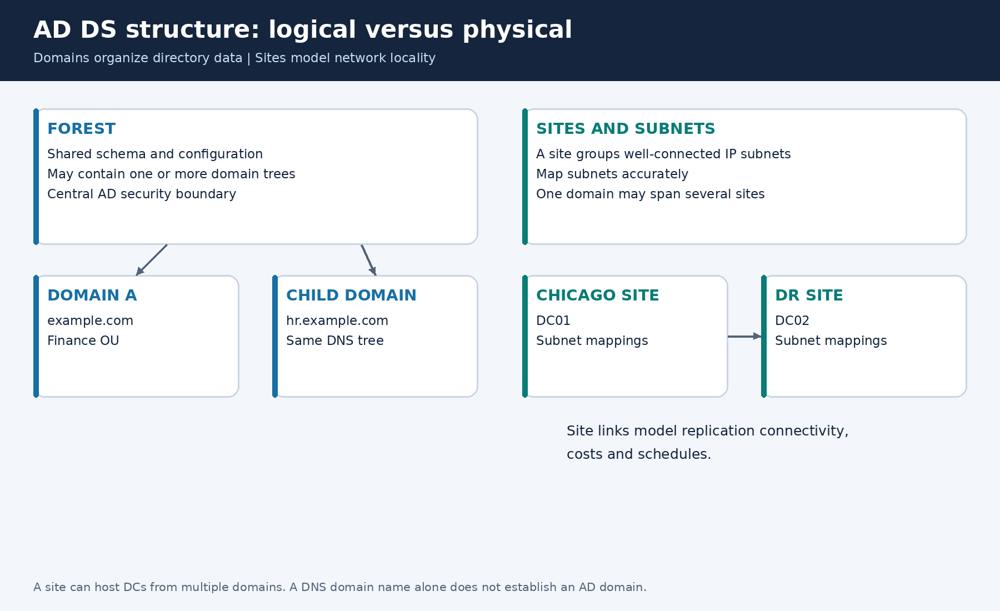

*Naya educational diagram; source ki tafseel IMAGES_AND_SOURCES.md mein hai.*

**Kitab ka topic - pages 14-15.**

### 8.1 Logical components

| Component | Matlab | Misal |
| --- | --- | --- |
| Domain | Forest mein directory partition aur administrative/replication unit | `ad.example.com` |
| Tree | Ek ya zyada domains jinka DNS namespace contiguous ho | `example.com` aur `hr.example.com` |
| Forest | Ek ya zyada domains jo schema, configuration aur forest-wide relationships share karte hain | Forest mein multiple trees ho sakte hain |
| OU | Domain ke andar organization/delegation/GPO container | Finance OU |

Forest mein sirf ek domain bhi ho sakta hai. Ek forest ke mukhtalif trees alag DNS namespaces use kar sakte hain.

**Mazeed wazahat:** Forest AD ki bunyadi security boundary hai. Domain administrative/replication boundary hai, lekin usi forest ke doosray hissay mein bohat privileged administrators se mukammal security isolation nahin.

### 8.2 DNS namespace

Namespace naamon ko hierarchy mein organize karta hai. `dc01.ad.example.com` mein:

- `com` top-level domain hai.
- `example.com` domain hai.
- `ad.example.com` subdomain hai.
- Is misal mein `dc01` host label hai.

Sirf DNS domain name hona AD domain ke wajood ka saboot nahin. DNS aur AD mutalliq lekin mukhtalif systems hain.

### 8.3 Physical components

| Component | Matlab |
| --- | --- |
| Site | IP subnets ka group jinhen AD locality/topology ke liye achhi connectivity wala samjha jata hai |
| Subnet | Network prefix jo site se map ho |
| Site link | Replication connectivity/cost/schedule model karne wala logical relationship |
| DC | Directory replicas aur domain services host karne wala server |

Site aksar location se milti hai, lekin sirf shehar ka label nahin. Sahi subnet mapping aham hai. Ek domain multiple sites mein phail sakta hai; ek site mein multiple domains ke DCs ho sakte hain.

**Mazeed wazahat:** Logical structure ka sawal hai “Identities kis tarah organize hain?” Physical structure ka sawal hai “Services aur network connections kahan hain?”

## 9. Tamam paanch FSMO roles

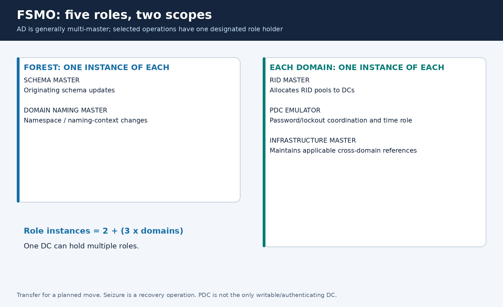

*Naya educational diagram; source ki tafseel IMAGES_AND_SOURCES.md mein hai.*

**Kitab ka topic - pages 16-18.**

**FSMO = Flexible Single Master Operations.**

AD DS aam tor par multi-master hai, lekin conflicts se bachne ke liye kuch khaas operations ek designated role holder karta hai. Ek DC multiple FSMO roles rakh sakta hai.

| Scope | Role | Bunyadi zimmedari |
| --- | --- | --- |
| Forest | Schema Master | Forest schema ki originating changes |
| Forest | Domain Naming Master | Domain/naming-context namespace changes control karna |
| Domain | RID Master | DCs ko RID pools allocate karna |
| Domain | PDC Emulator | Password/lockout coordination, time hierarchy aur preferred administrative functions |
| Domain | Infrastructure Master | Jahan applicable ho cross-domain object references maintain karna |

Har forest ke do roles aur har domain ke teen roles ka matlab **2 + (3 x domains ki tadaad)** role instances hai. Teen-domain forest mein 11 instances honge; lazman 11 alag servers nahin.

### 9.1 Schema Master

Har forest mein ek. Schema updates is ke DC par originate hote hain aur phir replicate hote hain.

Source schema classes/attributes delete karna bhi likhta hai. Yeh misleading hai: classSchema/attributeSchema definitions ki normal deletion allowed nahin. Definitions add/modify karna aur supported defunct handling alag operations hain.

### 9.2 Domain Naming Master

Har forest mein ek. Domains aur application naming contexts add/remove karne jaisi changes coordinate karta hai aur namespace references consistent rakhta hai.

Lecture domain rename ka zikr karta hai. Role ka available hona kisi supported rename workflow ka sirf ek hissa hai; role akela rename ko safe ya supported nahin banata.

### 9.3 RID Master

Har domain mein ek. Writable DCs ko Relative Identifiers ke pools allocate karta hai. Security principals create karte waqt DC apne available pool se RID use karta hai.

**SID ka concept:** Domain SID + RID se principal ki domain SID identity banti hai.

RID Master ko har user-creation request ke liye khud naya RID dena zaroori nahin. Agar yeh unavailable ho to DCs apne usable pools baqi rehne tak principals create karte reh sakte hain.

### 9.4 PDC Emulator

Har domain mein ek. Is ke mutalliq functions mein shamil hain:

- Password updates preferential taur par receive karna.
- Jab doosray DC ke paas purani information ho sakti ho to failed-password authentication attempts resolve karne mein madad.
- Account-lockout processing.
- Windows domain time synchronization mein khaas jagah.
- Group Policy management jaisay tools ke liye preferred administrative target.
- Windows NT ke PDC expectations ke saath historical compatibility.

**Wazahat / durusti:**

- Doosray writable DCs bhi aam password changes accept kar sakte hain.
- PDC akela users authenticate karne wala DC nahin.
- Clients Group Policy process karte hain; PDC khud har client ki settings apply nahin karta.
- Forest-root PDC normal domain time hierarchy ke top par hota hai; is ke liye munasib reliable upstream time source configure karein. Har machine ko seedha usi se query karna zaroori nahin.
- NT 4.0 compatibility tareekh samjhati hai; obsolete clients deploy karne ki recommendation nahin.

### 9.5 Infrastructure Master

Har domain mein ek. Doosray domains ke objects ke references maintain karta hai, jaise changes ke baad cross-domain group membership references.

Is ka practical workload forest design, GC placement aur AD Recycle Bin jaisay features par depend karta hai. Yeh tamam objects replicate karne ya har user ke attributes update karne wala role nahin.

### 9.6 Transfer aur seizure ka farq

Lecture ntdsutil aur GUI tools ka zikr karta hai.

| Operation | Munasib surat |
| --- | --- |
| Transfer | Mojooda role holder available ho; planned move |
| Seizure | Zaroori recovery situation mein role holder recover na ho sake; recovery procedure |

Har role ke GUI tools alag hain: domain roles ke liye AD Users and Computers, Domain Naming Master ke liye AD Domains and Trusts aur Schema Master ke liye Schema snap-in. PowerShell aur ntdsutil bhi supported tools hain.

Seizure chhoti outage ka routine failover nahin. Purana role holder wapas lane se pehle recovery guidance follow karein. Is document mein jaan-boojh kar role-seizure command nahin di gayi.

Role unavailable honay se lazman foran tamam logins band nahin hote. Asar role, cached/pool information, topology aur outage ke duration par depend karta hai.

## 10. Schema versions

**Kitab ka topic - pages 19-20.**

Page 20 ki heading FSMO roles hai, lekin andar schema versions ki maloomat hai.

Schema version, schema naming context ke **objectVersion** attribute mein record hota hai. Yeh schema level batata hai, har DC ka OS nahin.

### 10.1 Source ki poori table, saaf tarteeb mein

| Source mein Windows Server release | Schema objectVersion |
| --- | --- |
| Windows Server 2025 | 91 |
| Windows Server 2022 | 88 |
| Windows Server 2019 | 88 |
| Windows Server 2016 | 87 |
| Windows Server 2012 R2 | 69 |
| Windows Server 2012 | 56 |
| Windows Server 2008 R2 | 47 |
| Windows Server 2008 RTM | 44 |
| Windows Server 2003 R2 | 31 |
| Windows Server 2003 RTM, SP1 aur SP2 | 30 |
| Windows 2000 Server | 13 |

Yeh historical mappings hain; unsupported versions deploy karne ki recommendation nahin.

### 10.2 Version ke teen alag concepts

| Concept | Kya batata hai? |
| --- | --- |
| DC operating-system version | Kisi khaas DC par installed Windows release |
| Schema version | Forest-wide class/attribute schema level |
| Domain/forest functional level | AD capabilities aur allowed DC OS combinations |

Jahan compatibility rules ijazat dein, naya schema puranay supported DCs ke saath coexist kar sakta hai. “Schema 91” ka matlab nahin ke har DC Windows Server 2025 hai.

Windows Server 2019 aur 2022 ka newest functional level Windows Server 2016 hai. Windows Server 2025, 2025 functional level introduce karta hai. Level actual DC compatibility matrix se choose karein, schema table se nahin.

## 11. Installation ki zarooriyat

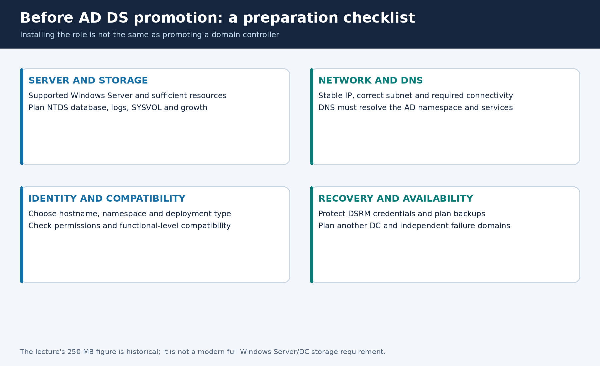

*Naya educational diagram; source ki tafseel IMAGES_AND_SOURCES.md mein hai.*

**Kitab ka topic - pages 21-22. Har listed prerequisite cover hai.**

| Source prerequisite | Wazahat |
| --- | --- |
| Windows Server OS | DC role ke liye supported Windows Server release use karein |
| Administrator rights | Credentials ki zaroorat new forest, new domain ya additional DC par depend karti hai |
| Static IP, misal 192.168.0.111/24 | Stable addressing aur sahi network configuration dein |
| Unique domain name | Munasib DNS namespace plan karein aur naming conflicts se bachein |
| DNS server | AD ki name/service discovery ensure karein; DNS promotion ke dauran install ho sakta hai |
| DSRM password | Protected Directory Services Restore Mode recovery password set karein |
| Forest functional level | Tamam relevant DCs aur design ke saath compatible level choose karein |
| Domain functional level | Compatible domain capability level choose karein |
| 250 MB minimum: 200 MB database + 50 MB logs | Purana figure; modern Windows Server DC ka valid total size nahin |

### 11.1 OS aur hardware sizing

**Wazahat / durusti:** 250 MB modern server installation ya realistic DC ke liye kaafi nahin. OS, updates, paging, directory database, transaction logs, SYSVOL, monitoring aur growth ka hisaab rakhein. Current Windows Server documentation mein OS storage minimum gigabytes mein hai; minimum installation requirements production recommendations nahin.

Exact OS aur deployment option ki current requirements use karein. Chhotay learning host par modest isolated lab se shuru karein aur host ki capacity se zyada VMs na chalayein. Ek universal CPU/RAM/disk allocation har AD deployment ke liye theek nahin.

### 11.2 Permissions

Naya forest banane ke liye munasib local administrative credentials chahiye. Domain ya DC add karne ki domain/forest permissions alag hain; schema preparation ke liye mazeed privileges chahiye ho sakte hain.

Local Administrator, Domain Admin aur Enterprise Admin ko ek na samjhein. In ka scope alag hai.

### 11.3 Addressing

Source ka address `192.168.0.111/24` IP `192.168.0.111` aur subnet mask `255.255.255.0` ko zahir karta hai.

Yeh misal hai, apne network par lazman yahi address lagane ki instruction nahin. IP, prefix, jahan darkar ho gateway, DNS settings aur subnet reachability plan karein.

### 11.4 DNS aur naming

Clients aur DCs ko aisi DNS services use karni chahiye jo AD namespace aur service records resolve kar saken. Sirf public DNS aam tor par private AD records resolve nahin kar sakta. Munasib forwarding se external resolution di ja sakti hai.

Naye lab ke liye apne control ka namespace use karein; documentation mein munasib reserved example namespace use karein. Learner ke puranay lab mein VCPLAB.com tha; yeh note us public domain ki ownership establish nahin karta.

### 11.5 DSRM

Directory Services Restore Mode, AD DS maintenance/recovery ka recovery mode hai. Is ka password normal domain-account use se alag hai. Isay mehfooz record karein; public repo ya command history mein passwords na rakhein.

### 11.6 Functional levels

DC compatibility aur required features ki bunyaad par choose karein. Domain functional level, forest functional level se neeche nahin ho sakta.

Existing domain mein Windows Server 2025 DCs ke liye Microsoft kam az kam Windows Server 2016 functional level requirement document karta hai. 2025 level tak raise karne ke liye affected scope ke tamam DCs compatible hon. Andaza lagane ke bajaye plan aur verify karein.

### 11.7 Mazeed preparation checklist

**Mazeed wazahat:**

1. Server identity, hostname aur intended role confirm karein.
2. Network, DNS aur time verify karein.
3. Plan karein ke naya forest, child domain ya additional DC banana hai.
4. Supported volumes par database/log/SYSVOL storage plan karein.
5. Updates aur required security configuration apply karein.
6. Zaroori role rules ke saath firewall protection enabled rakhein.
7. Availability zaroori ho to doosra DC aur independent failure domains plan karein.
8. Supported system-state/forest recovery backups plan karein aur recovery test karein.
9. Lab ko existing production domain se isolated rakhein.
10. Promotion se pehle aur baad configuration evidence capture karein.

Lecture prerequisites deta hai, mukammal installation walkthrough nahin. In notes ko promotion already complete honay ka saboot na samjhein.

## 12. Tamam concepts ki mushtarka misal

**Mazeed wazahat - farzi misal; completed environment nahin.**

Organization `ad.example.com`, DC01 aur DC02, Finance OU, Khalid ka user account aur file server FS01 use karti hai.

| Step | Zimmedar component |
| --- | --- |
| Client DC dhoondta hai | DNS aur domain discovery |
| Khalid pehchan prove karke tickets leta hai | Client aur DC ka KDC |
| Khalid Finance files mangta hai | Client aur FS01 |
| Access permission evaluate hoti hai | FS01 identities/groups aur access rules se |
| Help desk Finance password reset karti hai | Mutalliq objects par delegated permissions |
| Password/user changes phailte hain | AD replication |
| Desktop lock setting apply hoti hai | Client Group Policy processing |
| Policy files replicate hoti hain | SYSVOL/DFSR |
| Forest schema update authorize/perform hota hai | Munasib permissions aur Schema Master |

DC01 fail ho to DNS, replication aur connectivity healthy honay ki surat mein DC02 munasib domain services de sakta hai. FS01 apni files ka zimmedar rehta hai. Sirf doosra DC add karna FS01 ki failure ka hal nahin.

## 13. Mustaqbil ke lab ke liye read-only checks

**Mazeed wazahat:** Yeh AD DS install nahin karte. Sirf munasib AD environment mein available tools aur read permissions ke saath chalayein. Neeche kisi output ko aap ke servers se observed claim nahin kiya gaya.

### 13.1 Useful consoles

| Tool | Maqsad |
| --- | --- |
| `dsa.msc` | AD Users and Computers |
| `dssite.msc` | AD Sites and Services |
| `domain.msc` | AD Domains and Trusts |
| `gpmc.msc` | Group Policy Management |
| `adsiedit.msc` | Advanced directory inspection; be-fikri se edit na karein |
| DNS Manager | DNS zones aur records |

### 13.2 Domain forest aur DCs inspect karein

~~~powershell
Import-Module ActiveDirectory

Get-ADDomain |
    Select-Object DNSRoot, DomainMode, PDCEmulator, RIDMaster, InfrastructureMaster

Get-ADForest |
    Select-Object RootDomain, ForestMode, SchemaMaster, DomainNamingMaster

Get-ADDomainController -Filter * |
    Select-Object HostName, Site, IsGlobalCatalog, IsReadOnly
~~~

### 13.3 Schema version inspect karein

~~~powershell
$rootDse = Get-ADRootDSE
Get-ADObject -Identity $rootDse.schemaNamingContext -Properties objectVersion |
    Select-Object DistinguishedName, objectVersion
~~~

Yeh schema metadata read karta hai. Schema extend nahin karta.

### 13.4 Role holders aur replication inspect karein

~~~powershell
netdom query fsmo
repadmin /replsummary
repadmin /showrepl
~~~

netdom/repadmin ki availability installed management tools par depend karti hai. Failures ko topology, DNS aur events ke saath review karein; foran changes force na karein.

### 13.5 Mojooda Kerberos tickets dekhein

~~~powershell
klist
~~~

Output session-specific hai. Tickets nazar aana is par depend karta hai ke aap ne kaise sign in kiya aur kaunsi services access ki hain. Tickets, secrets ya ghair-zaroori identity details publish na karein.

## 14. Corrections ka register

| Source ke alfaaz ya diagram | Durust samajh |
| --- | --- |
| KCC replication service hai | KCC topology banata/maintain karta hai; AD replication directory changes transfer karti hai |
| Chaar partitions | Chaar categories; asal partition count chaar se zyada ho sakta hai |
| Schema database ko forms mein display karta hai | Schema object/attribute structure define karta hai |
| Domain data kabhi domains cross nahin karta | Full domain replication domain-scoped hai; GC doosray domains ke partial replicas rakhta hai |
| Resource server par NTDS.DIT hai | Aam member resource servers ko is ki zaroorat nahin |
| AS aur TGS alag servers hain | Logical KDC functions; alag machines lazmi nahin |
| AD har resource ka access decide karta hai | Resource/application checks identity information se permissions enforce karte hain |
| Site-to-site replication tez hai | Lazman nahin; cost, schedules aur bandwidth intersite replication par asar dalte hain |
| Schema Master definitions delete karta hai | Normal schema-definition deletion allowed nahin; supported defunct handling alag hai |
| PDC password-change master hai | Doosray writable DCs changes accept karte hain; PDC ki khaas coordination zimmedariyan hain |
| PDC tamam GPO updates process karta hai | Clients policy process karte hain; PDC preferred administrative target hai |
| Schema version server OS ke barabar hai | Schema, OS version aur functional levels alag hain |
| 250 MB installation ke liye kaafi hai | Purani sizing; modern full DC/OS requirement nahin |
| ADSI Edit paths ke saath diya hai | Management tool hai, database path nahin |

Yeh corrections lecture ke topics barqarar rakhti hain aur technical precision behtar karti hain.

## 15. Revision sawalat aur jawab

**1. AD DS kya hai?**  
Directory service jo identities/resources organize karti aur domain authentication aur administration support karti hai.

**2. DC kya hai?**  
Aisa server jo AD DS host karne aur domain services dene ke liye promote hua ho.

**3. Kya sirf role install karna kaafi hai?**  
Nahin. Promotion/configuration bhi complete honi chahiye.

**4. Active Directory kab introduce hua?**  
Windows 2000 ke saath.

**5. KCC kya karta hai?**  
Replication topology banata aur maintain karta hai.

**6. Directory database kahan hai?**  
Default taur par `C:\Windows\NTDS\ntds.dit` mein.

**7. Partition ki chaar categories kya hain?**  
Schema, configuration, domain aur application.

**8. Kya iska matlab exactly chaar partitions hain?**  
Nahin. Multiple application partitions aur GC replicas ki wajah se actual count zyada pecheeda ho sakta hai.

**9. Schema kya define karta hai?**  
Allowed object classes, attributes aur mutalliq structural rules.

**10. Configuration mein kya hota hai?**  
Forest-wide configuration, jis mein sites, subnets aur replication topology information shamil hai.

**11. GC kya add karta hai?**  
Forest-wide lookup aur mutalliq functions ke liye doosray domains ke domain objects ke partial replicas.

**12. Kya SYSVOL, NTDS.DIT ke andar hai?**  
Nahin. Yeh replicated filesystem content hai.

**13. Kya AS aur TGS lazman alag servers hain?**  
Nahin. DCs par KDC ke functions hain.

**14. Kya file server aam tor par NTDS.DIT rakhta hai?**  
Nahin. Member file server DC nahin hota.

**15. Kya Kerberos ticket har permission deta hai?**  
Nahin. Service ab bhi operations authorize karti hai.

**16. OU aur group mein kya farq hai?**  
OU organization/delegation/policy scope support karta hai; security groups permission assignment support karte hain.

**17. Kya published share object mein asal documents hote hain?**  
Nahin. Files file server/storage par rehti hain.

**18. Kya trust khud-ba-khud access deta hai?**  
Nahin. Authentication paths aur resource permissions alag hain.

**19. Kya AD FS aur AD DS ek hain?**  
Nahin. Federation alag service/concept hai.

**20. Ek-domain forest mein kitne FSMO roles hain?**  
Paanch instances: do forest-wide aur teen domain-wide.

**21. RID Master kya allocate karta hai?**  
RID pools jo DCs security principals banate waqt use karte hain.

**22. Kya PDC akela writable DC hai?**  
Nahin. Aam writable DCs multi-master updates support karte hain.

**23. Planned move ke liye transfer ya seizure?**  
Mojooda role holder available ho to transfer.

**24. 2019/2022 aur 2025 ke schema versions kya hain?**  
Bil-tarteeb 88 aur 91.

**25. Kya schema 91 sabit karta hai ke tamam DCs 2025 hain?**  
Nahin. DC OS aur functional-level compatibility alag check karein.

**26. Kya 250 MB modern DC disk allocation hai?**  
Nahin. OS aur tamam workload/storage requirements plan karein.

**27. DSRM kis liye hai?**  
Directory-services recovery/maintenance scenarios ke liye.

**28. DNS kyun aham hai?**  
Clients ko munasib DNS records se DCs aur services locate karni hoti hain.

**29. Kya replication backup hai?**  
Nahin. Na-pasandeeda changes bhi replicate ho sakte hain.

**30. Do DCs kyun rakhein?**  
Ek server par dependency kam karne ke liye, bashart-e-ke DNS, replication, connectivity aur failure-domain design bhi kaam karein.

## 16. Istilahaat ki fehrist

| Term | Matlab |
| --- | --- |
| AD DS | Active Directory Domain Services |
| DC | Domain Controller; DN mein DC ka matlab domain component hai |
| NTDS.DIT | AD directory database file |
| ESE | Extensible Storage Engine |
| Naming context | Directory partition |
| KCC | Knowledge Consistency Checker |
| KDC | Key Distribution Center |
| AS | Authentication Service |
| TGS | Ticket-Granting Service |
| TGT | Ticket-Granting Ticket |
| SPN | Service Principal Name |
| GC | Global Catalog |
| OU | Organizational Unit |
| GPO | Group Policy Object |
| SYSVOL | Policy/script files wali shared replicated directory |
| DFSR | Distributed File System Replication |
| FSMO | Flexible Single Master Operations |
| RID | Relative Identifier |
| SID | Security Identifier |
| PDC Emulator | Primary Domain Controller Emulator role |
| DSRM | Directory Services Restore Mode |
| UPN | User Principal Name |
| LDAP | Lightweight Directory Access Protocol; database ka filename nahin |
| AD FS | Active Directory Federation Services |
| RODC | Read-Only Domain Controller |

## 17. References

Uploaded lecture, coverage aur topics ki tarteeb ka primary source hai. Neeche Microsoft references additional explanations aur corrections support karte hain. English version ki tayyari ke waqt documentation check ki gayi thi; deployment se pehle current requirements dekhein.

1. [AD replication concepts](https://learn.microsoft.com/en-us/windows-server/identity/ad-ds/get-started/replication/active-directory-replication-concepts) - KCC, sites aur GC.
2. [Naming contexts and directory partitions](https://learn.microsoft.com/en-us/windows/win32/ad/naming-contexts-and-partitions) - partition concepts.
3. [Kerberos authentication overview](https://learn.microsoft.com/en-au/windows-server/security/kerberos/kerberos-authentication-overview) - KDC aur tickets.
4. [Kerberos protocol exchanges](https://learn.microsoft.com/en-us/openspecs/windows_protocols/ms-kile/b4af186e-b2ff-43f9-b18e-eedb366abf13) - AS/TGS/application exchanges.
5. [FSMO roles](https://learn.microsoft.com/en-us/windows-server/identity/ad-ds/manage/understand-fsmo-roles) - roles ka scope aur zimmedariyan.
6. [FSMO details and qualifications](https://learn.microsoft.com/en-us/troubleshoot/windows-server/active-directory/fsmo-roles) - cross-domain references aur role behaviour.
7. [Active Directory schema specification](https://learn.microsoft.com/en-us/openspecs/windows_protocols/ms-adts/5859bab0-f545-4db6-80c6-9798b484b3d8) - schema objects aur defunct handling.
8. [Find schema version](https://learn.microsoft.com/en-us/windows-server/identity/ad-ds/deploy/find-active-directory-schema) - objectVersion mappings.
9. [Install AD DS](https://learn.microsoft.com/en-us/windows-server/identity/ad-ds/deploy/install-active-directory-domain-services--level-100-) - deployment options aur prerequisites.
10. [AD DS functional levels](https://learn.microsoft.com/windows-server/identity/ad-ds/active-directory-functional-levels) - DC/version compatibility.
11. [Raise functional levels](https://learn.microsoft.com/en-us/windows-server/identity/ad-ds/plan/raise-domain-forest-functional-levels) - preparation aur compatibility.
12. [Windows Server hardware requirements](https://learn.microsoft.com/en-us/windows-server/get-started/hardware-requirements) - modern OS sizing ki maloomat.

## Appendix - Original lecture visuals

Yeh di hui lecture PDF ke pages ke high-resolution renders hain; naye Microsoft screenshots nahin. Source ki ghaltiyan bhi barqarar hain, jin ki corrections register mein di gayi hain, khaas taur par pages 7, 13, 17, 18 aur 22.

### PDF page 3 - ADDS Foundations

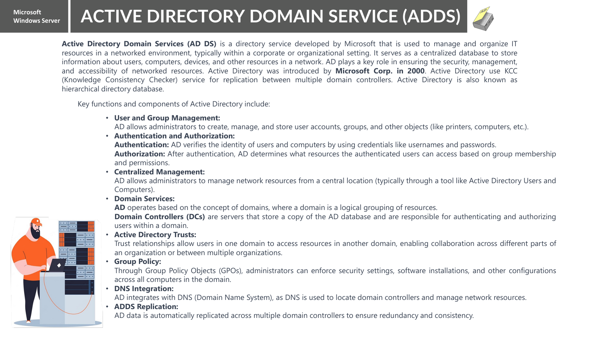

### PDF page 5 - Database and Partitions

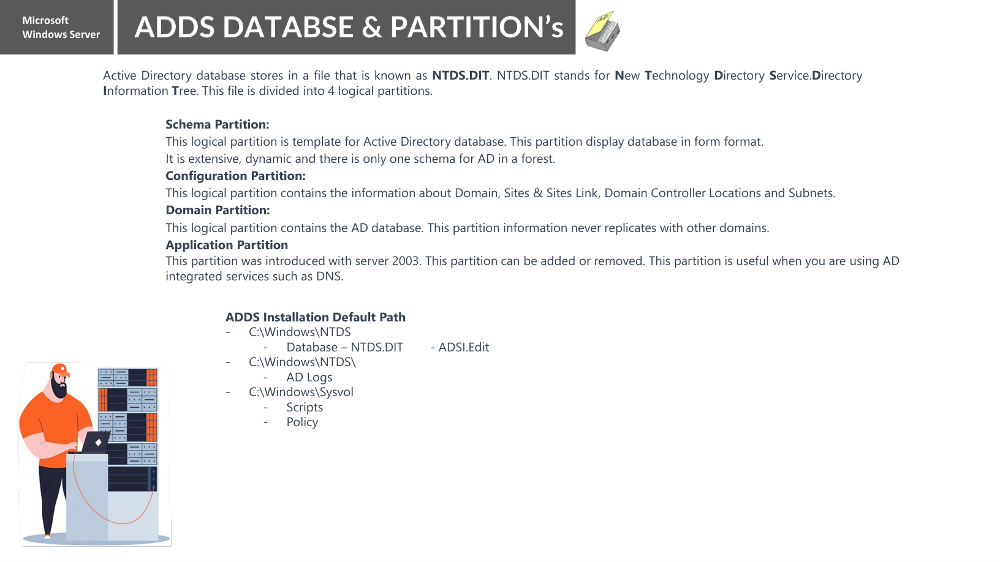

### PDF page 7 - Authentication

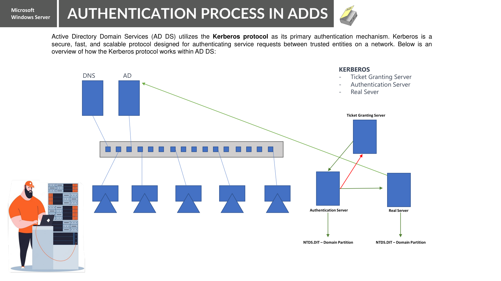

### PDF page 9 - Objects

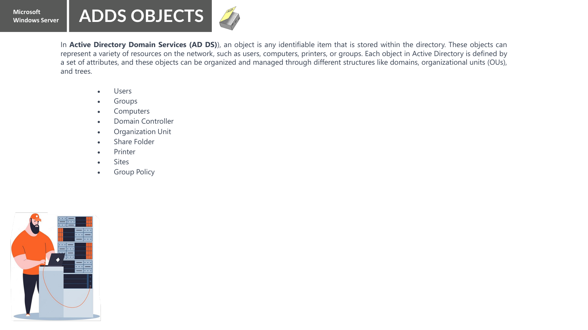

### PDF page 11 - Purposes

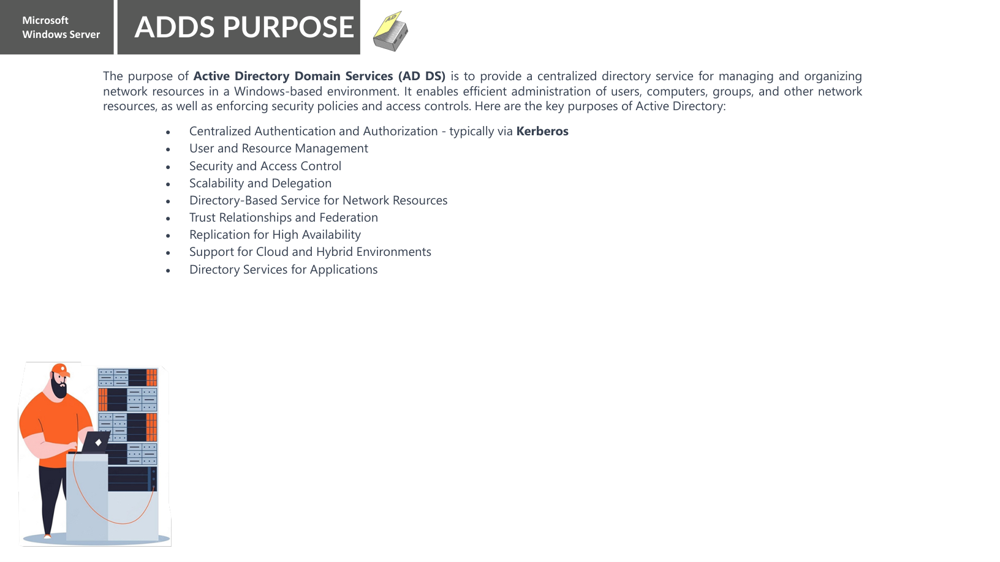

### PDF page 13 - Features

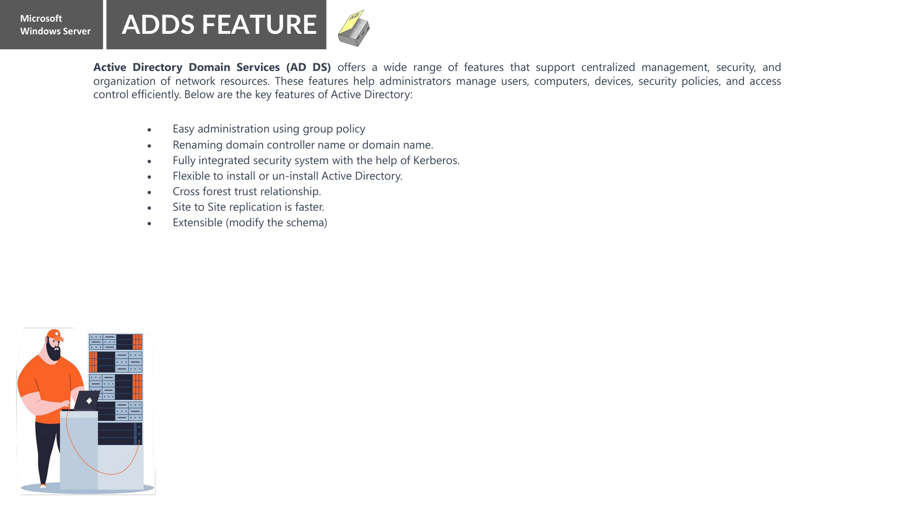

### PDF page 15 - Structure

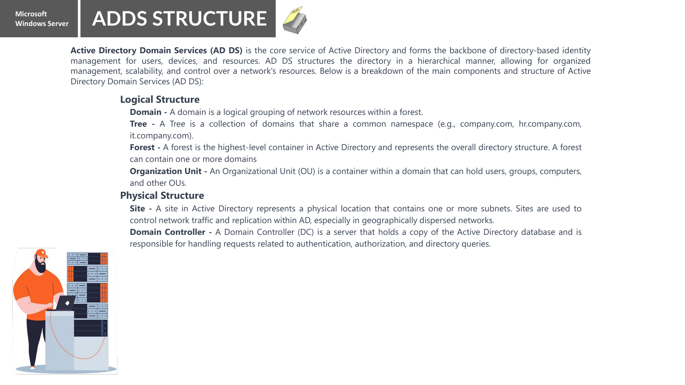

### PDF page 17 - FSMO Forest

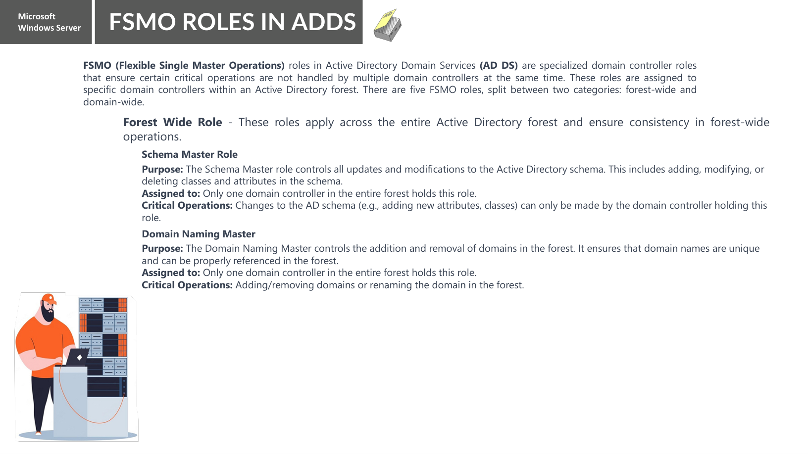

### PDF page 18 - FSMO Domain

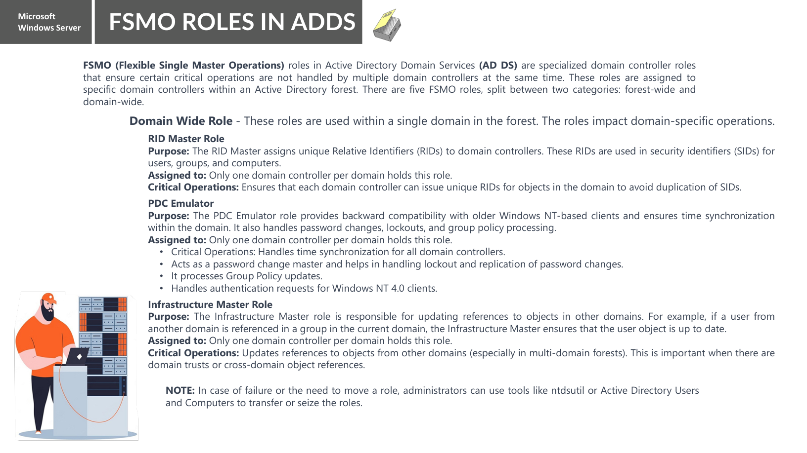

### PDF page 20 - Schema Versions

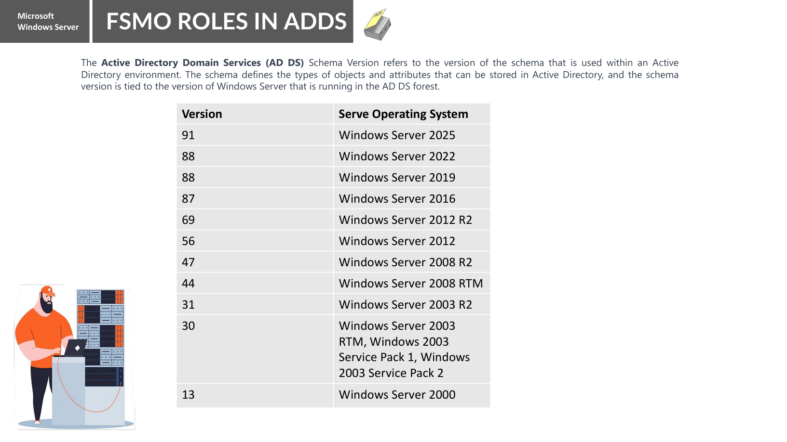

### PDF page 22 - Installation Requirements

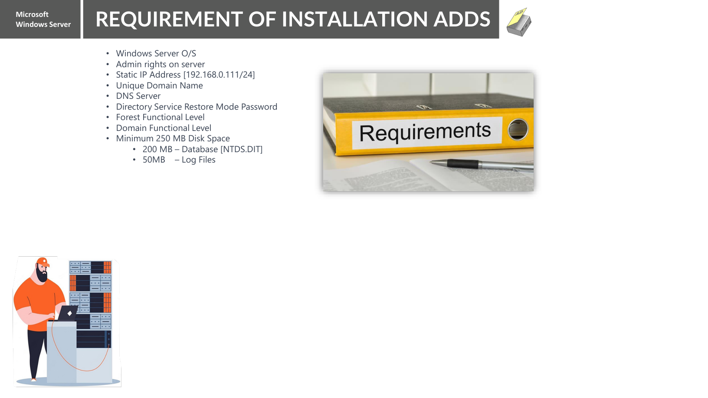

[Image provenance / Tasaveer ki tafseel](IMAGES_AND_SOURCES.md) | [README](README.md)
