# DNS01 — Primary DNS Server Configuration

## Bunyadi tasawwur

Primary DNS zone records ki writable aur authoritative asal copy hai. Is ka maqsad names resolve karna aur secondary server ko asal data dena hai. Is lab mein DNS01 par forward aur reverse zone, A, PTR aur CNAME records maintain huay aur DNS02 ne zone transfer se copies leen.


Step-by-step lab record • 21 October 2026

Is bundle mein primary zone, reverse zone, A/PTR, CNAME aur verification hain. DNS02 secondary aur DNS03 stub ki configuration alag chapters mein recorded hai.

## Is configuration ko samjhein

In **standard file-backed zones** mein primary records edit karne ki jagah hai. `dns02.vcplab.com` forward zone ka A record hai; address se naam ki mapping alag reverse zone mein PTR hai. `dns.vcplab.com` jaisa CNAME alias asal naam ki taraf ishara karta hai; us mein seedha IP store nahin hota.

Client jab DNS01 `.121` ko directly query karta hai to DNS01 apni hosted zones ka jawab deta hai. DNS02 poori copy le sakta hai, magar sirf DNS02 ka A record add karne se woh copy configure nahin hoti. Isi liye records aur secondary-zone configuration alag chapters hain.

“Primary” server par aik zone ka role hai, machine ki permanent pehchan nahin. Aik DNS server doosri zones ke liye doosray roles bhi rakh sakta hai. Baad ki AD-integrated exercise mein suitable writable domain-controller DNS replicas AD replication use karti hain; har doosri replica ko standard secondary na samjhein.

**Result parhne ka tareeqa:** `nslookup name server-IP` mein aakhri IP us DNS server ki hai jis ko test kiya ja raha hai. Answer mein aane wali IP queried naam ki hoti hai. Successful lookup naam resolve hone ka saboot hai, SSH, RDP ya doosri application chalne ka nahin.

**Agla marhala:** DNS02 par forward aur reverse zones ki independently query honay wali copy.

## Lab settings

| Server | IP | Recorded zone role |
| --- | --- | --- |
| DNS01 | 192.168.0.121 | Primary — configured |
| DNS02 | 192.168.0.122 | Secondary — verified |
| DNS03 | 192.168.0.123 | Stub — verified |

Network: VMnet2 host-only, 192.168.0.0/24; gateway blank. Zone: VCPLAB.Com. DNS01 remains a workgroup server in this workflow; DNS suffix configuration is separate from domain joining.

## Zaroori alfaaz

| Term | Matlab |
| --- | --- |
| Primary zone | Writable authoritative copy |
| A | Naam se IPv4 address |
| PTR (Pointer Record) | IP se DNS naam |
| CNAME | Alias se asal DNS naam |
| NS | Zone ka authoritative name server |
| SOA | Authority, serial aur refresh ki information |
| Zone transfer | Zone data doosray DNS server ko copy karna |

## Lab record ko parhne ka tareeqa

Neechay configuration ka recorded workflow hai jo practice mein dobara use ho sakta hai. Verified result supplied record ka hai; proposed tests aur missing captures alag wazeh hain. Is review mein running machines ki setting change ya live re-test nahin ki gayi.

## 1. DNS Manager kholen

Server Manager → Tools → DNS kholen. Ya Win + R dabayein, `dnsmgmt.msc` likhein aur Enter karein. DNS01 → Forward Lookup Zones kholen. Shuru mein zone list khaali thi.


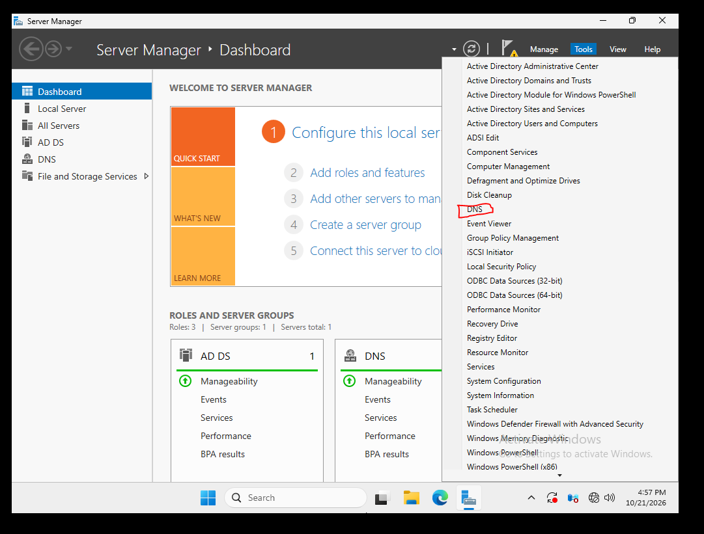

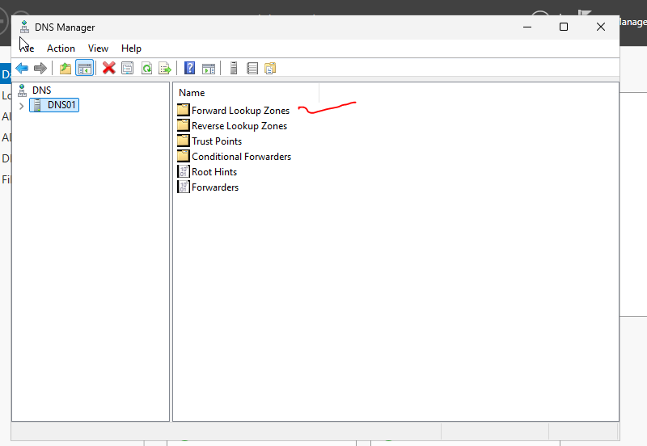

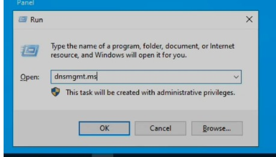


## 2. Standard primary forward zone banayein

Forward Lookup Zones par right-click → New Zone → Next karein. Primary zone select karein. Active Directory wala checkbox is lab mein available nahi. Zone name **VCPLAB.Com** likhein. Nayi file **VCPLAB.Com.dns** rakhein. Isolated classroom lab mein teacher ki tarah **Allow both nonsecure and secure dynamic updates** select karein. Is se baghair authentication updates aa sakti hain; yeh production ki secure default setting nahi. Summary check karke Finish karein.

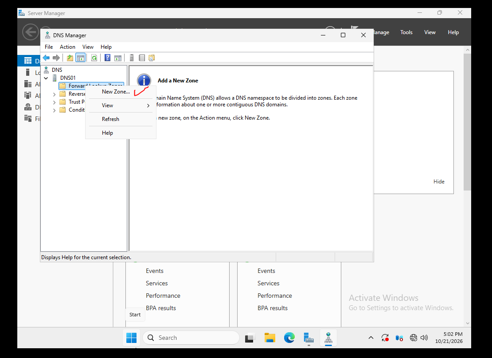

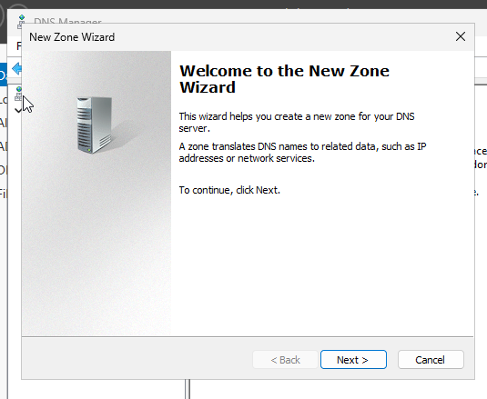

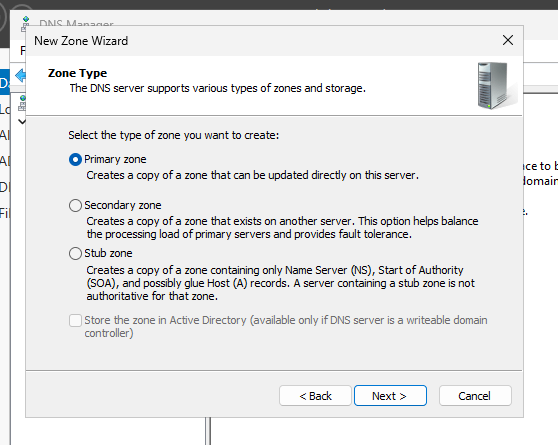

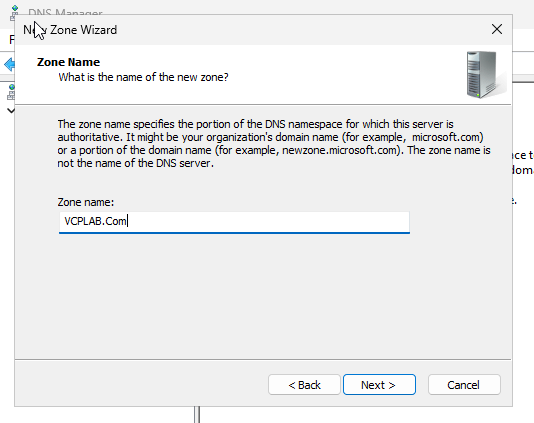

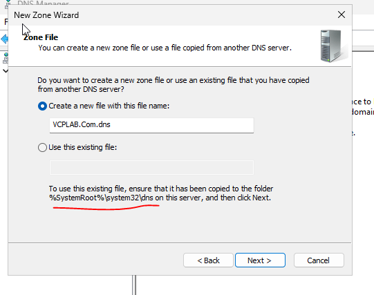


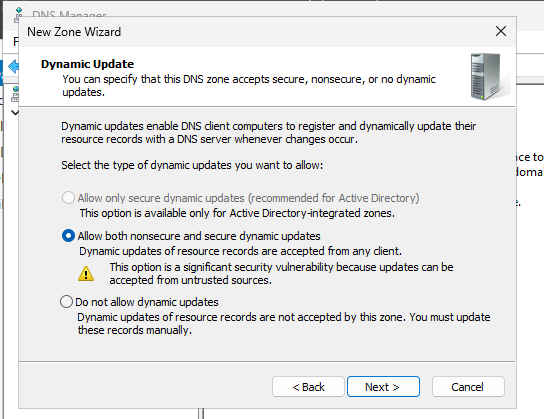

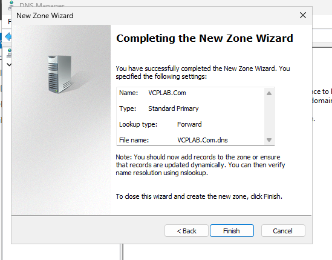

## 3. Zone aur zone file check karein

VCPLAB.Com select karein. SOA, NS aur dns01 ka A record 192.168.0.121 nazar aata hai. Zone Standard Primary aur Running hai. Win + E se File Explorer khol kar C:\Windows\System32\dns mein file dekhein. VCPLAB.Com.dns zone banne ke baad nazar aati hai; pehle nahi thi. Is lab mein records DNS Manager se manage karein.


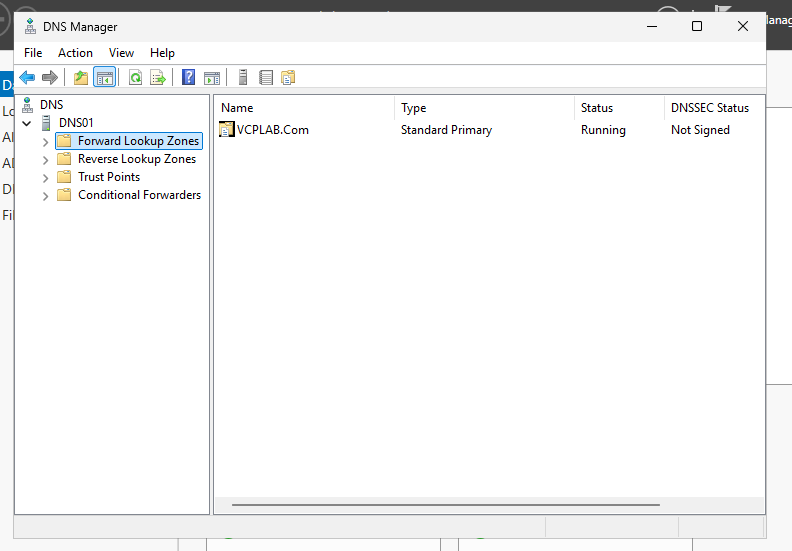


## 4. IPv4 reverse zone aur DNS01 PTR banayein

Agli 12 tasveerain **teacher reference screenshots** hain, aap ki machine ki captures nahi. Aap ne bataya ke DNS01 par inhein follow kiya. Reverse Lookup Zones → New Zone → Next → Primary zone → IPv4 select karein. Network ID **192.168.0** likhein. Zone **0.168.192.in-addr.arpa** aur file **0.168.192.in-addr.arpa.dns** hogi. Classroom dynamic-update option select karke Finish karein. Forward zone mein dns01 A record ki Properties kholen, Update associated pointer (PTR) record check karke Apply / OK karein. Reverse zone refresh karein. Apne lab mein 192.168.0.121 ka target dns01.vcplab.com hoga. Teacher ke hostnames ki jagah apna DNS01 naam use karein.


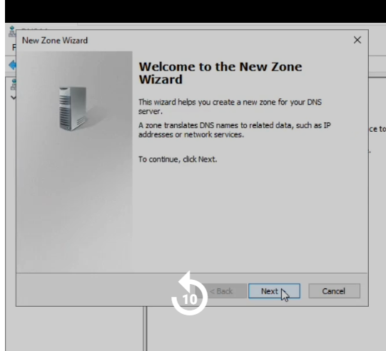


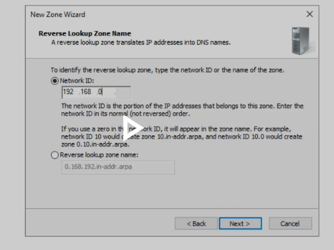


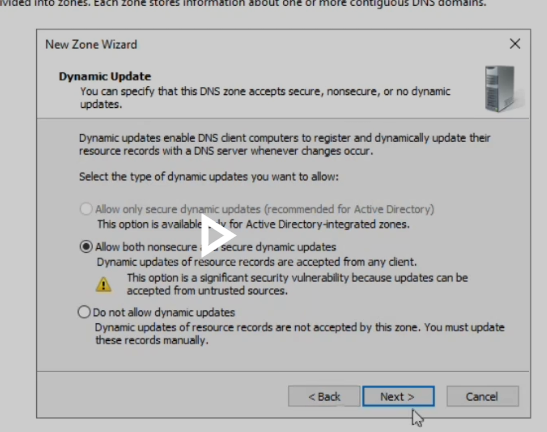


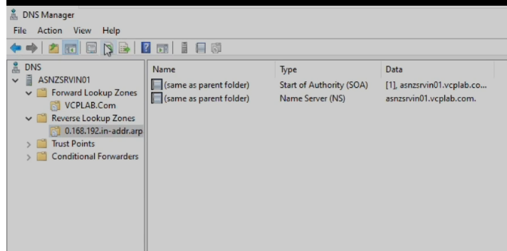

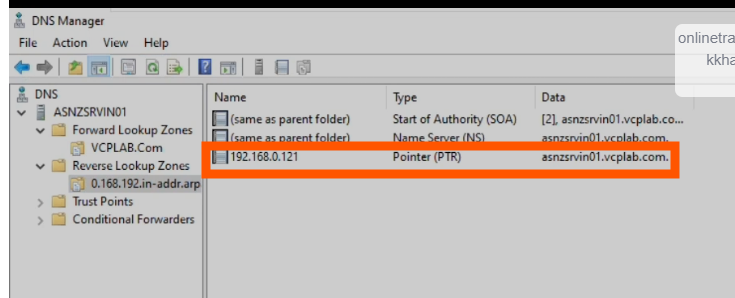

## 5. DNS01 verify karein aur pehle errors samjhein

Command `nslookup dns01.vcplab.com. 192.168.0.121` chalayein. Pehle test mein Non-existent domain aaya. Final dot ke saath aglay test mein sahi IP aayi lekin timeout aur Unknown bhi tha. PTR ke baad aap ki screenshot mein server name aur jawab dono sahi hain aur timeout nahi. PTR na hone se Unknown aa sakta hai, magar har timeout ya NXDOMAIN ki wajah sirf PTR nahi samajhni. Local query ke liye Internet zaroori nahi. Aakhri dot naam ko absolute banata hai.

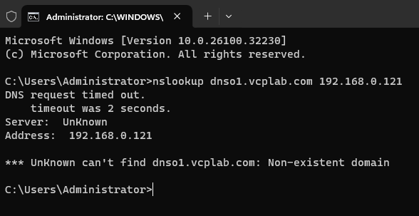


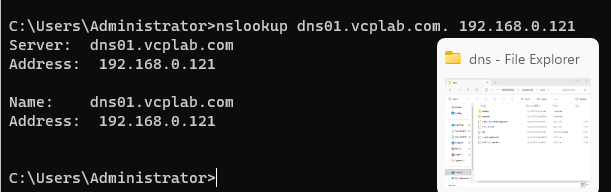

## 6. DNS01 par DNS02 aur DNS03 host records add karein

DNS01 → Forward Lookup Zones → VCPLAB.Com par right-click → New Host (A or AAAA) karein. DNS02 aur 192.168.0.122 likhein. PTR checkbox check karke Add Host → OK karein. DNS03 ke liye 192.168.0.123 use karein aur Done karein. Aik screenshot mein galti se **19.168.0.123** tha; final verified list mein **192.168.0.123** sahi hai. Yeh records add karna doosri machine par secondary ya stub zone banana nahi hai.


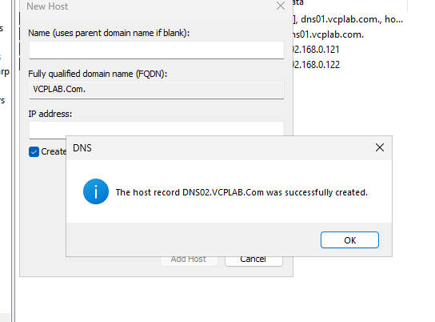

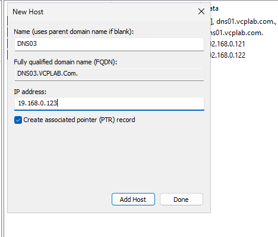

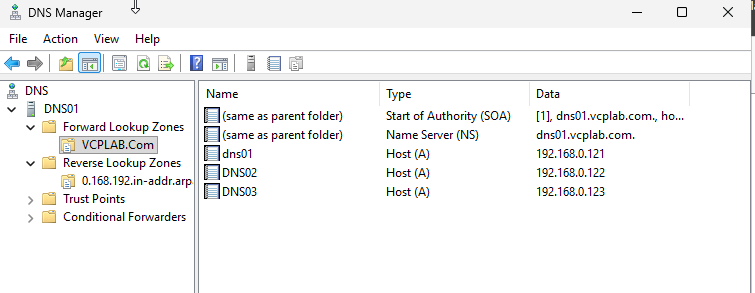

## 7. Refresh aur duplicate PTR entries ki safai

PTR missing samajhne se pehle reverse zone refresh karein. Pehle DNS02 nazar nahi aaya; refresh ke baad DNS02 aur DNS03 ki do do entries thin. Har IP ki aik sahi PTR rakh kar extra entry delete ki gayi. Final screenshot mein .121, .122 aur .123 ki aik aik PTR hai. DNS mein capital aur small letters ka farq nahi. Sahi PTR pehle se ho to dobara add na karein.


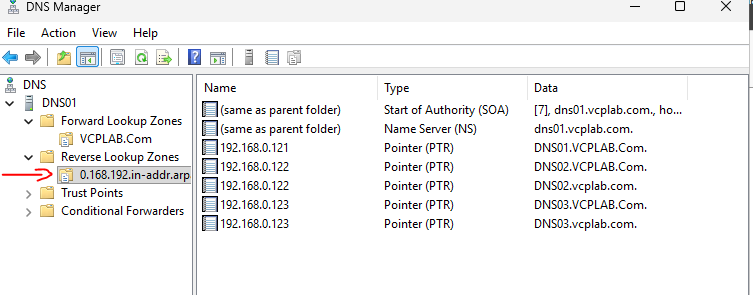

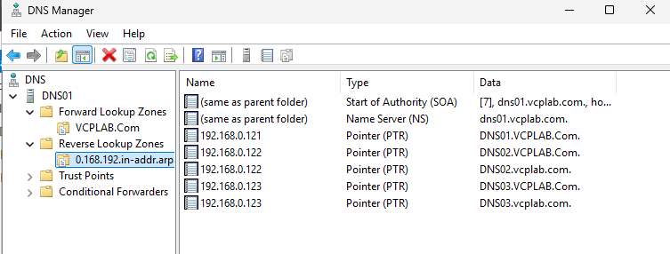


## 8. DNS CNAME alias banayein

VCPLAB.Com par right-click → New Alias (CNAME) karein. Alias **DNS** likhein. Browse → DNS01 → Forward Lookup Zones → VCPLAB.Com → dns01 select → OK karein, phir record create karne ke liye OK karein. Alias **dns.vcplab.com → dns01.vcplab.com** hai. CNAME mein target ka DNS naam hota hai; IP target ke A record se milti hai.


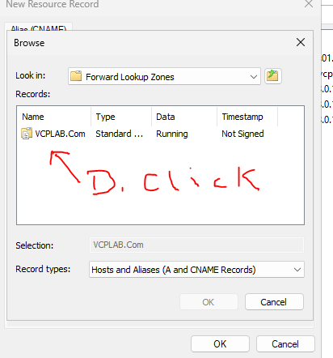


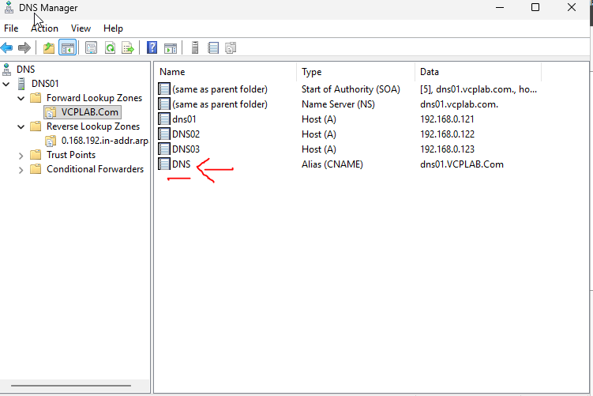

## 9. Alias aur host records verify karein

**nslookup dns.vcplab.com. 192.168.0.121** chalayein. Final output mein Name dns01.vcplab.com, Address 192.168.0.121 aur Aliases dns.vcplab.com hai. Pehle dns01 ya sirf vcplab.com query hua tha, is liye alias test nahi hua tha. DNS01 ke zariye DNS02 ki forward aur reverse queries bhi sahi hain. Is se DNS01 ke records verify hote hain, DNS02 ki secondary service nahi.


## 10. Secondary DNS ka agla marhala

Pehle incomplete transfer setup ke baad Chapter 02 mein completed procedure recorded hai. Lab ke baad walay marhalay mein DNS02 aur DNS03 ki lookups successful thin. DNSSEC exercise mein DNS01 ki zone sign aur phir unsign hui; final forward zone unsigned hai. Tafseel Chapter 05 mein hai.

## Dobara verification ki commands

```powershell
nslookup dns01.vcplab.com. 192.168.0.121
nslookup dns02.vcplab.com. 192.168.0.121
nslookup dns03.vcplab.com. 192.168.0.121
nslookup 192.168.0.121 192.168.0.121
nslookup 192.168.0.122 192.168.0.121
nslookup 192.168.0.123 192.168.0.121
nslookup dns.vcplab.com. 192.168.0.121
```

Expected A answers tarteeb se .121, .122 aur .123 hain. PTR targets VCPLAB.Com mein DNS01, DNS02 aur DNS03 hain. Alias target DNS01, .121 hai. Yeh repeat checklist hai; har command run honay ki screenshot recorded nahin.


## Current lab checkpoint / Maujooda halat

DNS01 primary, DNS02 secondary aur DNS03 stub se lab lookups successful thin. KRNC.org forwarding configured hai magar resolution test recorded nahin. VCPLAB.Com sign aur phir unsign hui; trust-anchor import aur DNSSEC validation ki evidence nahin.
