# DNS02 — Secondary DNS lab (Roman Urdu)

## Bunyadi tasawwur

Secondary DNS zone mukammal read-only authoritative copy hai. Is se doosra server apni replicated records se jawab de sakta hai. DNS02 master DNS01 se zone leta, SOA maloomat se changes check karta aur zone transfer se copy refresh karta hai. Records primary par change hotay hain.


## Is configuration ko samjhein

DNS02 **apni poori zone copy** se queries ka jawab deta hai. Har lookup par DNS01 se nahin poochta. Is se aik running DNS process par dependence kam hoti hai, lekin availability design mein shared ESXi host, storage, power aur network bhi dekhna hota hai.

Primary par change ke baad SOA serial se naya version pehchana jata hai. Notify check karne ka paigham de sakta hai; refresh/retry timers bhi checks control karte hain. Shuru ki full transfer aur baad ke updates copy ko current rakhte hain. Expiry interval tak successful refresh na ho to secondary hamesha ke liye woh zone serve nahin kar sakta. Yeh expiry cached record ke TTL se alag hai.

Secondary zone aur client ki “alternate DNS server” setting aik cheez nahin. Client settings munasib honi chahiye. NXDOMAIN jaisa valid negative jawab milne par client aam tor par har alternate resolver ko nahin poochta. Existing records ka jawab dene ke liye secondary ko primary banana zaroori nahin. Writable primary mein conversion alag administrative recovery action hai; automatic failover nahin.

**Evidence ki had:** transferred records aur direct forward/reverse queries recorded hain. Naya record add karke replication aur primary band karke outage test recorded nahin. Yeh optional follow-up tests hain.

**Agla marhala:** DNS03 poori zone ke bajaye authority information rakhta hai.

## Lab values

| Server | Address | Role |
| --- | --- | --- |
| DNS01 | 192.168.0.121 | Standard primary |
| DNS02 | 192.168.0.122 | Secondary |
| DNS03 | 192.168.0.123 | Stub / resolving server |

VMnet2 host-only: 192.168.0.0/24. Forward zone: VCPLAB.Com. Reverse zone: 0.168.192.in-addr.arpa. Internet is unnecessary for these local lookups. A DNS suffix does not join a computer to an AD domain. This lab uses file-backed zones, not AD-integrated zones.

## Lab mein is ka kirdar

Secondary zone primary ki mukammal, read-only authoritative copy hoti hai. Records DNS01 par change karein; DNS02 zone transfer se changes leta hai. Forward aur reverse zones ka setup alag hota hai.

## Lab record ko parhne ka tareeqa

Neechay configuration ka recorded workflow hai jo practice mein dobara use ho sakta hai. Verified result supplied record ka hai; proposed tests aur missing captures alag wazeh hain. Is review mein running machines ki setting change ya live re-test nahin ki gayi.

## 1. DNS01 ke records check karein

DNS01=.121, DNS02=.122, DNS03=.123 ke A records, DNS alias ka dns01.vcplab.com target aur teen PTR records check karein. In ko banana Primary chapter mein hai.

## 2. DNS01 par transfer allow karein

1. DNS Manager → DNS01 → Forward Lookup Zones → VCPLAB.Com ki Properties kholein.
2. Zone Transfers → Allow zone transfers check karein.
3. Only to the following servers select karke .122 aur .123 ke poore IP add karein.
4. Notify → Automatically notify → following servers mein dono IP add karein.
5. OK → Apply → OK karein.
6. Reverse zone 0.168.192.in-addr.arpa par bhi transfer permission dein.
7. Teacher ke mutabiq reverse Notify bhi configure karein; us dialog ka screenshot share nahin hua.

Outgoing list mein DNS01 ka apna .121 zaroori nahin. DNS02 ke wizard mein master .121 hi hoga. Notify sirf changes check karne ka paigham hai, transfer ki kamyabi ka saboot nahin. .123 teacher ke setup ke mutabiq add hua; stub mukammal secondary copy nahin rakhta.

## 3. DNS02 forward secondary zone

1. DNS02 → Forward Lookup Zones par right-click → New Zone → Next.
2. Secondary zone select karein.
3. Zone name VCPLAB.Com dein.
4. Master 192.168.0.121 add karein aur OK validation dekhein.
5. Next → Finish → Refresh karein.
6. SOA, NS, teen A records aur DNS CNAME confirm karein.

## 4. DNS02 reverse secondary zone

1. Reverse Lookup Zones → New Zone → Secondary zone → IPv4.
2. Network ID 192.168.0 dein. Zone 0.168.192.in-addr.arpa banega. Agar wizard zone name seedha mangay to poora reverse name dein.
3. Master 192.168.0.121 → Next → Finish → Refresh.
4. .121, .122, .123 ke PTR check karein. Darmiyani wizard pages capture nahin huay, final records nazar aa rahe hain.

## 5. DNS02 ko seedha test karein

```powershell
nslookup dns01.vcplab.com. 192.168.0.122
nslookup 192.168.0.121 192.168.0.122
```

Screenshot 033333 mein dono tests successful hain. Jawab dene wala DNS02 .122 hai; result DNS01 aur .121 hai. Failover test abhi nahin kiya.

## Masla aaye to

Zone spelling, master .121, DNS01 ki .122 transfer permission, DNS service, network aur TCP 53 check karein. Queries UDP 53 bhi use karti hain. Refresh ya Transfer from Master karein aur SOA serial compare karein. Records primary par edit karein.


## Screenshots ka silsila

Upar diye gaye steps follow karein. Ye tasaveer capture kiye gaye stages dikhati hain. Jo wizard pages share nahin huay un ki exact settings confirm nahin hain.

## 025824 — DNS01 forward-zone Properties

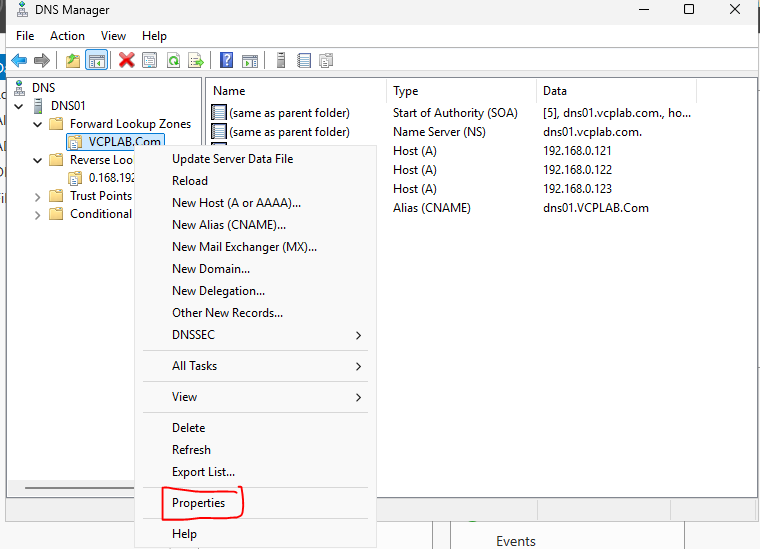

## 030026 — Zone Transfers selection

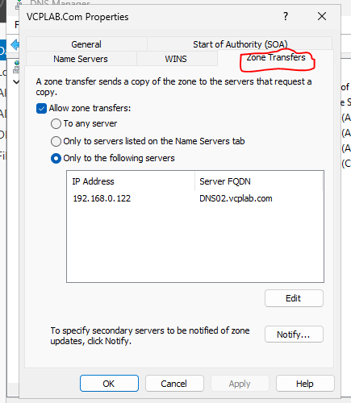

## 030452 — Transfer destination editing; validation incomplete

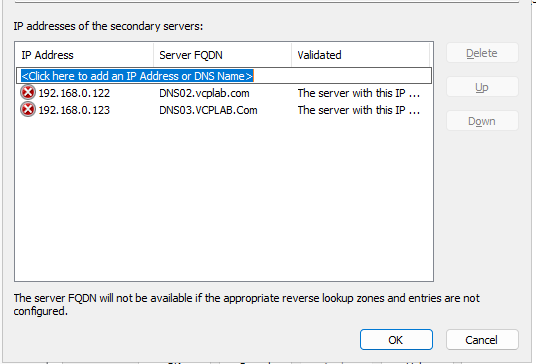

## 030512 — Both destination addresses

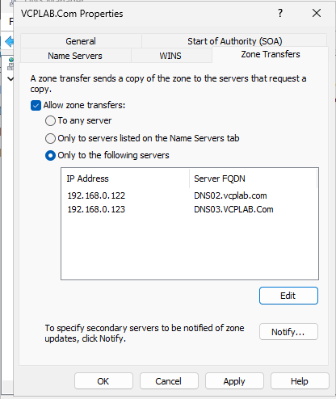

## 030616 — Notify button

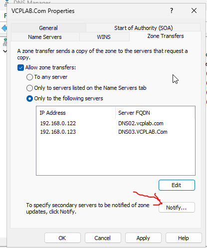

## 030802 — Notify validation in progress


## 030924 — Notify destinations validate OK

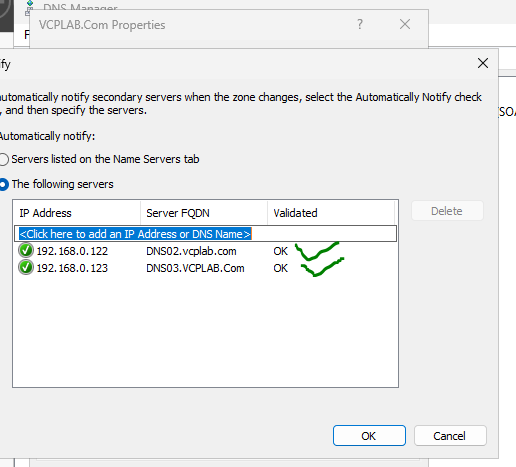

## 031013 — Forward settings before Apply

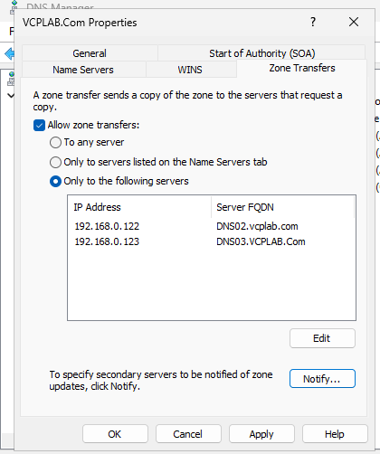

## 031343 — Reverse-zone transfer destinations


## 031455 — Primary PTR records

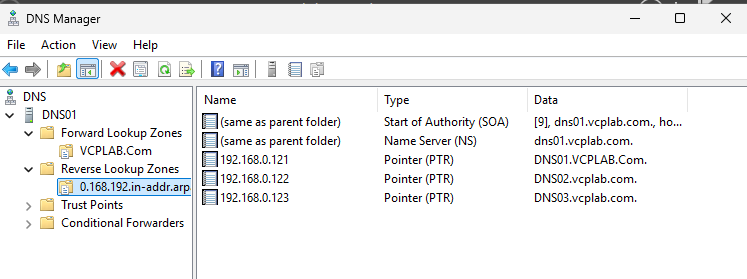

## 031518 — Primary forward records

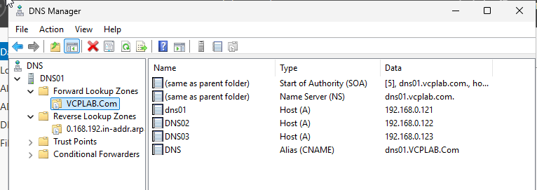

## 031936 — DNS02 New Zone

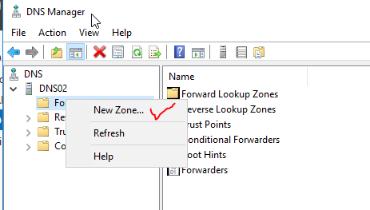

## 032017 — Wizard welcome

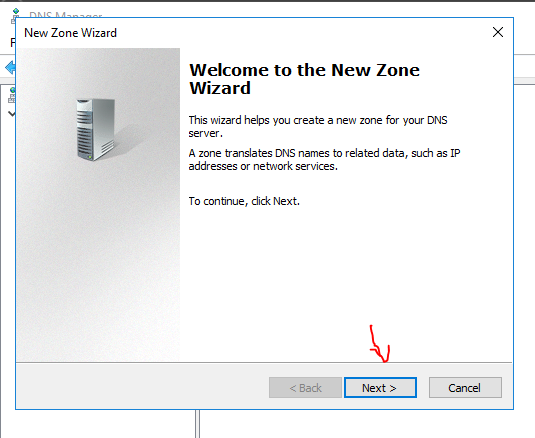

## 032134 — Secondary selected


## 032222 — Forward zone name

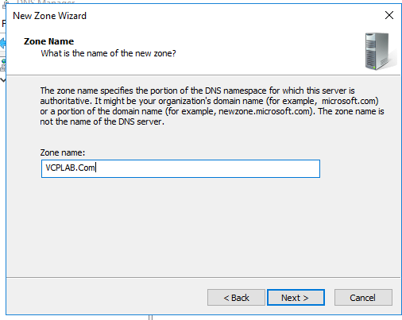

## 032410 — DNS01 master validated

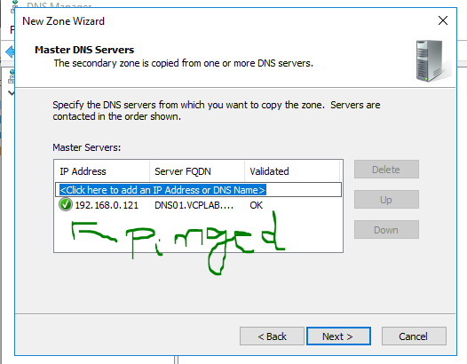

## 032454 — Forward secondary summary

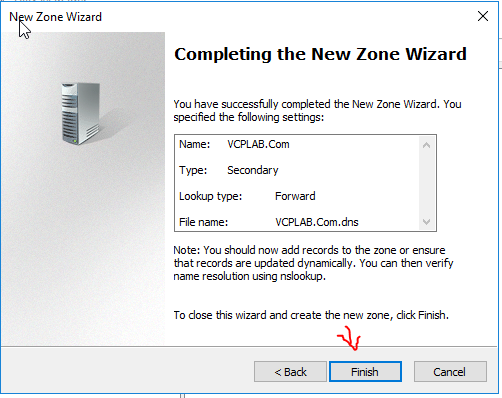

## 032546 — Forward records transferred


## 032756 — Reverse PTR records transferred

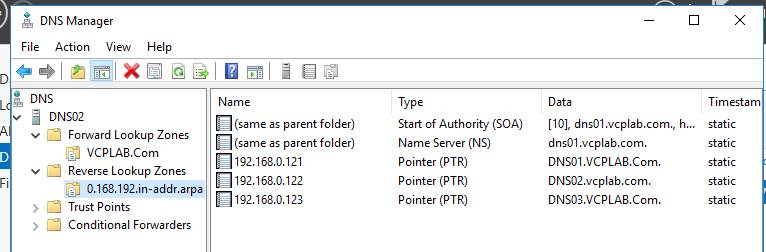

## 033333 — Forward and reverse queries pass against DNS02


