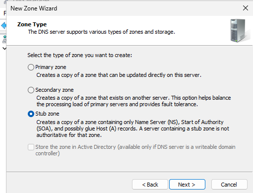
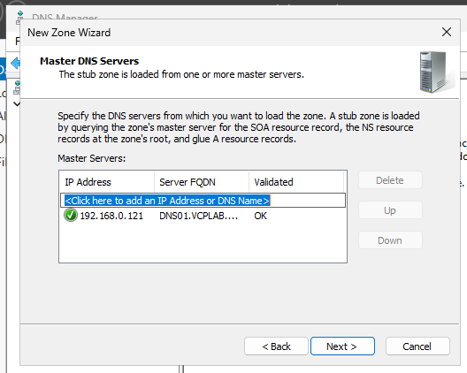
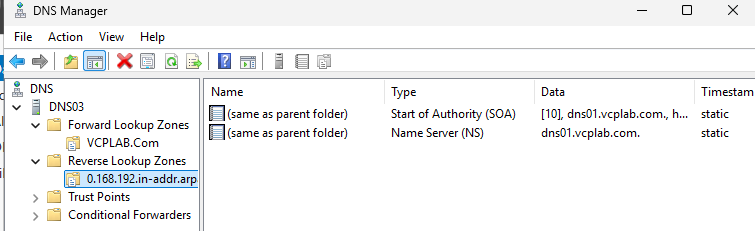

# Screenshot evidence

## 033557 — DNS03 New Zone

## 033643 — Wizard welcome

## 033722 — Stub selected

## 033806 — VCPLAB.Com name

## 033935 — New stub file

## 034036 — DNS01 master validates OK

## 034058 — Forward stub summary

## 034304 — Forward stub records

## 034336 — Reverse stub final records

## 034759 — DNS03 forward and reverse tests pass

