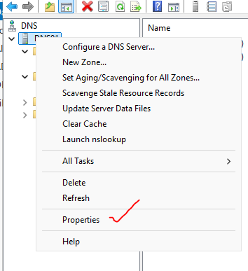
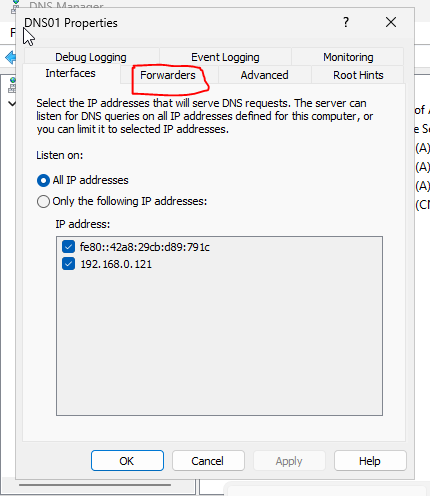
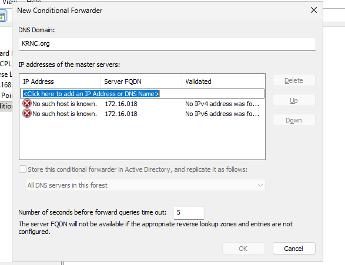
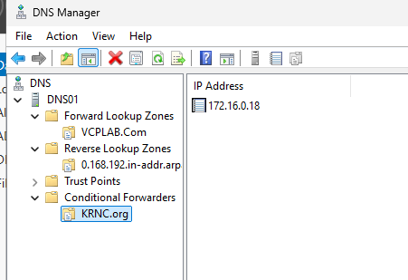

# Conditional forwarding — KRNC.org example

## Concept overview

A conditional forwarder sends queries for a specific domain to selected DNS server IPs. It supports resolution between connected private or partner networks without copying their zones. The saved KRNC.org rule directs matching queries to 172.16.0.18; successful answers require that destination to be reachable and able to resolve the requested name.


## Understanding this configuration

The rule answers a routing question: “Which DNS server should handle queries for this namespace?” For `KRNC.org`, the saved destination is `172.16.0.18`. DNS01 does not become authoritative for that domain merely by creating the rule, and it does not receive its zone records through the rule.

This differs from the stub’s authority-discovery information. The forwarding destination is explicitly configured, so changes to that destination must be managed. It also differs from a default gateway: a DNS forwarder routes DNS questions at the application level, while the network still needs a route to the target IP.

The current VMnet2 host-only subnet is `192.168.0.0/24`, with no gateway recorded. Saving a rule for another subnet does not create connectivity. A known target server, a real test record, working routing and permitted DNS traffic are prerequisites for a meaningful test.

**Result recorded:** the corrected rule was saved. Successful resolution through it has not been demonstrated. Future testing should compare a direct query to the target with the same query through DNS01 and capture the actual results. A TCP port test alone cannot prove that a valid DNS answer is available.

## Purpose in this lab

A conditional forwarder sends queries for a chosen domain to configured DNS server addresses. It does not copy that domain's zone. It is useful between connected private networks, partner organizations and hybrid networks. A general forwarder handles other eligible queries; a conditional forwarder matches a specific namespace.

## Your saved configuration

| Configured on | DNS domain | Target DNS IP |
| --- | --- | --- |
| DNS01 (192.168.0.121) | KRNC.org | 172.16.0.18 |

This means a query such as app.KRNC.org can be forwarded to 172.16.0.18. That host name is illustrative, not a verified record. Queries for VCPLAB.Com are still handled by the existing local zone.

## Configure step by step

1. Open DNS Manager on DNS01.
2. Expand DNS01 → right-click Conditional Forwarders → New Conditional Forwarder.
3. DNS Domain: KRNC.org.
4. Enter 172.16.0.18 in the IP address row; press Enter to commit.
5. Leave AD storage unchecked/unavailable for this workgroup lab.
6. Click OK. Select Conditional Forwarders → KRNC.org and confirm the target IP.

Your first two screenshots show server Properties and the general Forwarders tab location; they do not show creating the domain-specific rule there. Use the separate Conditional Forwarders node. The historical introduction date/UI change was not independently established in this lab.

## Correct the captured typing mistake

Screenshot 040114 shows 172.16.018, which was interpreted as a name and generated No such host is known. The final screenshot 040430 shows the correct 172.16.0.18 and the saved rule. Do not copy the incorrect entry.

## Verify when the destination exists

1. Confirm that 172.16.0.18 is a real DNS server reachable from DNS01.
2. Your host-only 192.168.0.0/24 lab does not automatically route to 172.16.0.18. Provide appropriate routing/connectivity and permit DNS UDP/TCP 53.
3. Obtain a known, existing KRNC.org host name from the teacher.
4. Query that name directly against 172.16.0.18, then through DNS01.

```powershell
# Replace known-host with a record that really exists.
nslookup known-host.krnc.org. 172.16.0.18
nslookup known-host.krnc.org. 192.168.0.121
```

Checkpoint: rule saved; no successful KRNC.org lookup shown. A saved rule or a server-name display alone does not establish successful forwarding. No zone-transfer permission is needed just to forward queries. Avoid circular forwarding rules.


## Screenshot walkthrough

Follow the numbered procedure above; these images preserve the captured stages. Missing wizard pages are not evidence of the exact settings chosen.

## 035645 — Server Properties entry



## 035838 — General Forwarders tab location



## 040114 — Incorrect address entry produces errors



## 040430 — Correct KRNC.org rule saved


