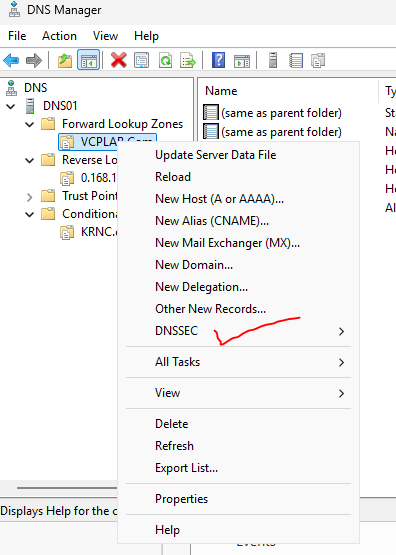
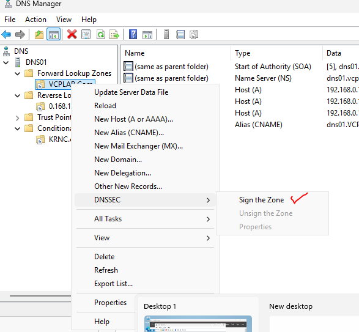
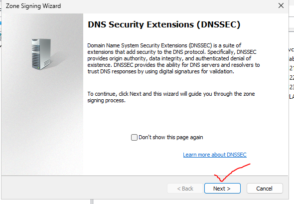
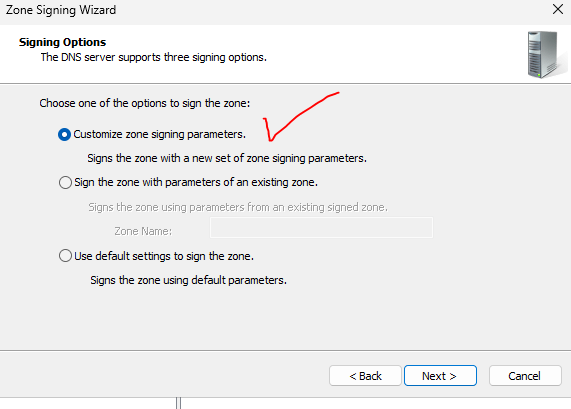
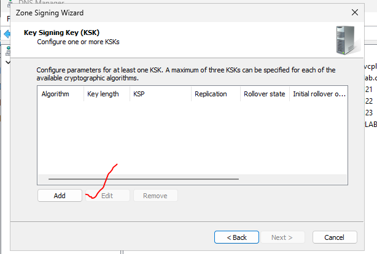
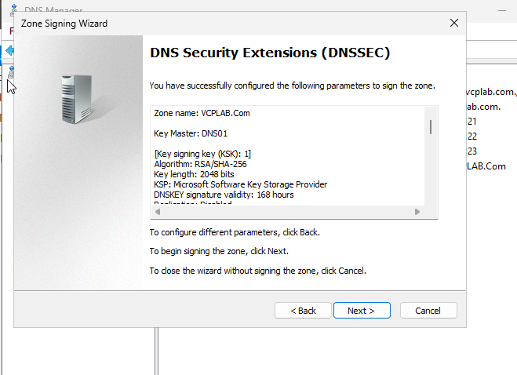
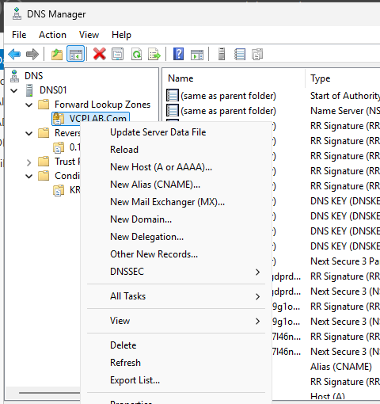
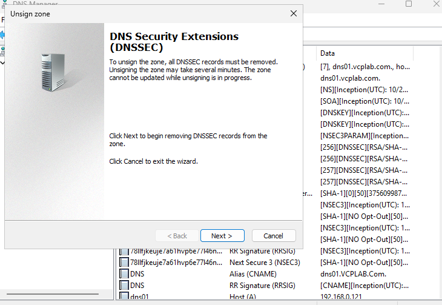
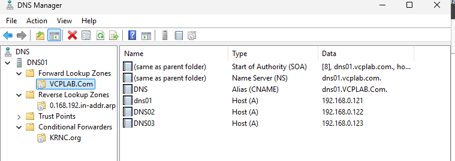

# Screenshot evidence

## 040944 — Zone DNSSEC menu

## 041031 — Sign the Zone

## 041149 — DNSSEC introduction

## 041216 — Customize signing parameters

## 041320 — KSK explanation

## 041424 — Add KSK; list initially empty

## 041931 — Signing summary

## 042002 — Signed zone records

## 042153 — Zone context menu before unsigning

## 042217 — Unsign wizard warning

## 042249 — Final unsigned zone

