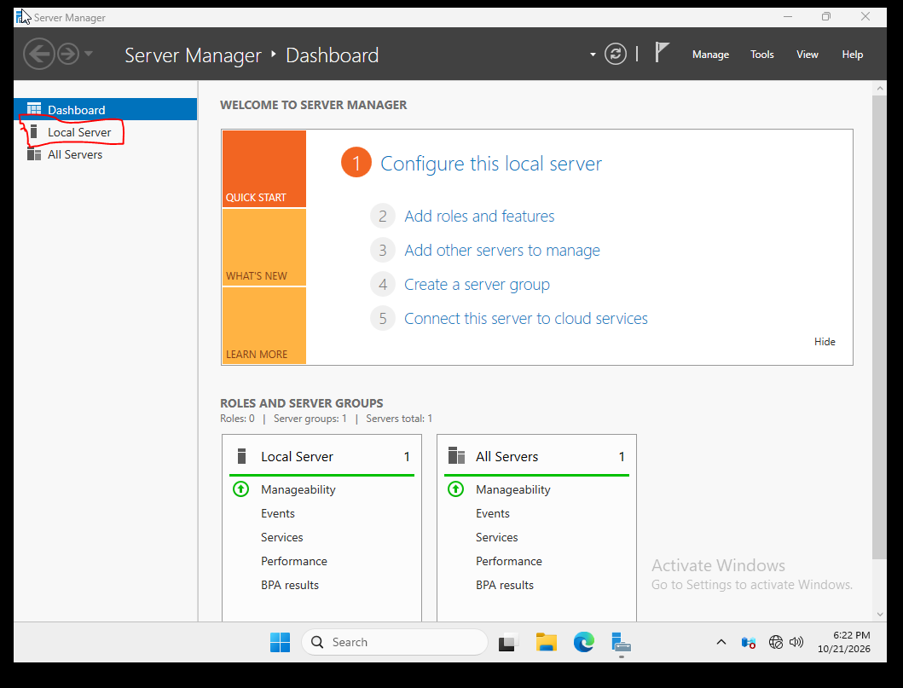
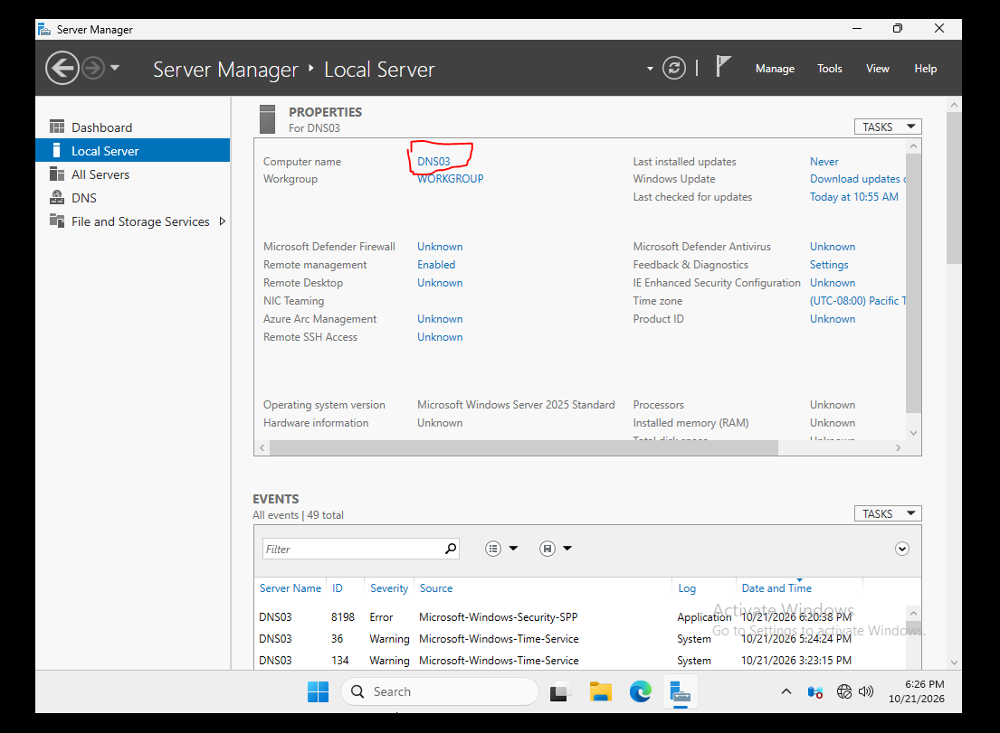
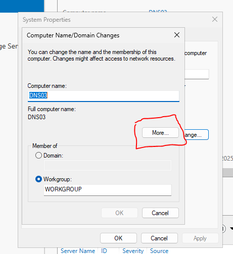
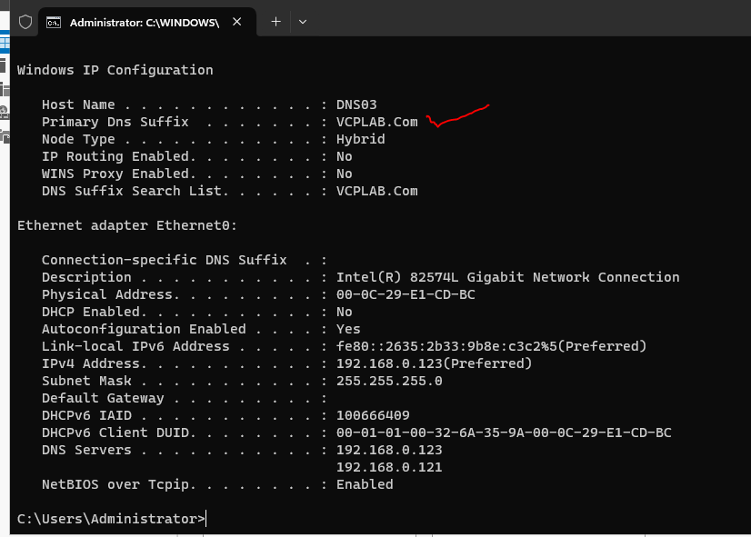

# DNS03 — DNS Suffix Study Notes

## Concept overview

A primary DNS suffix combines with a host name to form its full computer name, such as DNS03.VCPLAB.Com. It establishes the intended naming context; suffix search settings can also help expand short names. The suffix is configured in Computer Name → Change → More, applied after restart and checked with ipconfig /all. It does not itself create DNS records, create a zone or join Active Directory.


Lab record: 21 October 2026

Configure the primary DNS suffix on DNS03, following your classroom workflow. This record covers only the suffix procedure and its verification. Network values below are reference values observed in your lab; this procedure does not change them.

A primary DNS suffix combines with the host name to form the full computer name: **DNS03 + VCPLAB.Com = DNS03.VCPLAB.Com**. Setting it does not join Active Directory, create a DNS zone, or guarantee that a DNS record exists. DNS03 remains in WORKGROUP.

## Understanding this configuration

`DNS03` is the short host name; `DNS03.VCPLAB.Com` is the full name formed with its primary suffix. This gives consistent naming within the lab. A resolver’s suffix search behavior can also expand short names, but the primary suffix, connection-specific suffix and explicit search list are distinct settings.

For example, a short-name query for `dns02` may be expanded to `dns02.vcplab.com` under the configured search rules. An absolute query `dns02.vcplab.com.` explicitly includes the root-ending dot and avoids relying on suffix expansion. That is why the verification commands use complete names.

Setting the suffix changes neither WORKGROUP membership into AD membership nor a stub into a primary. It does not by itself guarantee successful DNS registration. The computer setting is checked with `ipconfig /all`; the DNS record is checked separately by querying the intended DNS server.

**Recorded result:** DNS03’s suffix and search-list values were shown after restart. Other servers’ suffixes should not be inferred solely from this DNS03 evidence. For a fresh build, this chapter can be read before creating the primary zone; the existing numbered folders are retained to preserve the original bundle layout.

## Lab reference

| Setting | Value |
| --- | --- |
| Computer | DNS03 |
| Operating system | Windows Server 2025 Standard (Desktop Experience) |
| Primary DNS suffix | VCPLAB.Com |
| Full computer name | DNS03.VCPLAB.Com |
| Membership | WORKGROUP |
| IPv4 address | 192.168.0.123 |
| Subnet mask | 255.255.255.0 |
| Default gateway | Blank |
| Preferred DNS server | 192.168.0.123 |
| Alternate DNS server | 192.168.0.121 |

## Reading the lab record

The procedure below documents the configuration workflow and can be reused for practice. Statements marked verified refer to the supplied record; proposed tests and missing captures are identified separately. The review did not change or re-test the running machines.

## Step 1: Open Local Server

On DNS03, open **Server Manager** and click **Local Server** in the left menu.



## Step 2: Open the computer properties

Under Properties, click the blue **DNS03** computer name.



## Step 3: Open Computer Name/Domain Changes

In **System Properties → Computer Name**, click **Change…**.


## Step 4: Open the DNS suffix settings

Keep the computer name **DNS03** and the membership set to **Workgroup: WORKGROUP**. Click **More…**.



## Step 5: Enter the primary DNS suffix

In **Primary DNS suffix of this computer**, enter **VCPLAB.Com**. Keep the NetBIOS computer name **DNS03**. Leave **Change primary DNS suffix when domain membership changes** checked, as shown. Click **OK**, then **OK** in Computer Name/Domain Changes.


## Step 6: Restart DNS03

A message says that you must restart the computer to apply the changes. Click **OK**, close System Properties, and choose **Restart Now**. Restart the DNS03 virtual machine. Sign back in after it starts.


## Step 7: Verify the result

Open Command Prompt or PowerShell inside DNS03 and run:

```powershell
ipconfig /all
```

Confirm **Host Name: DNS03**, **Primary DNS Suffix: VCPLAB.Com**, and **DNS Suffix Search List: VCPLAB.Com**. The last screenshot confirms these values.



## Quick repeat checklist

Server Manager → Local Server → DNS03 → Change → More → VCPLAB.Com → OK → OK → restart DNS03 → `ipconfig /all`.

## If the result is different

- If the suffix is blank, return to **Change → More**, check the entry, apply it, and restart.
- If you see a domain-controller contact error, check whether **Domain** was selected. This suffix procedure uses **WORKGROUP** and **More…**.
- DNS names are case-insensitive: `VCPLAB.Com` and `vcplab.com` refer to the same name.
- Successful suffix verification checks the computer setting; DNS resolution and zones require separate checks.
