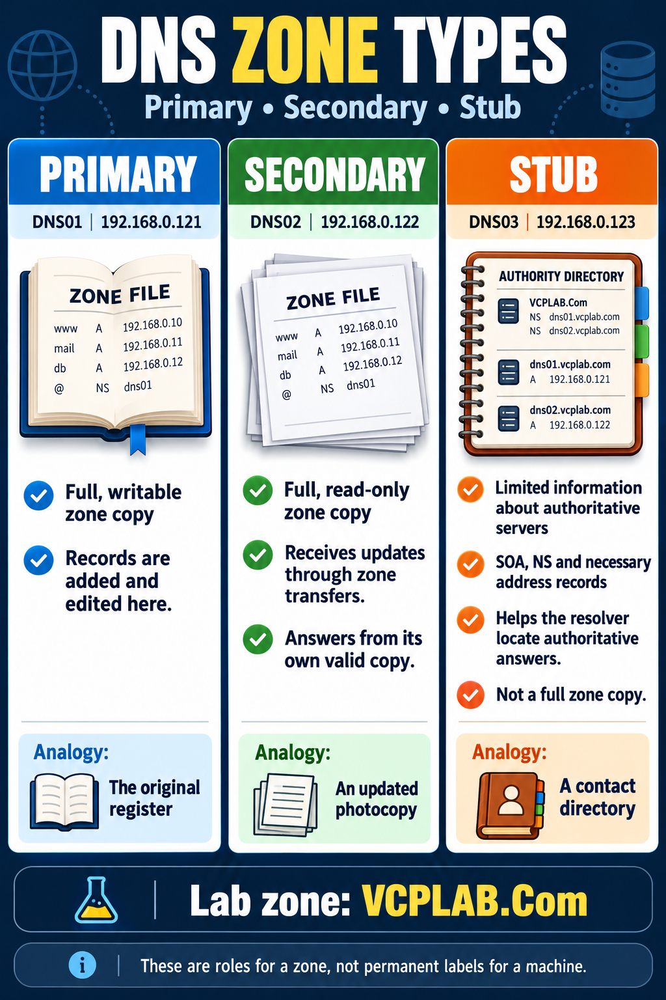

# DNS Zones — Primary, Secondary and Stub

English study notes • Concept → example → behavior → verification

This guide explains the three zone roles using your classroom DNS01/DNS02/DNS03 example. It is a concept and repeat-practice guide, not a new live inspection. The English poster is included below and preserved as a separate PNG.



**Reading the poster:** the book entries `www`, `mail` and `db`, and the multiple NS entries in its directory, are illustrative. They are not evidence that those records or all those NS entries exist in your lab. The confirmed classroom host examples used in these notes are DNS01, DNS02 and DNS03. The poster summarizes the standard file-backed model; AD-integrated replication is distinguished later.

---

## 1. First separate server, zone and record

- A **DNS server** is the service/machine answering DNS questions. 
- A **zone** is an administratively managed part of the DNS namespace.
- A **record** is an individual entry in that zone.

Think of a records office: the server is the office providing the service, the zone is a managed register, and each DNS record is an entry. The analogy is useful, but a zone is not necessarily a simple file: its storage depends on the design.

| Object | Classroom example |
|---|---|
| Server | DNS01, address 192.168.0.121 |
| Forward zone | VCPLAB.Com |
| Host A record | dns02.vcplab.com → 192.168.0.122 |
| CNAME alias | dns.vcplab.com → dns01.vcplab.com |
| Reverse zone | 0.168.192.in-addr.arpa |
| PTR record | 192.168.0.122 → dns02.vcplab.com |

A domain name and a zone are related but not always identical in scope. If a child namespace is delegated into its own zone, the parent does not keep all that child zone’s ordinary records. For this lesson, concentrate on the single classroom forward zone.

---

## 2. Primary — the editing point

In the standard file-backed design, the primary holds the full writable zone data. The administrator maintains records there. In the classroom example, DNS01 hosts the primary VCPLAB.Com zone.

Suppose an administrator creates an illustrative `printer.vcplab.com` A record. That write happens on the primary. Queries for the record can then be answered from that zone. The printer example is not a claim that a printer was configured in the lab.

**Analogy:** the original register that an authorized clerk can update.

“Writable” describes the zone’s role; it does not mean every client is allowed to change it. Permissions and dynamic-update policy still control who can submit changes. Primary does not mean the machine must be physical or that clients always query it first.

**Checkpoint:** adding an A record for DNS02 on DNS01 creates a name mapping. It does not create a secondary zone on DNS02.

---

## 3. Secondary — a complete read-only copy

DNS02 hosts a full read-only copy of the classroom zone. It can answer existing records from its own copy; it does not contact DNS01 for every user query. This provides another authoritative answering location.

Updates arrive through authorized **zone transfers**. The SOA serial helps identify changes. Notify can prompt a check, while refresh/retry settings govern update checks. Transfer authorization and a working network path are separate requirements. A valid configuration can also use another secondary as the transfer source.

**Analogy:** an updated photocopy. It is readable locally, but changes are maintained at the writable source.

If the primary stops, the secondary can keep answering from a valid copy without promotion. It cannot serve indefinitely if refresh fails beyond the zone’s expiry conditions. Zone expiry is different from a cached record’s TTL.

A secondary is useful for availability, but is not a replacement for backups: an accidental deletion can transfer to it too. Two DNS VMs on the same physical host also share a host failure dependency.

**Checkpoint:** administrative conversion of a standard secondary to primary is a separate recovery action, not automatic failover.

---

## 4. Stub — authority information, not the full register

DNS03’s stub retains limited information identifying authoritative servers. It contains SOA, NS and necessary address/glue records. There can be multiple entries; “three categories” does not mean exactly three records. It does not contain every host, alias and PTR in the full zone.

**Analogy:** a contact directory saying where the complete register can be consulted.

A resolver using a stub can locate a reachable authority to resolve a missing answer. It may also use an appropriate cached answer. The authority can be a primary or secondary; it is not universally “the primary only.” A stub’s configured master list used to refresh its metadata and its NS authority list are related but distinct concepts.

A stub therefore does not offer the same independent full-copy behavior as a secondary. If no usable answer is cached and required authorities are unreachable, the stub cannot manufacture a missing host record. It is not a guaranteed faster query path or a full DR backup.

**Classroom boundary:** the recorded stub showed DNS01 authority information. Do not assume DNS02 will automatically be used merely because DNS02 exists as a secondary.

---

## 5. Follow the same question through all three

The question is: “What is the IPv4 address of dns02.vcplab.com?”

| Destination | How a correct answer can be obtained |
|---|---|
| DNS01, primary | Reads the A record from its writable authoritative zone |
| DNS02, secondary | Reads the A record from its full read-only authoritative copy |
| DNS03, stub/resolver | Uses authority discovery and resolution, or usable cached data; the full host list is not in the stub |

All can return `.122`, but that does not mean all store the same data. The client-visible answer and the server’s storage/role are different questions.

| Comparison | Primary | Secondary | Stub |
|---|---|---|---|
| Full ordinary zone records | Yes | Yes | No |
| Direct editing of full zone records | Writable source | No | Not a host-record editing copy |
| Main purpose here | Maintain zone data | Serve full replicated data | Discover authorities |
| Register analogy | Original | Updated photocopy | Contact directory |

**Forward/reverse is another classification:** it describes lookup direction. Primary/secondary/stub describes the zone role. A reverse zone can have a standard primary on DNS01 and a secondary on DNS02. Forward-zone setup does not automatically create reverse-zone setup.

---

## 6. Roles belong to zones; AD integration changes the model

One machine may host the primary for one zone and a secondary or stub for another. It cannot hold conflicting primary and secondary/stub copies of that same zone as separate local Windows DNS zone objects.

The register explanation above uses your workgroup/file-backed lab. In an AD-integrated design, appropriate writable domain-controller DNS replicas can accept updates and use AD replication. Do not automatically call the second writable AD-integrated copy a standard read-only secondary. A read-only domain controller is a separate design.

Similarly, a client’s “preferred DNS” and “alternate DNS” settings select resolvers; they are not declarations that a server hosts a primary or secondary zone. A valid negative response such as NXDOMAIN is not normally a request to try every alternate resolver.

---

## 7. Repeat-practice verification

Run from a machine with a verified path to the isolated DNS lab. These are checks to repeat, not newly executed results.

```powershell
# Same host record, different DNS query destinations
nslookup -type=A dns02.vcplab.com. 192.168.0.121
nslookup -type=A dns02.vcplab.com. 192.168.0.122
nslookup -type=A dns02.vcplab.com. 192.168.0.123

# Inspect version metadata on the full copies
nslookup -type=SOA vcplab.com. 192.168.0.121
nslookup -type=SOA vcplab.com. 192.168.0.122

# Reverse lookup through the secondary
nslookup 192.168.0.122 192.168.0.122
```

The final argument is the DNS server being queried, not the answer expected. A correct A answer for DNS02 is `.122`. Query success does not establish the exact upstream packet path, prove DNSSEC validation or test application ports.

| Check | Evidence to record | Limitation |
|---|---|---|
| Primary lookup | Actual command and answer | Only that query at that time |
| Secondary lookup | Responding server .122 and correct answer | Not a primary-outage test |
| Stub lookup | Responding server .123 and answer | Not proof of a full copy or uncached path |
| New-record replication | Controlled edit plus record on secondary | Not completed merely by matching old records |
| Primary outage | Controlled outage and secondary responses | Copy validity and connectivity still matter |

Do not change existing records or shut down DNS simply to read these notes. Controlled change/outage tests belong in the planned lab with recovery steps and captured results.

---

## 8. Common mistakes and revision

| Misunderstanding | Correct interpretation |
|---|---|
| Secondary asks primary for every lookup | It answers from its own complete valid copy |
| Stub is a small full backup | It keeps limited authority information |
| Two successful answers prove failover | Failover needs a controlled outage test |
| Same answer means same stored records | Resolver behavior can hide storage differences |
| Primary must be physical | Zone role and physical/virtual hosting are different |
| Adding DNS02’s A record configures DNS02 | It only creates a name mapping on that zone |
| Creating a zone joins AD | Zone creation and domain joining are separate |

**Revision questions with answers**

1. Which standard copy is directly editable? **Primary.**
2. Which holds every ordinary zone record read-only? **Secondary.**
3. Which locates authorities without a full host list? **Stub.**
4. Can a secondary answer existing data while primary is unavailable? **Yes, while its copy is valid and reachable.**
5. Is primary/secondary a permanent server identity? **No, it is zone-specific.**
6. Does a stub prove all NS addresses illustrated in the poster exist in the lab? **No; the poster entries are illustrative.**

## Sources and study scope

The lab names/addresses and comparison examples follow the supplied study context. The poster is an educational illustration, not configuration evidence. No live machine was changed or tested for this bundle.

Official reference for the core zone-role definitions: [Microsoft — DNS zones](https://learn.microsoft.com/en-us/windows-server/networking/dns/zone-types).

Further protocol background: [RFC 1034 — Domain names: concepts and facilities](https://www.rfc-editor.org/rfc/rfc1034), particularly the distinction between authoritative data, transfers and cached resolver data.
