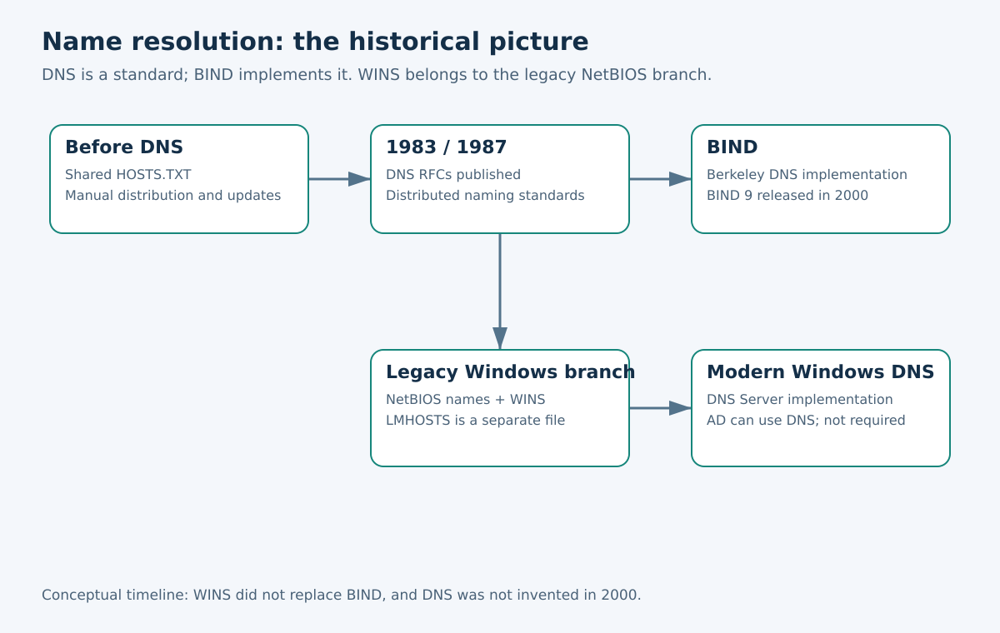
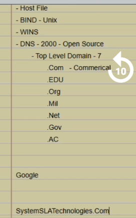
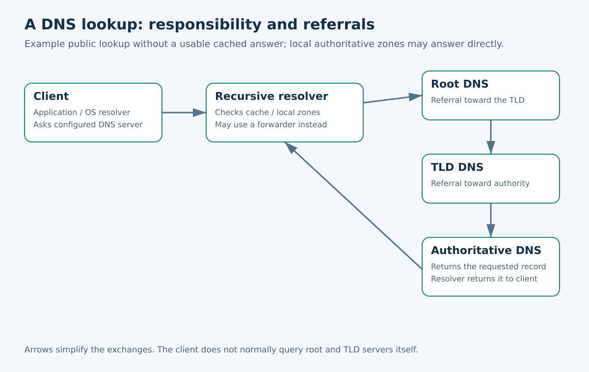
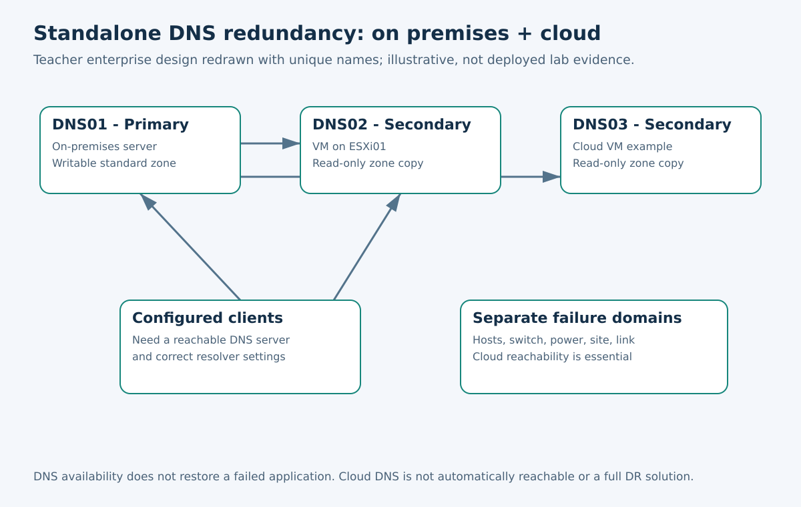
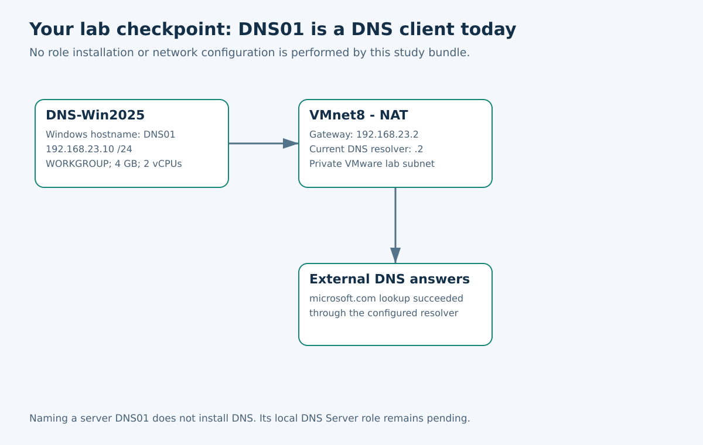

# DNS — History, Bunyaadi Concepts aur Aapki VMware Lab

Date: October 20, 2026 | Theory companion | Lab paused after Windows installation

## Index

1. [Purpose and learning order](#chapter-1)
2. [Why names need resolution](#chapter-2)
3. [History: HOSTS.TXT to distributed DNS](#chapter-3)
4. [Hosts files, LMHOSTS, BIND, WINS and DNS](#chapter-4)
5. [Names, hierarchy and the TLD correction](#chapter-5)
6. [Resolver, DNS server and a query](#chapter-6)
7. [Records and zones](#chapter-7)
8. [Redundancy: enterprise now and AD later](#chapter-8)
9. [Your exact lab checkpoint — no changes](#chapter-9)
10. [Optional read-only observation and troubleshooting](#chapter-10)
11. [Revision questions and next session](#chapter-11)

<a id="chapter-1"></a>

## 1. Purpose and learning order

Yeh theory guide aapki completed Windows installation notes ki companion hai. Theory aur installation evidence ko alag, magar linked rakhein. Agli DNS configuration class se pehle yeh guide parhein. Lab filhal hold par hai: parhte waqt preferred DNS change, role install, zone create ya cloud resources deploy nahi karne.

Class ka sequence follow hoga: pehle enterprise ka standalone DNS **bina Active Directory**; baad mein small organization ka **AD-integrated DNS**. Yeh teaching examples hain, company size ke compulsory rules nahi. Enterprise AD aur small organization standalone DNS bhi use kar sakti hai.

Bundle mein original installation notes aur unke 50 screenshots, naya class reminder screenshot aur chaar naye conceptual diagrams hain. Dobara banaye gaye designs illustration hain, deployed environment ka proof nahi.

<a id="chapter-2"></a>

## 2. Why names need resolution

Insan `dns01.lab.example` jaisay naam yaad rakhta hai; IP networking packets addresses ki madad se deliver karti hai. Name resolution naam se related address ya identifier hasil karti hai. DNS iska aik bara mechanism hai; hosts file aik local mechanism hai.

DNS ka matlab **Domain Name System** hai. Yeh distributed naming system aur protocols hain; aik worldwide server ya sirf Windows feature nahi. Addresses ke ilawa doosri record types bhi return karta hai.

Sirf example: `dns01.lab.example` ka address `192.168.23.10` ho sakta hai. Yahan likhne se record **create nahi hota**. `lab.example` documentation example hai, hamara selected lab domain nahi. DNS route nahi banata, firewall traffic allow nahi karta, root ko authenticate nahi karta aur destination service start nahi karta.

<a id="chapter-3"></a>

## 3. History: HOSTS.TXT to distributed DNS

DNS se pehle early Internet mein centrally maintained HOSTS.TXT table hosts ko distribute hoti thi. Network bara hua to frequent changes aur copies ko synchronized rakhna mushkil hua. RFC 882 isi scaling problem ko explain karta hai. [S1]

| Daur | Taraqqi | Ahmiyat |
| --- | --- | --- |
| DNS se pehle | Central host table | Manual distribution achhi tarah scale nahi karti thi |
| November 1983 | Paul Mockapetris ka RFC 882; implementation ke liye companion RFC 883 | Early DNS design aur protocol specifications |
| 1984 | RFC 920 mein domain requirements | Deployment aur naming ki administrative organization |
| November 1987 | RFC 1034 aur 1035 ne purani core specifications replace ki | DNS concepts aur data/message formats ki bunyaad |
| Early 1980s se | Berkeley mein BIND development | DNS implement karne wala software |
| Legacy Windows daur | NetBIOS aur WINS | Alag historical naming requirement |
| 2000 | BIND 9 first release; Windows 2000/AD alag platform milestone | Dono mein se koi DNS ki invention nahi |

Yeh hosts se BIND, phir WINS aur phir DNS ki compulsory upgrade chain nahi. Mechanisms aik hi daur mein bhi chalte rahe aur unke purposes alag thay. [S1–S5]



<a id="chapter-4"></a>

## 4. Hosts files, LMHOSTS, BIND, WINS and DNS

| Cheez | Kya hai | Kya karti hai |
| --- | --- | --- |
| Windows hosts | Local text file | Relevant system resolver use karne wali applications ke liye static hostname/address mapping |
| LMHOSTS | Legacy local mapping file | NetBIOS naam ko IPv4 address se map karti hai |
| DNS | Naming system aur protocols | Domain names ke resource records ki queries |
| BIND | Berkeley Internet Name Domain software | DNS server functions implement karta hai |
| WINS | Windows Internet Name Service | Legacy dynamic NetBIOS registration aur resolution |
| Windows DNS Server | Microsoft ki DNS implementation | Zones host aur DNS queries answer karti hai |
| SSH config Host alias | SSH client configuration | SSH ka address, user aur key file select karti hai |

**BIND DNS ka competing protocol nahi.** BIND install karna DNS software choose karna hai. Iski origins Berkeley/Unix mein hain; iska matlab DNS sirf Unix ke liye nahi. BIND 9 ISC ka maintained open-source software hai. “DNS open standard hai” aur “BIND open-source hai” alag baatein hain. [S4, S5]

**WINS aur LMHOSTS aik nahi.** WINS server database aur client registration use karta hai; LMHOSTS local file hai. Microsoft WINS ko legacy kehta hai aur naye environments ke liye DNS recommend karta hai. WINS ko puranay Windows environments samajhne ke liye parhenge, nayi DNS lab ki requirement ke taur par nahi. [S6]

Pehle `ssh dell-esxi9` is liye chala ke SSH alias janta tha. Chrome aur Test-NetConnection ko Windows name mapping chahiye thi. Hosts entry se local resolution theek hui; DNS server deploy nahi hua.

<a id="chapter-5"></a>

## 5. Names, hierarchy and the TLD correction

Educational naam `dns01.lab.example.` ko right se left parhein: aakhri dot DNS root; `example` reserved example TLD; `lab` child domain; `dns01` host label. Tamam labels mila kar FQDN banta hai. Software aksar aakhri dot dikhaye baghair FQDN show karta hai.

Aik hostname ke multiple addresses aur aik address ke multiple names ho sakte hain. Windows rename karne se unrelated DNS zone mein record automatically nahi banta.

Class screenshot ke “DNS - 2000 - Open Source” aur “Top Level Domain - 7” ko clarification wali reminders samjhein:

| Class reminder | Wazahat |
| --- | --- |
| DNS - 2000 | DNS 2000 se pehle tha; 1983 core documents iska proof hain |
| Open Source | DNS open standard hai; implementation ka license software par depend karta hai |
| .com, .edu, .org, .mil, .net, .gov | Mashhoor historical generic categories; modern root ki complete list nahi |
| .ac | Ascension Island ka country-code TLD; worldwide generic academic category nahi |
| .ac.uk ya .ac.in | Khas country domain ke neeche academic naming categories |
| Historical seven generic TLDs | Common list .com, .edu, .gov, .int, .mil, .net, .org; waqt ke saath introduce huay, aik original release mein sab nahi |
| Modern TLDs | Country codes aur bohat se naye generic domains; total sirf saat nahi |

RFC 920 early administrative categories deta hai; modern delegations ke liye IANA root database dekhein. Class screenshot ke neeche likha domain teacher material hai; woh automatically aapka owned ya selected lab domain nahi. [S2, S7]



<a id="chapter-6"></a>

## 6. Resolver, DNS server and a query

Client-side resolver configured DNS server ko query bhejta hai. Recursive resolver client ki taraf se answer hasil karta hai; authoritative server apni zimmedari wali zone ke data se jawab deta hai. Aik DNS software installation configuration ke mutabiq dono roles kar sakti hai.

Public naam ka usable cached answer na ho to resolver root se TLD aur phir authoritative server ki referrals follow kar sakta hai. Configured forwarder doosra path deta hai. Locally hosted authoritative zone ka jawab seedha mil sakta hai; har lookup root server tak nahi jata. [S3]

**Recursive query** mein recipient se final answer ya failure manga jata hai. **Iterative exchange** referral return kar sakti hai. TTL ordinary cache lifetime limit karta hai; purana answer expiry tak reh sakta hai. Negative answer bhi cache ho sakta hai.



DNS lookup aur HTTPS connection alag kaam hain: pehle address milta hai, phir us address aur service port par connection hota hai. Desktop incident mein naam theek resolve hua tha magar port 443 phir bhi fail tha.

<a id="chapter-7"></a>

## 7. Records and zones

| Record | Matlab | Educational example |
| --- | --- | --- |
| A | Naam se IPv4 | dns01.lab.example → 192.168.23.10 |
| AAAA | Naam se IPv6 | Host ka IPv6 address |
| PTR | Reverse mapping | 192.168.23.10 → dns01.lab.example |
| CNAME | Doosray DNS naam ka alias | portal.lab.example → web01.lab.example |
| MX | Mail exchanger | Domain ki mail delivery destination |
| NS | Authoritative name server | Zone ke responsible servers |
| SOA | Zone authority aur timing metadata | Serial, refresh, retry aur expiry |
| TXT | Text information | Verification ya mail policies |
| SRV | Service location | Target host, port, priority aur weight |

CNAME SSH alias nahi. MX mail server ka naam batata hai, sirf mailbox nahi. SRV sirf chat ke liye nahi. A aur PTR alag records hain; aik banne se doosray ka hona lazmi nahi. [S8]

Forward zone naam walay records organize karti hai. Reverse zone address se naam walay PTR records organize karti hai. **Direction** (forward/reverse) aur **zone type/storage** alag dimensions hain.

Standard primary writable original zone; secondary transferred read-only copy; stub authority locate karne ke limited records, tamam host records nahi. AD-integrated zone ka data AD mein store/replicate hota hai aur multiple writable DNS/DC copies support kar sakta hai. Yeh sab “sub-zones” nahi. Delegated child domain alag concept hai. [S9]

<a id="chapter-8"></a>

## 8. Redundancy: enterprise now and AD later

Teacher ke enterprise examples: primary on premises; doosray ESXi host par secondary VM; optional cloud secondary. Explanation mein unique DNS01/DNS02/DNS03 names use karenge, chahe sketch DNS01 repeat kare. Yeh conceptual topologies hain; current one-server lab mein deploy nahi huin.

Standard secondary authorized zone transfer se data leti hai. Primary outage ke baad secondary valid copy se jawab de sakti hai, magar refresh ke baghair SOA expiry guzar jaye to expired zone serve nahi karti. Clients ko suitable reachable internal DNS servers configure karne hotay hain. Secondary zone ka role aur client ki alternate DNS preference aik cheez nahi. Negative answer milna lazmi taur par doosray configured server ko query karne ka trigger nahi.



Failure domains important hain: aik host ki do DNS VMs host failure share karti hain; alag hosts aik switch par hon to switch failure share hota hai. Cloud tab madad karta hai jab service aur connectivity available ho. Outside users cloud DNS tak pohanch sakte hain magar DNS answering failed site ki application restore nahi karti. Cloud DNS ko suitable private/public design, routing aur access controls chahiye; internal recursive DNS Internet par expose na karein.

Agli AD class mein DNS/DC integration aur AD replication ko standard zone transfer se alag samjhenge. Standalone Windows DNS install karne ke liye AD prerequisite nahi. [S9, S10]

<a id="chapter-9"></a>

## 9. Your exact lab checkpoint — no changes

Supplied installation bundles (1) aur (2) bytes ke hisab se identical hain. Yahan aik installation copy include hai.

| Cheez | Recorded state |
| --- | --- |
| VM display name / guest hostname | DNS-Win2025 / DNS01 |
| OS | Windows Server 2025 Standard, Desktop Experience |
| Workgroup | WORKGROUP; AD deployment record nahi |
| Resources | 4 GB RAM, 2 vCPUs, 80 GB disk |
| Network | NAT / VMnet8, 192.168.23.0/24 |
| Static address | 192.168.23.10; DHCP disabled |
| Gateway | 192.168.23.2 |
| Preferred DNS | 192.168.23.2 — temporary VMware resolver setting |
| Evidence | Gateway ping aur microsoft.com lookup successful |
| DNS Server role / zones | Pending; Part 1 mein install/configure nahi huay |



**DNS01 filhal DNS use kar raha hai, planned DNS service provide nahi kar raha.** Sirf naam role installation ka proof nahi. Baad ke planned installation/configuration aur verification steps se pehle preferred DNS ko khud par point na karein.

Installation ki detail included [Part 1 notes](Installation_Part1/Windows_Server_2025_DNS_Lab_Part1_English/STUDY_NOTES_ENGLISH.md) mein hai. Unmein IP typo correction bhi hai: 192.168.231.10 ghalat tha; final 192.168.23.10 hai. Purani tamam screenshots final settings nahi hain.

<a id="chapter-10"></a>

## 10. Optional read-only observation and troubleshooting

Abhi nayi lab karna zaroori nahi. DNS01 review karte waqt yeh commands sirf inspect/test karti hain; role install ya records create nahi kartin:

```powershell
hostname
ipconfig /all
Get-DnsClientServerAddress -AddressFamily IPv4
nslookup microsoft.com
nslookup microsoft.com 192.168.23.2
```

Explicit .2 wali query isi VMnet8 environment ke andar chalayein; doosri machines ke paas uska route zaroori nahi. Public names ke output addresses badal sakte hain. `Server: Unknown` ka matlab resolver address ka reverse naam resolve na hona ho sakta hai; is se requested lookup ka fail hona lazmi nahi.

Role inspect karne ke liye elevated PowerShell **Windows Server ke andar** chalayein, physical Windows client par nahi:

```powershell
Get-WindowsFeature -Name DNS
```

Yeh optional future verification command hai; supplied bundle mein iska result observe nahi hua. DNS Client service aur DNS Server role ko alag samjhein.

| Result | Pehli interpretation |
| --- | --- |
| Address milne se pehle name resolution fail | Spelling, resolver settings aur hosts/DNS data check |
| IP sahi magar TCP 443 fail | VM power, routes, adapter, firewall aur HTTPS service check |
| NXDOMAIN / nonexistent domain | Queried naam nonexistent report hua; sahi zone/server check |
| DNS timeout | Waqt par answer nahi; reachability, service aur rules check |
| DNS sahi magar certificate warning | Certificate identity/trust alag check |

Ordinary DNS UDP aur TCP port 53 use karta hai; sirf UDP assume na karein. Test-NetConnection -Port 53 TCP check karta hai, complete UDP DNS transaction nahi. DNS test karne ke liye actual DNS query behtar hai. nslookup DNS servers ko query karta hai; Windows hosts-file behavior verify nahi karta.

<a id="chapter-11"></a>

## 11. Revision questions and next session

1. **DNS aur BIND ka farq?** DNS system/standard hai; BIND DNS software hai.
2. **WINS aur DNS?** Legacy NetBIOS registration/resolution aur domain-name records ki queries ka farq.
3. **DNS 2000 mein shuru hua?** Nahi; core documents 1983 mein publish huay.
4. **HOSTS.TXT se aagay kyun barhay?** Central distribution aur frequent updates scale nahi kartay thay.
5. **.ac har academic institution ka TLD hai?** Nahi; .ac country-code TLD hai.
6. **Forward aur reverse?** Naam se lookup aur address se naam ka lookup.
7. **Primary aur secondary?** Writable standard zone aur transferred read-only copy.
8. **Secondary se sab clients automatically fail over?** Nahi; client configuration, reachability aur resolver behavior matter karta hai.
9. **Sirf cloud DNS se data center recover?** Nahi; applications aur data ki recovery bhi chahiye.
10. **DNS01 abhi DNS server hai?** Recorded Part 1 state mein nahi; role pending hai.

Agli dafa: DNS01 ki current settings verify, DNS role state inspect, phir teacher ki standalone DNS installation aur zones ka sequence follow karenge. Zone banane se pehle namespace soch kar choose karenge. Har completed step ka evidence add hoga. Secondary servers, cloud aur AD baad ke phases hain.

## Sources / Hawalay

Primary references checked October 20, 2026. Source IDs in text map to the links below. The class screenshot is user-provided material; corrections and conceptual diagrams are explanatory additions.

- [S1 — RFC 882, November 1983: original DNS concepts and HOSTS.TXT scaling problem](https://www.rfc-editor.org/rfc/rfc882)
- [S2 — RFC 920, 1984: domain requirements](https://www.rfc-editor.org/rfc/rfc920)
- [S3 — RFC 1034, 1987: DNS concepts](https://www.rfc-editor.org/rfc/rfc1034)
- [S4 — ISC: History of BIND](https://www.isc.org/bindhistory/)
- [S5 — ISC: BIND 9 software](https://www.isc.org/bind/)
- [S6 — Microsoft: WINS overview](https://learn.microsoft.com/en-us/windows-server/networking/technologies/wins/wins-top)
- [S7 — IANA: Root Zone Database](https://www.iana.org/domains/root/db)
- [S8 — RFC 1035: core records and DNS transport](https://www.rfc-editor.org/rfc/rfc1035)
- [S9 — Microsoft: DNS zone types](https://learn.microsoft.com/en-us/windows-server/networking/dns/zone-types)
- [S10 — Microsoft: DNS overview](https://learn.microsoft.com/en-us/windows-server/networking/dns/dns-overview)

SRV is a later extension to the original record set; see [RFC 2782](https://www.rfc-editor.org/rfc/rfc2782). Reserved documentation names: [RFC 2606](https://www.rfc-editor.org/rfc/rfc2606). These supplemental standards are provided for further reading.
