# Windows Server 2025 DNS Lab — Part 1

## Scope and current progress

This study bundle records the completed lab from October 19–20, 2026: VM creation, Windows Server installation, first sign-in, hostname change, static IPv4 configuration, and connectivity tests. **The DNS Server role has not yet been installed.** DNS zones, records, forwarding, Active Directory, and the remaining two planned VMs are future work.

## Final confirmed configuration

| Item | Value |
|---|---|
| Hypervisor | VMware Workstation Pro 25H2 on Intel Windows desktop |
| Workstation VM display name | DNS-Win2025 |
| Guest computer name | DNS01 |
| Workstation Library folder | DNS (existing; move into folder instructed, final placement unconfirmed) |
| Host files directory | `D:\VMware-Labs\DNS\DNS-Win2025` |
| Installed edition | Windows Server 2025 Standard (Desktop Experience) |
| Memory | 4096 MB / 4 GB |
| CPU | 1 processor × 2 cores = 2 vCPUs |
| Disk | 80 GB, split into multiple files; NVMe |
| Network | One adapter, NAT / VMnet8 |
| Workgroup | WORKGROUP |
| IPv4 / mask | 192.168.23.10 / 255.255.255.0 |
| Gateway | 192.168.23.2 |
| Preferred DNS (current temporary setting) | 192.168.23.2 |
| Alternate DNS | Blank |
| VMware DHCP pool | 192.168.23.128–192.168.23.254 |
| Guest DHCP | Disabled after static setup |
| DNS Server role | Not installed |

ISO supplied by the user:

```text
D:\vmware\00 Tool & Application and Operating System\Windows Server\SWDVD9_WinSrvSTDCORE2025_24H2.16_64Bit_English_DC_STD_MLF_RTMUpdJan26_X24-26760.iso
```

## Using this bundle

Extract the ZIP before opening this file. Keep the screenshots folder beside the Markdown file so the images display. All 50 original screenshots are included. Earlier settings, mistakes, the teacher reference, and the superseded image are labeled; follow the corrected instructions and final configuration table.

## Step-by-step lab

### 01. Installation media

Locate the Windows Server 2025 ISO on the desktop host.

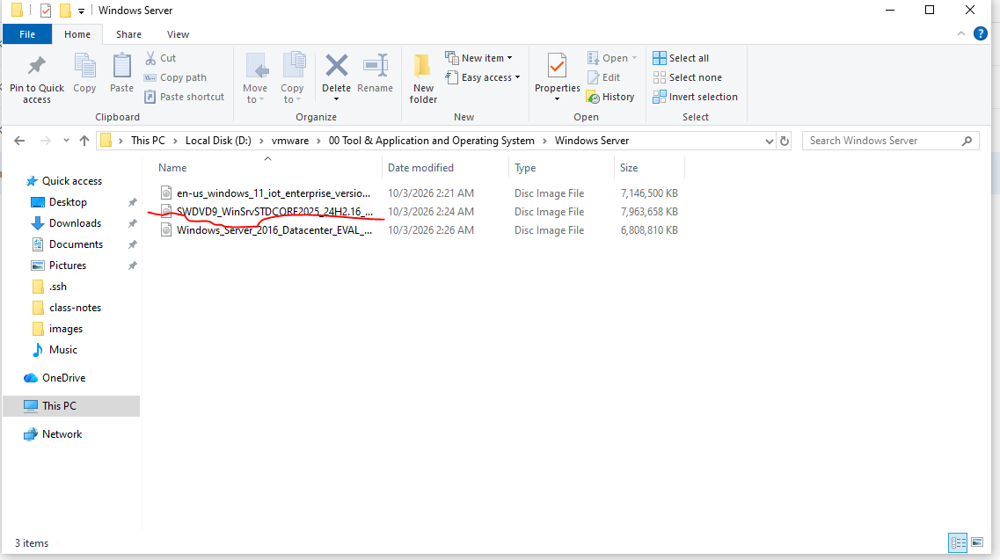

### 02. Start the VM wizard

In VMware Workstation choose File → New Virtual Machine.

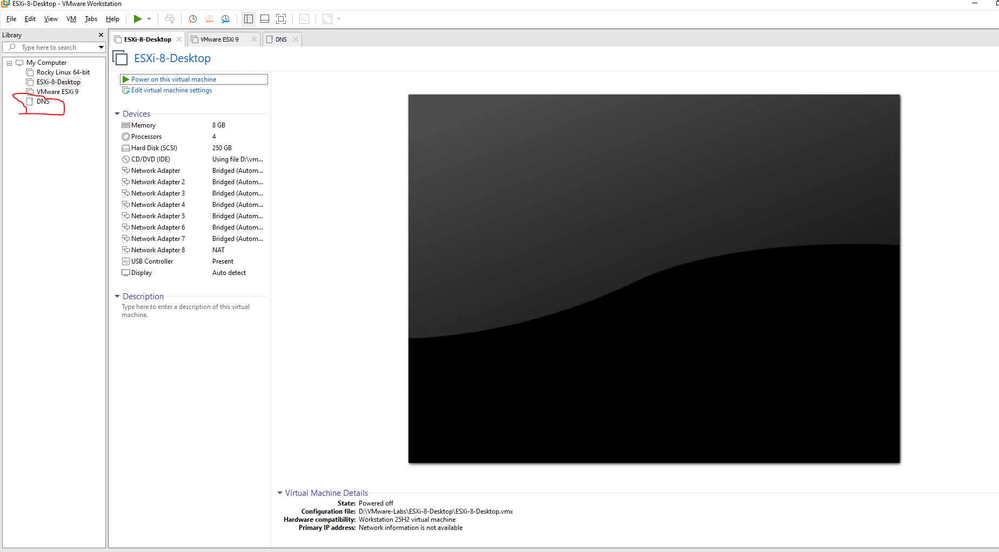

### 03. Configuration type

Select Typical and click Next.

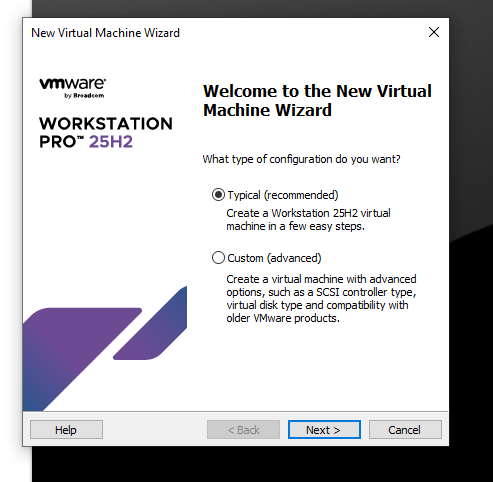

### 04. Install the OS later

Choose I will install the operating system later. This lets us configure hardware before booting.


### 05. Correction: guest OS

This screenshot records an incorrect ESX selection. Do not use it for this Windows VM; use the next corrected screen.

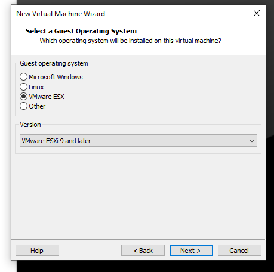

### 06. Correct guest OS

Choose Microsoft Windows and Windows Server 2025.

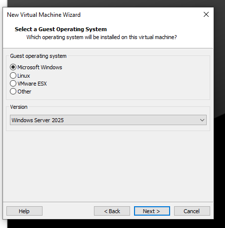

### 07. Name and location: initial screen

Replace the default name/location using the next screen.


### 08. VM name and files

Name: DNS-Win2025. Location: D:\VMware-Labs\DNS\DNS-Win2025.


### 09. Disk: initial setting

The initial disk size was 60 GB; our final setting is 80 GB, split into multiple files.


### 10. Review: disk correction needed

This earlier review still shows 60 GB. Return to the disk page and set 80 GB before finishing.


### 11. Teacher reference

Class reference only. Teacher hardware and NIC choices are not the final settings for this VM.


### 12. Memory

In Customize Hardware set memory to 4096 MB (4 GB). This screen records the earlier 2 GB state.

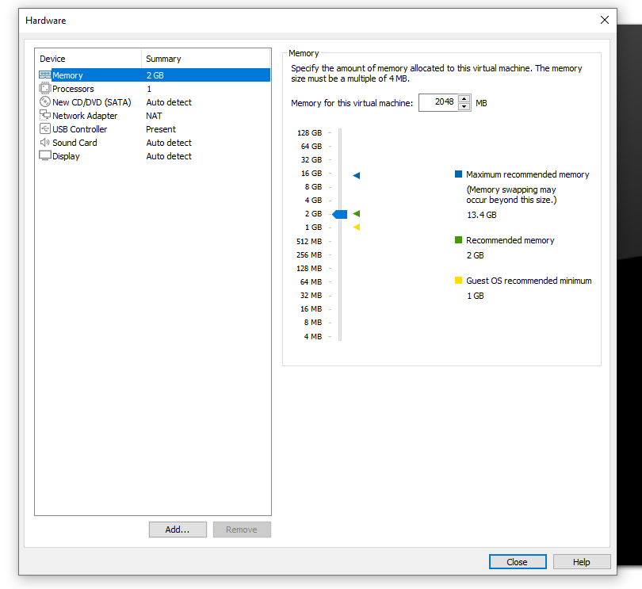

### 13. Processors

Set 1 processor with 2 cores: total 2 vCPUs. Leave virtualization engine checkboxes unchecked for this Windows DNS lab.

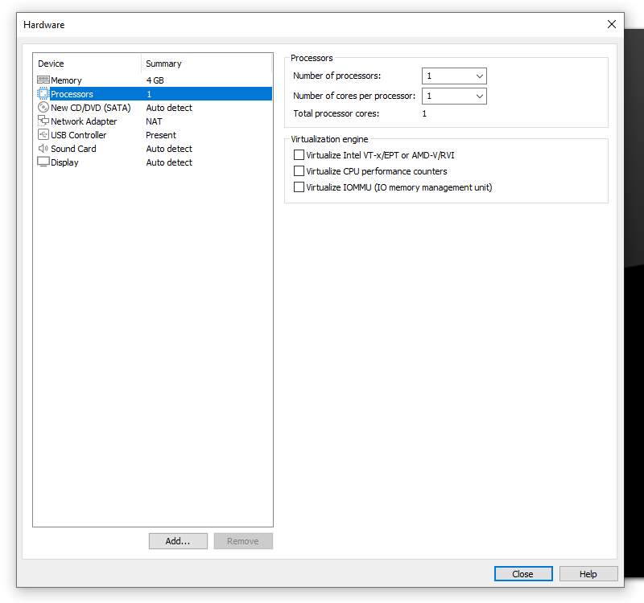

### 14. CD/DVD source

Select Use ISO image file rather than the physical drive.

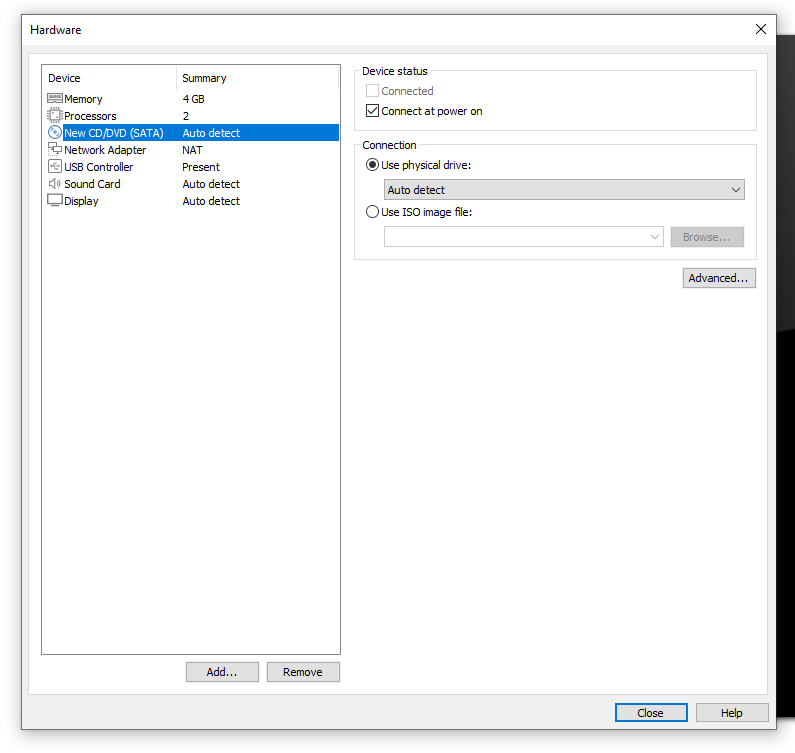

### 15. Attach ISO

Browse to the ISO listed in the environment table. Enable Connect at power on.

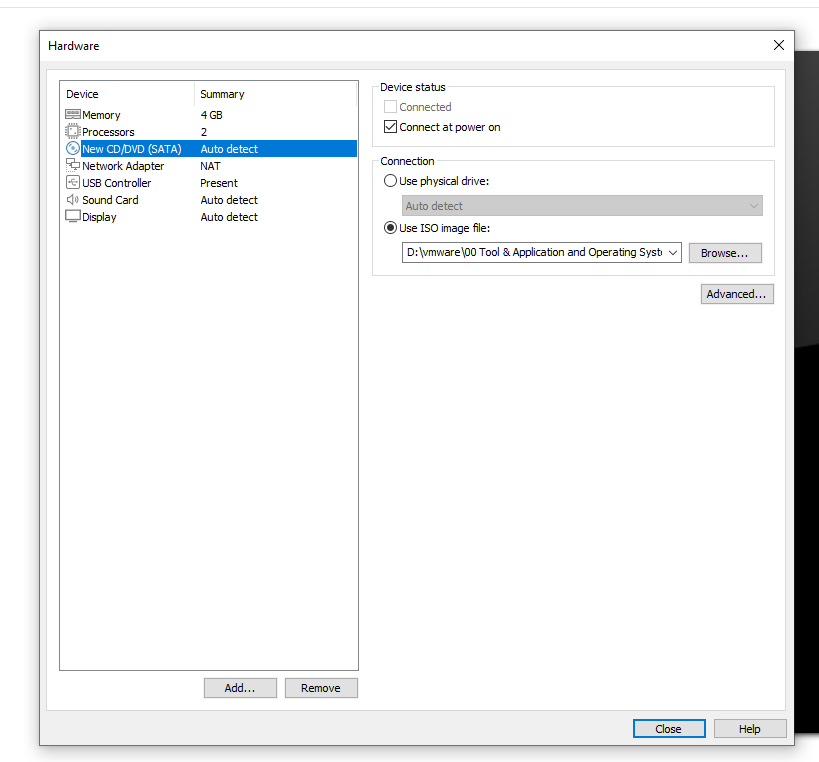

### 16. ISO evidence: additional view

Additional capture of the attached ISO; the full filename is recorded above.


### 17. Network adapter

Select NAT for this phase. The VM uses VMware VMnet8.


### 18. Final hardware review

Verify 4 GB RAM, 2 processor cores, and 80 GB disk before finishing.


### 19. Final review: second capture

Confirm the final summary and click Finish.

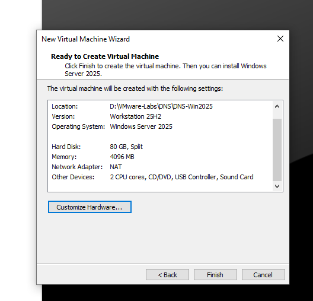

### 20. Superseded screenshot

User identified this upload as the wrong image. Retained in the evidence archive only; do not follow it.


### 21. VM created

The VM has been created. Power on the VM to begin installation.

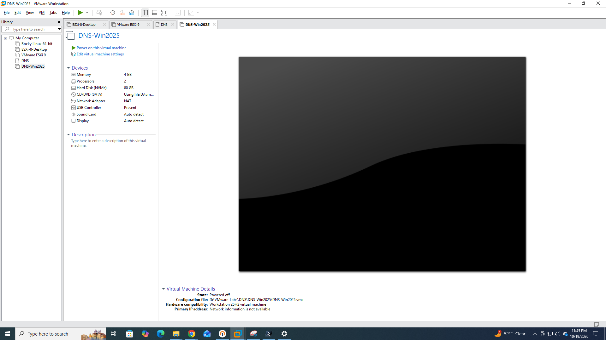

### 22. Missed ISO boot prompt

The keypress prompt was missed and boot fell through to PXE. This is a boot-selection issue, not evidence of a broken ISO.

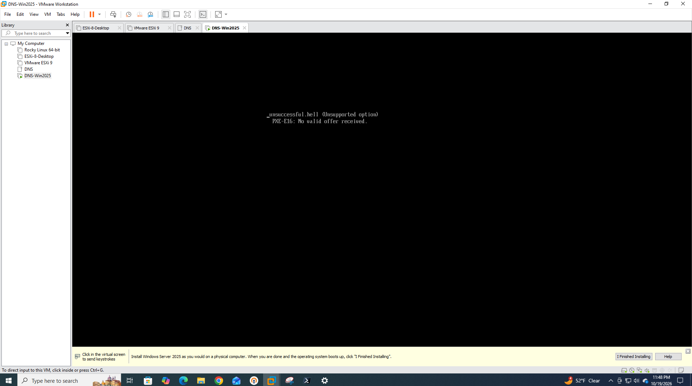

### 23. Recover through EFI Boot Manager

Select EFI VMware Virtual SATA CDROM Drive (1.0), press Enter, then promptly press Space when asked to boot from CD/DVD.

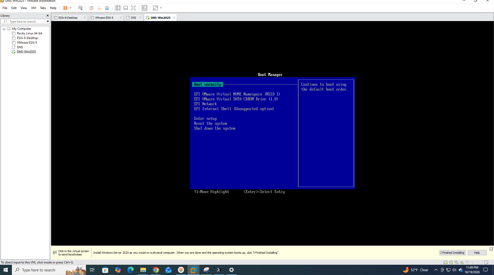

### 24. Windows Setup boot entry

At Windows Setup [EMS Enabled], press Enter.


### 25. Language and regional format

Keep English (United States) for language and time/currency, then Next.

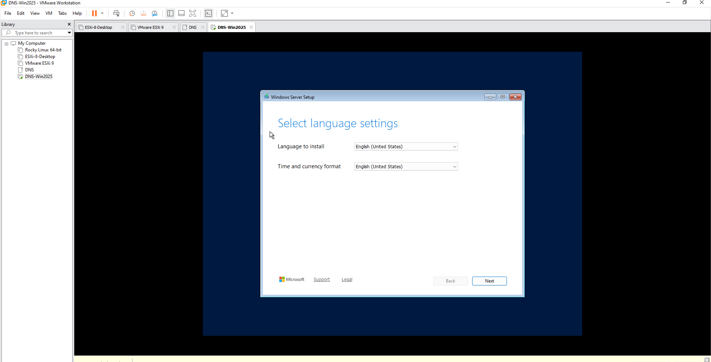

### 26. Keyboard

Keep US keyboard and click Next.


### 27. Installation option

Select Install Windows Server and acknowledge deletion for the new blank VM disk, then Next.

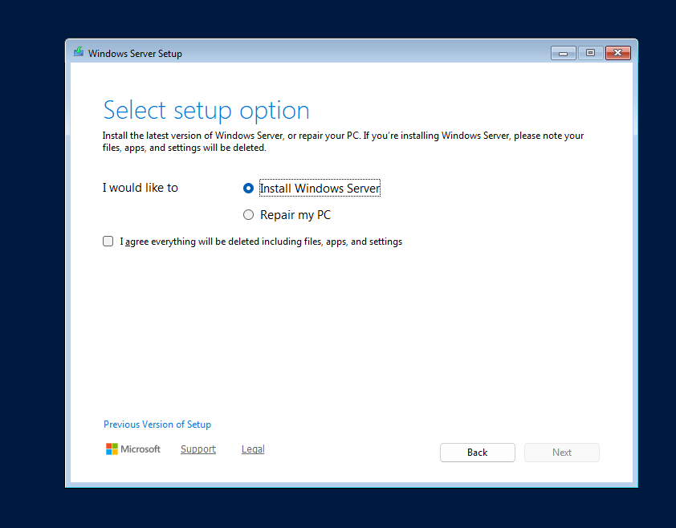

### 28. Select edition

Choose Windows Server 2025 Standard (Desktop Experience), the second option. Plain Standard is Server Core.


### 29. License terms

Read the terms and click Accept to proceed if you agree.


### 30. Installation disk

Select Disk 0 Unallocated Space, 80.0 GB. Click Next; Setup creates the required partitions.


### 31. Ready to install

Verify Standard (Desktop Experience) and Keep nothing. Click Install. Allow automatic restarts. On subsequent CD/DVD boot prompts do not press a key.


### 32. Workstation Library organization

DNS is a Library folder; DNS-Win2025 is the VM. The earlier assistant interpretation of the folder icon was incorrect.

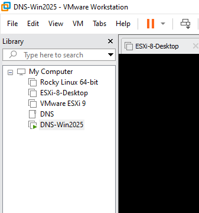

### 33. Folder menu and grouping

An existing DNS folder was confirmed by the user. Close the menu with Esc; drag DNS-Win2025 onto DNS to group it. Completion was instructed but not confirmed by a later folder screenshot.

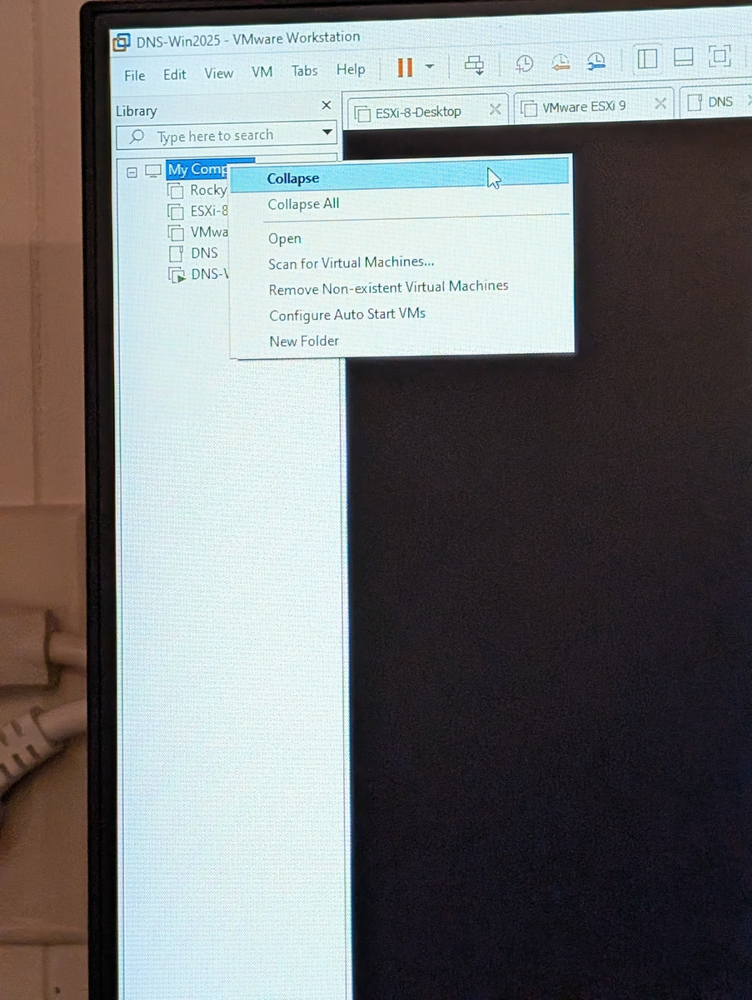

### 34. Administrator password

Enter and confirm your own Administrator password; click Finish. Do not record the password in study notes.

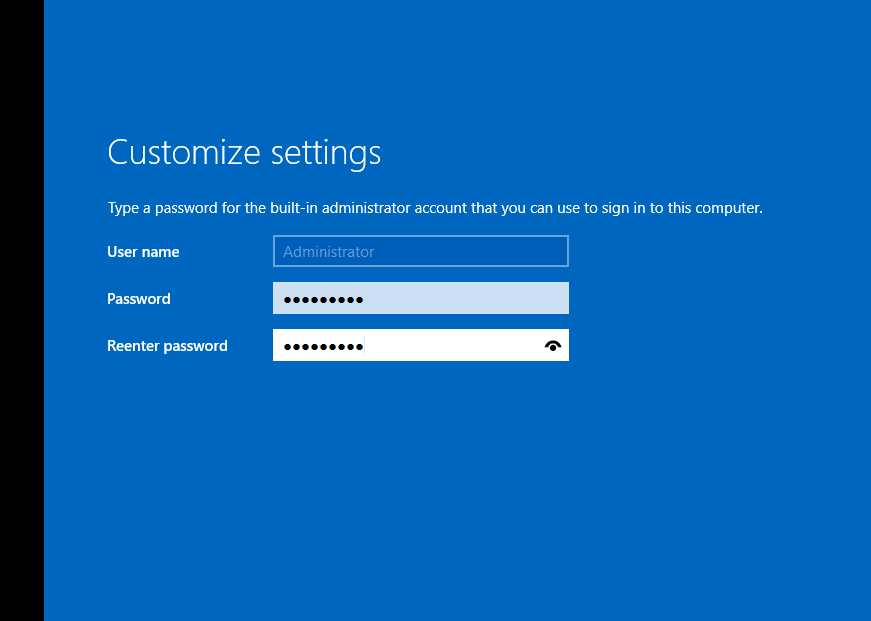

### 35. First sign-in

Click inside the VM and press Ctrl+Alt+Insert to send Ctrl+Alt+Delete to the guest. Sign in as Administrator.


### 36. Diagnostic data

Select Required only, then Accept.


### 37. Server Manager

Dismiss the Windows Admin Center/Azure Arc informational popup; optionally tick Do not show again. Open Local Server.

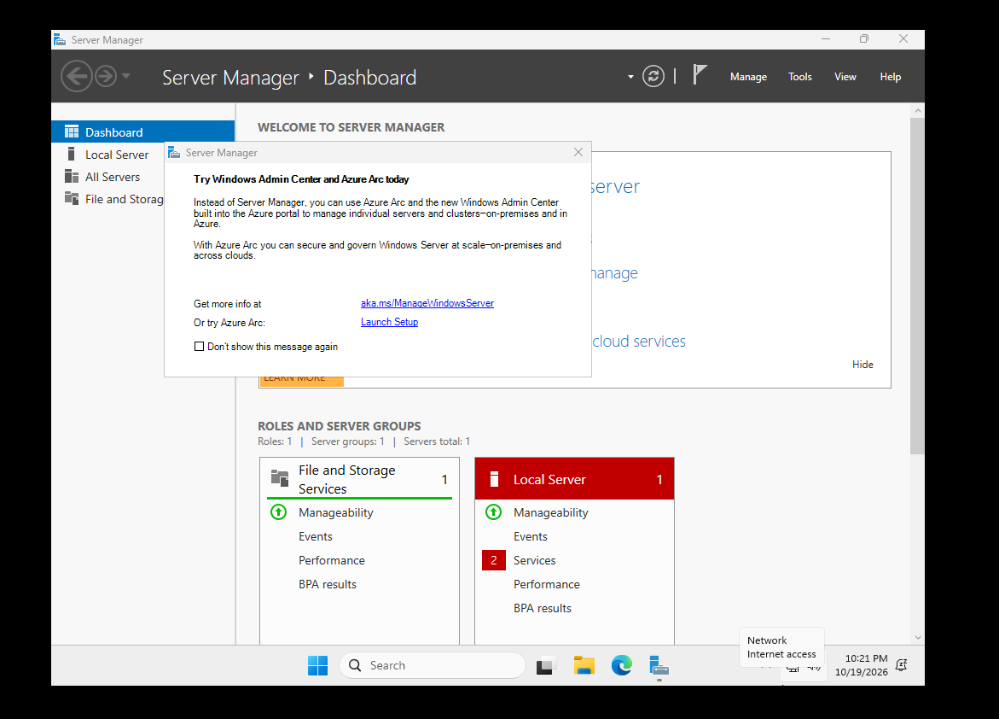

### 38. Inspect initial server state

The server is in WORKGROUP; Ethernet0 uses DHCP. Click the blue computer-name link.


### 39. Open rename dialog

In System Properties → Computer Name, click Change. Leave Computer description blank.

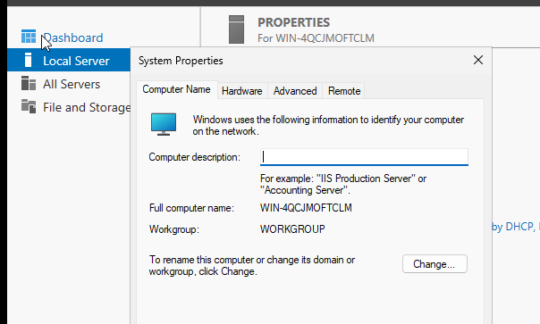

### 40. Set hostname

Replace the generated computer name with DNS01. Keep Workgroup: WORKGROUP and click OK.

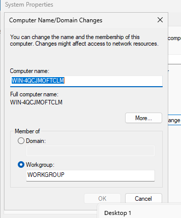

### 41. Restart for rename

Acknowledge restart, close System Properties, and choose Restart Now. Sign in again.


### 42. Verify hostname

Local Server now shows DNS01. Open CMD and run ipconfig /all.

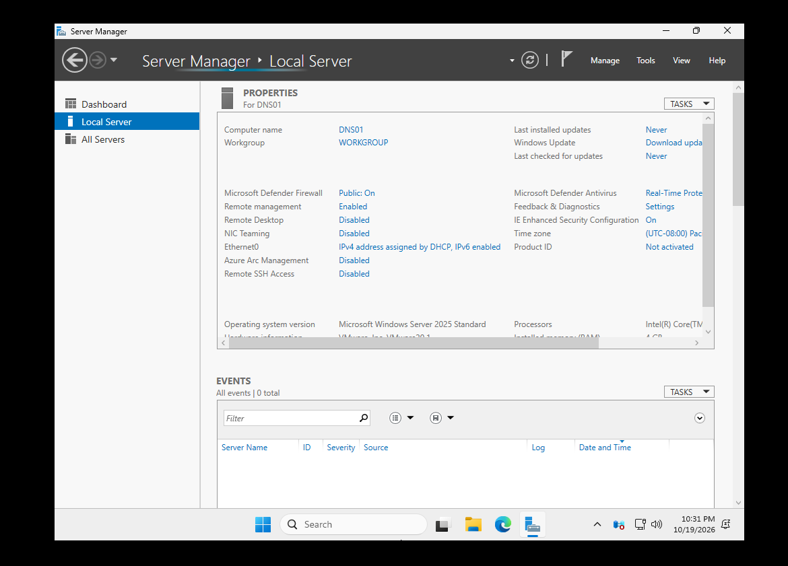

### 43. DHCP baseline

Observed IP 192.168.23.128/24, gateway and DNS 192.168.23.2, DHCP server 192.168.23.254.


### 44. Inspect VMnet8

Release input with Ctrl+Alt. Open Edit → Virtual Network Editor. Select VMnet8 (NAT), then DHCP Settings. Do not change the VMware network.


### 45. Record DHCP pool

VMnet8 subnet is 192.168.23.0/24; pool is 192.168.23.128–192.168.23.254. Plan 192.168.23.10 outside the pool. Outside-pool does not itself guarantee an address is unused by another static VM.

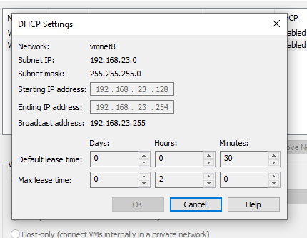

### 46. Network Connections

Close VMware network dialogs with Cancel. Inside DNS01 run ncpa.cpl. Right-click Ethernet0 → Properties.

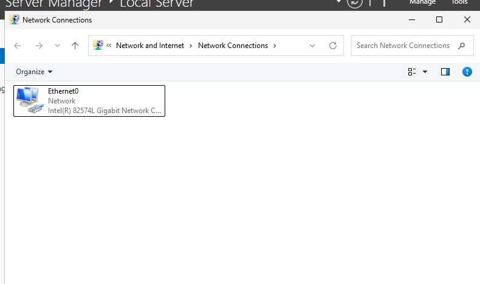

### 47. IPv4 Properties

Select Internet Protocol Version 4 (TCP/IPv4) → Properties. Choose manual IP and manual DNS.

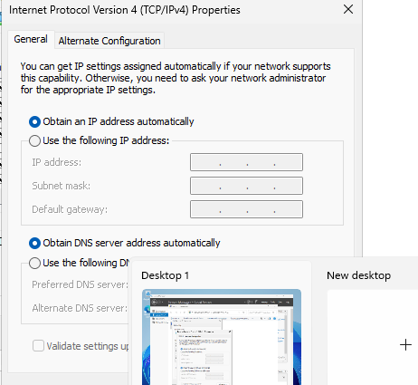

### 48. Catch the IP typo

This screen has 192.168.231.10, which is wrong for this /24 network. Correct the third octet from 231 to 23. Set mask 255.255.255.0, gateway 192.168.23.2, preferred DNS 192.168.23.2; alternate DNS blank. Click OK → Close.


### 49. Verify static configuration

Run ipconfig /all: DNS01, DHCP Enabled: No, IPv4 192.168.23.10 (Preferred), /24 mask, gateway/DNS .2.


### 50. Connectivity and name resolution

Run ping 192.168.23.2 and nslookup microsoft.com. The capture shows 3 ping replies, 0% loss, then Ctrl+C; lookup returned IPv4/IPv6 answers. Server: Unknown means the resolver name was not obtained, while this query still succeeded.


## Commands and shortcuts

| Command or shortcut | Purpose |
|---|---|
| `ipconfig /all` | Show hostname, DHCP status, IP address, mask, gateway, and DNS servers. |
| `ncpa.cpl` | Open Network Connections. |
| `ping 192.168.23.2` | Test reachability of the VMware NAT gateway. |
| `nslookup microsoft.com` | Test name resolution through the configured DNS resolver. |
| Ctrl+Alt | Release keyboard and mouse capture from the VM. |
| Ctrl+Alt+Insert | Send Ctrl+Alt+Delete to the guest for sign-in. |

## Key concepts

**VM name and Windows hostname:** DNS-Win2025 is the display name in Workstation; DNS01 is the Windows computer name inside the VM. These names can differ.

**Library folder and disk folder:** The DNS folder in Workstation groups VM entries. The D: directory stores the actual VM files. Dragging a VM into a Library folder organizes the entry; it does not move the VM files on disk. The user confirmed that DNS was already a folder. Final placement of DNS-Win2025 inside it was instructed but not confirmed by a later screenshot.

**NAT and the gateway:** VMnet8 uses a private network. The guest uses 192.168.23.2 as its VMware NAT gateway for outbound access. This is different from the physical home router, 10.0.0.1.

**Static IP and DHCP:** A DNS server needs a predictable address for clients. VMware's DHCP pool is 192.168.23.128–192.168.23.254; 192.168.23.10 was selected outside that pool. Being outside the pool does not guarantee that another manually configured VM is not using the address. After applying our configuration, Windows reported it as Preferred.

**Subnet mask:** With 255.255.255.0, 192.168.23.10 and 192.168.23.2 are in the same subnet. The mistyped address 192.168.231.10 belongs to a different subnet and was corrected before the final verification.

**DNS client and DNS server:** Windows can resolve names using VMware's DNS resolver without the Windows DNS Server role being installed. Successful nslookup output does not prove that the DNS Server role is present.

**Desktop Experience and Core:** Desktop Experience provides the graphical desktop used throughout this lab. The plain Standard installation option is Server Core.

**What the tests establish:** Gateway ping replies establish gateway reachability. The lookup establishes that the particular DNS query succeeded. These tests do not establish that every internet service or any future local DNS zone is working.

## Troubleshooting record

| Symptom | Finding | Correction |
|---|---|---|
| VM attempted PXE boot | The ISO boot keypress prompt was missed. | EFI Boot Manager → SATA CDROM → press a key at the prompt. |
| Plain Standard edition initially highlighted | This option installs Server Core. | Selected Standard (Desktop Experience). |
| Earlier disk summary showed 60 GB | Initial wizard value had not been corrected. | Changed the disk to 80 GB. |
| IP entered as 192.168.231.10 | Typo in the third octet. | Changed 231 to 23. |
| nslookup displayed Server: Unknown | The resolver name was not obtained. | The query still returned addresses; no query failure was inferred. |
| DNS folder initially described as a VM | Incorrect interpretation of the icon. | User confirmed it was an existing folder. |

## Verified results

- Windows Server 2025 Standard (Desktop Experience) installed and Administrator sign-in completed.
- Hostname DNS01 applied after restart.
- IPv4 192.168.23.10, mask 255.255.255.0, gateway 192.168.23.2, and preferred DNS 192.168.23.2 verified.
- DHCP Enabled: No; IPv4 address marked Preferred.
- Gateway test captured three replies with 0% packet loss, then Ctrl+C.
- microsoft.com lookup returned IPv4 and IPv6 addresses through 192.168.23.2.

## Pending checks and next session

- [ ] Confirm the VM's final placement under the Workstation DNS Library folder.
- [ ] Install or verify VMware Tools; completion was not evidenced in this session.
- [ ] Review the guest time zone: screenshots showed Pacific, while Chicago uses Central.
- [ ] Install the Windows DNS Server role and management tools.
- [ ] Configure and test DNS zones, records, and forwarding according to the class topology.
- [ ] Confirm the roles of the other two planned VMs before creating them.

To resume, power on **DNS-Win2025**, sign in as **Administrator**, then open **Server Manager → Manage → Add Roles and Features**. Share the first wizard screen and continue one step at a time.

The current preferred DNS remains **192.168.23.2** until the Windows DNS service and intended resolution path are ready. No domain join or Active Directory promotion has been performed.

## Evidence notes

The archive includes all 50 Windows-lab screenshots shared from 04:05:34 through 05:54:46 UTC, including the class reference and the upload explicitly identified as the wrong image. Each is labeled in its corresponding step. Earlier ESXi and RDP images belong to separate labs and are excluded. The Administrator password is not recorded; its screenshot shows masked fields. Review host paths and network details before publishing publicly.
