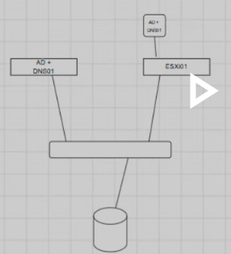
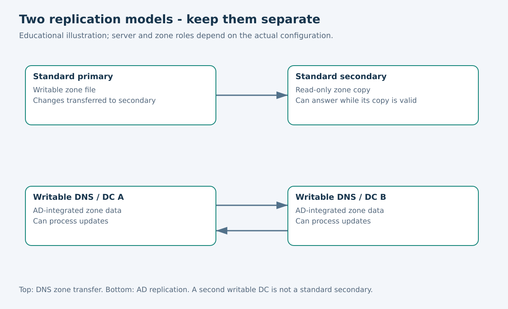
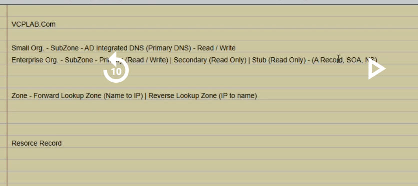
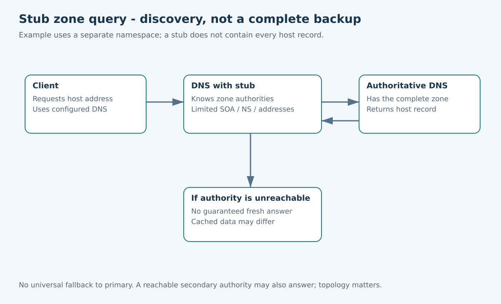
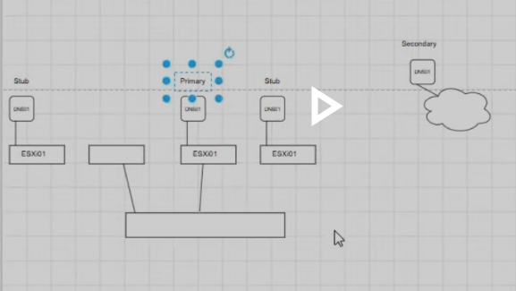
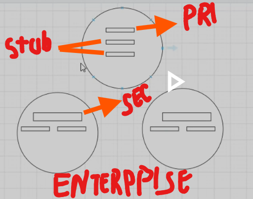
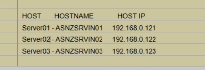

# DNS: Qadam Ba Qadam Study Guide

Roman Urdu edition • 20 October 2026

Bhai, is guide ko shuru se tarteeb ke saath parhein. Hum aik misaali organization se shuru karein ge jahan sirf aik DNS server hai. Phir har aglay lesson mein pichlay lesson ka masla hal karein ge. Teacher ke screenshots lecture ki evidence hain; in se yeh sabit nahin hota ke aapki lab ki configuration complete ho chuki hai.

Hum misaal ke liye `lab.example` namespace use karein ge. Yeh aapke current servers ke naam badalne ki instruction nahin hai. Teacher ka asal IP aur hostname plan Lesson 7 mein hai.

**Parhne ki tarteeb:** DNS ki bunyaad → primary aur secondary → failure dependencies → AD-integrated DNS → stub zones → doosri location aur recovery → aapki lab.

Aik waqt mein aik lesson parhein. Uska chhota sawal samajhne ke baad aglay lesson par jayein. English aur Roman Urdu files mein aik hi mazmoon hai; dono ko aik saath parhna zaroori nahin.

---

## Lesson 1 — DNS ki Demand kyun hai?

**Maqsad:** Naam, IP address, record aur zone samajhna.

Maan lein aik server ka IP `192.0.2.20` hai. Har baar IP yaad rakhne ke bajaye `files.lab.example` yaad rakhna aasaan hai. DNS mein aise records hotay hain jin ki madad se client naam se address maloom karta hai. Yeh IP sirf documentation ki misaal hai.

**A record** naam ko IPv4 address ke saath jorta hai. **AAAA record** naam ko IPv6 address ke saath jorta hai. **Zone** DNS ka woh hissa hai jis ke records ko aik administrative unit ke taur par manage kiya jata hai. Hamari misaali zone `lab.example` hai aur us mein `files.lab.example` aik record hai.

Forward lookup ka sawal hai: “Is naam ka address kya hai?” Reverse lookup ka sawal hai: “Is address ke saath kaunsa naam associated hai?” Reverse lookup ki alag zone aur PTR records hotay hain. Forward record banane se yeh zaroori nahin ke reverse record bhi ban gaya ho.

DNS directory ka kaam karta hai. Agar naam sahi IP par resolve ho raha hai, tab bhi firewall SSH ya HTTPS block kar sakti hai. User ke login permissions bhi alag masla hain.

### Thori history, taa ke terms clear hon

Shuru mein networks HOSTS file mein naam aur address ki mapping rakhte thay. Network barha to aik file ko har jagah update karna mushkil ho gaya. DNS distributed aur hierarchical naming system le kar aaya. **BIND** DNS server software hai, koi alag naming protocol nahin. **WINS** puranay NetBIOS names ke liye legacy service hai; modern DNS ka badal nahin. Windows ki local `hosts` file aur DNS server ki zone database alag cheezein hain.

### Ab sirf aik server se shuru karein

Hamari organization DNS-A par standard primary zone banati hai. Administrator file server ka record yahan add karta hai. DNS-A is zone ka authoritative server hai: is ke paas woh zone data hai jis ki zimmedari is server par hai.

**Chhota sawal:** Naam resolve hota hai lekin port 443 block hai. Kya DNS zaroor kharab hai?

**Jawab:** Nahin. Naam resolve hona aur service se connection hona do alag checks hain.

**Agla sawal:** Agar DNS-A band ho jaye to kya karein?

---

## Lesson 2 — Aik server fail ho to secondary kaam aaye

**Maqsad:** AD se pehle standard primary aur secondary ka model samajhna.

DNS-A par writable standard primary zone hai. Ab DNS-B par `lab.example` ki secondary zone banate hain. Approved zone transfer se DNS-B ko poori zone ki read-only copy milti hai. DNS-A band ho tab bhi DNS-B queries ka jawab de sakta hai, bashartay ke us ki copy valid ho aur clients us tak pohanch saken.

| Kaam | DNS-A: standard primary | DNS-B: secondary |
|---|---|---|
| Is zone ke records administrator badal sakta hai | Haan | Seedha nahin |
| Apni zone copy se query ka jawab deta hai | Haan | Haan |
| Is misaal mein zone transfer ka kirdar | Copy bhejta hai | Copy leta hai |

Yeh role **zone ka** hota hai, poori machine ka permanent label nahin. Aik server aik zone ke liye primary aur doosri ke liye secondary ho sakta hai. Munasib configuration mein approved secondary bhi transfer source ho sakta hai.

### Aik change ko follow karein

1. DNS-A par `printer.lab.example` record add karein.
2. SOA serial se zone ka naya version pehchana jata hai.
3. DNS-B changes check karke zone transfer se update leta hai.
4. DNS-B ko directly query karke naya record verify karein.
5. Is ke baad primary ki failure ka controlled test karein.

DNS-B har user query ke liye DNS-A se nahin poochta. Woh apni copy se jawab deta hai. SOA refresh aur retry update checks ko control karte hain. Expiry batati hai ke successful refresh ke baghair copy kitni der serve ho sakti hai. Record ka cache TTL alag timer hai. Secondary ki copy hamesha ke liye offline valid nahin rehti.

### Client ki settings bhi zaroori hain

Client ko sahi DNS resolvers tak pohanchna aur unhein use karna aana chahiye. Server ka “secondary” hona client ki alternate DNS setting banne ke barabar nahin. NXDOMAIN jaisa valid negative answer milne par client aam tor par har doosray DNS ko dobara nahin poochta. Internal naamon ke liye configured resolvers ka data consistent hona chahiye.

DNS ke liye aam tor par UDP aur TCP port 53 dono chahiye. Standard full zone transfer TCP use karta hai. Transfers sirf approved servers ko allow karein.

Agar primary permanently lost ho jaye to administrator suitable standard secondary zone ko primary mein convert kar sakta hai. Yeh automatic nahin. Purana primary wapas aaye to writable copies ki consistency ka khayal rakhna hoga. Pehle backup aur change ka record rakhein.

**Chhota sawal:** DNS-A fail ho to DNS-B ko jawab dene se pehle primary banana zaroori hai?

**Jawab:** Nahin. Valid copy wala reachable secondary pehle hi jawab de sakta hai. Promotion ka talluq future changes likhne se hai.

**Agla sawal:** Agar dono servers aik ESXi host par hon to kya redundancy kaafi hai?

---

## Lesson 3 — Sirf servers na ginein, unki dependencies dekhein

**Maqsad:** Teacher ne physical server aur ESXi VM ka zikr kyun kiya?

Aik ESXi host par do DNS VMs hon to aik guest OS ke maslay se kuch protection milti hai. Magar host ki power chali jaye to dono VMs band ho jati hain. Alag hosts par rakhne se isolation behtar hoti hai, lekin shared switch, datastore ya power phir bhi dono ko affect kar sakti hai.

Teacher ki physical-plus-virtual misaal kuch platform dependencies alag karti hai:



Is tasveer ko aik physical AD/DNS server aur ESXi par doosri AD/DNS instance ki misaal samjhein. Dono network se connected hain. Labels classroom shorthand hain. Storage ka symbol yeh sabit nahin karta ke VM ko external database lazmi chahiye.

**Datastore** VM ki files rakhta hai. Guest filesystem mein us ka operating system aur application data hota hai. AD DS ki directory database, aam tor par NTDS.dit, domain controller ki configured storage mein hoti hai. VM local ya shared storage use kar sakti hai. Virtualization ki wajah se external database lazmi nahin ho jata.

Physical DNS server aik valid design choice hai; har small organization ke liye lazmi rule nahin. Virtual DNS aur domain controllers bhi valid ho sakte hain. Dekhein har server kis host, disk, switch, power aur site par depend karta hai. Backup bhi rakhein: ghalat deletion redundant copies par replicate ho sakti hai.

**Chhota sawal:** Aik hi host ki do DNS VMs host band hone par chalti rahengi?

**Jawab:** Nahin. Dono ka aik common dependency wohi host hai.

**Agla sawal:** Tasveer mein AD bhi hai. Kya is se primary/secondary model badalta hai?

---

## Lesson 4 — AD-integrated DNS ka replication model alag hai

**Maqsad:** Identity management aur DNS ka farq, phir do zone models ka muqabla.

Aapki class pehle enterprise standalone DNS baghair AD parh rahi hai. Baad mein small organization ke example mein AD add hoga. Yeh teaching scenarios hain. Is ka matlab nahin ke enterprise AD/DNS combine nahin kar sakti ya har small organization ko combine karna lazmi hai.

**AD DS** domain ke users, groups aur computers jaisi identities manage karta hai. IAM mein authentication aur authorization mein madad karta hai. DNS clients ko domain controller aur doosri services dhoondne mein madad karta hai. DNS khud users ke permissions manage nahin karta.

**GPO** ka matlab Group Policy Object hai. Is ki links aur filtering ke mutabiq users aur computers par settings apply ho sakti hain. Lecture mein “GPU” se murad zyada imkaan GPO tha; GPU graphics hardware hai. Group Policy Software Installation se suitable MSI packages deploy kiye ja sakte hain, jab package access, permissions aur policy scope sahi hon. Har application ko is tareeqay se install karna mumkin nahin.

### Ab Lesson 2 ke model se muqabla karein

| Sawal | Standard primary/secondary zone | AD-integrated zone |
|---|---|---|
| Zone data kahan hai? | Standard zone files mein | AD DS mein |
| Data kaise replicate hota hai? | DNS zone transfers se | AD replication se |
| Write kahan hoti hai? | Standard primary par | Munasib writable DC/DNS replicas par |
| Kya doosri har copy secondary hai? | Secondary explicitly banani hoti hai | Nahin |



Doosray writable AD/DNS server ko automatically “read-only secondary” na samjhein. RODC aik alag design hai. AD replication scope, permissions aur updates ki configuration bhi aham hai.



Is slide ko teen sawalon mein parhein: **forward/reverse** lookup ki direction batata hai; **primary/secondary/stub** zone ka role batata hai; **AD-integrated** storage aur replication batata hai. Yeh aik hi category nahin. Slide ka “SubZone” lafz dekh kar har zone type ko delegated child zone na samjhein.

**Chhota sawal:** Do writable AD-integrated DNS copies standard primary-to-secondary transfer hi use karti hain?

**Jawab:** Nahin. Un ka AD-integrated data AD replication se jata hai.

**Agla sawal:** Agar doosri namespace ke DNS servers dhoondne hon magar us ke tamam records ki copy na chahiye to?

---

## Lesson 5 — Stub raasta batata hai, poora backup nahin hota

**Maqsad:** Stub, Lesson 2 ke secondary ka badal kyun nahin hai?

Ab hamari organization ko doosri namespace `branch.example` ke names resolve karne hain. Us ke tamam host records copy karne ke bajaye DNS-A par stub zone hai. Is mein us namespace ke authoritative DNS servers ki maloomat hoti hai.

Stub mein SOA, NS aur zaroori address/glue records hotay hain, jin mein A aur AAAA shamil ho sakte hain. Inhein record ki categories samjhein; lazmi nahin ke sirf teen individual entries hon. Branch ke tamam host records stub mein nahin hotay.

### Aik query ko follow karein

1. Client DNS-A se `printer.branch.example` poochta hai.
2. DNS-A stub ki authority information se `branch.example` ka authoritative server dhoondta hai.
3. Reachable authoritative server se jawab leta hai.
4. Client ko result deta hai aur DNS rules ke mutabiq cache kar sakta hai.



Authority primary bhi ho sakti hai aur secondary bhi; har baar sirf primary nahin. Agar saaray authoritative servers unreachable hon aur usable cached answer bhi na ho, to stub missing host record khud nahin bana sakta. “Stub fail ho to primary ki taraf redirect” koi universal DNS rule nahin.

Stub authority discovery mein madad de sakta hai. Har query ko tez karne ki guarantee nahin aur yeh full disaster recovery copy nahin. Aik server aik zone ka stub aur doosri zone ka primary ya secondary rakh sakta hai. “Stub server hamesha stub hi rahega” machine ka permanent rule nahin.

**Chhota sawal:** Poori read-only zone secondary mein hoti hai ya stub mein?

**Jawab:** Secondary mein. Stub mein limited authority information hoti hai.

**Agla sawal:** Agar poori site fail ho jaye to full copy kahan honi chahiye?

---

## Lesson 6 — Doosri location ka DNS aur poori disaster recovery

**Maqsad:** DNS available hona aur application recover hona alag samajhna.

Agar DNS-A aur DNS-B aik data center mein hon to poori site ke outage mein dono lost ho sakte hain. DNS-C doosri location par ho to yeh common risk kam hota hai. Cloud mein DNS VM aik option hai, magar private routing, security, supported transfers aur operations plan karne hotay hain. Managed cloud DNS service ko seedha Windows DNS VM ke barabar na samjhein.



Sketch primary, stub aur cloud-secondary ke ideas dikhata hai. Repeat honay walay ESXi labels classroom shorthand hain. Yeh live hosts, links ya cloud configuration ki confirmation nahin.



### Data center band ho to kya ho sakta hai?

| Kya available hai? | Mumkin nateeja |
|---|---|
| Remote DNS aur us tak working raasta | Us raastay walay clients names resolve kar sakte hain |
| Remote DNS hai magar local clients ka network raasta band hai | Local clients phir bhi query nahin kar sakte |
| DNS jawab deta hai magar application server failed site mein hai | Naam resolve hoga, application nahin chalegi |
| Remote DNS, application replica, data aur connectivity hain | Zyada mukammal service recover ki ja sakti hai |

“Bahar ki duniya connected hai magar internal communication band hai” aik mumkin scenario hai, cloud DNS ka automatic rule nahin. Dekhna hoga kaunse services, records aur network paths bachay hain.

**DR site** disaster recovery ki location hai. VMware **DRS** ka matlab Distributed Resource Scheduler hai; woh alag feature hai. **DC** likhte waqt clear karein ke data center murad hai ya domain controller.

### Teacher ka “3–4 ghantay peechay” wala example

Maan lein outage 16:00 par hua aur latest usable restored data 12:00 ka hai. Chaar ghantay tak ke changes missing ho sakte hain. Yeh recovery point aur acceptable data loss yani **RPO** se related hai. Service 18:00 par wapas aaye to recovery mein do ghantay lagay. Is duration ka target **RTO** hota hai. Target aur actual result aik jaisay hona lazmi nahin.

Is ka matlab Windows ki clock peechay karna nahin. Matlab puranay data state se recovery hai. Redundant DNS ke saath backups aur recovery process bhi test karein.

**Chhota sawal:** Sirf cloud secondary honay se poori site fail honay par file server bhi wapas aa jayega?

**Jawab:** Nahin. Workloads, data aur network connectivity ki recovery bhi chahiye.

**Agla sawal:** Ab yeh concepts aapki actual lab par kaise apply honge?

---

## Lesson 7 — Aapki lab: pehle sabit settings, phir future plan

**Maqsad:** Existing installation aur naye lecture plan ko mix na karna.

### A. Installation notes ka last evidenced checkpoint

Yeh maloomat aapke diye huay Windows Server installation notes se hai. Yeh historical checkpoint hai; aaj ki live machine inspection nahin.

| Cheez | Notes mein sabit value |
|---|---|
| VM display name / Windows hostname | DNS-Win2025 / DNS01 |
| OS | Windows Server 2025 Standard, Desktop Experience |
| Domain state | WORKGROUP; AD deployment confirm nahin |
| VM resources | 4 GB RAM, 2 vCPUs, 80 GB split NVMe virtual disk |
| VM path | `D:\VMware-Labs\DNS\DNS-Win2025` |
| Network | NAT VMnet8, `192.168.23.0/24` |
| Server address | `192.168.23.10/24` |
| Gateway | `192.168.23.2` |
| Temporary preferred DNS | `192.168.23.2`; alternate blank |
| DHCP | Server par disabled; recorded pool `.128–.254` |
| Successful checks | Gateway ping aur external name lookup |
| DNS Server role | Is checkpoint par install nahin tha |

Is stage par external name resolve hona configured resolver ka kaam karna dikhata hai. Is se aapki apni DNS role ya zone ka hona sabit nahin hota. Nslookup mein sirf `Server: Unknown` aana bhi failure ka saboot nahin; resolver ka reverse name available na ho sakta hai.

### B. Teacher ka baad wala three-server plan



| Class label | Hostname | IP address |
|---|---|---|
| Server01 | ASNZSRVIN01 | 192.168.0.121 |
| Server02 | ASNZSRVIN02 | 192.168.0.122 |
| Server03 | ASNZSRVIN03 | 192.168.0.123 |

Tasveer mein prefix length, gateway, VMnet, resolver settings aur DNS roles ki assignment nahin di hui. Sirf table match karne ke liye `/24` assume na karein, DNS01 rename na karein aur IP na badlein. Pehle intended virtual network aur addressing verify karein. Server number ka matlab automatically primary, secondary ya stub nahin.

Class reminder mein `VCPLAB.Com` likha hai. Woh lecture text hai; is se public domain ki ownership confirm nahin hoti. Hamari `lab.example` misaal sirf samjhane ke liye hai.

### C. Agli practical lab is tarteeb se karein

1. **Inventory:** har server ka actual hostname, IP/prefix, gateway, virtual network aur installed roles note karein.
2. **Class topology choose karein:** existing network rakhna hai ya naya banana hai, deliberate decision karein. Confirmed roles bhi likhein.
3. **Primary:** standalone lesson mein DNS install karke standard primary forward zone banayein.
4. **Records:** test A record add karke usi DNS server ko directly query karein. Reverse DNS jab chahiye alag bana kar test karein.
5. **Secondary:** authorized zone transfers configure karke doosray server ki copy verify karein.
6. **Failure test:** primary temporarily unavailable karke secondary ko directly query karein. Evidence save karein aur primary restore karein.
7. **Stub exercise:** doosri namespace use karein taa ke discovery ka purpose clear ho. Secondary ko chupke se stub se replace na karein.
8. **Baad ka AD lesson:** AD-integrated replication ko alag exercise mein parhein; troubleshooting mein do models mix na karein.

Yeh planned stages hain; abhi execute honay ka dawa nahin. Lab karte waqt exact GUI steps, outputs aur results capture karein ge.

### Har Windows Server ke andar safe inventory commands

Role checks elevated PowerShell mein chalayein. Yeh configuration dekhte hain; role install ya IP change nahin karte.

```powershell
hostname
Get-NetIPConfiguration
Get-DnsClientServerAddress -AddressFamily IPv4
Get-WindowsFeature DNS,AD-Domain-Services
Get-Service DNS -ErrorAction SilentlyContinue
```

DNS service na mile to role installed hai ya nahin check karein. Successful output assume na karein. Jab lab zone ban jaye to test ke liye dono placeholders replace karein:

```powershell
Resolve-DnsName -Name '<test-name-in-your-zone>' -Server '<DNS-server-IP>' -Type A
```

**Chhota sawal:** Kya `192.168.0.121` aapki current working server IP confirm hai?

**Jawab:** Nahin. Woh teacher ka plan hai. Diye gaye installation checkpoint mein `192.168.23.10` tha.

**Aagay barhne ki tayyari tab hai:** jab primary aur secondary, secondary aur stub, AD replication aur zone transfer, aur evidenced setting aur planned setting ka farq apne alfaaz mein bata saken.

---

## Aakhri revision — design apne alfaaz mein samjhayein

Hamari standard-zone misaal mein changes primary par hotay hain. Secondary poori read-only copy rakhta hai aur valid copy se jawab de sakta hai. Writable AD-integrated copy AD replication model follow karti hai. Stub authorities dhoondne mein madad karta hai, poori host list nahin rakhta. Remote copy tab madad karti hai jab client us tak pohanch sake. Poori disaster recovery ke liye applications aur unka data bhi chahiye.

Practical session mein yeh evidence table use karein:

| Stage | Expected result | Actual evidence | Status |
|---|---|---|---|
| Inventory | Addresses aur roles note hon | Capture karni hai | Pending |
| Primary | Direct query se test naam resolve ho | Capture karni hai | Pending |
| Secondary | Wohi naam secondary se resolve ho | Capture karni hai | Pending |
| Update | Naya record secondary tak aaye | Capture karni hai | Pending |
| Controlled failure | Valid secondary jawab de | Capture karni hai | Pending |
| Recovery | Primary restore ho, data consistent ho | Capture karni hai | Pending |
| Stub | Doosri namespace reachable authority se resolve ho | Capture karni hai | Pending |

### Mazeed parhne ke liye

Yeh official references explanation ki bunyaad hain. Lessons ke baad Demand par parhein.

- [Microsoft: DNS zone types](https://learn.microsoft.com/en-us/windows-server/networking/dns/zone-types)
- [Microsoft: Manage DNS zones](https://learn.microsoft.com/en-us/windows-server/networking/dns/manage-dns-zones)
- [Microsoft: Virtualized domain controllers](https://learn.microsoft.com/en-us/windows-server/identity/ad-ds/get-started/virtual-dc/virtualized-domain-controllers-hyper-v)
- [Microsoft: Group Policy overview](https://learn.microsoft.com/en-us/windows-server/identity/ad-ds/manage/group-policy/group-policy-overview)
- [Microsoft: Group Policy se software deployment](https://learn.microsoft.com/en-us/troubleshoot/windows-server/group-policy/use-group-policy-to-install-software)
- [RFC 1034: DNS concepts](https://www.rfc-editor.org/rfc/rfc1034)
- [AWS: Disaster recovery planning](https://docs.aws.amazon.com/wellarchitected/latest/reliability-pillar/plan-for-disaster-recovery-dr.html)

Original class pictures jaisi mili thin waisi preserve hain. Comparison aur query illustrations samjhane ke liye add ki gayi hain. Purani installation screenshots alag installation notes mein rakhein taa ke yahan learning flow seedha rahe.
