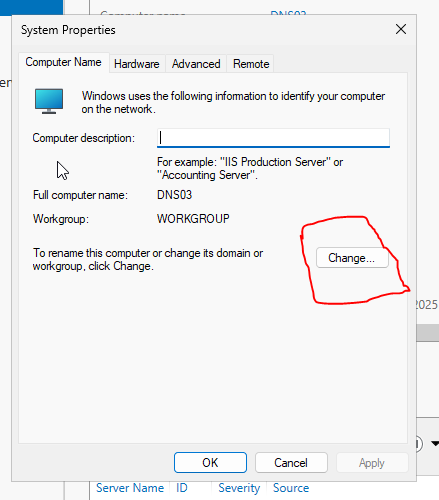
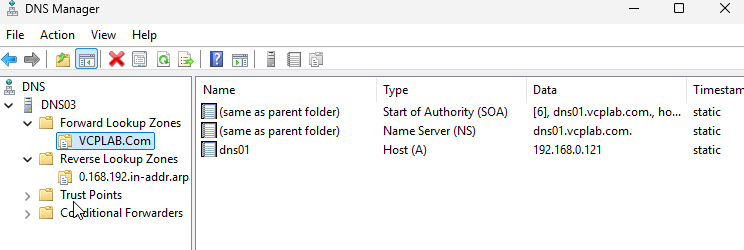

# DNS03 — Windows Server 2025: installation ki tabdeeli aur DNS readiness

## Is chapter ka maqsad

DNS03 par pehle Windows 11 install hua tha. Us se client desktop aur network tests huay, magar server lab ki Windows Server DNS role ke liye woh platform nahin tha. Baad mein DNS03 ko Windows Server 2025 se rebuild kiya gaya. Yeh chapter installation section mein us replacement ka checkpoint deta aur baad ki documented DNS configuration se jorta hai.

Supplied organized archive mein DNS03 ki separate Server 2025 setup walkthrough nahin thi. Is liye yeh **retrospective installation/readiness checkpoint** hai; har installer page capture honay ka dawa nahin. Windows 11 record historical archive mein hai. Us ki ISO, hardware allocation aur VM path ko replacement server ka proof nahin samjha gaya.

## Recorded replacement server ki pehchan

| Cheez | Recorded value / evidence ki had |
|---|---|
| Guest hostname | DNS03 |
| Operating system | Suffix notes mein Windows Server 2025 Standard, Desktop Experience recorded |
| Membership | WORKGROUP; suffix set karna AD join nahin |
| Network | Configuration record mein VMnet2 host-only, 192.168.0.0/24 |
| IPv4 / mask | 192.168.0.123 / 255.255.255.0 |
| Gateway | Isolated lab mein blank |
| Preferred / alternate DNS | DNS03 suffix evidence mein 192.168.0.123 / 192.168.0.121 |
| Primary DNS suffix | VCPLAB.Com |
| Full computer name | DNS03.VCPLAB.Com |
| Baad ki DNS role | Configuration chapter mein forward/reverse stub zones documented |
| Replacement ISO aur VM storage ka exact path | Available replacement captures se establish nahin |
| Replacement RAM, CPU aur disk allocation | Yahan independently establish nahin; Windows 11 values proof nahin |

## Installation ki tabdeeli ka silsila

1. Windows 11 build DNS03 ki pehli attempt thi. Woh Archive/Historical_VM_Setups/DNS03_Windows_11 mein preserve hai.
2. Replacement mein Windows Server 2025 ka graphical Desktop Experience use hua. Baad ki capture mein Server Manager available hai.
3. DNS03 ki guest identity aur isolated static-network settings establish huin. Later ipconfig final settings ki evidence hai; har intermediate dialog ki nahin.
4. Stub-zone exercise tak DNS Server role available thi. Original add-role wizard sequence yahan nahin; subsequent working configuration us later role state ki evidence hai.
5. Primary suffix aur DNS operation apni configuration exercises mein verify huay. Un ke detailed chapters neeche linked hain.

## Checkpoint 1 — Server Manager aur server identity

Existing DNS03 suffix workflow Server Manager → Local Server se shuru hota hai. Yeh baad ki server-readiness evidence hai, installer screenshot nahin.


Computer properties capture bhi usi DNS03 suffix workflow ka hissa hai. Source notes OS ko Windows Server 2025 Standard (Desktop Experience) batati hain.



## Checkpoint 2 — Naming aur network ka result

Recorded suffix Computer Name → Change → More se apply hua aur restart hua. Final command thi:

```powershell
ipconfig /all
```

Result mein DNS03, VCPLAB.Com, static .123/24 aur DNS addresses recorded hain. Primary suffix naming context deta hai; AD join, zone creation ya har DNS record ki registration ka proof nahin.


Complete [DNS Suffix procedure](../../Configuration/06_DNS_Suffix/STUDY_NOTES_ROMAN_URDU.md) mein tamam saat captured stages hain. Is checkpoint se tamam firewall profiles, Windows activation, VMware Tools ya exact replacement hardware allocation ki verification claim nahin ki gayi.

## Checkpoint 3 — DNS role readiness aur baad ki stub configuration

Later record mein DNS03 par VCPLAB.Com stub hai. Is mein limited authority information hai, secondary jaisi full zone copy nahin.



.123 ke zariye direct forward aur reverse tests recorded hain:

```powershell
nslookup dns02.vcplab.com. 192.168.0.123
nslookup 192.168.0.122 192.168.0.123
```


Successful results DNS03 ke zariye later DNS service operation sabit karte hain. Primary-outage recovery ya exact upstream packet path sabit nahin hota. Complete [Stub DNS chapter](../../Configuration/03_Stub_DNS/STUDY_NOTES_ROMAN_URDU.md) mein configuration aur evidence ki had dono hain.

## Repeat installation ke liye inventory checklist

Neeche future verification checklist hai, naye captured outputs nahin. Replacement Windows Server ke andar elevated PowerShell se identity, OS, addresses aur role state record ho sakti hai:

```powershell
hostname
Get-CimInstance Win32_OperatingSystem |
    Select-Object Caption, Version, BuildNumber, OSArchitecture
ipconfig /all
Get-WindowsFeature DNS
Get-Service DNS -ErrorAction SilentlyContinue
```

Role ka `Installed` hona, service ka running hona aur actual query successful hona alag checks hain. Complete repeat build mein replacement ISO/edition, VM path/hardware, disk selection, pehla Server Manager session, rename/restart, adapter settings aur role-install result capture hon. Windows 11 screenshots ko Server 2025 installer choices ki tasveer na samjhein.

## Status ka khulasa

- Later record mein completed: Server 2025 DNS03 identity, suffix/network checkpoint, stub configuration aur direct lookups.
- Separate historical walkthrough mein missing: replacement Windows Setup pages aur DNS-role installation wizard pages.
- Claim nahin: AD membership, full DNSSEC validation, primary-outage recovery ya documentation ke waqt live retest.
