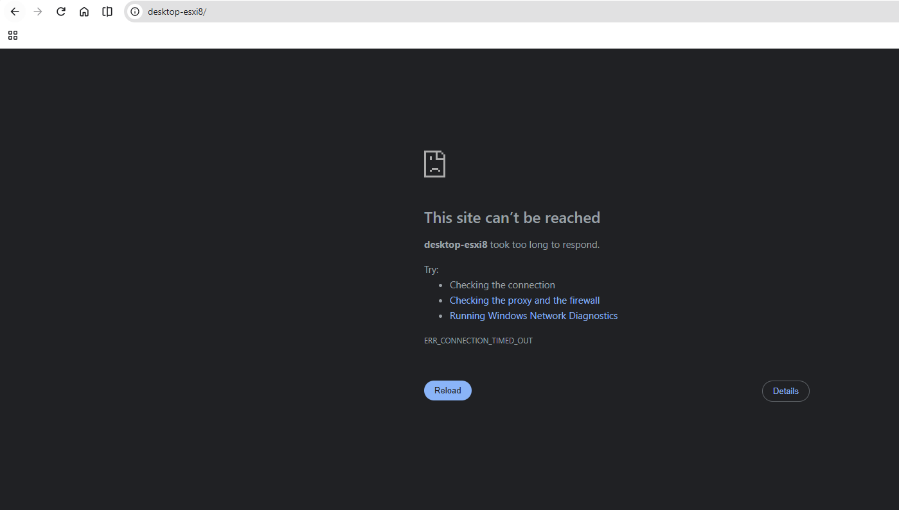
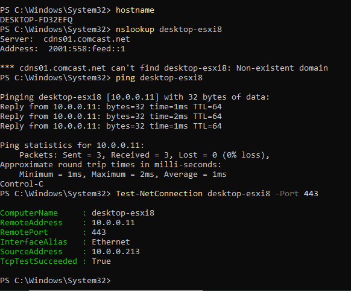
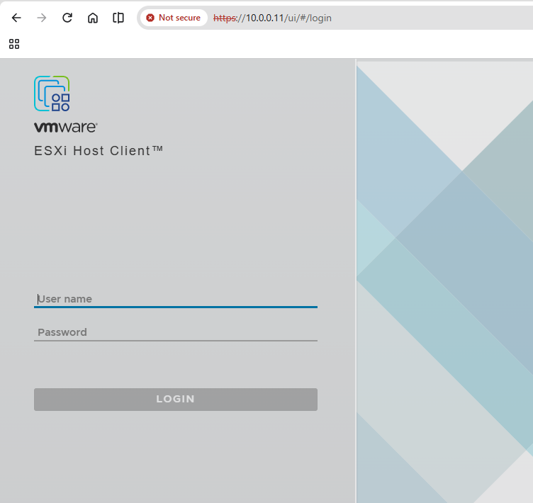
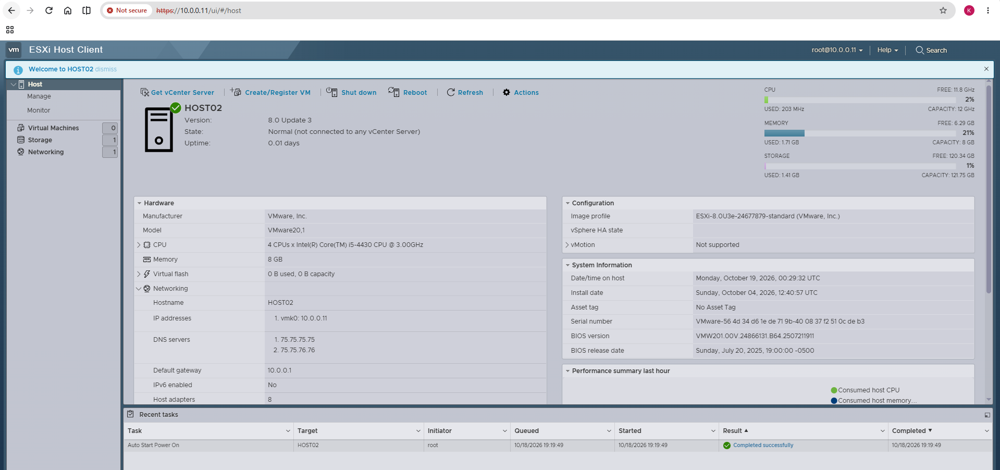
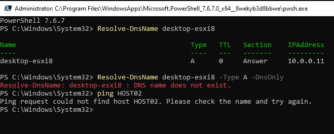
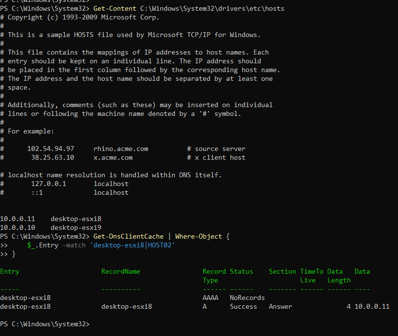
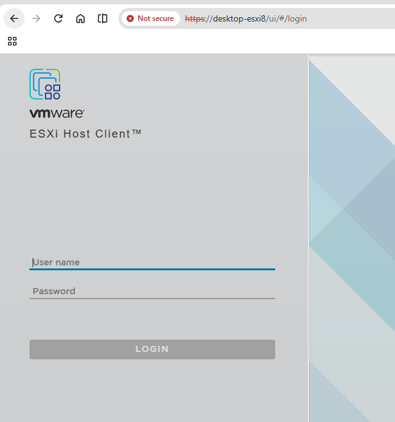
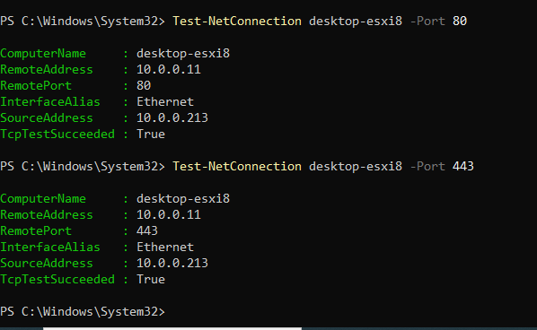
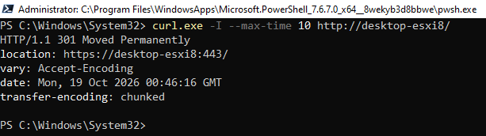

# VMware ESXi 8 Host Client — Complete Windows Desktop Troubleshooting Lab

> **Real lab case | October 18–19, 2026 | English + Roman Urdu | GitHub-ready**  
> Includes 9 original screenshots, actual captured outputs, explanations, troubleshooting logic, command reference, revision sheet and interview questions.

## Table of contents

1. [Lab goal and final result](#1-lab-goal-and-final-result)
2. [Environment and network diagram](#2-environment-and-network-diagram)
3. [Step-by-step investigation with screenshots](#3-step-by-step-investigation-with-screenshots)
4. [Why these commands? Detailed output dictionary](#4-why-these-commands-detailed-output-dictionary)
5. [What we proved vs what remains unknown](#5-what-we-proved-vs-what-remains-unknown)
6. [Reusable troubleshooting runbook](#6-reusable-troubleshooting-runbook)
7. [Practical commands cheat sheet](#7-practical-commands-cheat-sheet)
8. [Interview questions with answers](#8-interview-questions-with-answers)
9. [Evidence checklist and GitHub usage](#9-evidence-checklist-and-github-usage)

---

## 1. Lab goal and final result

**Problem:** Chrome initially displayed `This site can't be reached` / `ERR_CONNECTION_TIMED_OUT` for `desktop-esxi8/`.

**Goal:** Determine whether the fault was DNS, Windows name resolution, network reachability, TCP ports, ESXi management services, HTTP/HTTPS routing or the browser.

**Final outcome:** Both `https://10.0.0.11/ui` and `https://desktop-esxi8/ui` displayed the ESXi Host Client login page, and login by IP successfully opened the dashboard. Port 80 returned an HTTP **301 redirect** to HTTPS. No server or hosts-file configuration changes were needed during this investigation.

**Important distinction:** We restored/confirmed normal access, **but did not prove the original timeout's precise root cause**. It could have been transient or browser-specific; simply typing the explicit HTTPS URL succeeded and cannot, by itself, prove that omission of `https://` was the cause because the HTTP redirect also worked later.

| Evidence | Observed result | Conclusion |
|---|---|---|
| Windows hosts file | `10.0.0.11 desktop-esxi8` | Local hostname-to-IP mapping exists |
| DNS-only query | Name does not exist | Configured DNS has no short-name record |
| `ping desktop-esxi8` | `10.0.0.11`, 0% loss | Host resolves locally and responds to ICMP |
| TCP 80/443 | `TcpTestSucceeded: True` both | TCP handshakes complete to both ports |
| Browser by IP | ESXi login + successful dashboard login | HTTPS Host Client works by IP |
| Browser by name | ESXi login page displayed | HTTPS Host Client works by hostname |
| HTTP HEAD | `HTTP/1.1 301 Moved Permanently` | HTTP endpoint redirects to HTTPS |

### Roman Urdu — Khulasa

Pehle browser par `desktop-esxi8/` open nahi ho raha tha. Humne DNS, Windows hosts file, ping, TCP ports, browser aur HTTP redirect ko alag-alag test kiya. ESXi `10.0.0.11` par accessible hai aur `desktop-esxi8` naam bhi Windows hosts file ki madad se sahi IP par ja raha hai. **Asal initial timeout ki exact wajah abhi prove nahi hui**, lekin ab dono HTTPS URLs work karte hain.

## 2. Environment and network diagram

| Item | Observed value | Notes |
|---|---|---|
| Windows desktop hostname | `DESKTOP-P532EFQ` | Result of Windows `hostname` |
| Windows source IPv4 | `10.0.0.213` | Ethernet interface used for port test |
| ESXi management IPv4 | `10.0.0.11` | Confirmed on ESXi dashboard as `vmk0` |
| Windows alias | `desktop-esxi8` | Listed in Windows hosts file |
| ESXi configured hostname | `HOST02` | Displayed on dashboard; different from Windows alias |
| ESXi version | `8.0 Update 3` | Screenshot |
| ESXi management gateway | `10.0.0.1` | ESXi dashboard |
| ESXi configured DNS | `75.75.75.75`, `75.75.76.76` | ESXi-side DNS settings |
| DNS queried by Windows `nslookup` | `cdns01.comcast.net`, IPv6 `2001:558:feed::1` | Different context than ESXi DNS settings |
| ESXi CPU/RAM | 4 virtual CPUs, 8 GB | ESXi reports VMware virtual hardware |
| Virtual machines listed in ESXi | 0 | No guest VMs in this nested ESXi screenshot |
| ESXi storage | 1 datastore | At screenshot time |

```text
Windows desktop — DESKTOP-P532EFQ
Ethernet/source: 10.0.0.213
   |
   | Windows HOSTS file: desktop-esxi8 -> 10.0.0.11
   | ping (ICMP), TCP 80 (HTTP), TCP 443 (HTTPS)
   v
Home/Lab network 10.0.0.x
   |
   v
ESXi management vmk0: 10.0.0.11
Configured ESXi hostname: HOST02
ESXi Host Client (HTTPS /ui)

Windows DNS server queried for short name:
cdns01.comcast.net --> NXDOMAIN for desktop-esxi8
(Does not cancel the hosts-file mapping.)
```

**Concept:** `HOST02` is the hostname configured inside ESXi. `desktop-esxi8` is an alias mapped in Windows. The names do not have to match for Windows hosts-file-based connectivity to work. A proper internal DNS record could be deployed later if multiple clients need centralized naming.

## 3. Step-by-step investigation with screenshots

### Step 1 — Record the original browser error



**Observation:** Opening `desktop-esxi8/` gave `ERR_CONNECTION_TIMED_OUT`.

**Why screenshot it?** Capture the *exact* URL, browser error and starting state. “Website not working” alone is too vague to reproduce.

**Interpretation:** A timeout indicates that the browser did not finish its connection/request in time. It does **not** identify a particular cause. At this point DNS, TCP, TLS, proxies and web services all remained hypotheses.

**Roman Urdu:** Sab se pehle original error ka screenshot lena zaroori hai. Timeout ka matlab sirf itna hai ke browser ko waqt par response nahi mila; is se ye sabit nahi hota ke DNS hi kharab hai.

### Step 2 — Identify the computer and test DNS, ICMP, HTTPS TCP

```powershell
hostname
nslookup desktop-esxi8
ping desktop-esxi8
Test-NetConnection desktop-esxi8 -Port 443
```



**Why each command?** `hostname` labels the testing computer; `nslookup` specifically asks a DNS server; `ping` tests resolution plus ICMP response; `Test-NetConnection -Port 443` tests TCP connectivity to the HTTPS port independently of the browser.

**Relevant recorded output:**

```text
hostname
DESKTOP-P532EFQ

nslookup desktop-esxi8
Server:  cdns01.comcast.net
Address: 2001:558:feed::1
*** cdns01.comcast.net can't find desktop-esxi8: Non-existent domain

ping desktop-esxi8
Pinging desktop-esxi8 [10.0.0.11] with 32 bytes of data:
Reply from 10.0.0.11: bytes=32 time=1ms TTL=64
Reply from 10.0.0.11: bytes=32 time=2ms TTL=64
Reply from 10.0.0.11: bytes=32 time=1ms TTL=64
Packets: Sent = 3, Received = 3, Lost = 0 (0% loss)

Test-NetConnection desktop-esxi8 -Port 443
ComputerName     : desktop-esxi8
RemoteAddress    : 10.0.0.11
RemotePort       : 443
InterfaceAlias   : Ethernet
SourceAddress    : 10.0.0.213
TcpTestSucceeded : True
```

**What it means:** The configured DNS server does not know this name, but Windows still converts the name to `10.0.0.11` for ping/TCP. ICMP works and TCP 443 accepts a connection. Neither result alone shows an HTTPS login page.

**Roman Urdu:** `nslookup` DNS server se poochta hai, isliye fail hua. `ping` ne `10.0.0.11` find kar liya aur response mila. `Test-NetConnection` se pata chala ke HTTPS ka TCP connection ban raha hai; web page ka load hona abhi separately check karna tha.

### Step 3 — Bypass hostname and test the ESXi IP directly

In Chrome navigate to:

```text
https://10.0.0.11/ui
```



**Why this test?** Bypassing the *hostname* separates browser/ESXi service problems from name-resolution problems. It is not a DNS query. The screenshot proves that the ESXi Host Client responds over HTTPS at the IP.

**Output:** ESXi Host Client login page displayed. Chrome's “Not secure” text is consistent with an untrusted or mismatched certificate; the screenshot alone doesn't identify the exact certificate defect. In a trusted lab, inspect the certificate before choosing to proceed.

**Roman Urdu:** IP direct use karne ka faida ye hai ke hostname ke problem ko side par rakh kar dekhein ke ESXi web service chal rahi hai ya nahi.

### Step 4 — Verify the ESXi dashboard after logging in



**Why?** Seeing the login page proves the web service answers; opening the dashboard proves a successful login and working Host Client session. Do not include passwords or active tokens in screenshots.

**Dashboard fields:**

| Field | Meaning |
|---|---|
| `HOST02` | ESXi's *configured* hostname |
| `8.0 Update 3` | ESXi version |
| `Normal` | Host reports normal state in UI at capture time |
| `vmk0: 10.0.0.11` | ESXi VMkernel management interface IP |
| Gateway `10.0.0.1` | Router/default next hop for nonlocal traffic |
| DNS `75.75.75.75` and `75.75.76.76` | ESXi's DNS servers (not necessarily Windows' DNS) |
| 4 CPUs and 8 GB RAM | Resources available to nested ESXi host |
| 0 virtual machines | No VMs registered in this ESXi host at capture time |
| Not connected to vCenter | Host is being accessed directly rather than through vCenter |

**Roman Urdu:** Login page aana aur dashboard khulna do alag proofs hain. Dashboard se hamne management IP, gateway, ESXi hostname aur version bhi confirm kar liya.

### Step 5 — Compare Windows name resolution with DNS-only resolution

```powershell
Resolve-DnsName desktop-esxi8
Resolve-DnsName desktop-esxi8 -Type A -DnsOnly
ping HOST02
```



**Recorded results:**

```text
Resolve-DnsName desktop-esxi8
Name           Type  TTL  Section  IPAddress
desktop-esxi8  A     0    Answer   10.0.0.11

Resolve-DnsName desktop-esxi8 -Type A -DnsOnly
Resolve-DnsName: desktop-esxi8 : DNS name does not exist.

ping HOST02
Ping request could not find host HOST02.
```

**Why?** Default `Resolve-DnsName` can account for local hosts-file name resolution, whereas `-DnsOnly` limits lookup to DNS. `-Type A` specifically requests an IPv4 (`A`) record. `HOST02` is a different short hostname without a demonstrated Windows mapping.

**Interpretation:** Windows knows `desktop-esxi8` locally; the DNS service does not; `HOST02` is not resolvable from this Windows computer at this time. `TTL 0` in this displayed local result is not proof that the external DNS server supplied the answer.

**Roman Urdu:** `-DnsOnly` ka matlab sirf DNS server ko use karna. Isliye jab local hosts mapping ko ignore kiya to query fail ho gayi. `HOST02` ka mapping nahi mila, isliye ping name find nahi kar saka.

### Step 6 — Locate and confirm the Windows hosts-file record

```powershell
Get-Content C:\Windows\System32\drivers\etc\hosts
Get-DnsClientCache | Where-Object {
    $_.Entry -match 'desktop-esxi8|HOST02'
}
```



**Recorded active hosts-file records:**

```text
10.0.0.11    desktop-esxi8
10.0.0.10    desktop-esxi9
```

The cache output contained an `A` record answering `10.0.0.11` for `desktop-esxi8`, and an `AAAA` entry marked `NoRecords`.

**Why these commands?** `Get-Content` *reads* the hosts file. `Get-DnsClientCache` inspects Windows DNS Client's cached resolution information; `Where-Object` filters rows to just these ESXi names; `-match` uses a regular expression and `|` means OR inside the quoted pattern.

**What it means:** We found the exact reason ordinary Windows name resolution works: a local hosts-file IPv4 mapping. The cached `AAAA NoRecords` does not mean IPv4 is broken; it indicates no IPv6 address record is available in that result. The second mapping, `desktop-esxi9 -> 10.0.0.10`, was observed but **not tested** during this case.

**Roman Urdu:** Hosts file Windows ki local address-book ki tarah hai. Is mein ESXi ka name aur IP likha hai, isliye DNS server par record na hone ke bawajood Windows sahi IP use kar raha hai. `Get-Content` sirf file read karta hai, change nahi karta.

### Step 7 — Test browser login using the hostname

```text
https://desktop-esxi8/ui
```



**Why?** This is an end-to-end browser test of *hostname resolution + HTTPS + ESXi Host Client*. It succeeded.

**What we know:** Both name-based and IP-based HTTPS access work now. We do **not** know whether the first failure was temporary, a browser state issue, an earlier network issue, or something else.

**Roman Urdu:** Ab jab same ESXi login page hostname se bhi khul gaya to ye verify ho gaya ke Windows ki local name mapping aur HTTPS dono ab kaam kar rahe hain.

### Step 8 — Test TCP ports 80 and 443 independently

```powershell
Test-NetConnection desktop-esxi8 -Port 80
Test-NetConnection desktop-esxi8 -Port 443
```



**Relevant recorded results:**

```text
RemoteAddress    : 10.0.0.11
RemotePort       : 80
SourceAddress    : 10.0.0.213
TcpTestSucceeded : True

RemoteAddress    : 10.0.0.11
RemotePort       : 443
SourceAddress    : 10.0.0.213
TcpTestSucceeded : True
```

**Why?** Test whether a TCP handshake works with the usual HTTP port **80** and HTTPS port **443**. This helps narrow a connection problem but tests neither a complete HTTP exchange nor the browser's actual navigation.

**Roman Urdu:** Dono ports par `True` aaya, matlab Windows se TCP connection ban gaya. Lekin ye alone prove nahi karta ke HTTP request ka response ya login page zaroor milega.

### Step 9 — Verify HTTP response and redirection

```powershell
curl.exe -I --max-time 10 http://desktop-esxi8/
```



**Actual output:**

```http
HTTP/1.1 301 Moved Permanently
location: https://desktop-esxi8:443/
vary: Accept-Encoding
date: Mon, 19 Oct 2026 00:46:16 GMT
transfer-encoding: chunked
```

**Why `curl.exe`?** On Windows PowerShell, `curl.exe` explicitly runs the curl executable, avoiding possible shell aliases. `-I` requests response headers using an HTTP HEAD request; `--max-time 10` stops the operation after 10 seconds; `http://...` explicitly targets HTTP instead of HTTPS.

**Read the output:**

- `HTTP/1.1`: HTTP protocol version in the server response.
- `301 Moved Permanently`: Server says the resource should be accessed at a different, permanent URL.
- `location: https://desktop-esxi8:443/`: The specific HTTPS destination suggested by the server. `:443` is the standard HTTPS port and is typically optional when typing HTTPS URLs.
- `vary: Accept-Encoding`: Response metadata indicating content could vary based on supported compression encodings.
- `date: ... GMT`: Server-generated UTC/GMT timestamp; not your Windows local clock.
- `transfer-encoding: chunked`: HTTP transfer framing indication; not a connection error.

**Key lesson:** HTTP port 80 is not broken: it responded with a redirect at the time of this test. The earlier timeout **cannot** safely be blamed solely on missing `https://`. Also, a HEAD request confirms this response but does not prove every browser GET/navigation will always work.

**Roman Urdu:** `301` ka matlab server keh raha hai ke URL permanent taur par doosri jagah move ho gaya hai. `location` batata hai ke HTTPS port 443 par jana hai. Is test ne redirect confirm kiya, lekin pehle timeout ki exact wajah phir bhi confirm nahi hui.

---

## 4. Why these commands? Detailed output dictionary

### A. Tool layers — don't confuse them

| Layer/check | Tool used | Checks | Does not prove |
|---|---|---|---|
| Computer identity | `hostname` | Current Windows machine name | ESXi hostname |
| External DNS question | `nslookup` | DNS server's answer | Windows hosts-file contents |
| Windows resolution | `Resolve-DnsName` | Local/system resolution behavior | Website health |
| DNS-only A query | `Resolve-DnsName -Type A -DnsOnly` | IPv4 DNS lookup | Local hosts-file mapping |
| ICMP/network | `ping` | Name resolution + ICMP echo/reply | Port 443/service health |
| TCP service reachability | `Test-NetConnection -Port` | TCP handshake | TLS, HTTP response or login |
| HTTP application response | `curl.exe -I` | HTTP status/headers for HEAD | Full browser navigation |
| Browser UI | `https://.../ui` | Browser can load ESXi login | Correct root cause of earlier outage |
| Authenticated dashboard | ESXi login | Host Client authentication and dashboard at capture time | Future availability |

### B. Exact terms used in your output

| Output term | Meaning | Your actual value |
|---|---|---|
| `ComputerName` | Target name given to test | `desktop-esxi8` |
| `RemoteAddress` | IP the name resolved to for test | `10.0.0.11` |
| `RemotePort` | TCP service port being tested | `80` or `443` |
| `InterfaceAlias` | Local Windows network interface | `Ethernet` |
| `SourceAddress` | Local IP from which connection originates | `10.0.0.213` |
| `TcpTestSucceeded` | True if TCP handshake succeeded | `True` |
| `Server` in `nslookup` | DNS server being queried | `cdns01.comcast.net` |
| `Non-existent domain` | DNS lookup got no matching domain name | For `desktop-esxi8` |
| `A` record | Name to IPv4-address mapping | `desktop-esxi8 → 10.0.0.11` locally |
| `AAAA` record | Name to IPv6-address mapping | No IPv6 record shown in cache |
| `TTL` in DNS | Time-to-live/caching-related field | `0` in local resolution result |
| `TTL=64` in ping | IP packet hop-limit remaining in echo reply | `64` (does not identify OS conclusively) |
| `time=1ms` | Approximate echo round-trip time | 1–2 ms observed |
| `0% loss` | All sent ping echoes received replies | 3 of 3 received |
| `301` | HTTP permanent redirect response | HTTP moved to HTTPS |
| `location` | HTTP response header for redirect URL | `https://desktop-esxi8:443/` |
| `vmk0` | ESXi VMkernel interface, here management IP | `10.0.0.11` |

### C. DNS vs Hosts vs Gateway — easy comparison

**Hosts file:** Local name-to-IP entries maintained on a single computer. `10.0.0.11 desktop-esxi8` is not a centralized DNS record.

**DNS:** A name-resolution service other machines can query. Your Comcast resolver did not recognize the local short name.

**Gateway:** A router for traffic to other networks. ESXi's configured gateway `10.0.0.1` is a routing setting, not a DNS server or HTTP service.

**HTTP vs HTTPS:** Port 80 usually serves HTTP; port 443 usually serves HTTPS (HTTP over TLS). The success of one protocol test cannot automatically substitute for the other.

**Roman Urdu:** Hosts file ek computer ki local name/IP list hai. DNS ek network service hai. Gateway doosre networks tak traffic bhejne ka rasta hai. Port 80 HTTP aur 443 HTTPS ke liye commonly use hote hain.

## 5. What we proved vs what remains unknown

### Proved with screenshots and tests

- The Windows hosts file contained the `desktop-esxi8` mapping.
- A DNS-only lookup for `desktop-esxi8` failed; Windows local resolution succeeded.
- ICMP and TCP connections to `10.0.0.11` worked.
- ESXi 8.0 Update 3 `HOST02` had VMkernel management interface `vmk0: 10.0.0.11`.
- IP-based ESXi login and dashboard worked.
- Hostname-based ESXi login page worked.
- HTTP HEAD to port 80 returned a `301` redirect to HTTPS.

### Not proved (avoid overclaiming)

- **Exact cause of first Chrome timeout.** Later success is not a forensic explanation of the earlier failure.
- That port 80 previously failed; later the port and redirect both worked.
- That external Comcast DNS should resolve private ESXi short aliases (it generally will not without appropriate configuration).
- That `desktop-esxi9` at `10.0.0.10` is healthy; it was only observed in the hosts file.
- That browser “Not secure” was specifically caused by one certificate issue; inspect certificate details to know for sure.

**If issue returns:** record exact URL and time, compare IP vs hostname in a new browser window, inspect Chrome's error and proxy/VPN settings, rerun port checks and HTTP/HTTPS curl requests. Do **not** modify hosts file, restart ESXi or disable the firewall without evidence.

## 6. Reusable troubleshooting runbook

> Use this sequence on another day; take screenshot evidence for each failed step. Commands are read-only unless otherwise noted.

1. **Record user-visible symptom.** Screenshot URL and exact browser error.
2. **Identify tester.** `hostname`; `ipconfig` to see source addresses if needed.
3. **Verify name resolution.** `Resolve-DnsName HOST`, `Resolve-DnsName HOST -Type A -DnsOnly`, `nslookup HOST`, then read hosts file.
4. **Verify reachability.** `ping HOST`; remember firewalls may block ICMP even when HTTPS works.
5. **Verify TCP.** `Test-NetConnection HOST -Port 443` (and 80 if HTTP redirect is relevant).
6. **Verify service/application.** Open `https://IP/ui`, then `https://HOST/ui`; optionally inspect `curl.exe -I http://HOST/` for a redirect.
7. **Only if needed, inspect TLS/browser.** Check certificate, proxy/VPN, alternate browser, and `curl.exe -v https://HOST/ui` as a diagnostic (never paste cookies/tokens/passwords).
8. **If host itself fails, check ESXi console.** Confirm vmk0, management IP, VLAN/gateway and services. Avoid disruptive restarts with running workloads.
9. **Close the incident accurately.** Say what worked, what changed (if anything), and what is still unknown.

### Branching reference

```text
START: Chrome ESXi timeout
 |
 +-- Does https://IP/ui load?
 |      +-- YES --> Does https://NAME/ui load?
 |      |             +-- YES --> Recovered; inspect original URL/browser behavior
 |      |             +-- NO  --> Check hosts file, DNS-only result, proxy, TLS name handling
 |      +-- NO  --> Does TCP 443 connect?
 |                    +-- NO  --> Network/IP, gateway, VLAN, host status, firewall
 |                    +-- YES --> Test HTTPS HTTP response, certificate and ESXi services
 |
 +-- HTTP 80 question --> curl.exe -I http://NAME/
                         +-- 301 Location HTTPS --> Redirect works at test time
                         +-- Other/error --> Investigate actual status/error
```

## 7. Practical commands cheat sheet

```powershell
# Windows computer's hostname
hostname

# Ask the configured DNS server only (NOT local hosts-file mapping)
nslookup desktop-esxi8

# Windows name resolution (may include local hosts-file data)
Resolve-DnsName desktop-esxi8

# Ask DNS only for IPv4 A record
Resolve-DnsName desktop-esxi8 -Type A -DnsOnly

# ICMP and name resolution
ping desktop-esxi8

# TCP handshake to ESXi HTTPS (not an HTTP test)
Test-NetConnection desktop-esxi8 -Port 443

# TCP handshake to ESXi HTTP redirect endpoint
Test-NetConnection desktop-esxi8 -Port 80

# READ hosts file; don't change anything
Get-Content C:\Windows\System32\drivers\etc\hosts

# Display matching Windows DNS Client cache entries
Get-DnsClientCache | Where-Object { $_.Entry -match 'desktop-esxi8|HOST02' }

# Send HTTP HEAD; inspect HTTP status + redirect Location
curl.exe -I --max-time 10 http://desktop-esxi8/

# Optional: check HTTPS response and certificate diagnostics
curl.exe -v --max-time 15 https://desktop-esxi8/ui

# Optional: test local IP info
ipconfig /all
```

Use browser:

```text
https://10.0.0.11/ui
https://desktop-esxi8/ui
```

**Safety:** Never publish passwords, live session tokens, SSH keys, sensitive cookies or administrator credentials in screenshots or pasted outputs. Lab private IP addresses are included here because they are part of this user's observed network evidence; review what to publish publicly on GitHub.

## 8. Interview questions with answers

**Q1. How can `nslookup` fail while `ping` succeeds for the same hostname?**  
**A:** `nslookup` queries DNS. Windows may resolve through a local hosts-file entry. Here the hosts-file entry was explicitly verified.

**Q2. Does `TcpTestSucceeded: True` guarantee the HTTPS website works?**  
**A:** No. It proves the TCP handshake, not TLS, HTTP or application login.

**Q3. What does HTTP 301 mean?**  
**A:** The server indicates a permanent redirect; the `Location` response header gives the new destination.

**Q4. What is the difference between an A record and AAAA record?**  
**A:** A maps a name to IPv4; AAAA maps it to IPv6.

**Q5. What is the difference between a hosts file and DNS?**  
**A:** Hosts is a local file on one system; DNS is a queryable naming service used across systems.

**Q6. What does `vmk0: 10.0.0.11` show?**  
**A:** It identifies an ESXi VMkernel interface with the management IPv4 address in this host.

**Q7. Is ESXi's hostname the same as the alias used to access it?**  
**A:** Not necessarily. This host calls itself `HOST02`, while Windows maps `desktop-esxi8` to its management IP.

**Q8. Why does Chrome say “Not secure” even though HTTPS works?**  
**A:** TLS may be working while certificate trust/hostname validation is not accepted. Inspect certificate details before naming the precise cause.

**Q9. If both ports 80 and 443 respond, why might a browser previously have timed out?**  
**A:** Tests were performed later; transient network, browser, proxy, protocol or host behavior can change. One cannot identify a single root cause without additional time-matched evidence.

**Q10. How would you troubleshoot ESXi access in an interview?**  
**A:** Collect exact error → confirm management IP → test local name resolution and DNS separately → test ICMP and TCP → test HTTPS URL/certificate and HTTP redirects → confirm Host Client → document known facts and unknowns.

### Roman Urdu interview revision

- `ping` ka reply milna web login ki guarantee nahi.
- `TcpTestSucceeded: True` ka matlab TCP connection successful; HTTPS application separately test karein.
- `301` ka matlab permanent redirect aur `Location` mein new URL.
- DNS aur hosts file do alag name-resolution methods hain.
- `HOST02` ESXi ka naam hai; `desktop-esxi8` Windows alias hai.
- Troubleshooting mein **observation**, **test**, **result**, **conclusion** ko alag likhna chahiye.

## 9. Evidence checklist and GitHub usage

All nine screenshots below were captured during the actual lab:

| # | Screenshot file | What it proves |
|---|---|---|
| 01 | `01_original_chrome_timeout.png` | Original browser timeout |
| 02 | `02_initial_powershell.png` | Initial hostname, DNS, ICMP, port 443 |
| 03 | `03_esxi_ip_login.png` | Browser login using IP |
| 04 | `04_esxi_host_dashboard.png` | Successful ESXi dashboard and management IP |
| 05 | `05_name_resolution_tests.png` | Local Windows vs DNS-only resolution |
| 06 | `06_hosts_and_dns_cache.png` | Hosts-file mapping and cache |
| 07 | `07_hostname_login.png` | Browser login using name |
| 08 | `08_tcp_ports_80_443.png` | Both TCP ports successful |
| 09 | `09_http_301_redirect.png` | HTTP-to-HTTPS redirect |

Suggested repository structure:

```text
esxi-windows-host-client-troubleshooting/
├── README.md
└── screenshots/
    ├── 01_original_chrome_timeout.png
    ├── 02_initial_powershell.png
    ├── 03_esxi_ip_login.png
    ├── 04_esxi_host_dashboard.png
    ├── 05_name_resolution_tests.png
    ├── 06_hosts_and_dns_cache.png
    ├── 07_hostname_login.png
    ├── 08_tcp_ports_80_443.png
    └── 09_http_301_redirect.png
```

**Final lab report:** ESXi management connectivity and web login **working** by IP and alias. Windows hosts-file resolution **confirmed**. HTTP port-80 redirect **confirmed**. **Exact initial timeout cause remains undetermined.** No configuration change claimed.
