# Incident Study: ESXi Hostname and HTTPS Connectivity

## Ticket summary

| Field | Record |
| --- | --- |
| Study ticket | **LAB-2026-1017-001** |
| Ticket type | Home-lab incident / learning simulation |
| Date | October 17, 2026 — America/Chicago |
| Title | Desktop ESXi 8 browser name fails; subsequent HTTPS connectivity fails |
| Status | **Resolved to TCP connectivity; browser login verification pending** |
| Impact | Administrator could not reach the ESXi 8 Host Client using the desired name |
| Scope | Nested ESXi home lab; no production outage demonstrated |
| Evidence | 11 user-supplied screenshots |

This ticket number is an educational reference created for these notes. It is not a number from an actual employer's ticketing system. The environment and observations below come from the shared lab evidence. No precise incident duration, business severity, or unobserved actions are invented.

## Contents

1. [Environment](#1-environment)
2. [Reported issue](#2-reported-issue)
3. [Evidence and diagnosis](#3-evidence-and-diagnosis)
4. [Resolution procedure](#4-resolution-procedure)
5. [Verification](#5-verification)
6. [Cause and limits of the conclusion](#6-cause-and-limits-of-the-conclusion)
7. [Rollback](#7-rollback)
8. [Lessons and next checks](#8-lessons-and-next-checks)
9. [Complete screenshot evidence](#9-complete-screenshot-evidence)
10. [Ticket closure note](#10-ticket-closure-note)

## 1. Environment

| Component | Observed configuration |
| --- | --- |
| Physical host | HP desktop, Intel Core i5-4430, approximately 16 GB RAM — previously shared inventory |
| Windows test source | Ethernet, `10.0.0.213` |
| Virtualization application | VMware Workstation; VM hardware compatibility shows Workstation 25H2 |
| ESXi VM | `ESXi-8-Desktop` |
| ESXi version | 8.0.3, build 24677879 |
| ESXi hostname | `HOST02` |
| ESXi management IPv4 | `10.0.0.11`, static |
| VM resources | 8 GB RAM; 4 processors in VM settings; 250 GB virtual disk |
| Virtual NICs | Five; first NIC inspected as connected and bridged |
| Bridge | VMnet0, initially Automatic; later explicitly selected Realtek PCIe GBE Family Controller |
| Other virtual networks | VMnet1 host-only `192.168.38.0`; VMnet8 NAT `192.168.23.0` |
| Desired access name | `desktop-esxi8` |
| Additional configured name | `desktop-esxi9` → `10.0.0.10`; not tested successfully in this incident |
| Relevant ports | HTTPS 443; SSH 22 |

The browser name `desktop-esxi8` is a client-side name mapping. It does not rename the ESXi host from HOST02.

## 2. Reported issue

The administrator entered `desktop-esxi8` in Chrome. Chrome displayed:

```text
This site can't be reached
Desktop-esxi8's server IP address could not be found.
ERR_NAME_NOT_RESOLVED
```

The SSH configuration already included:

```sshconfig
Host desktop-esxi8
    HostName 10.0.0.11
    User root
    IdentityFile ~/.ssh/desktop_esxi8
    IdentitiesOnly yes

Host desktop-esxi9
    HostName 10.0.0.10
    User root
    IdentityFile ~/.ssh/desktop_esxi9
    IdentitiesOnly yes
```

**Initial diagnosis:** an SSH alias only instructs the SSH client. It does not create a DNS record or a Windows-wide hostname mapping for Chrome.

## 3. Evidence and diagnosis

| Stage | Evidence | Interpretation |
| --- | --- | --- |
| Browser failure | Screenshot 01: ERR_NAME_NOT_RESOLVED | Browser name resolution failed |
| Alias review | Screenshot 02: SSH config contains the desired aliases | Mapping exists for SSH only |
| Hosts change | Screenshots 03–04: entries and Save As dialog | Local Windows name mapping prepared; proper saving required |
| First connectivity test | Screenshot 05: RemoteAddress 10.0.0.11, TCP False | Name resolution works; another issue remains |
| Console review | Screenshot 06: ESXi running, static 10.0.0.11 | Address matches the client mapping |
| Repeat test | Screenshot 07: DestinationHostUnreachable | Investigate network path before authentication |
| VM adapter | Screenshot 08: Connected, Bridged Automatic | NIC attachment appears enabled, but physical bridge mapping needs review |
| Virtual Network Editor | Screenshot 09: VMnet0 Auto-bridging; VM off | Automatic bridge selection observed; VM must run for final verification |
| Explicit bridge | Screenshot 10: Realtek Ethernet selected | Intended physical LAN adapter selected |
| Final verification | Screenshot 11: last TCP test True | Name and TCP 443 connectivity confirmed from desktop |

### Why SSH was not the cause

The user asked whether SSH needed to be enabled. Browser access uses HTTPS on **443**. SSH uses **22**. Enabling SSH does not repair HTTPS name resolution or a broken network path.

`DestinationHostUnreachable` suggests a reachability problem and can occur when the destination cannot be resolved at the local link layer, among other causes. The screenshot alone does not prove the precise packet-level failure. We did not collect ARP tables or a packet capture.

## 4. Resolution procedure

### Step 1 — Open the hosts file with administrator rights

On the Windows computer running Chrome, open PowerShell as Administrator:

```powershell
notepad "$env:WINDIR\System32\drivers\etc\hosts"
```

For a future repetition, make a backup before editing:

```powershell
Copy-Item "$env:WINDIR\System32\drivers\etc\hosts" `
    "$env:WINDIR\System32\drivers\etc\hosts.before-esxi-lab"
```

The backup command is a recommended improvement; it was not shown as executed during this incident.

### Step 2 — Add the mappings

Append these lines, or update existing entries for the same names:

```text
10.0.0.11    desktop-esxi8
10.0.0.10    desktop-esxi9
```

Keep unrelated entries unchanged. Do not prefix the new entries with `#`, which would comment them out.

### Step 3 — Save correctly

In Notepad's Save As dialog:

1. Confirm directory `C:\Windows\System32\drivers\etc`.
2. Select **All Files (*.*)**.
3. Set the filename to **hosts**, without `.txt`.
4. Save and confirm replacement if prompted.

The screenshot's Text Documents filter explains why existing extensionless files were not visible. It does not mean the directory was empty.

### Step 4 — Clear the resolver cache and test

```powershell
ipconfig /flushdns
Test-NetConnection desktop-esxi8 -Port 443
```

Observed intermediate result:

```text
ComputerName     : desktop-esxi8
RemoteAddress    : 10.0.0.11
RemotePort       : 443
InterfaceAlias   : Ethernet
SourceAddress    : 10.0.0.213
TcpTestSucceeded : False
```

The warning also reported `DestinationHostUnreachable`. Because RemoteAddress was correct, repeatedly editing the hosts file was not the appropriate next step.

### Step 5 — Check ESXi power and console address

In Workstation, inspect the ESXi console. Evidence showed HOST02, ESXi 8.0.3, and `https://10.0.0.11/ (STATIC)`.

Later Virtual Network Editor screenshots show ESXi 8 powered off. Before any final connection test, the VM must be powered on and fully booted. Power state is a separate prerequisite from name resolution.

### Step 6 — Inspect the VM NIC

Open **VM → Settings → Network Adapter**.

The first NIC showed:

- Connected: checked.
- Connect at power on: checked.
- Bridged: selected.
- Summary: Bridged (Automatic).

Five virtual NICs were present. We inspected the first adapter but did not prove its ESXi vmnic-to-management-uplink mapping. No evidence shows changes to the other four adapters.

### Step 7 — Select the intended physical Ethernet bridge

Open **Edit → Virtual Network Editor**, elevate through Change Settings if required, and select **VMnet0**.

Change **Bridged to** from **Automatic** to:

```text
Realtek PCIe GBE Family Controller
```

Click **Apply → OK**.

To identify the physical adapter on a future machine:

```powershell
Get-NetAdapter -Physical |
    Format-Table Name, InterfaceDescription, Status -AutoSize
```

This identification command was suggested; its output was not captured. Do not assume a different computer uses the same Realtek adapter.

VMnet0 is shared configuration: changing its physical bridge can affect other VMs connected through it. VMnet1 and VMnet8 were left unchanged in the shown procedure. Do not use Restore Defaults as a routine fix; it can replace other lab networking settings.

### Step 8 — Start ESXi and retest

Power on ESXi 8, wait for its management console, and run:

```powershell
Test-NetConnection desktop-esxi8 -Port 443
```

## 5. Verification

The **last test** in screenshot 11 shows:

```text
ComputerName     : desktop-esxi8
RemoteAddress    : 10.0.0.11
RemotePort       : 443
InterfaceAlias   : Ethernet
SourceAddress    : 10.0.0.213
TcpTestSucceeded : True
```

Earlier failed tests remain above it. Read the latest result rather than treating every result in the terminal as current.

| Check | Status |
| --- | --- |
| desktop-esxi8 resolves to 10.0.0.11 | Confirmed |
| Desktop 10.0.0.213 can establish TCP to port 443 | Confirmed |
| Host Client opens by hostname | Next check; no final browser screenshot supplied |
| Root login to Host Client | Not verified in this incident |
| SSH port 22 or key authentication after changes | Not tested in this incident |
| ESXi 9 hostname and HTTPS | Not verified in this incident |
| Access from Surface or Dell | Not verified in this incident |
| Connectivity persists after restart | Not verified |

Next browser check:

```text
https://desktop-esxi8/ui/
```

A certificate warning can remain even when name resolution and TCP connectivity work. Certificate trust and matching certificate names are separate checks. Do not describe this ticket as fixing certificate trust.

## 6. Cause and limits of the conclusion

**Confirmed initial cause:** Chrome was given an SSH-only alias without an available browser/Windows name mapping. A hosts-file entry resolved the name locally.

**Likely contributing network configuration:** VMnet0 used automatic bridge selection. An explicit Ethernet bridge was selected, and a subsequent TCP 443 test succeeded.

**Important qualification:** the evidence does not reveal which adapter Automatic had selected, and the VM's power state also changed during troubleshooting. We therefore cannot prove that incorrect automatic bridge selection was the sole cause of the connectivity failure. The documented recovery is explicit Ethernet bridge configuration plus ensuring ESXi is running, followed by a successful test.

No password reset, SSH enablement, ESXi reinstall, firewall disabling, or DNS-server deployment was demonstrated or required by the recorded resolution.

## 7. Rollback

Use rollback only if the new configuration causes a problem.

- Hosts mapping: remove only the two newly added lines, or restore a known-good backup while preserving later legitimate changes. Then run `ipconfig /flushdns`.
- VMnet0: record the current mapping, then restore the previous **Automatic** setting if necessary. Apply and retest dependent VMs. This may reintroduce the original symptom.
- Do not delete SSH keys or SSH config: those were not the source of the browser error.

## 8. Lessons and next checks

| Lesson | Practical meaning |
| --- | --- |
| SSH alias is client-specific | Chrome does not consult ~/.ssh/config |
| Hosts entry is local to one Windows installation | Repeat on another client only if needed, or deploy suitable internal DNS |
| Name resolution and connectivity are separate | Correct RemoteAddress with TCP False means investigate beyond naming |
| Test the service port | 443 for Host Client; 22 for SSH |
| VM power state matters | A saved static IP does not make a powered-off VM reachable |
| Explicit bridge selection can improve predictability | Bind to the intended active physical LAN adapter |
| TCP success is not application login success | Verify browser page and authentication separately |

Before closing the browser-access portion, capture the Host Client login page or successful dashboard without exposing passwords or sensitive data. Test ESXi 9 separately when powered on. On this approximately 16 GB desktop, avoid running both 8 GB ESXi VMs together unless host memory capacity allows it.

For GitHub, keep this Markdown file beside the images folder. The relative image links below will work after extracting the ZIP and when committed with the images.

## 9. Complete screenshot evidence

Screenshots are originals supplied in this troubleshooting conversation. Their filename timestamps are preserved below as source identifiers, not asserted as precise local event times. The sequence follows the conversation.

### Screenshot 01 — Chrome cannot resolve desktop-esxi8.

Source: `image(20261017-200302).png`

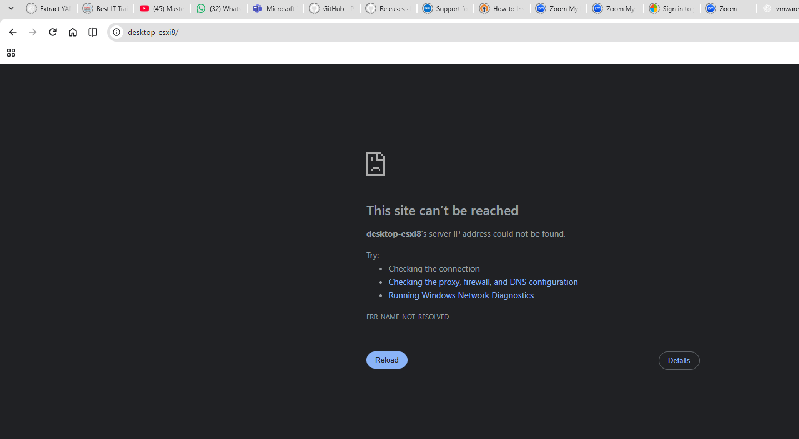

### Screenshot 02 — SSH config maps aliases to IP addresses; Chrome does not read this file.

Source: `image(20261017-200328).png`

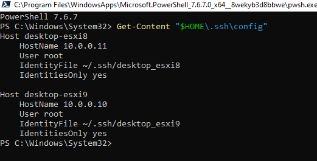

### Screenshot 03 — Correct hosts mappings entered; the asterisk shows the document is not yet saved.

Source: `image(20261017-200751).png`

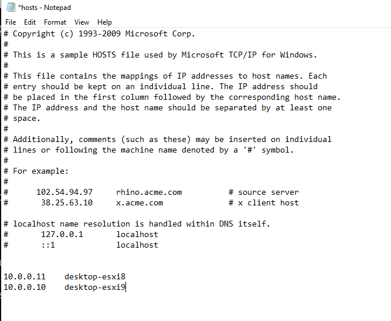

### Screenshot 04 — Save As initially filters Text Documents; save as All Files with filename hosts.

Source: `image(20261017-200825).png`

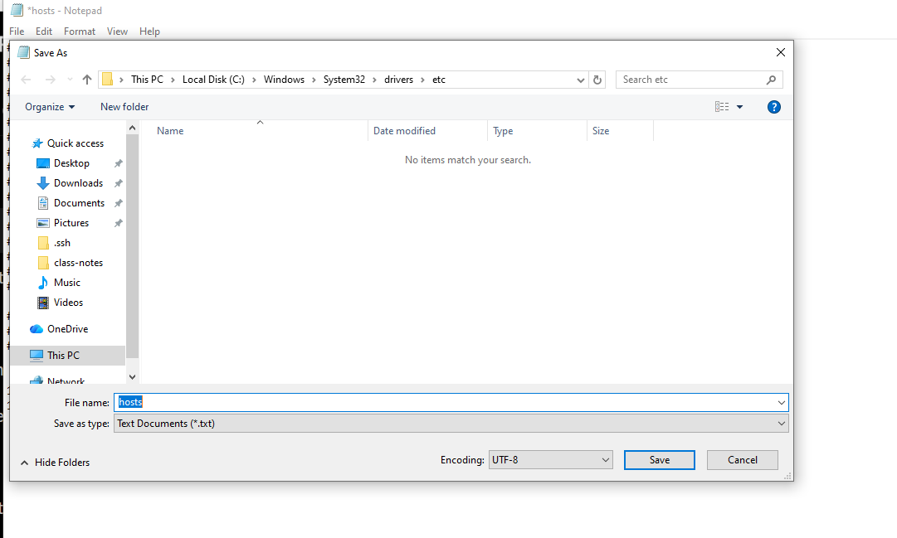

### Screenshot 05 — Name resolves to 10.0.0.11, but TCP 443 fails with DestinationHostUnreachable.

Source: `image(20261017-201421).png`

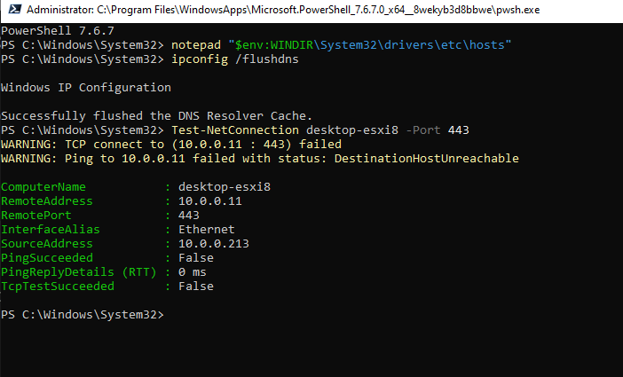

### Screenshot 06 — ESXi 8 console shows HOST02 and static IP 10.0.0.11.

Source: `image(20261017-201628).png`

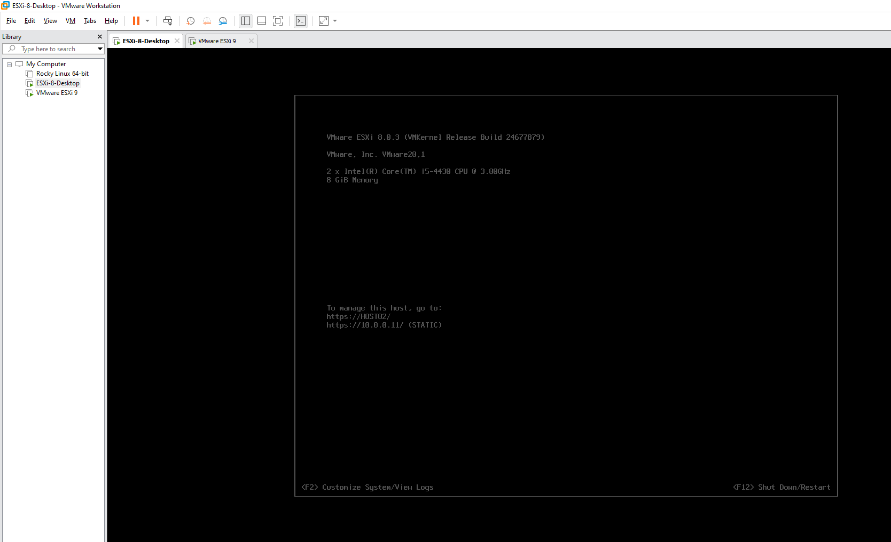

### Screenshot 07 — Repeated port 443 test still fails.

Source: `image(20261017-201731).png`

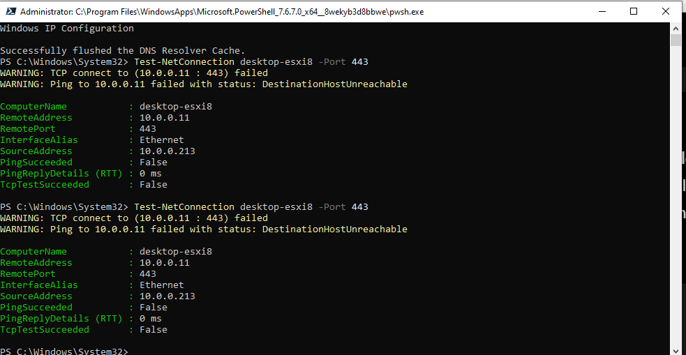

### Screenshot 08 — First virtual NIC is connected and set to Bridged (Automatic); five NICs are present.

Source: `image(20261017-201934).png`

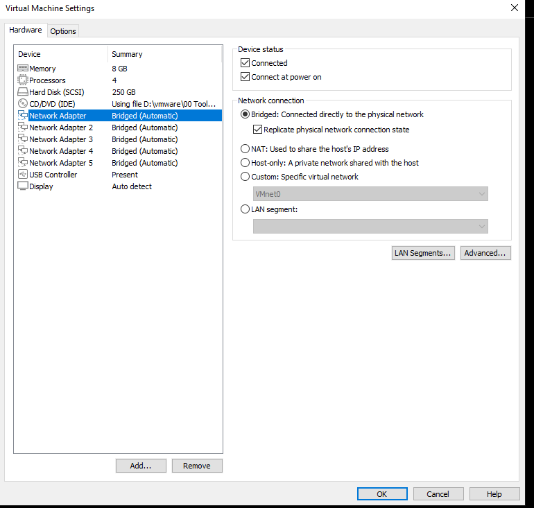

### Screenshot 09 — VMnet0 uses automatic bridging. ESXi 8 is powered off at this stage.

Source: `image(20261017-202450).png`

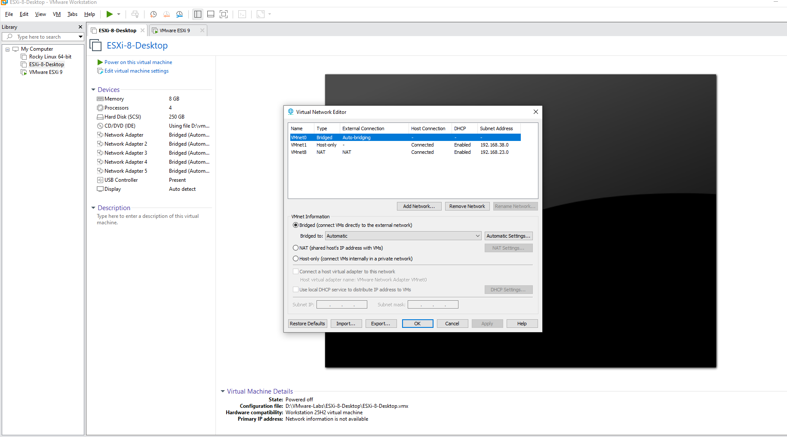

### Screenshot 10 — VMnet0 has Realtek PCIe GBE Family Controller selected; Apply is available.

Source: `image(20261017-202755).png`

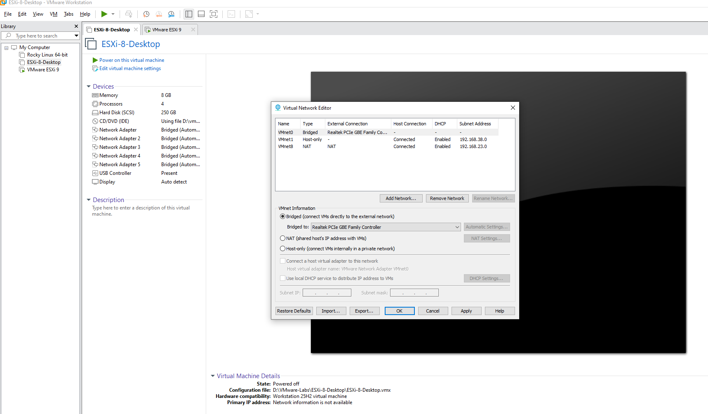

### Screenshot 11 — Last test resolves desktop-esxi8 to 10.0.0.11 and returns TcpTestSucceeded True.

Source: `image(20261017-203053).png`

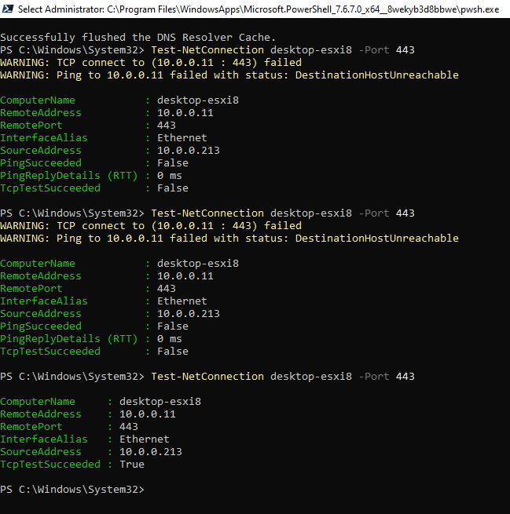

## 10. Ticket closure note

> **LAB-2026-1017-001 — Technical recovery verified:** Browser access initially failed because the desired name existed only in the SSH client configuration. Added Windows hosts mappings and confirmed desktop-esxi8 resolved to 10.0.0.11. A subsequent TCP 443 failure required further network troubleshooting. Reviewed the ESXi console and virtual NIC settings, selected the physical Realtek Ethernet adapter for VMnet0 bridging, and ensured the ESXi VM was running. The final test from 10.0.0.213 to desktop-esxi8:443 succeeded. Host Client browser display and login remain pending user verification. Automatic bridge misselection is a suspected contributor, not a conclusively isolated root cause.
