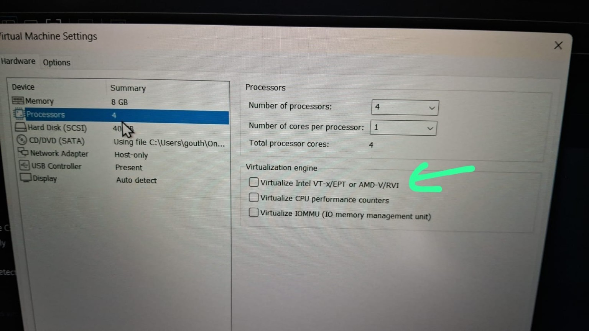
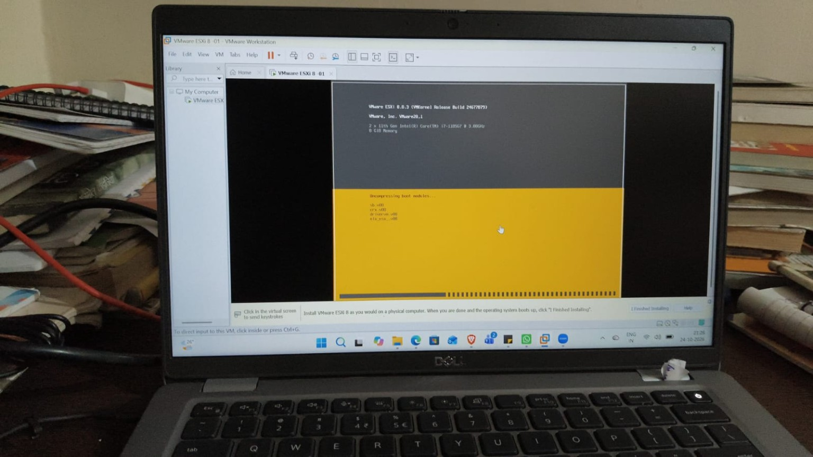

# Case Study: ESXi Nested Virtualization Not Enabled

## Symptom
A classmate repeatedly encountered an error when attempting to run ESXi inside VMware Workstation. The exact error wording was not captured legibly in the shared images.

## Evidence

The VM settings showed 8 GB RAM, four virtual CPUs (four processors x one core), a 40 GB disk and a Host-only network adapter. The **Virtualize Intel VT-x/EPT or AMD-V/RVI** checkbox was unchecked.

## Root cause and resolution
The classmate reported that checking **Virtualize Intel VT-x/EPT or AMD-V/RVI** fixed the issue. This is consistent with the ESXi guest requiring hardware virtualization capabilities from Workstation.

### Steps
1. Completely **Power Off** the ESXi VM (not Suspend).
2. Open **VM > Settings > Hardware > Processors**.
3. Check **Virtualize Intel VT-x/EPT or AMD-V/RVI**.
4. Click **OK**, power on ESXi, and verify it boots.
5. If it still fails, check BIOS/UEFI virtualization, host Hyper-V/VBS compatibility and `vmware.log`.

## Normal guest versus nested hypervisor
| Guest in Workstation | Nested virtualization setting |
|---|---|
| Windows Server / Windows desktop | Usually not needed |
| Ubuntu / Rocky Linux (ordinary guest) | Usually not needed |
| ESXi hypervisor | Required for nested ESXi operation |
| Hyper-V or KVM running inside a guest | Required for nested virtualization |

**Important:** Host firmware VT-x/AMD-V support is distinct from exposing virtualization extensions to the guest VM. Windows 11 guest requirements (e.g. TPM/Secure Boot) are separate.

## If enabling the checkbox does not work
- Confirm host CPU supports virtualization and BIOS/UEFI has it enabled.
- Inspect `msinfo32` for VBS and hypervisor state. Some host configurations restrict nested virtualization.
- Check VMware Workstation version and guest compatibility.
- Read `vmware.log` from the VM folder for precise error text.
- Record the VM's network mode separately; **Host-only** networking does not by itself explain a CPU virtualization error.

## Verification checklist
- [ ] VM powered off before settings changed
- [ ] Nested virtualization checkbox enabled
- [ ] ESXi boot proceeds to installer or DCUI
- [ ] Screenshot of final boot state captured
- [ ] Exact error text and log captured if problem recurs

## Interview questions
1. What is nested virtualization?
2. Why does ESXi need virtualization extensions when running in Workstation?
3. What is the difference between host firmware virtualization and guest exposure?
4. When should you inspect `vmware.log`?
5. Why is Host-only networking a separate concern from CPU virtualization?

## Evidence note

`Decompressing boot modules` is a normal installation boot stage unless progress stops or an explicit error appears.
