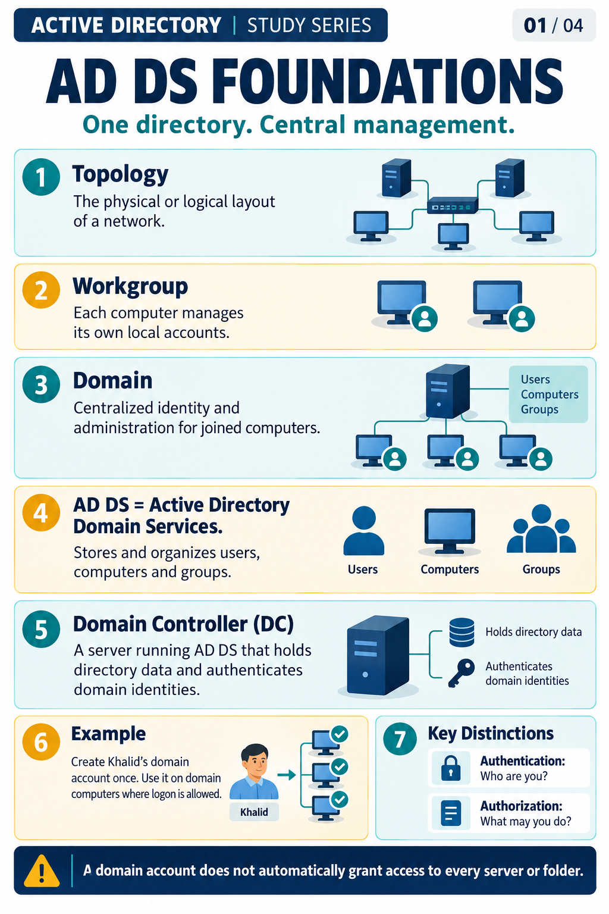
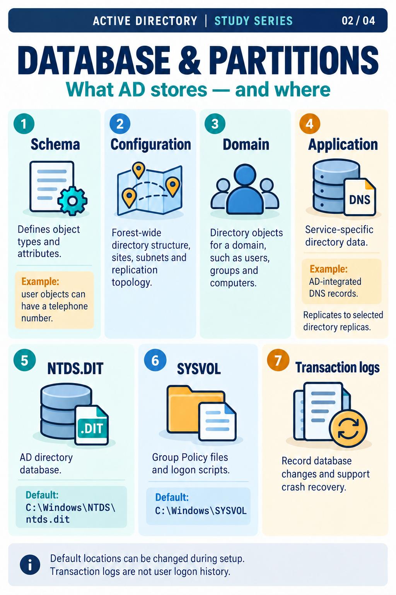
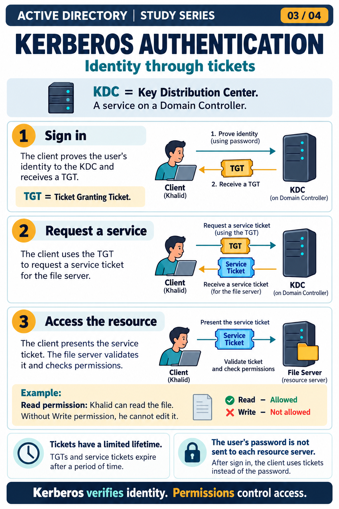
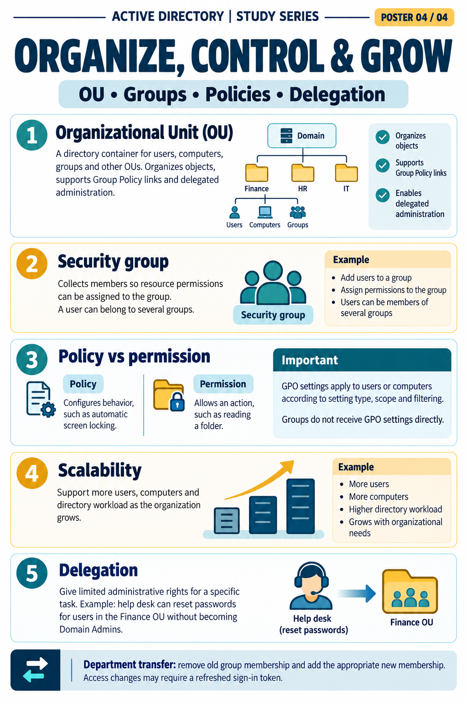

# Active Directory Learning Posters

Four English posters in the correct study order. Start with Foundations, then study the database, authentication, and administration. Each poster is a visual revision aid; use the detailed notes for qualifications and practical steps.

## Open a poster

| Order | Topic | Image |
|---|---|---|
| 01 | AD DS Foundations | [Open poster](01_AD_DS_Foundations.png) |
| 02 | Database and Partitions | [Open poster](02_Database_and_Partitions.png) |
| 03 | Kerberos Authentication | [Open poster](03_Kerberos_Authentication.png) |
| 04 | OU, Groups, Policies and Delegation | [Open poster](04_OU_Groups_Policies_and_Delegation.png) |

[Download or open the combined four-page PDF](AD_DS_Learning_Posters.pdf)

## Poster gallery

### 01. AD DS Foundations

### 02. Database and Partitions

### 03. Kerberos Authentication

### 04. OU, Groups, Policies and Delegation

## Corrections made

- Foundations was stored under the Kerberos filename; it is now correctly named `01_AD_DS_Foundations.png`.
- The incorrectly assigned database duplicate with the `tds.dit` typo is excluded from this corrected set.
- The retained Database poster correctly shows `C:\Windows\NTDS\ntds.dit`.
- The original Kerberos poster has been restored as `03_Kerberos_Authentication.png`.
- Poster numbers, filenames and content now follow the same 01–04 order.

See [correction record](CORRECTIONS.md) for source details.

## Reading qualifications

- Schema, Configuration, Domain and Application are partition categories; multiple application partitions may exist.
- SYSVOL and transaction logs are separate from the directory database file. A line wrap in the poster's path is only a layout break.
- “Prove identity using password” describes a simplified password-based Kerberos scenario; it does not mean the plaintext password is sent to the KDC. Other authentication methods also exist.
- A service ticket authenticates to a service; the resource's permissions still determine allowed operations. Read/Write in the poster is a simplified example.
- GPO settings apply to users/computers according to setting type, placement, scope and filtering. A security group is not an OU.
- The images are the original 1024 × 1536 pixels. The PDF preserves their proportions on A4 pages; it does not add new image detail. For printing, use fit-to-page and check the small text in print preview.

## Add to your repository

Copy this entire `Posters` folder into `09_Active_Directory/`.

Add this line to `09_Active_Directory/README.md`:

- [AD DS Learning Posters](Posters/README.md)

Keep images and PDF alongside this README so links work on GitHub. These are study illustrations, not screenshots proving a lab deployment.
