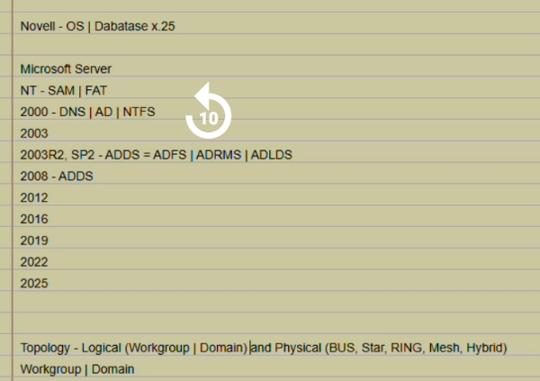
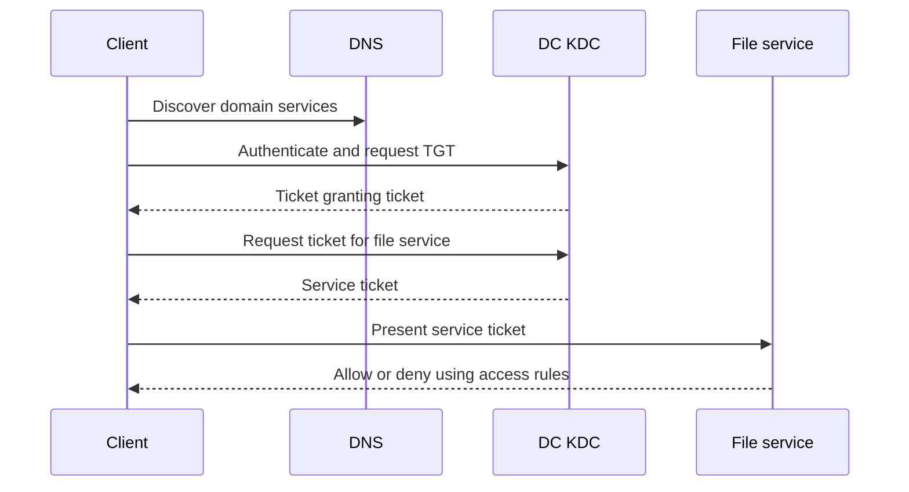
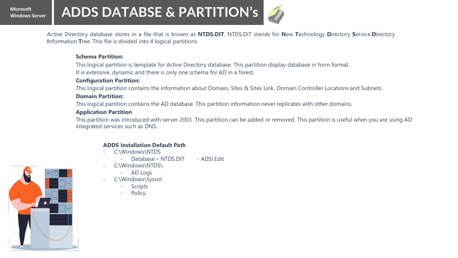
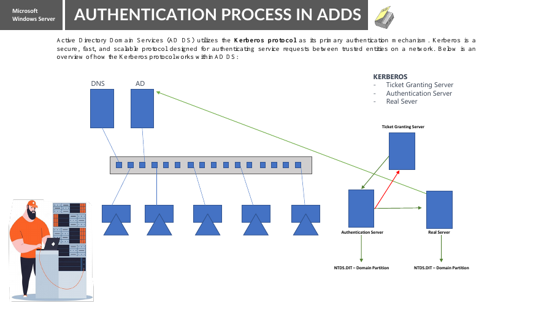
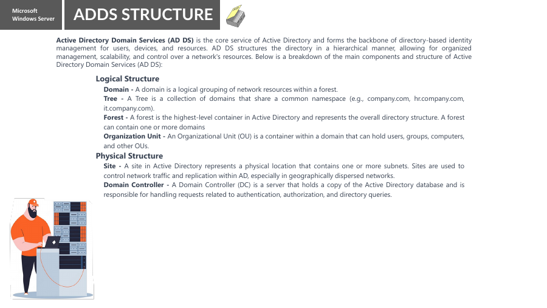
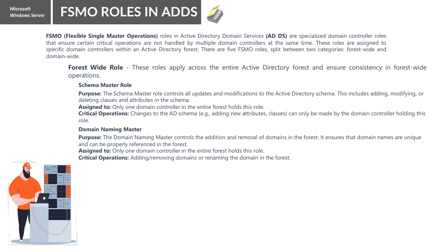
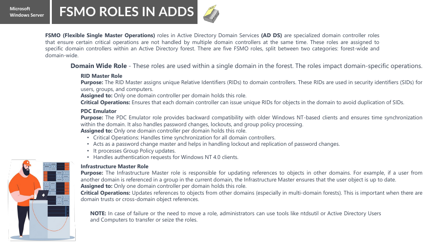

# Active Directory Domain Services — from DNS to centralized identity

English study guide • 24 October 2026 • Theory first; practical implementation deferred

This guide follows your teacher’s 22-page AD DS lecture and the supplied history/topology screenshot, with explanations suited to your VMware/DNS lab experience. It is a learning companion, not a completed deployment report. Keep the existing DNS practice lab as its own recorded environment.

Read one chapter at a time: the business problem → workgroup/domain → DNS and DCs → objects and organization → login → database/replication → administration and FSMO → readiness. The separate LAB_ROADMAP files describe what we will do later; no installation or promotion was performed.

## Study route

1. The problem AD DS solves
2. Workgroup versus domain
3. Your lecture history and topology notes
4. DNS, AD DS and a domain controller
5. Objects, attributes, OUs and groups
6. Domain, tree, forest and site
7. A login journey: authentication and authorization
8. NTDS.dit, partitions, SYSVOL and replication
9. Group Policy and permissions
10. Five FSMO roles
11. Schema version versus functional level
12. Installation readiness and lecture clarifications
13. Tools, troubleshooting and revision

The poster-like diagrams in this guide are explanatory, not live network evidence. Page references use the original PDF page numbers.

---

## 0. Start here — our discussion in small steps

**How to study:** Read one subsection, explain it in your own words, then answer its question. Pause before moving on. These examples explain concepts; they do not describe an AD deployment already completed in your lab.

### 0.1 Topic coverage check

All the main topics from our discussion were already present. This beginner section adds the specific examples and clears up the points that caused confusion.

| Discussion topic | Existing chapter | What this section adds |
|---|---|---|
| Topology | 3 | Star network and cable/switch failure examples |
| Workgroup | 2 | Independent accounts do not mean disconnected PCs |
| Domain | 1, 2, 6 | One account on PC1 and PC2; password-change example |
| Active Directory / AD DS | 1, 4, 5 | Full name and simple directory analogy |
| Domain Controller | 4, 7 | Server role versus server name versus service |
| Users, computers and groups | 5, 9 | Teachers group and shared-folder example |
| Authentication / authorization | 7, 9 | Identity check versus resource permission; server roles |
| Group Policy | 9 | Screen-lock example; our next teaching point |

### 0.2 Topology: how devices connect

Topology describes the physical or logical arrangement of a network and its connections.

**Star example:** Four PCs each have their own cable to one central switch. If PC1's cable breaks, PC1 loses that connection. The other three can still communicate through the working switch and their working cables. If that single central switch fails, communication through it is affected for all four PCs.

**Say it back:** “Topology describes how network devices connect.”

**Question:** One PC cable breaks. Does every PC lose its connection? **Answer: No, only that PC's connection is lost in this example.**

### 0.3 Workgroup: each PC manages its own accounts

A workgroup has no central AD DS account authority. Each PC manages its local users and passwords.

`PC1\Ali` and `PC2\Ali` are two separate local accounts, even when both are named Ali. Changing the password of `PC1\Ali` does not change `PC2\Ali`. Saved credentials used to access PC1's shares may need updating.

**Important clarification:** Independent account management does not mean network isolation. Workgroup PCs can communicate and share files or printers when networking, sharing and permissions allow it. For a few home PCs, this is often the simplest setup.

**Question:** Can workgroup PCs share files? **Answer: Yes, if configured and permitted.**

### 0.4 Domain: centrally managed identities

An AD DS domain is a centrally managed directory environment containing identities such as users and computers. A domain can have more than one Domain Controller.

**Ali's example, one step at a time:**

1. Ali has one domain account: `ADLAB\Ali`.
2. PC1 and PC2 are two different computers joined to the same domain.
3. Ali can use that same account on either PC if logon permissions and the required connectivity allow it.

PC1 and PC2 are computer names. They are not two Ali accounts or two domains. Using the same account also does not automatically copy Ali's files or desktop between PCs.

**Password example:** An administrator changes Ali's domain password. Ali's account still exists; it has not been disabled. For a fresh online domain authentication, Ali uses his new password once the change is available to the authenticating DC. Ahmed's password is unchanged. Ali does not manually change a separate local password on every domain PC.

**Small exception to remember later:** Cached offline logons, existing sessions and DC replication can affect when a password change is observed. Avoid the absolute claim that the old password instantly stops working everywhere.

**Question:** Did changing Ali's password close his account? **Answer: No; it changed the password.**

### 0.5 AD DS: the directory service

**AD DS = Active Directory Domain Services.** “Services” is plural.

Think of a central telephone directory: it keeps records. AD DS stores directory objects and their attributes, including users, computers and groups, and supports domain identity services. This is more than a simple list, but the list analogy helps you start.

**Question:** Does AD DS keep only device records? **Answer: No; it also keeps user, group and other directory objects.**

### 0.6 Domain Controller: the server providing the role

A **Domain Controller (DC)** is a server promoted to provide AD DS for a domain. Its computer name might be `DC01`; “Domain Controller” describes its role, not its required name. Merely installing the AD DS role is not completed promotion.

Keep three ideas separate: **domain = managed environment; AD DS = directory service; DC = server providing that service.** Domain authentication services on a DC verify a domain user's identity.

**Question:** Must a DC be named “DomainController”? **Answer: No.**

### 0.7 Authentication and authorization

| Term | Simple question | Office example | Computer example |
|---|---|---|---|
| Authentication | Who are you? | Guard verifies your identity | Domain authentication verifies Ali's identity |
| Authorization | What may you do? | Your access permits entry to a room | Folder permissions permit or deny reading |

In our domain example, the DC provides identity authentication and relevant group information. The system hosting a folder enforces access using the user's security context and its permissions.

**It need not be a second physical server.** A separate file server is a common example; access enforcement belongs to the system hosting the resource, even when roles share a machine. A DC also enforces permissions on its own resources.

**Question:** Ali logs in successfully but cannot open a folder. Which concept explains the folder decision? **Answer: Authorization.**

### 0.8 Groups: assign access to members together

Create a security group called `Teachers`, add Ali and Sara, and grant that group Read permission on a lesson folder. Both can receive access through that membership, subject to effective permissions and a current security token. The group is a collection of accounts, not one shared user account.

A group helps manage permissions together. It does not mean every setting automatically applies to every member. OU/GPO scope and security filtering are separate policy concepts.

**Question:** Why grant folder access to a group? **Answer: To manage access for its members together.**

### 0.9 Group Policy: our next lesson

Group Policy manages supported user and computer settings through **Group Policy Objects (GPOs)**. For example, an administrator can configure a suitable policy so targeted computers lock after five minutes of inactivity.

Domain GPOs link to sites, domains or OUs; scope, filtering and processing determine where they apply. A security group and a GPO are different things.

**Next teaching question:** “An administrator configures automatic screen locking on targeted PCs. Is this Group Policy or a folder permission?” **Answer: Group Policy.**

Continue from here slowly: explain Group Policy first, then ask one question and wait for the answer.

**Attachment note:** Existing image links and references to companion files below are preserved. Their image folders, source map and lab roadmap were not included with these two Markdown attachments; those links require the original companion files.

---

## 1. The problem AD DS solves

Imagine 20 staff members and 20 Windows computers. In a workgroup, each computer has its own local accounts. Creating or disabling a person’s access across many machines becomes repetitive. Reusing the same username/password does not make those accounts one identity.

AD DS supplies a directory for centrally managed identities and related resource information. A domain user can authenticate using that domain identity on appropriately configured systems. Groups simplify permissions; policies help manage supported Windows settings. AD DS is not the storage location for every user document and does not magically install every application.

**Running example:** Aisha joins the Accounts department. An administrator creates her domain account, adds it to an appropriate Accounts access group and places the user/computer objects in a manageable OU structure. A file server grants that group suitable permissions. When Aisha leaves, disabling the domain account can block new authentication with it; already established sessions/tokens may need separate handling.

This is part of Identity and Access Management (IAM): managing who exists, how identity is verified and what access is permitted. In your Linux background, compare a local `/etc/passwd` account with a centrally provided directory identity. Windows AD DS has its own protocols, objects and administration; it is not simply the Linux file copied to a server.

**Checkpoint:** Does a domain account mean the same password is manually created on every PC? **No. The domain provides a centrally managed identity.**

---

## 2. Workgroup versus domain

| Question | Workgroup | AD DS domain |
|---|---|---|
| Account authority | Each machine’s local account database | Domain controllers for domain identities |
| Administration | Local configuration on each machine | Central directory administration plus local controls |
| Example identity | PC01\aisha | ADLAB\aisha or a suitable UPN |
| Central policy | No domain-linked GPO processing as a domain member | Applicable domain GPOs can apply |
| Network needs | Ordinary networking for resource access | DNS/DC connectivity and other domain prerequisites |

A domain member still has a local machine identity and may retain local users. Joining a domain does not erase the local OS, move every file to a DC or grant everyone administrator privileges. A DC has a different account model from an ordinary member server; do not assume its local-account management works the same way.

A workgroup can share files and use DNS. A domain can contain physical and virtual machines. Therefore “workgroup” is not “no network,” and “domain” is not the shape of the Ethernet cabling.

**Your DNS03 example:** setting `VCPLAB.Com` as its primary DNS suffix while retaining WORKGROUP did not join AD. A zone name, a computer naming suffix and AD membership are separate concepts.

---

## 3. Read the lecture history and topology notes accurately

The screenshot is a lecture outline, not a precise product-release timeline. Its first line is transcribed as “Novell - OS | Database x.25”; the intended database/protocol term is ambiguous. Do not turn that shorthand into a claim that X.25 is the AD database. X.25 is a networking protocol family; directory standards and Novell directory products need separate historical treatment.

Windows NT domains used SAM-based account management and a primary/backup domain-controller model. AD arrived with Windows 2000 Server and introduced the modern directory/domain framework. Later Windows Server releases extended AD features. **SAM is an account database; FAT and NTFS are filesystems; DNS is a naming service.** They are not competing versions of one component.

| Name on the outline | Main purpose |
|---|---|
| AD DS | Windows domain directory and domain identity services |
| AD LDS | LDAP directory service for applications, without an AD DS domain |
| AD FS | Federation/token-based identity service; not the domain database |
| AD RMS | Rights-management technology for protected content |

The outline’s `ADDS = ADFS | ADRMS | ADLDS` should be read as a family-of-services reminder, not equality or a guarantee they all launched in the same release. Microsoft Entra ID is a cloud identity platform, not an ordinary on-premises AD DS domain controller.

**Topology:** physical/logical network designs include star, ring and mesh. Workgroup/domain describes an identity-management model. In AD, “logical structure” also specifically refers to domains, OUs, trees and forests; sites/subnets describe network-location structure. These meanings of topology should not be collapsed together.

---

## 4. DNS, AD DS and a domain controller

You already know DNS maps names and publishes records. AD DS adds identities and directory administration. A **domain controller (DC)** is a Windows Server promoted to provide AD DS for a domain. Installing the AD DS role is not the same as completing promotion.

DNS helps domain clients discover DC services, particularly through **SRV records**. An A record answers “where is this named host?” A service record helps answer “which server provides this domain service?” An application/server then uses the appropriate protocols and credentials. DNS itself does not decide whether Aisha may open the Accounts folder.

| Component | Question it helps answer |
|---|---|
| DNS | Where can this host/service be found? |
| Kerberos/KDC | Can this identity obtain appropriate authentication tickets? |
| LDAP/directory tools | What directory objects and attributes are available? |
| Resource access controls | Is this identity allowed this action on this resource? |

A DC often hosts DNS, but the roles are conceptually distinct. Enterprise environments can combine AD-integrated DNS and DC roles; organization size is not a rule requiring separation. Public resolvers generally cannot answer your private AD service records. Domain members should use DNS capable of resolving the domain, not a public resolver as an assumed alternate for missing internal names.

Your existing standard primary/secondary/stub DNS exercise is not automatically an AD deployment. AD-integrated DNS on suitable writable DCs uses AD replication, unlike that standard primary-to-secondary zone-transfer model.

---

## 5. Objects, attributes, OUs and groups

An **object** represents something in the directory. Its **attributes** describe it. A user has a logon name and other identity attributes; a computer account represents a joined machine. A group has members. An OU organizes eligible objects and supports delegated administration and GPO scope.

| Object/concept | Example | Purpose |
|---|---|---|
| User | aisha | A person/service identity, as designed |
| Computer | CLIENT01 | Domain computer identity |
| Security group | GG_Accounts_Users | Collect identities for permission assignment |
| OU | OU=Accounts | Organize objects, delegate and scope policy |
| Published printer/share | Directory information about a resource | Help discovery; actual content remains at the resource |

An OU is not a security group. Placing Aisha in an OU does not itself grant access to a file share. Adding her to a group does not move her user object. Use the OU for organization/policy and the security group for permissions.

A directory entry for a shared folder is not the folder’s file contents inside NTDS.dit. The resource server still hosts the files and enforces share/NTFS permissions. Likewise, a published printer object is not the physical printer.

Example distinguished name: `CN=Aisha,OU=Accounts,DC=ad,DC=lab,DC=example`. Here **DC=** means a domain component in the directory name, not “domain controller.” The name is illustrative, not a domain already created in your lab.

---

## 6. Domain, tree, forest, site and global catalog

| Term | Beginner-friendly meaning |
|---|---|
| Domain | Directory namespace and administrative/replication scope for its domain objects |
| Tree | Domains in a contiguous DNS namespace, for example ad.lab.example and child.ad.lab.example |
| Forest | One or more domains sharing the forest schema/configuration and trust framework |
| OU | A container inside one domain, not a separate domain |
| Site | A logical representation of network locality using mapped IP subnets |
| Global catalog (GC) | A DC capability supporting forest-wide searches and relevant logon/group lookups |

A site often corresponds to a well-connected physical location but is not merely the name of an office building. Subnet mapping helps clients locate an appropriate DC and influences replication design. A forest is the principal AD security boundary; an OU is not a hard isolation boundary against domain administrators.

A global catalog is not necessarily a separate server appliance. A GC holds its own domain’s full objects and selected attributes for objects elsewhere in the forest. This explains the lecture’s simplified claim that a DC holds “the AD database”: not every DC holds the full writable data for every domain.

Start with one forest, one domain and one site for learning. You do not need multiple forests to represent Accounts and IT departments; OUs/groups usually express that beginner example more simply.

---

## 7. A login journey: authentication then authorization

Teacher reference: PDF page 7. The “Authentication Server,” “Ticket Granting Server” and “Real Server” labels should not be interpreted as three mandatory DC machines. **AS and TGS are logical services of the KDC**, normally on domain controllers. The target service can be an ordinary member file server; it does not need its own copy of NTDS.dit.

This is a simplified successful Kerberos flow, not a packet-by-packet protocol trace. The client normally does not send the plaintext password to every resource server. Kerberos uses tickets and cryptographic proofs; the service still applies authorization. Time synchronization and correct service identity/SPNs matter. NTLM may be used in some scenarios, but it should not be taught as the intended universal replacement for Kerberos.

**Authentication:** “Are you Aisha?” **Authorization:** “May Aisha read this folder?” Correct login does not grant all permissions. A trust enables an authentication relationship/path; it does not grant every user access to every resource.

A cached Windows domain logon can sometimes let a previously used user enter a disconnected PC. That does not prove a DC is reachable or that new remote access will work.

---

## 8. Directory database, partitions and SYSVOL

Teacher reference: page 5. The usual database file is **NTDS.dit**, often under `C:\Windows\NTDS`; database/log paths are selected during deployment. **Partitions are logical naming contexts, not four disk partitions** and not necessarily exactly four instances on every DC.

| Category | What it contains | Typical scope |
|---|---|---|
| Schema | Permitted object classes and attributes | Forest-wide |
| Configuration | Forest configuration such as sites and services | Forest-wide |
| Domain | Full directory objects for a particular domain | DCs of that domain |
| Application | Application-specific directory data, such as AD-integrated DNS | Selected replica scope |

`DomainDnsZones` and `ForestDnsZones` are important application partitions in suitable AD-integrated DNS designs. The lecture’s “domain information never replicates to another domain” needs qualification: full domain data replicates within its domain; a GC can hold a partial replica of other domains’ objects.

**SYSVOL**, commonly `C:\Windows\SYSVOL`, contains domain policy files and scripts shared by DCs. A domain GPO has directory-side information and a filesystem-side template. SYSVOL contents are not simply embedded user documents inside NTDS.dit.

AD directory replication and modern SYSVOL replication (DFSR) are separate mechanisms. The **KCC** calculates/maintains replication topology and connection objects; it is not the entire replication engine and is not a separate server you must install. Healthy DC-to-DC communication, DNS and time remain important.

Replication is not a backup: deletion or a bad change may replicate. Supported system-state/recovery planning is required. A VM snapshot alone is not a general AD backup/recovery strategy.

---

## 9. Group Policy, groups and access control

Use **GPO**, not GPU. A GPU processes graphics. A Group Policy Object holds configurable policy settings. Domain GPOs are linked at site, domain or OU scope and apply subject to inheritance, filtering and relevant processing rules. They are not automatically applied identically to every object just because the domain exists.

For Aisha, keep three separate decisions clear: her user object’s OU, her security-group memberships and the file server’s permissions. A beginner access model can be **accounts → global group → domain-local permission group → resource permission** (AGDLP), within a suitable single-domain exercise.

A safe first policy lab might configure a harmless desktop setting on a dedicated test OU. Do not first experiment on the Domain Controllers OU or link a restrictive policy at the domain root. GPO-based software installation can deploy suitable packages under the right conditions; it is not a universal replacement for all application deployment tools.

A successful login followed by “Access denied” often means investigate authorization, not immediately reset the password. Effective access may involve group membership, share permissions, NTFS permissions and the session/token’s current state. Updating a group may require a fresh token/session before the expected access appears.

**Checkpoint:** OU placement organizes policy/delegation; group membership helps access assignment. They are complementary, not interchangeable.

---

## 10. Five FSMO roles without confusing them with all logons

Ordinary directory writes use a multi-master model on suitable writable DCs. Some operations need a single role owner to coordinate them. These are **Flexible Single Master Operations** roles. They are roles on DCs, not five mandatory separate machines. The first DC of a new one-domain forest normally starts with all five.

| Role | Scope | Main responsibility |
|---|---|---|
| Schema Master | One per forest | Coordinates schema updates |
| Domain Naming Master | One per forest | Coordinates domain naming additions/removals in the forest |
| RID Master | One per domain | Allocates RID pools to writable DCs for unique security identifiers |
| PDC Emulator | One per domain | Important password/lockout coordination and domain time hierarchy role |
| Infrastructure Master | One per domain | Maintains relevant cross-domain object references; actual duties vary with GC/AD features |

The PDC Emulator is not the only DC capable of logon or accepting password changes. It is a preferred/default target for some administration, including ordinary Group Policy editing behavior, not the machine that alone processes every client GPO. The forest-root PDC Emulator has a key time hierarchy role; do not manually set every member to an unrelated time source.

For two domains, count 2 forest-wide plus 3 per domain = **8 role instances**, not eight required DC machines. Multiple roles can share a DC.

**Transfer** is a planned move with an available owner. **Seizure** is recovery when the old owner cannot be used and requires a controlled return/rebuild plan. A temporary network hiccup is not a reason to seize roles. Schema changes are controlled operations, not unrestricted deletion of directory definitions.

---

## 11. Schema version is not functional level

The schema is the rulebook defining directory object classes and attributes. Its **objectVersion** identifies the AD schema revision. A domain functional level and forest functional level define domain/forest capabilities and compatible DC operating systems. They are not the client OS version, the DNS zone version or the number of DCs.

| DC release associated with schema revision | Schema objectVersion in the lecture/official mapping |
|---|---|
| Windows Server 2016 | 87 |
| Windows Server 2019 / 2022 | 88 |
| Windows Server 2025 | 91 |

A schema upgraded to 91 does not mean every DC runs Server 2025, nor that the functional level is automatically 2025. Extensions from applications are another aspect of schema management.

For your mixed 2016/2025 learning context: a **2016 functional-level design** supports suitable Server 2016/2019/2022/2025 DCs; a **2025 functional level requires 2025 DCs**. These restrictions apply to DC roles, not to requiring every member workstation to run Server 2025. Server 2025 DC introduction also has functional-level prerequisites; choose deliberately before the lab.

We will not raise levels or extend the schema just to match a slide. For the future lab, an all-2025 pair or a deliberately compatible mixed design will be chosen first. Check current official compatibility at implementation time.

---

## 12. Installation readiness and precise lecture interpretation

Before promotion: identify the server OS/edition, intended hostname, static addressing, subnet and DNS plan, time, adequate OS/database/log/SYSVOL space, admin credentials and a securely retained **DSRM password**. DSRM is Directory Services Restore Mode for recovery; it is not the normal domain-user password to publish in notes.

The PDF’s `192.168.0.111/24` is a teacher example, not evidence of a free address on your network. The “minimum 250 MB” note must not be used as a modern Windows Server VM sizing requirement. The OS, servicing, directory, logs, SYSVOL and backups need realistic capacity. Suggested lab allocations are given in the separate roadmap, not claimed as your present setup.

| Slide shorthand | Accurate learning interpretation |
|---|---|
| KCC service replicates everything | KCC maintains topology; directory replication and SYSVOL/DFSR are separate mechanisms |
| Four logical partitions | Four categories; multiple naming contexts/application partitions may exist |
| GPO across all domain computers | Effective scope depends on links, filtering and processing |
| Domain data never leaves its domain | Full domain replication is domain-scoped; GC partial replicas qualify the statement |
| Easy rename/install/uninstall | Promotion, demotion, DC/domain rename and schema changes need supported planning |
| Site-to-site is faster | Inter-site design balances network cost, schedules and convergence; not inherently faster |
| Trust/federation/cloud are one feature | AD trusts, AD FS federation and cloud identity integration are distinct |
| Schema Master deletes definitions | Schema maintenance is constrained; do not treat arbitrary deletion as routine |

These clarifications expand classroom shorthand; they do not claim what the instructor did or did not explain verbally.

---

## 13. Tools, symptom-based thinking and revision

| Tool / read-only check | What it helps inspect |
|---|---|
| Server Manager / AD DS tools | Roles and administration consoles |
| AD Users and Computers (`dsa.msc`) | Users, computers, groups, OUs |
| Group Policy Management (`gpmc.msc`) | GPO links, scope and settings |
| AD Sites and Services (`dssite.msc`) | Sites, subnets and replication-related objects |
| DNS Manager (`dnsmgmt.msc`) | Host and service-discovery records |
| `klist` | Current Kerberos ticket cache, where applicable |
| `gpresult /r` | Applied policy summary in a suitable session |
| `dcdiag`, `repadmin /replsummary` | DC health and directory replication, after deployment |

Commands/tools depend on installed roles, RSAT, permissions and context. A missing cmdlet on your current client is not proof that AD is corrupt. ADSI Edit exposes low-level directory objects; it is not the first beginner repair tool. No role transfer/seizure or direct database manipulation is proposed here.

| Symptom | First reasoning step |
|---|---|
| Domain cannot be found | Client DNS, SRV discovery, connectivity and actual domain name |
| Login fails | Identity format, account state, DC discovery/time; not password alone |
| Login works but folder denied | Group/token and share/NTFS authorization |
| Policy missing | Correct object OU, GPO link, scope/filtering and processing result |
| New change missing on another DC | Replication health and correct domain/replica context |
| Logon works with DC offline | Consider cached logon; verify a new service/DC request separately |

**Revision answers**

1. DNS or AD DS authenticates domain identity? **AD authentication services; DNS locates services.**
2. Is an OU a permission group? **No.**
3. Does installing the role finish DC deployment? **No; promotion and verification follow.**
4. Must Kerberos AS and TGS be separate machines? **No.**
5. Does a normal file server require NTDS.dit? **No.**
6. Do five FSMO roles require five DCs? **No.**
7. Is schema 91 the same as functional level 2025? **No.**
8. Is replication a backup? **No.**
9. Does a domain trust automatically grant file access? **No.**
10. Are we deploying AD in this bundle? **No; theory and a later-lab plan only.**

Next: explain in your own words how Aisha finds a DC, signs in and receives or is denied file access. Then use the separate roadmap when ready for the practical.

[Source map and official references](SOURCES_AND_LECTURE_MAP.md)

## Selected original class diagrams / Class ke asal diagrams

These are lecture references, not deployment evidence. Read the explanations and clarifications above alongside them. / Yeh lecture references hain, deployment ka evidence nahin.

### Database partitions

### Kerberos lecture diagram

### Directory structure

### Forest FSMO roles

### Domain FSMO roles

