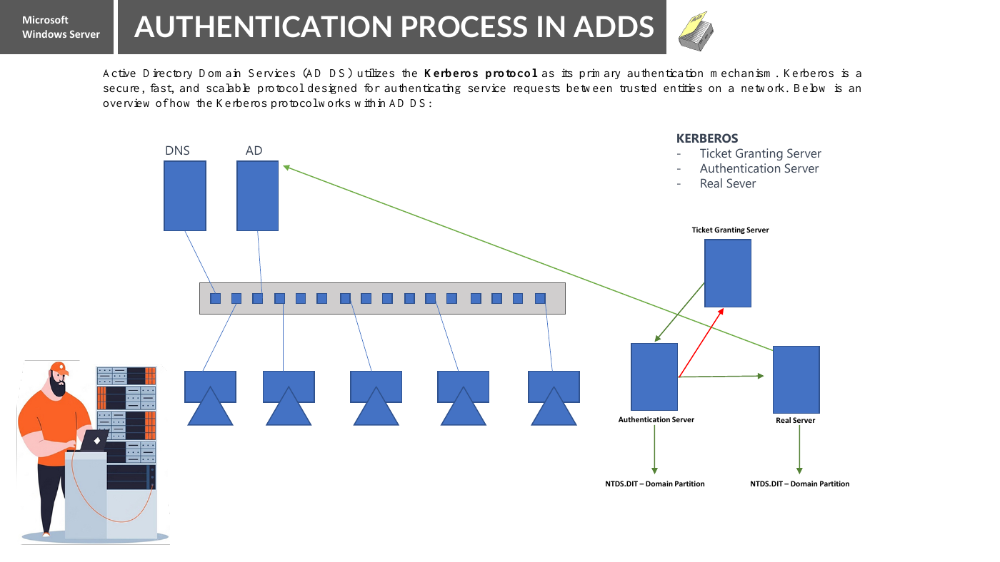

# User aur Group Management se Active Directory Domain Services tak

Roman Urdu study notes | Class companion | 27 October 2026

Yeh notes aapke typed class points aur supplied 22-page AD DS lecture ko combine karti hain. Learning order hai: identities → local accounts → directory services → protocols → login → structure → administration. Examples samjhane ke liye hain jab tak explicitly pehle ke lab records na kaha gaya ho. AD deployment ya configuration change ka claim nahin hai.

## Contents

1. Users, groups aur permissions
2. SAM aur workgroup accounts
3. AD DS, domain aur Domain Controller
4. LDAP aur Linux directory integration
5. VMware SSO
6. Novell aur history notes
7. Windows Server aur AD services ki family
8. Topology, workgroup aur domain
9. Azure AD, Entra ID aur hybrid identity
10. UPN aur DOMAIN\username
11. AD objects aur directory structure
12. Kerberos login aur resource access
13. Database partitions, SYSVOL aur replication
14. FSMO roles
15. Schema version aur functional levels
16. Readiness, tools, revision aur baad ka lab

Pehle sections 1–5 parhein. Break ke baad naming aur history ki taraf jayein. Original PDF ko topic map ke saath use karein; har slide ke shorthand ko literal definition na samjhein.

---

## 1. Users, groups aur permissions

**User account** aik identity represent karta hai. Woh kisi insaan ka ho sakta hai ya service ke liye use ho sakta hai. **Security group** identities ko jama karta hai taake administrator consistent permissions de sake.

Example: Ali aur Aisha Accounts mein kaam karte hain. Dono accounts Accounts security group mein add karein aur folder ki munasib permission group ko dein. Naya colleague aaye to har person ke liye folder edit karne ke bajaye group membership se intended access di ja sakti hai.

| Concept | Sawal | Example |
|---|---|---|
| Identity management | Kis ka account hai aur uska lifecycle kya hai? | Ali create karna, baad mein account disable karna |
| Authentication | Aap kaun hain? | Ali ka sign-in verify karna |
| Authorization | Aap kya kar sakte hain? | Accounts read allow; Payroll write deny |

Sirf group member banne se access nahin banti: relevant permission ya application role ko us group ka reference dena hota hai. Kuch groups messages distribute karte hain, security access nahin dete. User/group management mein names, membership review, password policies, unused accounts disable karna aur munasib admin privileges bhi aate hain.

Login successful hone se har folder ki access nahin milti. Resource server aur uske access controls authorization mein hissa lete hain.

---

## 2. SAM aur workgroup accounts

**SAM = Security Accounts Manager.** Ordinary Windows workstations aur member servers par SAM local account information manage karta hai. Workgroup mein har machine apni local identities khud manage karti hai.

```text
DELL\Ali
DESKTOP\Ali
```

Yeh alag accounts hain, chahe username/password same hon. Dell par password change karne se desktop automatically update nahin hota. Local account ko us machine ke allowed share par authenticate karne ke liye use kiya ja sakta hai jo account own karti hai; workgroup networking ko band nahin karta.

SAM sirf workgroup tak limited nahin: ordinary domain member par local accounts aur domain sign-in dono ho sakte hain. DC ordinary domain accounts ke liye AD DS use karta hai; workstation wala local-user model seedha DC par apply na karein.

| Ghalat fehmi | Sahi samajh |
|---|---|
| Workgroup naam same to access | Credentials, connectivity aur permissions phir bhi chahiye |
| Username same to identity same | Account authority/computer bhi matter karta hai |
| Workgroup mein communication nahin | File sharing aur doosri services chal sakti hain |

---

## 3. AD DS, domain aur Domain Controller

**AD DS = Active Directory Domain Services.** Yeh Microsoft ki directory service hai jo domain identities aur related directory information manage karti hai. Directory objects aur unke attributes ko organized hierarchy mein rakhti hai.

**AD domain** forest ke andar administrative aur replication unit hai. Is mein users, computers aur doosre objects hote hain. **Domain Controller (DC)** par AD DS chalti hai aur directory data hota hai. Sirf Windows Server install karna DC banana nahin: role installation aur DC promotion alag steps hain.

Example: `VCPLAB\Ali` aik domain account ho sakta hai jo allowed domain-joined computers par use ho. Sign-in rights aur resource permissions phir bhi apply hoti hain.

| Term | Isay kaise samjhein |
|---|---|
| Windows Server | Operating system |
| AD DS | Directory service/role |
| Domain | Directory organization aur identity scope |
| DC | Directory services dene wala server |
| NTDS.dit | DC par AD DS database file |

Multiple writable DCs changes replicate karte hain. Domain ka design lazmi aik server ka nahin. Member computer ka local account same naam ke domain account se alag rehta hai.

---

## 4. LDAP aur Linux directory integration

**LDAP = Lightweight Directory Access Protocol. Yeh protocol hai, database product nahin.** Directory server information store karta hai; LDAP batata hai clients directory entries ko kaise access karein, authentication aur access controls ke mutabiq.

| Category | Example |
|---|---|
| Protocol | LDAP |
| Directory implementation | OpenLDAP; AD DS bhi LDAP support karta hai |
| Linux local account information | `/etc/passwd`, `/etc/shadow`, `/etc/group` |
| Directory client integration | Design ke mutabiq SSSD jaise components use ho sakte hain |

Har Linux login ke liye LDAP zaroori nahin. Local accounts ya configured central identity service use ho sakti hai. LDAP sirf Linux ka protocol nahin. Directory entry mein naam, mail attribute aur group-related information ho sakti hai; is ka matlab actual email messages directory mein store hona nahin.

### Aapki notes ka “389”

| Protocol/service | Aam port | Matlab |
|---|---|---|
| LDAP | TCP 389 | Directory access; sahi configuration mein StartTLS protection de sakta hai |
| LDAPS | TCP 636 | Connection ke shuru se TLS ke saath LDAP |
| Kerberos | TCP/UDP 88 | Domain authentication |
| DNS | TCP/UDP 53 | Domain-service discovery aur name resolution |

AD doosre ports aur services bhi use karta hai; yeh learning table hai, complete firewall rule set nahin. Port 389 akela “AD DS port” nahin. Sirf LDAP naam hone se encryption automatically nahin ho jati.

---

## 5. VMware SSO

**SSO = Single Sign-On.** Is se authenticated identity related services use kar sakti hai baghair baar baar credentials enter kiye, system ke scope, session rules aur permissions ke mutabiq.

Is VMware lesson ka mumkin context **vCenter Single Sign-On** hai. Aam default SSO administrator identity:

```text
administrator@vsphere.local
```

Isay standalone ESXi ke direct login wale `root` account se compare karein. Host account aur vCenter SSO identity alag account contexts hain. vCenter SSO configured identity sources ke saath kaam kar sakta hai; valid identity ko phir bhi sahi vCenter permissions chahiye.

SSO authentication ka experience/mechanism hai, har directory database ka doosra naam nahin. Aapka passwordless SSH alias bhi alag hai: us mein SSH client config aur key authentication hoti hai, vCenter SSO nahin.

---

## 6. Novell aur history notes

Aapki original line thi: `Novell - OS | Database x.25`.

- Novell company thi; NetWare uska network operating system tha.
- NDS ka matlab Novell Directory Services hai; directory technology baad mein eDirectory ke naam se jani gayi.
- X.25 networking protocols se related hai, directory database ka naam nahin.
- X.500 directory standards se related hai, is liye mumkin hai lecture mein yahi murad ho. **Teacher se confirm karein; original note ko khamoshi se replace na karein.**

Purane products se samajh aata hai organizations ko central identity aur directory services kyun chahiye thin. Current AD DS lab ke liye NetWare ya X.25 deploy karna zaroori nahin.

---

## 7. Windows Server aur AD services ki family

Aapki notes mein teen categories mix hain: OS versions, account/directory services aur file systems. Inhein alag samjhein.

| Class line | Explanation |
|---|---|
| NT — SAM / FAT | SAM accounts, FAT disk files se related hai. NT mein NTFS bhi tha aur AD se pehle historical NT domains bhi the. |
| 2000 — DNS / AD / NTFS | Windows 2000 Server mein Active Directory introduce hui. DNS aur NTFS pehle se the; DNS AD discovery ke liye important hai. |
| 2003 | AD platform aage barha; application directory partitions is generation ka hissa hain. |
| 2003 R2 / SP2 | R2 release variant aur SP2 service pack hai. Dono aik naam nahin. |
| 2008 — AD DS | AD service family mein AD DS aur AD LDS jaise distinct role names hain. |
| 2012 / 2016 / 2019 / 2022 / 2025 | Baad ki server releases. Yeh shorthand kuch R2 releases chhorta hai; complete chronology nahin. |

**FAT = File Allocation Table. NTFS = New Technology File System.** Dono account directory nahin. Files/folder data file system par hota hai; directory entries users/resources ki information rakh sakti hain baghair tamam resource content store kiye.

### AD DS ≠ AD FS ≠ AD RMS ≠ AD LDS

| Role | Full name | Bunyadi purpose |
|---|---|---|
| AD DS | Active Directory Domain Services | Traditional domains aur directory identities |
| AD FS | Active Directory Federation Services | Trust ke zariye federated application sign-in |
| AD RMS | Active Directory Rights Management Services | Supported content ke usage rights protect karna |
| AD LDS | Active Directory Lightweight Directory Services | Full AD DS domain banaye baghair application directory |

AD LDS pehle ADAM kehlata tha. `ADDS = ADFS | ADRMS | ADLDS` ko equality na samjhein aur na yeh assume karein sab 2003 R2/SP2 mein introduce hue. AD domain trust aur application federation ke purposes bhi alag hain.

---

## 8. Topology, workgroup aur domain

**Topology** arrangement aur connections batati hai. Physical topology devices/links dekhti hai; logical network topology un links ke upar communication ka organization dekhti hai.

| Pattern | Arrangement |
|---|---|
| Bus | Shared backbone |
| Star | Devices central device se connected |
| Ring | Connections loop banate hain |
| Mesh | Multiple interconnections; full mesh mein har pair connected |
| Hybrid | Patterns ka combination |

Cable failure ka asar design par depend karta hai. Simple star mein aik leaf connection fail ho to aam tor par us device par asar hota hai; central switch fail ho to bohat devices affect ho sakti hain. Sirf multiple links redundancy ka proof nahin.

Workgroup/domain identity aur management organization ki classification hai. Yeh bus/star/mesh wali classification se alag hai. Workgroup aur domain dono same physical star par chal sakte hain. AD logical structure ka context bhi alag hai: domains, OUs, trees aur forests. AD sites directory operations ke liye network connectivity model karti hain.

---

## 9. Azure AD, Entra ID aur hybrid identity

**Azure Active Directory ka naam Microsoft Entra ID hua.** Windows Server AD DS ka naam Entra ID nahin hua.

| Service | Bunyadi context |
|---|---|
| AD DS | Traditional Windows domains, DCs, Kerberos aur Group Policy |
| Microsoft Entra ID | Cloud identity, application sign-in aur access management |

Entra ID sirf cloud mein host kiya hua traditional DC nahin. Organization planned hybrid design se on-premises aur cloud identity connect kar sakti hai; synchronization se har capability ya policy aik jaisi nahin ban jati. Microsoft Entra Domain Services alag managed-domain offering hai; usay Entra ID ke saath confuse na karein.

Filhal traditional AD DS lab pehle samjhein. Cloud integration baad ka topic hai, isolated domain lab install karne ki prerequisite nahin.

---

## 10. UPN aur DOMAIN\username

Aapke examples same domain account ko identify kar sakte hain, agar usi tarah configured hon:

```text
vergank@vcplab.com
VCPLAB\vergank
```

| Format | Naam | Hissay |
|---|---|---|
| `vergank@vcplab.com` | User Principal Name (UPN) | User name + `@` + UPN suffix |
| `VCPLAB\vergank` | Down-level logon name | NetBIOS domain + `\` + account logon name |

Down-level format ka user hissa legacy `sAMAccountName` attribute se related hai. Attribute ka naam yeh nahin kehta ke domain account workstation ka local SAM account hai.

UPN email jaisa hai lekin mailbox hone ka proof nahin. Administrator alternate UPN suffix configure kar sakta hai, is liye suffix har dafa AD DNS domain naam ke barabar hona zaroori nahin. NetBIOS domain name alag field hai.

`DELL\vergank` se compare karein: DELL computer ka local account select hota hai; `VCPLAB\vergank` domain identity select karta hai jab VCPLAB us domain ka NetBIOS naam ho.

---

## 11. AD objects aur directory structure

**Object** directory entry hai; uske **attributes** usay describe karte hain. User object ka naam, UPN aur account status ho sakta hai. Shared folder AD mein publish karne se reference store hota hai, actual folder content nahin. Printer object tamam printed documents store nahin karta.

| Structure | Purpose |
|---|---|
| OU: Organizational Unit | Objects organize, administration delegate aur GPO link karna |
| Domain | Forest ke andar identity aur replication unit |
| Tree | Contiguous DNS namespace share karne wale domains |
| Forest | Aik ya zyada domains jo schema/configuration aur forest relationships share karein |
| Site | Service location aur replication ke liye well-connected subnets ka model |
| DC | Directory services dene wala server |

OU security group nahin. Ali ko Accounts OU mein rakhne se folder permission khud nahin milti. Forest bunyadi AD security boundary hai; OU us jaisi isolation nahin.

**GPO = Group Policy Object**, GPU nahin. Group Policy applicable user/computer settings aur kuch supported software deployment scenarios configure kar sakti hai. Links, filtering, inheritance aur processing scope tay karte hain. AD hone se policies har object par automatically nahin lagtin.

Domain trusts cross-domain authentication ka rasta de sakte hain; resource permissions phir bhi chahiye. Doosre domain ki har cheez ki unconditional access maqsad nahin.

---

## 12. Kerberos login aur resource access

Normal AD domain scenarios mein Kerberos primary authentication mechanism hai. DNS client ko DC locate karne mein madad deta hai; accurate time Kerberos ke liye important hai.

### Ali se file server tak simplified scenario

1. Client AD-aware DNS records se DC locate karta hai.
2. Required authentication exchange ke baad Kerberos Authentication Service processing se client ko Ticket Granting Ticket (TGT) milta hai.
3. Ali service access kare to client TGT se Ticket Granting Service se relevant service ticket mangta hai.
4. Client service ticket file service ko present karta hai.
5. Service authentication material validate karti hai aur requested operation ko permissions aur Ali ke security context ke mutabiq check karti hai.

AS aur TGS Key Distribution Center (KDC) ke functions hain, jo aam tor par DC par hota hai; lazmi alag physical servers nahin. Normal resource server ko apni NTDS.dit database nahin chahiye. Is flow mein password seedha har resource server ko nahin bheja jata.



**Original diagram ko upar ki clarifications ke saath parhein.** “Real Server” se murad target resource/service hai. Uske neeche database dekh kar normal file server ke liye NTDS.dit ki requirement assume na karein.

Pehle cached Windows login DC unavailable hone par kabhi chal sakta hai. Yeh live domain authentication, fresh tickets ya tamam network resources available hone ka proof nahin.

---

## 13. Database partitions, SYSVOL aur replication

Default database file aam tor par `C:\Windows\NTDS\NTDS.dit` hoti hai. Database logs bhi aam tor par NTDS directory mein hote hain jab tak doosri location configure na ki jaye. `C:\Windows\SYSVOL` mein domain policy/script file content hota hai. SYSVOL sirf NTDS.dit ke andar nahin hota.

Lecture ki “four partitions” ko **chaar partition categories** samajhna behtar hai; har deployment mein exactly chaar physical pieces nahin.

| Category | Bunyadi content | Aam replication scope |
|---|---|---|
| Schema | Allowed object classes aur attributes | Poora forest |
| Configuration | Sites, services aur forest configuration | Poora forest |
| Domain | Users, groups, computers aur domain data | Us domain partition ko rakhne wale DCs |
| Application | Application-specific data, AD-integrated DNS samait | Selected replica scope |

Multiple application partitions ho sakti hain, jaise DomainDnsZones aur ForestDnsZones. Global Catalog servers doosre domains ki partial information rakhte hain; is liye “domain information doosre domain mein kabhi replicate nahin hoti” ko is qualification ke saath samjhein.

**KCC = Knowledge Consistency Checker.** Yeh replication topology aur connection objects calculate karta hai; poora replication engine nahin. Modern SYSVOL replication DFS Replication se hoti hai, jo database replication se alag hai.

Aksar ordinary changes kisi bhi writable DC par ho kar replicate ho sakti hain. Do writable DCs standard DNS primary/secondary pair se mukhtalif hain. AD-integrated DNS zone apne configured AD scope ke mutabiq replicate hota hai.

Replication availability barhati hai; backup nahin. Ghalat change bhi replicate ho sakti hai. Inter-site replication network needs aur schedules ke mutabiq configure hoti hai; intra-site se inherently tez nahin.

---

## 14. FSMO roles

**FSMO = Flexible Single Master Operations.** AD bohat operations ke liye multi-master updates deta hai, magar kuch special operations designated DCs coordinate karte hain.

| Scope | Role | Zimmedari |
|---|---|---|
| Forest mein aik | Schema Master | Schema updates coordinate |
| Forest mein aik | Domain Naming Master | Directory domains add/remove aur related naming operations coordinate |
| Har domain mein aik | RID Master | DCs ko RID pools dena taake security identifiers unique hon |
| Har domain mein aik | PDC Emulator | Password-change coordination, account-lockout functions aur time hierarchy duties |
| Har domain mein aik | Infrastructure Master | Relevant cross-domain object references maintain; ahmiyat design par depend |

Paanch roles ke liye paanch servers zaroori nahin. Naye single-domain forest ka pehla DC aam tor par shuru mein sab roles rakhta hai. Do domains ke forest mein do forest-wide aur har domain ke teen role instances: kul aath.

PDC emulator akela DC nahin jo users authenticate ya password changes accept kare. Group Policy processing clients par hoti hai; editing consistency ke liye admin tools aam tor par PDC prefer karte hain. Default hierarchy mein forest-root PDC ka special time-source role hai.

Schema objects ordinary accounts ki tarah casually delete nahin karte; controlled planning chahiye. Infrastructure Master placement mein Global Catalog aur forest-design qualifications hain; blanket rule na banayein.

**Transfer** planned role move hai jab current holder available ho. **Seizure** recovery action hai jab holder normal tor par wapas nahin aa sakta. Dono beginner troubleshooting shortcut nahin; yahan koi move/seizure nahin kiya gaya.

---

## 15. Schema version aur functional levels

**Schema** allowed object classes aur attributes define karta hai. **Schema version** schema revision identify karti hai. Server OS version, schema version, domain functional level aur forest functional level related magar alag values hain.

| Lecture ki Windows Server generation | Schema version |
|---|---:|
| 2000 | 13 |
| 2003 / SP1 / SP2 | 30 |
| 2003 R2 | 31 |
| 2008 | 44 |
| 2008 R2 | 47 |
| 2012 | 56 |
| 2012 R2 | 69 |
| 2016 | 87 |
| 2019 aur 2022 | 88 |
| 2025 | 91 |

Schema update ka matlab har DC ka us OS par upgrade hona nahin. Functional levels AD capabilities aur supported DC versions tay karte hain; yeh user count ya client Windows edition nahin. Server 2019/2022 ke naam par alag domain/forest functional levels introduce nahin hue.

Schema number se functional levels infer na karein aur sirf naya ISO hone par levels raise na karein. Pehle current DC compatibility aur planned design check karein. Schema extension, functional-level changes aur backup/recovery baad ke administration topics hain.

---

## 16. Readiness, tools, revision aur baad ka lab

### Teacher ki installation checklist samjhein

| Lecture item | Baad ke lab ke liye matlab |
|---|---|
| Windows Server aur admin rights | Suitable supported guest OS aur permissions |
| Static IP `192.168.0.111/24` | Teacher ki example; aapke lab mein confirmed free address nahin |
| Unique domain name | Promotion se pehle suitable namespace soch kar choose karein |
| DNS server | AD-aware discovery aur clients ki munasib resolver configuration |
| DSRM password | Alag Directory Services Restore Mode recovery credential; private rakhein |
| Forest/domain functional levels | DC design ke mutabiq compatibility choices |
| 250 MB disk space | Purana database/log context; modern complete server VM ke liye kaafi nahin |

Configuration se pehle resources, subnet overlap, time, naming, installation media aur recovery plan verify karein. Chosen edition ke current Windows Server/VM requirements check hon. Domain rename, DC rename aur demotion controlled operations hain, casual undo buttons nahin.

### Windows par read-only observation

```powershell
Get-CimInstance Win32_ComputerSystem |
    Select-Object Name, PartOfDomain, Domain
whoami
whoami /groups
```

`PartOfDomain` traditional Windows domain membership check karta hai. `whoami` current security context dikhata hai. DNS suffix ya Microsoft-account sign-in AD DS membership ka proof nahin. Cloud identity states alag inspect hoti hain.

Domain banne ke baad suitable tools/permissions se yeh checks kaam aa sakte hain:

| Tool | Purpose |
|---|---|
| Active Directory Users and Computers | Users, groups, computer objects aur OUs |
| DNS Manager | AD discovery records aur zones |
| Group Policy Management | GPO links, settings aur scope |
| `klist` | Current Kerberos ticket cache |
| `gpresult /r` | Applied policy results |
| `dcdiag` | DC diagnostics |
| `repadmin /replsummary` | Replication summary |

Is table ka matlab yeh tools aapke host par already installed hona nahin. ADSI Edit ya `ntdsutil` ko baghair samjhe repair steps ke taur par use na karein.

### Self-check: key se pehle jawab dein

1. SAM, LDAP, SSO aur UPN ki full forms?
2. `DELL\Ali` aur `VCPLAB\Ali` automatically same account?
3. LDAP database hai aur sirf Linux ka hai?
4. TCP/389 se AD ki har requirement poori hoti hai?
5. `vergank@vcplab.com` mailbox ka proof hai?
6. Workgroup aur domain same star network use kar sakte hain?
7. Kerberos access ke liye normal file server ko NTDS.dit chahiye?
8. AS aur TGS lazmi do machines hain?
9. OU folder permission deta hai?
10. Domain trust automatic file access deta hai?
11. Har deployment mein exactly chaar directory partitions hain?
12. KCC poora replication engine hai?
13. Paanch FSMO roles ke liye paanch DCs chahiye?
14. Schema 91 aur functional level 2025 aik cheez hain?
15. Replication backup ko replace karti hai?

### Jawabat

1. Security Accounts Manager; Lightweight Directory Access Protocol; Single Sign-On; User Principal Name.
2. Nahin: local aur domain account authorities alag hain.
3. Yeh directory access protocol hai jo multiple platforms support karte hain.
4. Nahin: AD multiple services aur ports use karta hai.
5. Nahin: sign-in name aur mailbox alag concepts hain.
6. Ji haan: topology aur identity organization alag dimensions hain.
7. Nahin.
8. Nahin: yeh KDC functions hain.
9. Nahin: resource permissions/security groups alag hain.
10. Nahin: authorization phir bhi apply hoti hai.
11. Nahin: chaar categories; application partitions multiple ho sakti hain.
12. Nahin: replication topology calculate karta hai.
13. Nahin: aik DC multiple roles rakh sakta hai.
14. Nahin: dono alag cheezein measure karte hain.
15. Nahin: ghalat changes bhi replicate ho sakti hain.

### Baad ke practical ka learning order

Inventory aur plan → separate server/client lab prepare → AD DS/DNS install aur promote → discovery verify → member join → user/group/OU create → harmless GPO test → allowed/denied folder access verify → optional second DC/replication → supported backup planning.

Existing standard DNS primary/secondary/stub exercise alag documented rakhein. Actual machine names/IPs, client edition, resources aur evidence practical ke waqt confirm hon ge. **In study notes ke liye installation nahin ki gayi.**

[README par wapas](README.md) | [Sources aur lecture map](SOURCES_AND_LECTURE_MAP.md)
