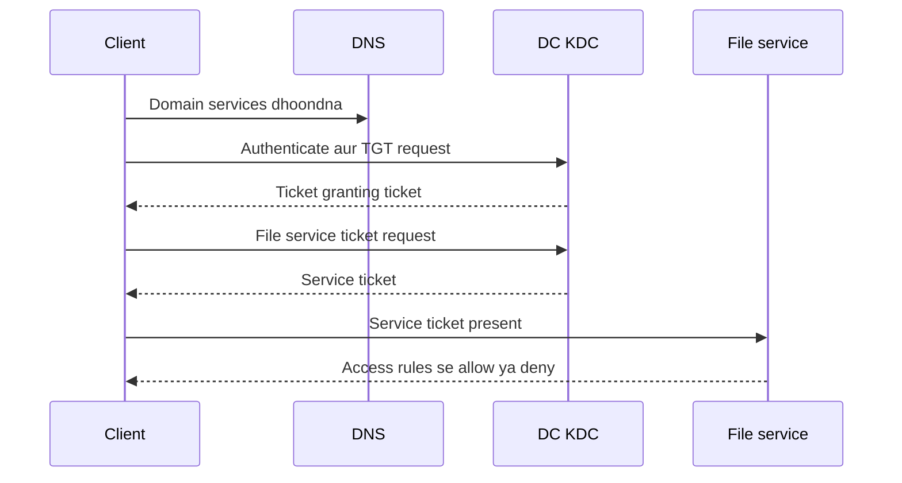

# Active Directory Domain Services — DNS se centralized identity tak

Roman Urdu study guide • 24 October 2026 • Pehle theory; practical implementation baad mein

Bhai, yeh guide aapki teacher ki 22-page AD DS lecture PDF aur history/topology screenshot ke mutabiq hai. Explanations aapki VMware/DNS lab understanding se jori gayi hain. Yeh learning companion hai, completed deployment report nahin. Existing DNS practice lab ko apne recorded environment ke taur par alag rakhein.

Aik waqt mein aik chapter parhein: business problem → workgroup/domain → DNS aur DCs → objects aur organization → login → database/replication → administration aur FSMO → readiness. Separate LAB_ROADMAP files mein baad ki practice ka plan hai; abhi installation ya promotion perform nahin hui.

## Parhne ki tarteeb

1. AD DS kaunsa masla hal karta hai?
2. Workgroup aur domain
3. Lecture ki history aur topology
4. DNS, AD DS aur domain controller
5. Objects, attributes, OUs aur groups
6. Domain, tree, forest aur site
7. Login ka safar: authentication aur authorization
8. NTDS.dit, partitions, SYSVOL aur replication
9. Group Policy aur permissions
10. Paanch FSMO roles
11. Schema version aur functional level ka farq
12. Installation readiness aur lecture clarifications
13. Tools, troubleshooting aur revision

Guide ke explanatory diagrams live network evidence nahin hain. Page references original PDF ke page numbers hain.

---

## 0. Yahan se shuru karein — hamari guftagu chhotay hisson mein

**Parhne ka tareeqa:** Aik subsection parhein, apne alfaaz mein samjhayein, phir uska sawal hal karein. Agla hissa shuru karne se pehle ruk kar samajh lein. Yeh samjhane ki misaalein hain; lab mein AD deployment complete honay ka dawa nahin.

### 0.1 Topics ka coverage check

Hamari guftagu ke tamam main topics pehle se mojood thay. Is beginner section mein khaas misaalein aur confusion walay points ki wazahat add ki gayi hai.

| Guftagu ka topic | Pehle se chapter | Is section mein izafa |
|---|---|---|
| Topology | 3 | Star network, cable aur switch fail honay ki misaal |
| Workgroup | 2 | Independent accounts ka matlab disconnected PCs nahin |
| Domain | 1, 2, 6 | PC1/PC2 par aik account aur password change |
| Active Directory / AD DS | 1, 4, 5 | Poora naam aur directory ki aasaan misaal |
| Domain Controller | 4, 7 | Server role, computer name aur service ka farq |
| Users, computers aur groups | 5, 9 | Teachers group aur shared-folder access |
| Authentication / authorization | 7, 9 | Pehchaan aur ijazat ka farq; server ka kaam |
| Group Policy | 9 | Screen-lock misaal; hamara agla teaching point |

### 0.2 Topology: devices kis tarah juray hain

Topology network ki physical ya logical banawat aur connections ko kehte hain.

**Star ki misaal:** Chaar PCs apni apni cable se aik central switch se juray hain. PC1 ki cable toot jaye to PC1 ka woh connection tootega. Baqi teen working cables aur switch se communicate kar sakte hain. Agar woh aik central switch hi fail ho jaye to us ke zariye chaaron ki communication mutasir hogi.

**Apne alfaaz mein:** “Topology batati hai network ke devices kis tarah juray hain.”

**Sawal:** Aik PC ki cable tootne se sab disconnect honge? **Jawab: Is misaal mein sirf us PC ka connection tootega.**

### 0.3 Workgroup: har PC apne accounts manage karta hai

Workgroup mein central AD DS account authority nahin hoti. Har PC apne local users aur passwords manage karta hai.

`PC1\Ali` aur `PC2\Ali` do alag local accounts hain, chahe dono ka naam Ali ho. `PC1\Ali` ka password badalne se `PC2\Ali` ka password nahin badalta. PC1 ke shares ke liye saved credentials update karne par sakte hain.

**Zaroori wazahat:** Accounts ka independent hona network se isolated hona nahin. Workgroup PCs networking, sharing aur permissions theek hon to files aur printers share kar sakte hain. Ghar ke chand PCs ke liye yeh aksar sab se seedha setup hai.

**Sawal:** Workgroup PCs files share kar sakte hain? **Jawab: Ji haan, configuration aur ijazat ho to.**

### 0.4 Domain: identities aik central nizam se manage hoti hain

AD DS domain aik centrally managed directory environment hai jis mein users aur computers jaisi identities hoti hain. Aik domain mein aik se zyada Domain Controllers ho sakte hain.

**Ali ki misaal, aik aik qadam:**

1. Ali ka aik domain account hai: `ADLAB\Ali`.
2. PC1 aur PC2 do alag computers hain jo aik hi domain mein joined hain.
3. Ali isi aik account se dono par login kar sakta hai, agar logon ki ijazat aur zaroori connectivity ho.

PC1 aur PC2 computers ke naam hain. Yeh Ali ke do accounts ya do domains nahin. Aik account se login honay ka matlab Ali ki files aur desktop automatically doosray PC par copy hona bhi nahin.

**Password ki misaal:** Administrator Ali ka domain password badalta hai. Ali ka account mojood rehta hai; disable nahin hua. Fresh online domain authentication ke liye Ali naya password use karega jab authenticating DC par change available ho. Ahmed ka password nahin badlega. Ali ko har domain PC par alag local password manually change nahin karna.

**Baad ke liye chhota exception:** Cached offline logons, pehle se chalti sessions aur DC replication ki wajah se change nazar aanay ka waqt mukhtalif ho sakta hai. Yeh na kahein ke purana password foran har jagah har surat mein band ho jata hai.

**Sawal:** Password badalne se Ali ka account band hua? **Jawab: Nahin; sirf password badla.**

### 0.5 AD DS: directory service

**AD DS = Active Directory Domain Services.** Aakhir mein “Services” plural hai.

Telephone directory ki misaal lein: us mein records hotay hain. AD DS users, computers aur groups ke directory objects aur unki attributes rakhti hai aur domain identity services provide karti hai. Is ka kaam simple list se zyada hai, magar shuru mein list ki misaal madad karti hai.

**Sawal:** Kya AD DS sirf devices ki maloomat rakhti hai? **Jawab: Nahin; users, groups aur doosray directory objects bhi.**

### 0.6 Domain Controller: service provide karne wala server

**Domain Controller (DC)** woh server hai jo domain ki AD DS provide karne ke liye promote kiya gaya ho. Computer ka naam `DC01` ho sakta hai. “Domain Controller” uska role hai, lazmi computer name nahin. Sirf AD DS role install karna completed promotion nahin.

Teen baatein alag yaad rakhein: **domain = managed environment; AD DS = directory service; DC = woh server jo service provide karta hai.** DC ki domain authentication services domain user ki pehchaan verify karti hain.

**Sawal:** Kya DC ka naam “DomainController” rakhna lazmi hai? **Jawab: Nahin.**

### 0.7 Authentication aur authorization

| Term | Aasaan sawal | Office ki misaal | Computer ki misaal |
|---|---|---|---|
| Authentication | Aap kaun hain? | Guard aapki pehchaan verify kare | Domain authentication Ali ki pehchaan verify kare |
| Authorization | Aap kya kar sakte hain? | Aapko kamray mein janay ki ijazat ho | Folder permissions parhne dein ya mana karein |

Hamari domain misaal mein DC identity authenticate karta aur relevant groups ki maloomat provide karta hai. Jis system par folder hai, woh user ke security context aur apni permissions se access enforce karta hai.

**Doosra physical server lazmi nahin.** Separate file server aik aam misaal hai. Resource ki ijazat usay host karne wala system enforce karta hai, chahe roles aik machine par hon. DC apne resources ki permissions bhi enforce karta hai.

**Sawal:** Ali login ho gaya magar folder nahin khol sakta. Folder ka faisla kis concept ka hai? **Jawab: Authorization.**

### 0.8 Groups: members ka access ikathay manage karein

`Teachers` security group banayein, Ali aur Sara ko members banayein aur lesson folder par group ko Read permission dein. Dono ko membership ke zariye access mil sakta hai; effective permissions aur current security token bhi matter karte hain. Group accounts ka majmua hai, aik shared user account nahin.

Group permissions ikathay manage karne mein madad karta hai. Is ka matlab har setting har member par automatically apply hona nahin. OU/GPO scope aur security filtering policy ke alag concepts hain.

**Sawal:** Folder ki permission group ko dene ka faida? **Jawab: Members ka access ikathay manage hota hai.**

### 0.9 Group Policy: hamara agla sabaq

Group Policy supported user aur computer settings ko **Group Policy Objects (GPOs)** ke zariye manage karti hai. Misaal: administrator munasib policy configure kare ke targeted computers paanch minute inactivity ke baad lock ho jayein.

Domain GPO site, domain ya OU se link hota hai. Scope, filtering aur processing tay karte hain kahan apply hoga. Security group aur GPO alag cheezein hain.

**Agla teaching sawal:** “Administrator targeted PCs par automatic screen lock configure karta hai. Yeh Group Policy hai ya folder permission?” **Jawab: Group Policy.**

Yahin se aahista aage chalein: pehle Group Policy samjhayein, phir aik sawal karein aur jawab ka intezar karein.

**Attachments ka note:** Neechay original image links aur companion files ke references mehfooz hain. Image folders, source map aur lab roadmap in do Markdown attachments ke saath nahin aaye; un links ke liye original companion files chahiye hongi.

---

## 1. AD DS kaunsa masla hal karta hai?

Maan lein 20 staff members aur 20 Windows computers hain. Workgroup mein har computer ke apne local accounts hotay hain. Aik bande ka access har machine par banana ya band karna repetitive hota hai. Same username/password rakhne se woh accounts aik identity nahin ban jate.

AD DS centrally managed identities aur related resources ki directory deta hai. Domain user munasib configured systems par apni domain identity se authenticate kar sakta hai. Groups permissions aasaan aur policies supported Windows settings manage karti hain. AD DS har user document ka storage nahin aur har application automatic install nahin karta.

**Running misaal:** Aisha Accounts department join karti hai. Administrator domain account banata, munasib Accounts access group mein add karta aur user/computer objects ko manageable OU structure mein rakhta hai. File server us group ko suitable permissions deta hai. Aisha chali jaye to domain account disable karna new authentication block kar sakta hai; pehle se established sessions/tokens ka handling alag ho sakta hai.

Yeh Identity and Access Management (IAM) ka hissa hai: kaun exist karta hai, identity kaise verify hoti hai aur kya access milta hai. Aapki Linux understanding mein local `/etc/passwd` account aur centrally provided directory identity ka farq yaad karein. AD DS ke apne protocols, objects aur administration hain; Linux file ko server par copy karna nahin.

**Revision:** Domain account ka matlab har PC par same password manually banana hai? **Nahin. Domain centrally managed identity deta hai.**

---

## 2. Workgroup aur domain

| Sawal | Workgroup | AD DS domain |
|---|---|---|
| Account authority | Har machine ki local account database | Domain identities ke liye domain controllers |
| Administration | Har machine par local configuration | Central directory administration aur local controls |
| Identity ki misaal | PC01\aisha | ADLAB\aisha ya suitable UPN |
| Central policy | Domain member jaisi domain-linked GPO processing nahin | Applicable domain GPOs apply ho sakti hain |
| Network needs | Resource access ke liye ordinary networking | DNS/DC connectivity aur doosri domain requirements |

Domain member ki apni machine identity rehti aur local users bhi ho sakte hain. Domain join OS erase, har file DC par move ya har user ko administrator nahin banata. DC ka account model ordinary member server se alag hai; uski local-account management same assume na karein.

Workgroup files share aur DNS use kar sakta hai. Domain mein physical aur virtual dono machines ho sakti hain. Is liye workgroup ka matlab “network nahin” aur domain ka matlab Ethernet cable ki shape nahin.

**Aapki DNS03 misaal:** WORKGROUP rakh kar primary suffix `VCPLAB.Com` set karna AD join nahin tha. Zone name, computer suffix aur AD membership alag concepts hain.

---

## 3. Lecture ki history aur topology ko sahi parhein

Screenshot lecture outline hai, exact product-release timeline nahin. Pehli line “Novell - OS | Database x.25” jaisi hai; intended database/protocol term ambiguous hai. Is shorthand se X.25 ko AD database na samjhein. X.25 networking protocol family hai; directory standards aur Novell directory products ki history alag hai.

Windows NT domains mein SAM-based accounts aur primary/backup domain-controller model tha. Windows 2000 Server ke saath AD aaya aur modern directory/domain framework mila. Baad ki Windows Server releases ne features extend kiye. **SAM account database, FAT/NTFS filesystems aur DNS naming service hai.** Yeh aik hi component ki competing versions nahin.

| Outline ka naam | Main purpose |
|---|---|
| AD DS | Windows domain directory aur domain identity services |
| AD LDS | Applications ki LDAP directory; AD DS domain nahin |
| AD FS | Federation/token-based identity service; domain database nahin |
| AD RMS | Protected content ki rights-management technology |

Outline ka `ADDS = ADFS | ADRMS | ADLDS` family-of-services reminder samjhein, equality ya same release mein launch honay ka proof nahin. Microsoft Entra ID cloud identity platform hai, ordinary on-premises AD DS domain controller nahin.

**Topology:** star, ring aur mesh network designs hain. Workgroup/domain identity-management model hai. AD mein “logical structure” specifically domains, OUs, trees aur forests bhi hai; sites/subnets network-location structure hain. In meanings ko aik na karein.

---

## 4. DNS, AD DS aur domain controller

Aap jante hain DNS names aur records provide karta hai. AD DS identities aur directory administration add karta hai. **Domain controller (DC)** woh Windows Server hai jo domain ke AD DS ke liye promote hua ho. AD DS role install aur promotion complete hona aik cheez nahin.

DNS domain clients ko DC services dhoondne mein madad karta hai, khaas taur par **SRV records** se. A record poochta hai “is named host ka address?” Service record poochta hai “yeh domain service kaunsa server deta hai?” Baad mein application/server munasib protocols aur credentials use karta hai. DNS khud decide nahin karta ke Aisha Accounts folder khol sakti hai ya nahin.

| Component | Kis sawal mein madad? |
|---|---|
| DNS | Host/service kahan mil sakta hai? |
| Kerberos/KDC | Identity ko munasib authentication tickets mil sakti hain? |
| LDAP/directory tools | Kaunse directory objects aur attributes available hain? |
| Resource access controls | Identity ko resource par yeh action allowed hai? |

DC aksar DNS bhi host karta hai magar roles conceptually alag hain. Enterprise mein AD-integrated DNS aur DC roles combine ho sakte hain; organization size separation ka lazmi rule nahin. Public resolvers aam tor par private AD service records nahin jante. Domain members ko aisa DNS chahiye jo domain resolve kare; public resolver ko missing internal names ka automatic alternate na samjhein.

Existing standard primary/secondary/stub exercise automatic AD deployment nahin. Suitable writable DCs ki AD-integrated DNS, AD replication use karti hai; standard zone-transfer model se alag.

---

## 5. Objects, attributes, OUs aur groups

**Object** directory mein kisi cheez ko represent karta hai. **Attributes** uski properties hain. User ka logon name aur doosri identity properties hoti hain; computer account joined machine ki identity hai. Group ke members hotay hain. OU eligible objects organize, administration delegate aur GPO scope mein madad karta hai.

| Object/concept | Misaal | Purpose |
|---|---|---|
| User | aisha | Design ke mutabiq person/service identity |
| Computer | CLIENT01 | Domain computer identity |
| Security group | GG_Accounts_Users | Permissions ke liye identities ka group |
| OU | OU=Accounts | Organization, delegation aur policy scope |
| Published printer/share | Resource ki directory information | Discovery; actual content resource par rehta hai |

OU security group nahin. Aisha ko OU mein rakhne se file share access khud nahin milta. Group mein add karne se uska user object move nahin hota. OU organization/policy aur security group permissions ke liye use karein.

Shared folder ki directory entry ka matlab uski files NTDS.dit ke andar nahin. Resource server files host aur share/NTFS permissions enforce karta hai. Published printer object physical printer nahin.

Distinguished name ki misaal: `CN=Aisha,OU=Accounts,DC=ad,DC=lab,DC=example`. Yahan **DC=** domain component hai, “domain controller” nahin. Yeh illustrative naam hai, aapki lab mein already created domain nahin.

---

## 6. Domain, tree, forest, site aur global catalog

| Term | Aasaan matlab |
|---|---|
| Domain | Domain objects ka directory namespace aur administrative/replication scope |
| Tree | Contiguous DNS namespace walay domains, jaise ad.lab.example aur child.ad.lab.example |
| Forest | Aik ya zyada domains jo schema/configuration aur trust framework share karte hain |
| OU | Aik domain ke andar container, alag domain nahin |
| Site | Mapped IP subnets se network locality ki logical representation |
| Global catalog (GC) | DC ki capability jo forest-wide searches aur relevant logon/group lookups mein madad kare |

Site aksar well-connected physical location se match hoti hai magar sirf building ka naam nahin. Subnet mapping client ko suitable DC aur replication design ko guide karti hai. Forest principal AD security boundary hai; OU domain administrators ke khilaf hard isolation boundary nahin.

GC lazmi alag server appliance nahin. GC apne domain ke full objects aur forest ke doosray domains ke objects ki selected attributes rakhta hai. Lecture ka “DC ke paas AD database hai” simplified statement hai: har DC har domain ka full writable data nahin rakhta.

Learning ke liye aik forest, aik domain aur aik site se shuru karein. Accounts aur IT departments ke liye multiple forests ki zaroorat nahin; beginner example mein OUs/groups zyada seedhay hain.

---

## 7. Login ka safar: pehle authentication, phir authorization

Teacher reference: PDF page 7. “Authentication Server,” “Ticket Granting Server” aur “Real Server” ko teen mandatory DC machines na samjhein. **AS aur TGS, KDC ki logical services hain**, aam tor par domain controllers par. Target service ordinary member file server ho sakti hai; usay apni NTDS.dit copy nahin chahiye.

Yeh simplified successful Kerberos flow hai, packet-by-packet trace nahin. Client aam tor par har resource server ko plaintext password nahin bhejta. Kerberos tickets aur cryptographic proofs use karta hai; service authorization phir bhi apply karti hai. Time synchronization aur correct service identity/SPNs aham hain. Kuch scenarios mein NTLM aa sakta hai, magar isay Kerberos ka intended universal replacement na samjhein.

**Authentication:** “Kya aap Aisha hain?” **Authorization:** “Kya Aisha yeh folder parh sakti hai?” Correct login har permission nahin deta. Trust authentication relationship/path deta hai; har user ko har resource ka access nahin deta.

Cached Windows domain logon kabhi previously used user ko disconnected PC mein login kara sakta hai. Is se DC reachable ya new remote access working prove nahin hota.

---

## 8. Directory database, partitions aur SYSVOL

Teacher reference: page 5. Database file **NTDS.dit** hai, aksar `C:\Windows\NTDS` mein; database/log paths deployment mein choose hotay hain. **Partitions logical naming contexts hain, disk ki chaar partitions nahin**, aur har DC par exactly chaar instances lazmi nahin.

| Category | Kya hota hai? | Typical scope |
|---|---|---|
| Schema | Allowed object classes aur attributes | Forest-wide |
| Configuration | Sites/services jaisi forest configuration | Forest-wide |
| Domain | Particular domain ke full directory objects | Us domain ke DCs |
| Application | Application data, jaise AD-integrated DNS | Selected replica scope |

Suitable AD-integrated designs mein `DomainDnsZones` aur `ForestDnsZones` application partitions aham hain. Lecture ka “domain data doosray domain mein kabhi replicate nahin hota” qualify karein: full domain data apne domain mein replicate hota hai; GC doosray domains ke objects ki partial replica rakh sakta hai.

**SYSVOL**, aam tor par `C:\Windows\SYSVOL`, DCs ki shared domain policy files/scripts rakhta hai. Domain GPO ki directory-side information aur filesystem-side template hoti hai. SYSVOL contents NTDS.dit ke andar user documents nahin.

AD directory replication aur modern SYSVOL replication (DFSR) alag mechanisms hain. **KCC** replication topology aur connection objects calculate/maintain karta hai; poora replication engine ya alag install karne wala server nahin. Healthy DC-to-DC connectivity, DNS aur time phir bhi zaroori hain.

Replication backup nahin: deletion ya bad change replicate ho sakta hai. Supported system-state/recovery planning chahiye. Sirf VM snapshot general AD backup/recovery strategy nahin.

---

## 9. Group Policy, groups aur access control

**GPO** kahein, GPU nahin. GPU graphics process karta hai. Group Policy Object configurable settings rakhta hai. Domain GPO site, domain ya OU scope par link hota aur inheritance/filtering/processing rules ke mutabiq apply hota hai. Sirf domain honay se har object par identical apply nahin hota.

Aisha ki teen decisions alag rakhein: user object ki OU, security-group memberships aur file server permissions. Suitable single-domain exercise mein beginner model **accounts → global group → domain-local permission group → resource permission** (AGDLP) ho sakta hai.

Pehli safe policy lab dedicated test OU par harmless desktop setting ho sakti hai. Domain Controllers OU ya domain root par pehla restrictive experiment na karein. GPO suitable packages ki software installation mein madad kar sakta hai, magar har deployment tool ka universal replacement nahin.

Successful login ke baad “Access denied” ho to authorization investigate karein; foran password reset zaroori nahin. Effective access mein group membership, share/NTFS permissions aur session/token ki current state hoti hai. Group update ke baad expected access ke liye fresh token/session chahiye ho sakta hai.

**Revision:** OU placement policy/delegation organize aur group membership access assignment mein madad karti hai. Dono complementary hain, interchangeable nahin.

---

## 10. Paanch FSMO roles ko har login se mix na karein

Suitable writable DCs par ordinary directory writes multi-master model use karti hain. Kuch operations ko coordinate karne ke liye aik role owner chahiye. Yeh **Flexible Single Master Operations** roles hain. DCs par roles hain, paanch mandatory separate machines nahin. New one-domain forest ka pehla DC aam tor par paanchon roles se shuru hota hai.

| Role | Scope | Main responsibility |
|---|---|---|
| Schema Master | Forest mein aik | Schema updates coordinate |
| Domain Naming Master | Forest mein aik | Forest mein domain naming additions/removals coordinate |
| RID Master | Har domain mein aik | Unique security identifiers ke liye writable DCs ko RID pools |
| PDC Emulator | Har domain mein aik | Password/lockout coordination aur domain time hierarchy mein aham role |
| Infrastructure Master | Har domain mein aik | Relevant cross-domain references maintain; actual duties GC/AD features se badal sakti hain |

PDC Emulator akela login karane ya password change accept karne wala DC nahin. Kuch administration ka preferred/default target hai, jaise ordinary Group Policy editing behavior; har client ka GPO akela process nahin karta. Forest-root PDC Emulator time hierarchy mein aham hai; har member ka time source unrelated manually set na karein.

Do domains hon to 2 forest-wide + 3 per domain = **8 role instances**, aath required DC machines nahin. Multiple roles aik DC par ho sakte hain.

**Transfer** available owner ke saath planned move hai. **Seizure** unavailable old owner ki recovery hai aur controlled return/rebuild plan mangti hai. Temporary network hiccup roles seize karne ki wajah nahin. Schema changes controlled hain; unrestricted definitions delete karna nahin.

---

## 11. Schema version aur functional level aik nahin

Schema directory object classes aur attributes ka rulebook hai. **objectVersion** AD schema revision batata hai. Domain/forest functional levels capabilities aur compatible DC operating systems tay karte hain. Yeh client OS version, DNS zone version ya DCs ki tadaad nahin.

| Schema revision se related DC release | Lecture/official mapping ka objectVersion |
|---|---|
| Windows Server 2016 | 87 |
| Windows Server 2019 / 2022 | 88 |
| Windows Server 2025 | 91 |

Schema 91 honay se har DC Server 2025 nahin ho jata, na functional level automatically 2025 hota hai. Applications ki schema extensions aik aur aspect hain.

Aapke mixed 2016/2025 context mein: **2016 functional-level design** suitable Server 2016/2019/2022/2025 DCs support karta hai; **2025 functional level par 2025 DCs chahiye**. Yeh restrictions DC roles ki hain; har member workstation ko Server 2025 chalana nahin parta. Server 2025 DC introduction ki functional-level prerequisites bhi hain; lab se pehle deliberate choice hogi.

Sirf slide match karne ke liye levels raise ya schema extend nahin karein ge. Future lab mein all-2025 pair ya deliberately compatible mixed design pehle choose hoga. Implementation ke waqt current official compatibility check hogi.

---

## 12. Installation readiness aur lecture ki precise interpretation

Promotion se pehle OS/edition, intended hostname, static addressing, subnet/DNS plan, time, realistic OS/database/log/SYSVOL space, admin credentials aur securely retained **DSRM password** chahiye. DSRM Directory Services Restore Mode recovery ke liye hai; normal domain-user password nahin jo notes mein publish ho.

PDF ka `192.168.0.111/24` teacher example hai, aapke network mein free address ki evidence nahin. “Minimum 250 MB” ko modern Windows Server VM sizing na samjhein. OS, servicing, directory, logs, SYSVOL aur backups realistic capacity mangte hain. Separate roadmap mein suggested allocations hain, current setup ka dawa nahin.

| Slide shorthand | Sahi learning interpretation |
|---|---|
| KCC service sab replicate karti hai | KCC topology maintain; directory replication aur SYSVOL/DFSR alag |
| Chaar logical partitions | Chaar categories; multiple naming contexts/application partitions ho sakti hain |
| GPO saaray domain computers par | Effective scope links/filtering/processing se tay hota hai |
| Domain data doosray domain nahin jata | Full replication domain-scoped; GC partial replicas statement qualify karti hain |
| Rename/install/uninstall aasaan | Promotion, demotion, rename aur schema changes supported planning mangte hain |
| Site-to-site tez hai | Inter-site design cost/schedule/convergence balance karta hai; inherently faster nahin |
| Trust/federation/cloud aik feature | AD trusts, AD FS aur cloud identity integration alag hain |
| Schema Master definitions delete karta hai | Schema maintenance constrained hai; arbitrary deletion routine nahin |

Yeh clarifications classroom shorthand expand karti hain; teacher ne verbally kya bataya ya nahin, uska dawa nahin.

---

## 13. Tools, symptoms se reasoning aur revision

| Tool / read-only check | Kya inspect hota hai? |
|---|---|
| Server Manager / AD DS tools | Roles aur administration consoles |
| AD Users and Computers (`dsa.msc`) | Users, computers, groups, OUs |
| Group Policy Management (`gpmc.msc`) | GPO links, scope aur settings |
| AD Sites and Services (`dssite.msc`) | Sites, subnets aur replication-related objects |
| DNS Manager (`dnsmgmt.msc`) | Host aur service-discovery records |
| `klist` | Applicable current Kerberos ticket cache |
| `gpresult /r` | Suitable session ka applied policy summary |
| `dcdiag`, `repadmin /replsummary` | Deployment ke baad DC health aur directory replication |

Commands/tools installed roles, RSAT, permissions aur context par depend karte hain. Current client par cmdlet missing ho to AD corrupt honay ka proof nahin. ADSI Edit low-level objects expose karta hai; beginner ka pehla repair tool nahin. Yahan role transfer/seizure ya direct database manipulation propose nahin.

| Symptom | Pehli reasoning |
|---|---|
| Domain nahin mil raha | Client DNS, SRV discovery, connectivity aur actual domain name |
| Login fail | Identity format, account state, DC discovery/time; sirf password nahin |
| Login sahi, folder denied | Group/token aur share/NTFS authorization |
| Policy missing | Object ki OU, GPO link, scope/filtering aur processing result |
| Doosray DC par change missing | Replication health aur correct domain/replica context |
| DC offline phir bhi login | Cached logon consider; new service/DC request alag verify |

**Revision jawab**

1. DNS ya AD DS domain identity authenticate karta hai? **AD authentication services; DNS services locate karta hai.**
2. OU permission group hai? **Nahin.**
3. Role install se DC deployment complete? **Nahin; promotion aur verification baqi.**
4. Kerberos AS/TGS separate machines lazmi? **Nahin.**
5. Normal file server ko NTDS.dit chahiye? **Nahin.**
6. Paanch FSMO roles ke liye paanch DCs? **Nahin.**
7. Schema 91 aur functional level 2025 aik? **Nahin.**
8. Replication backup hai? **Nahin.**
9. Domain trust se file access automatic? **Nahin.**
10. Is bundle mein AD deploy kar rahe hain? **Nahin; theory aur baad ki lab ka plan hai.**

Agla kaam: apne alfaaz mein batayein Aisha DC kaise dhoondti, login kaise karti aur file access allow/deny kaise hota hai. Practical ke liye tayyar hon to separate roadmap use hoga.

[Source map and official references](SOURCES_AND_LECTURE_MAP.md)

## Selected original class diagrams / Class ke asal diagrams

These are lecture references, not deployment evidence. Read the explanations and clarifications above alongside them. / Yeh lecture references hain, deployment ka evidence nahin.

### Database partitions

### Kerberos lecture diagram

### Directory structure

### Forest FSMO roles

### Domain FSMO roles

