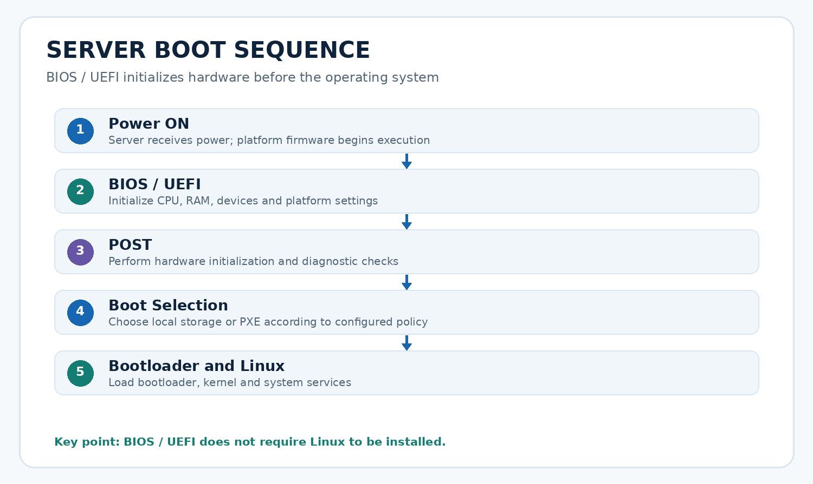
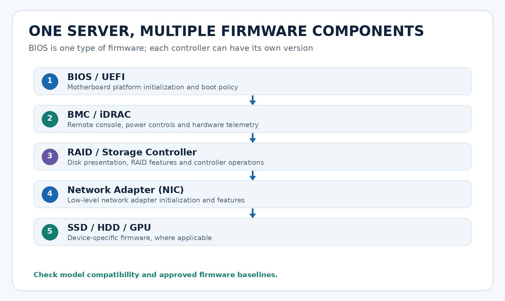
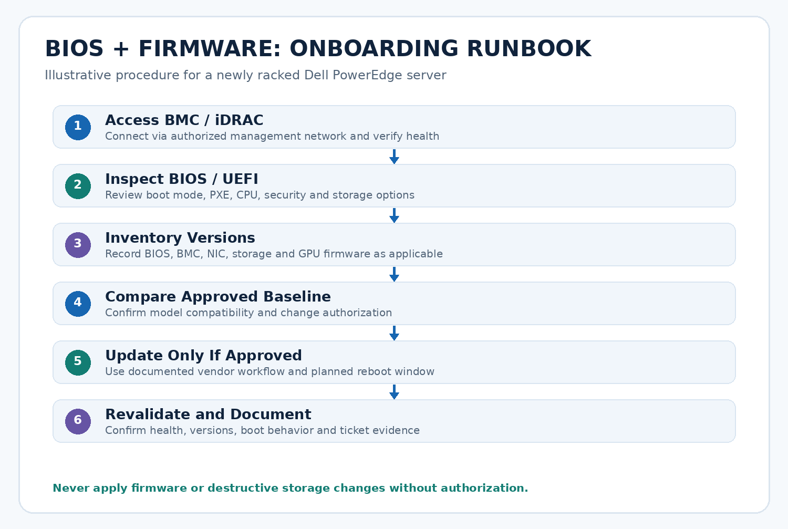
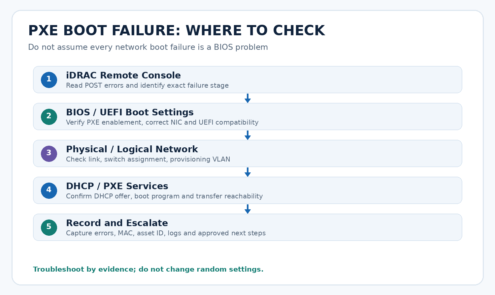

# BIOS and Firmware — Complete Server Onboarding Study Notes

**Audience:** Vultr Server Onboarding Specialist interview preparation  
**Languages:** English and Roman Urdu  
**Format:** Full-length Markdown with four included original diagrams  
**Important:** All IPs, versions, and procedures are **illustrative**, not Vultr's internal runbooks or approved firmware baselines.

## Table of Contents

1. [What is BIOS?](#1-what-is-bios)
2. [What is UEFI?](#2-what-is-uefi)
3. [What is firmware?](#3-what-is-firmware)
4. [Visual: server boot sequence](#4-visual-server-boot-sequence)
5. [Visual: firmware components](#5-visual-firmware-components)
6. [BIOS versus firmware](#6-bios-versus-firmware)
7. [BIOS versus operating system](#7-bios-versus-operating-system)
8. [BIOS settings used in onboarding](#8-bios-settings-used-in-onboarding)
9. [Complete Dell PowerEdge onboarding procedure](#9-complete-dell-poweredge-onboarding-procedure)
10. [Firmware update precautions](#10-firmware-update-precautions)
11. [PXE failure troubleshooting](#11-pxe-failure-troubleshooting)
12. [Useful Linux commands](#12-useful-linux-commands)
13. [Interview questions and answers](#13-interview-questions-and-answers)
14. [Roman Urdu complete explanation](#14-roman-urdu-complete-explanation)
15. [Revision checklist](#15-revision-checklist)

---

## 1. What is BIOS?

**BIOS = Basic Input/Output System.** BIOS is a type of low-level firmware that initializes platform hardware and starts the boot process. In modern enterprise servers, **UEFI** has largely replaced traditional legacy BIOS. Engineers often say “BIOS settings” when referring to UEFI setup menus.

When you press the power button, the server does not immediately start Linux. Platform firmware executes first, discovers and initializes hardware, checks its condition, and selects a boot path. The operating system comes later.

**Roman Urdu:** BIOS ek low-level firmware hai jo server ON hotay hi hardware initialize karta hai aur boot process start karta hai. Linux pehle nahi chalta; pehle BIOS/UEFI ka kaam hota hai.

### Example

A newly racked Dell PowerEdge has no operating system. You can still enter UEFI System Setup locally or via a supported iDRAC remote console because the firmware is independent of the installed OS.

## 2. What is UEFI?

**UEFI = Unified Extensible Firmware Interface.** It is the modern firmware interface for platform initialization, boot services and boot management. UEFI provides features such as UEFI boot entries and Secure Boot when supported and enabled.

**UEFI versus Legacy BIOS:** A deployment image and PXE boot environment must be compatible with the selected boot mode. Do not switch UEFI/Legacy settings casually, especially on a server with an existing OS installation.

**Roman Urdu:** UEFI BIOS ka modern replacement hai. Agar automated imaging UEFI ke liye design hui hai aur server Legacy mode par hai, to boot fail ho sakta hai. Company ki approved configuration follow karein.

## 3. What is firmware?

**Firmware is low-level software stored in nonvolatile memory that initializes or controls hardware.** A server contains many firmware-controlled devices. BIOS/UEFI is firmware, but firmware is not limited to BIOS.

Examples include:

- **BIOS/UEFI firmware:** platform initialization, boot policy and platform configuration.
- **BMC/iDRAC firmware:** out-of-band remote management, console, power controls and hardware status.
- **RAID/HBA controller firmware:** storage-controller operations and supported disk configurations.
- **NIC firmware:** low-level network adapter functions.
- **SSD/HDD firmware:** device-internal storage functions.
- **GPU firmware:** device-specific GPU initialization and control, where applicable.

**Roman Urdu:** Firmware ek broad term hai. Server ke BIOS, iDRAC, RAID controller, NIC, disk aur GPU sab ke apne firmware ho sakte hain.

## 4. Visual: server boot sequence



### Step-by-step explanation

1. **Power ON:** Hardware receives power and the platform begins its startup sequence.
2. **BIOS/UEFI initialization:** Platform firmware initializes CPU, memory and other required devices.
3. **POST:** Power-On Self-Test and initialization checks help identify hardware issues. Exact tests vary by vendor/platform.
4. **Boot selection:** Firmware follows configured boot policy: local disk, RAID virtual disk or network/PXE.
5. **Bootloader:** Bootloader is loaded from the selected source.
6. **Linux kernel:** The kernel starts and initializes OS-level drivers and subsystems.
7. **Services:** The init/service manager starts system services; the server becomes accessible if networking and services are healthy.

**Important nuance:** Some POST and device-initialization activities overlap with firmware initialization; the diagram is a simplified learning model, not a vendor timing chart.

## 5. Visual: firmware components



| Component | Main purpose | Onboarding check |
|---|---|---|
| BIOS/UEFI | Platform initialization and boot | Boot mode, boot order, approved version |
| BMC/iDRAC | Remote out-of-band management | Reachability, health, version |
| RAID/HBA | Storage presentation and control | Mode, health, compatibility |
| NIC | Network adapter features | Link, PXE support, firmware baseline |
| SSD/HDD | Storage-device operations | Inventory, health, version if required |
| GPU | Accelerator hardware | Population, detection, applicable firmware |

**Roman Urdu:** Har component ka firmware alag ho sakta hai. BIOS update karne se zaroori nahi ke iDRAC ya NIC firmware bhi update ho jaye.

## 6. BIOS versus firmware

| BIOS / UEFI | Firmware |
|---|---|
| Specific firmware for system initialization and boot | Broad category of embedded low-level software |
| Associated with motherboard/platform | Found across BMC, NIC, RAID, drives and GPU |
| Controls boot mode, boot order and platform settings | Controls device-specific behavior |
| Has its own version and update process | Each component may have its own version and update process |

**Memorize:** Every BIOS/UEFI implementation is firmware; not every firmware is BIOS.

## 7. BIOS versus operating system

BIOS/UEFI runs **before** the operating system. A server can reach BIOS setup even without Linux installed. A BMC/iDRAC may provide a remote console to access setup, provided the BMC has standby power, network connectivity, supported console features and appropriate authorization.

**BIOS is not Linux.** SSH access to a Linux IP requires a running OS and network/SSH services; accessing iDRAC uses the management controller and its own management IP.

**Example addresses only:**

```text
Linux / in-band OS IP: 192.168.10.100
BMC / out-of-band IP: 10.20.30.50
Browser from authorized management network: https://10.20.30.50
SSH after Linux is installed: ssh admin@192.168.10.100
```

The BMC may use a dedicated Ethernet port or a supported shared-NIC mode. **Separate management IP does not always mean a separate cable.**

## 8. BIOS settings used in onboarding

| Setting | Why it matters | What to verify |
|---|---|---|
| Boot mode | Determines UEFI/Legacy boot behavior | Approved boot mode for imaging |
| Boot order | Chooses boot device | PXE during imaging, approved local boot after |
| PXE / network boot | Enables network-based provisioning | Correct NIC and boot method |
| Intel VT-x / AMD-V | CPU virtualization support | Required state for platform workload |
| Hyper-Threading / SMT | CPU execution topology | Approved CPU baseline |
| Power profile | Performance/power behavior | Approved server profile |
| Secure Boot | Firmware boot security | Imaging/OS compatibility and policy |
| Storage mode | RAID/JBOD/HBA presentation | Approved controller and disk mode |
| NIC options | Network boot/device configuration | Correct enabled ports and network path |

**Do not guess configuration values.** The approved settings depend on the specific server model, hardware SKU, operating environment and company runbook.

**Roman Urdu:** Interview mein yeh kehna behtar hai: “I verify settings against the approved baseline,” na ke “I always enable or disable every setting.”

## 9. Complete Dell PowerEdge onboarding procedure



This is an **illustrative safe runbook**, not a reproduction of Vultr's internal procedures.

### Step 1 — Confirm hardware handoff and prerequisites

- Verify asset tag, serial number, rack location and assigned ticket.
- Confirm the server model, CPU/RAM/storage/GPU inventory and expected build profile.
- Confirm power, cabling, approved access and any required maintenance/change authorization.
- Verify the assigned BMC management IP, network segment and credentials through an approved secure system.

**Expected result:** You have the correct server and an authorized task scope.

**Roman Urdu:** Pehle confirm karein ke aap bilkul sahi server par kaam kar rahe hain. Ghalat asset par changes serious issue bana sakti hain.

### Step 2 — Access iDRAC/BMC

- Connect from the authorized management network/VPN.
- Open the BMC HTTPS interface or approved management tool.
- Check server power state, health summary, hardware inventory and event logs.
- Open remote console if available; note POST or boot errors.
- Do not store BMC passwords in plain-text notes or tickets.

**Expected result:** BMC is reachable and hardware health is understood.

### Step 3 — Inspect BIOS/UEFI

- Review boot mode and boot order.
- Check PXE/network boot configuration and correct NIC selection.
- Verify virtualization, SMT, power profile and Secure Boot only where required by baseline.
- Confirm storage controller operating mode matches the approved design.
- Record deviations without making unauthorized changes.

**Expected result:** Firmware settings match the server's approved build profile.

### Step 4 — Inventory firmware versions

Record versions for components that the runbook requires: BIOS, iDRAC/BMC, NIC, storage controller, and relevant disks/GPUs.

| Component | Illustrative version | Required action |
|---|---|---|
| BIOS | 2.8.1 | Compare with approved baseline |
| iDRAC | 7.10.00 | Compare with approved baseline |
| RAID controller | 52.24.0 | Compare with approved baseline |
| NIC | 22.5.1 | Compare with approved baseline |

**These numbers are fictional examples, not vendor recommendations.** Different models use different version schemes.

### Step 5 — Compare against approved baseline

- Confirm hardware model and compatibility.
- Check approved firmware versions and required update order.
- Review release notes and known issues as required by policy.
- Confirm update authorization, maintenance window and recovery plan.
- If installed firmware differs, do **not** automatically assume newest is approved.

**Expected result:** A documented decision to leave firmware unchanged or update it through the approved workflow.

### Step 6 — Update only if approved

- Use the company's approved update method and vendor packages for the exact hardware.
- Verify integrity and compatibility as required.
- Follow update ordering, reboot/reset and power requirements.
- Avoid power interruption; do not interrupt an active update.
- If an update fails, follow documented recovery/escalation procedures instead of improvising.

**Expected result:** Authorized update completes without unplanned hardware faults.

### Step 7 — Revalidate

- Reconnect to BMC after any required restart.
- Verify firmware versions, server health and logs.
- Confirm settings remain correct and storage/NICs are detected.
- Test the approved boot path (PXE for provisioning, local boot as required afterward).
- Record successful checks and unresolved deviations.

### Step 8 — Document and hand off

- Update asset inventory, serial, rack, BMC network assignment and component details.
- Record firmware versions, validation evidence and issue/ticket references.
- Escalate unresolved blockers to appropriate teams.
- Hand off to imaging, validation or production activation only at the approved checkpoint.

**Roman Urdu:** “Server power ON ho gaya” ka matlab “production ready” nahi. Approved checks aur handoff complete hona zaroori hai.

## 10. Firmware update precautions

Firmware updates are **potentially disruptive**, especially for BMC, BIOS, storage or networking components.

1. Verify you are on the correct host and correct component.
2. Use only model-compatible, approved packages.
3. Follow internal change-control and update ordering.
4. Understand expected downtime and reboots.
5. Preserve management connectivity and recovery access where possible.
6. Check component and platform health after the update.
7. Capture versions, results and errors in the ticket.

**Do not:** Flash arbitrary images, switch RAID/JBOD modes on a populated system, clear arrays, reset BIOS to defaults or power-cycle repeatedly without approval.

**Roman Urdu:** Firmware update normal package update jaisa hamesha simple nahi hota. Ghalat image, interrupted update, ya incompatible version server ko unavailable kar sakti hai.

## 11. PXE failure troubleshooting



**Scenario:** A newly racked Dell server powers on but does not PXE boot.

### Structured troubleshooting

1. **Observe the error:** Use iDRAC remote console. Does POST complete? Is the message “no boot device,” “PXE timeout,” or “no DHCP offer”?
2. **Check firmware settings:** Is network boot enabled? Correct NIC selected? Does UEFI/Legacy mode match the provisioning environment?
3. **Check NIC link:** Is cable connected? Does link show up? Is the correct physical interface connected?
4. **Check switch/VLAN:** Verify port assignment and provisioning VLAN with network inventory/team.
5. **Check DHCP:** Does the server receive an address and the correct boot configuration?
6. **Check boot services:** Can the firmware/iPXE environment retrieve the intended boot program over the configured protocol?
7. **Check installer:** If the bootloader loads but installation fails, examine imaging logs and installer stage instead of blaming BIOS.
8. **Record evidence:** Asset ID, MAC, firmware settings, exact errors, timestamps, logs and ticket number.
9. **Escalate responsibly:** Contact networking/provisioning/hardware teams based on evidence; retry only authorized steps.

### Failure-stage table

| Symptom | Likely investigation area |
|---|---|
| No power / POST failure | Hardware, power, BMC logs |
| No network boot option | BIOS/UEFI boot settings |
| No NIC link | Cable, port, NIC, switch |
| No DHCP offer | VLAN, DHCP, relay, network reachability |
| DHCP succeeds; boot file fails | PXE boot config, TFTP/HTTP/iPXE service |
| Installer loads; disk missing | Storage mode, driver, controller/disk health |
| OS installed; cannot boot | Boot order, UEFI entry, bootloader, storage |

**Roman Urdu:** Har PXE problem BIOS ki wajah se nahi hoti. Error kis stage par aaya hai, pehle woh identify karein.

## 12. Useful Linux commands

These are useful **after Linux is available**. They are not substitutes for BMC/UEFI access before OS installation.

```bash
# Platform firmware vendor and version (may require root)
sudo dmidecode -t bios

# Hardware inventory and firmware-related DMI information
sudo dmidecode -t system

# Determine whether the running Linux OS booted via UEFI
[ -d /sys/firmware/efi ] && echo 'UEFI boot' || echo 'Legacy BIOS boot'

# Inspect block devices and filesystem mappings
lsblk -o NAME,SIZE,TYPE,MODEL,FSTYPE,MOUNTPOINTS

# Inspect PCI devices, including NIC and storage controllers
lspci

# Network interfaces and addresses
ip -br link
ip -br addr

# Boot messages for firmware / hardware hints
sudo journalctl -k -b | grep -Ei 'firmware|bios|uefi|raid|nvme|error' | head -80
```

**Caution:** `dmidecode` depends on firmware-provided tables; firmware and controller version visibility varies. Vendor/BMC tools may be needed for full component inventory. Commands can differ across distros and installed packages.

## 13. Interview questions and answers

### Q1. What is BIOS?

**Answer:** “BIOS is a type of firmware responsible for initializing server hardware and starting the boot process. Modern enterprise servers typically use UEFI firmware.”

**Roman Urdu hint:** BIOS/UEFI Linux se pehle chalta hai.

### Q2. What is firmware?

**Answer:** “Firmware is low-level software embedded in hardware devices. A server may have separate firmware for its BIOS, BMC, RAID controller, NIC and storage devices.”

### Q3. How is BIOS different from firmware?

**Answer:** “BIOS is a specific type of firmware used for platform initialization and booting, while firmware is a broader category that also includes BMC, NIC, storage-controller and other device software.”

### Q4. Can you access BIOS without Linux?

**Answer:** “Yes. BIOS or UEFI runs before the operating system. I can access firmware setup through a local console or a supported iDRAC remote console, even when Linux is not installed.”

### Q5. How would you check BIOS and firmware during onboarding?

**Answer:** “I would access the BMC, review hardware health and BIOS settings, inventory relevant firmware versions, compare them against the approved baseline, and apply only authorized changes. I would then revalidate and document the results.”

### Q6. What would you check if PXE boot fails?

**Answer:** “First I would identify the failing stage through the remote console. I would check boot mode and PXE settings, NIC link, provisioning VLAN, DHCP response and boot-service availability. I would capture evidence and escalate to the appropriate team if necessary.”

### Q7. Would you always install the latest firmware?

**Answer:** “No. I would use the firmware version approved for the exact hardware and platform, following the documented compatibility and change-control process.”

### Q8. What is POST?

**Answer:** “POST stands for Power-On Self-Test. It refers to hardware checks and initialization activities performed during startup before the OS boots.”

### Q9. What is the role of iDRAC in BIOS troubleshooting?

**Answer:** “iDRAC provides out-of-band access to hardware status, event logs and remote console features, allowing me to inspect boot failures and firmware setup without relying on the installed operating system.”

### Q10. What would you do if a firmware update fails?

**Answer:** “I would avoid repeated uncontrolled resets, record the exact failure, check the BMC and documented recovery guidance, and escalate according to the runbook. I would not attempt an unapproved recovery flash.”

### Q11. Why does boot mode matter for PXE?

**Answer:** “The PXE boot environment and its boot program must support the selected firmware boot mode. A mismatch can prevent the bootloader or installer from starting correctly.”

### Q12. How do you know a server is production-ready?

**Answer:** “A successful power-on is only the beginning. The server must pass the approved hardware, firmware, network, OS, configuration, inventory and validation checks before authorized handoff or activation.”

### 45-second interview answer

> “During server onboarding, I would first access the server through iDRAC or another BMC interface to confirm hardware health. I would review BIOS or UEFI settings such as boot mode, PXE configuration and storage mode, then compare BIOS and other component firmware versions with the approved baseline. If an update is required, I would follow the documented change procedure and verify the server after any reboot. Finally, I would capture the results and continue with imaging and validation only when the required checks pass.”

## 14. Roman Urdu complete explanation

### BIOS kya hota hai?

BIOS ka full form **Basic Input/Output System** hai. Yeh firmware ki ek type hai. Jab Dell PowerEdge server ON hota hai to Linux seedha start nahi hota. Pehle BIOS/UEFI platform ke hardware ko initialize karta hai, POST checks hotay hain, phir boot order ke mutabiq disk ya network/PXE se boot ki koshish hoti hai.

**Example:** Naya server rack mein install hua, Linux abhi install nahi. Aap phir bhi supported iDRAC remote console se BIOS/UEFI setup dekh sakte hain. Is ki wajah yeh hai ke BIOS ko Linux ki zaroorat nahi.

### UEFI kya hai?

UEFI, traditional BIOS ka modern replacement hai. Aaj kal enterprise servers mein UEFI commonly use hota hai. UEFI mode aur imaging environment ka compatible hona zaroori hai. Agar company ki imaging UEFI boot ke liye hai aur machine Legacy mode par ho, to PXE boot problem aa sakti hai.

### Firmware kya hota hai?

Firmware woh low-level software hai jo hardware components ko operate aur initialize karne mein madad karta hai. Ek server mein BIOS ke ilawa iDRAC/BMC, RAID controller, NIC, disks aur GPU ke apne firmware ho sakte hain.

**Yaad rakhein:** Har BIOS firmware hai, lekin har firmware BIOS nahi hai.

### POST kya hai?

POST ka matlab **Power-On Self-Test** hai. Startup ke dauran platform hardware checks perform karta hai. Agar RAM, CPU ya kisi aur device ka issue ho to error ya event log mein information mil sakti hai. Har vendor aur model mein exact POST sequence different ho sakti hai.

### Server ON se Linux tak ka flow

1. **Power ON:** Server ko power milti hai.
2. **BIOS/UEFI:** Hardware initialize hota hai.
3. **POST:** Startup checks perform hotay hain.
4. **Boot order:** Local disk ya PXE network boot choose hota hai.
5. **Bootloader:** Kernel load karne ki preparation hoti hai.
6. **Linux:** Kernel aur services start hoti hain.

Diagram: [Boot Sequence](images/01_boot_sequence.png)

### Vultr onboarding mein BIOS aur firmware ka kaam

Aapka goal sirf server ko ON karna nahi, balkay **approved configuration ke saath production-ready onboarding** karna hai.

**Step 1 — Hardware verify:** Serial number, asset tag, rack, cables, power aur ticket check karein.

**Step 2 — iDRAC login:** Authorized management IP par connect karein. Hardware health aur logs dekhein. Password ko ticket mein plain text mein na likhein.

**Step 3 — BIOS settings:** Boot mode, boot order, PXE, CPU settings, Secure Boot aur storage mode ko approved baseline se compare karein. Har setting change karna zaroori nahi.

**Step 4 — Firmware versions:** BIOS, iDRAC, RAID, NIC aur zaroorat ke mutabiq disks/GPU ki versions note karein.

**Step 5 — Baseline compare:** Company ke approved version se compare karein. Newest version automatically approved nahi hota.

**Step 6 — Authorized update:** Agar update required aur approved ho, to exact model ke liye correct package aur runbook follow karein. Update ke dauran power interrupt na karein.

**Step 7 — Revalidation:** Restart ke baad iDRAC access, firmware version, hardware health, boot settings aur PXE/local boot verify karein.

**Step 8 — Documentation:** Inventory, ticket, firmware versions, test results aur blockers record karke next team ko handoff karein.

Diagram: [Onboarding Workflow](images/03_onboarding_workflow.png)

### Agar PXE boot fail ho jaye?

Pehle remote console se exact error dekhein. Phir check karein ke PXE enabled hai ya nahi, sahi NIC selected hai ya nahi, UEFI mode compatible hai ya nahi. Uske baad cable/NIC link, switch port, VLAN, DHCP aur PXE boot service verify karein. Agar DHCP address mil raha hai lekin boot file nahi mil rahi, to problem provisioning service mein ho sakti hai, BIOS mein nahi. Findings record karein aur authorized scope ke mutabiq escalate karein.

Diagram: [PXE Troubleshooting](images/04_pxe_failure_checks.png)

### BIOS aur OS IP mein farq

Linux OS ka IP SSH aur applications ke liye hota hai. iDRAC/BMC ka OOB management IP hardware access ke liye hota hai. Agar Linux down hai lekin BMC powered aur reachable hai, to aap iDRAC remote console se boot problem check kar sakte hain.

### Interview mein kya kehna hai?

> “I verify BIOS settings and firmware versions against the approved baseline before OS provisioning. I use the BMC remote console for hardware-level checks, follow approved runbooks for any changes, and document validation results.”

### Safety point

Random BIOS settings, RAID mode ya firmware flash change na karein. Ghalat configuration se boot, storage ya network fail ho sakta hai. Approved procedure aur change authorization follow karein.

## 15. Revision checklist

- [ ] I can explain BIOS, UEFI and firmware.
- [ ] I know BIOS/UEFI runs before Linux.
- [ ] I can explain POST and the boot sequence.
- [ ] I can name BMC, RAID, NIC, disk and GPU firmware.
- [ ] I know why PXE boot mode matters.
- [ ] I know the difference between OS IP and OOB BMC IP.
- [ ] I can explain approved firmware baselines and change control.
- [ ] I can describe all eight onboarding steps.
- [ ] I can troubleshoot PXE failures by stage.
- [ ] I can give the 45-second interview answer in English.

---

**Study tip:** Open this file in VS Code, then press **Ctrl+Shift+V** for Markdown Preview. Keep the `images` folder beside the Markdown file; the four diagrams will render automatically.
