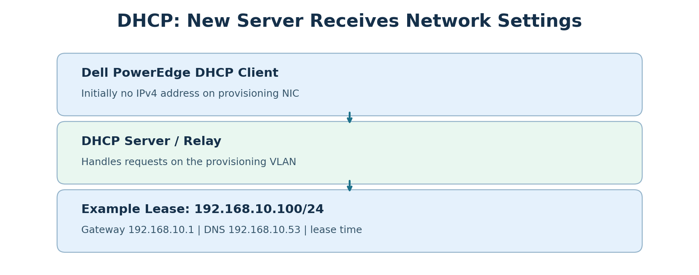
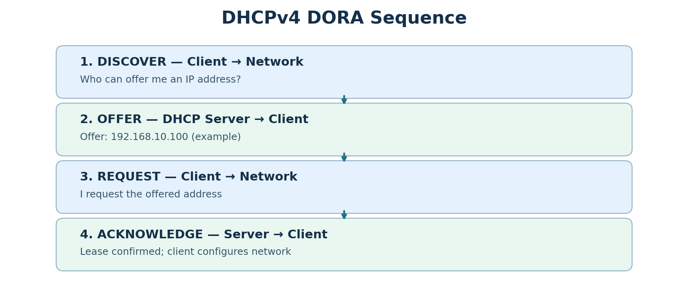
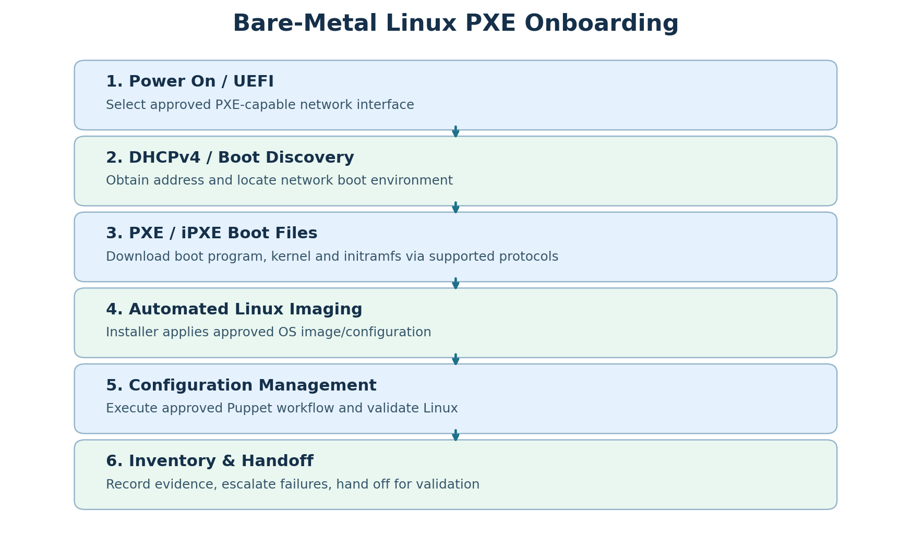
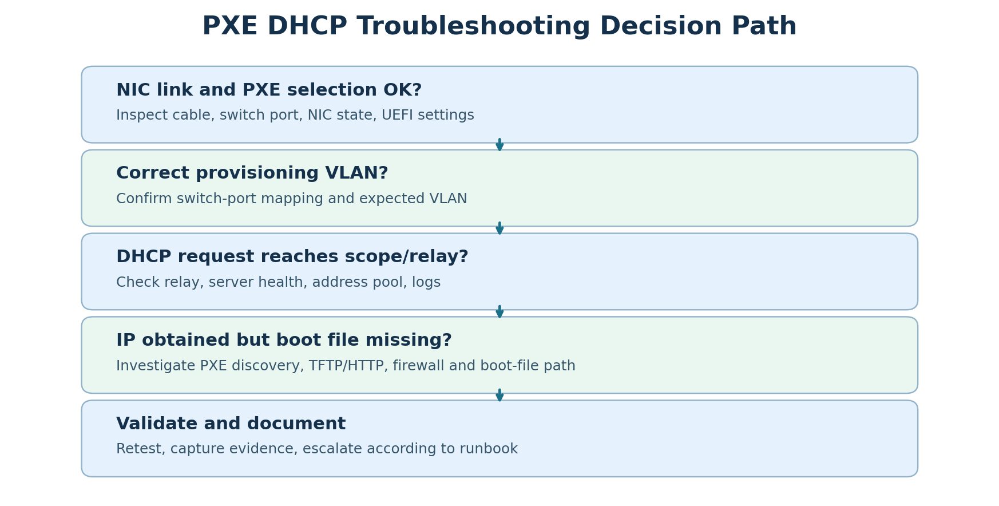

# DHCP — Complete Study Notes (English + Roman Urdu)

**Focus:** Vultr Server Onboarding Specialist interview preparation  
**Format:** English explanations, Roman Urdu teaching, examples, diagrams, commands, troubleshooting and practice.  
**Note:** All IP addresses, server workflows and diagrams are educational examples, **not Vultr internal network settings or runbooks**.

## Table of Contents
1. DHCP definition
2. DHCP network picture and example
3. DORA — DHCPv4 four-step process
4. DHCP ports and DHCPv6
5. DHCP in PXE and bare-metal onboarding
6. DHCP versus static addressing
7. Out-of-band management and DHCP
8. Linux commands for DHCP investigation
9. Real-world troubleshooting: no IP during PXE
10. Second scenario: IP obtained, boot file missing
11. Interview-ready English answer
12. Roman Urdu interview revision
13. Knowledge check and answers
14. Practical lab and checklist
15. Glossary

---

## 1. What is DHCP?

**DHCP = Dynamic Host Configuration Protocol.** It is a network protocol used to automatically assign IP configuration to devices. In a typical IPv4 environment a DHCP server can provide:

- IPv4 address
- Subnet mask / prefix length
- Default gateway (router)
- DNS server addresses
- Lease duration and other DHCP options

**Roman Urdu:** Jab naya laptop, desktop ya server network par connect hota hai to usko communication ke liye IP address chahiye hota hai. DHCP server automatically IP address aur network ki doosri settings provide kar sakta hai. Is se har device par manually IP type karne ki zaroorat kam hoti hai.

**Key idea:** DHCP provides configuration; DHCP **does not itself install Linux**.

## 2. DHCP network example



Imagine a newly installed Dell PowerEdge server. Its provisioning NIC starts without a usable IPv4 address and uses DHCP to obtain an address.

| Setting | Example |
|---|---|
| IP address | `192.168.10.100` |
| Subnet mask | `255.255.255.0` (`/24`) |
| Default gateway | `192.168.10.1` |
| DNS server | `192.168.10.53` |
| Lease | Depends on DHCP server policy |

**Roman Urdu:** DHCP server ne nayi machine ko example IP `192.168.10.100` diya. Subnet mask batata hai local network ka hissa, gateway doosray networks tak route deta hai, aur DNS names resolve karne mein madad karta hai. Sab environments mein ye exact addresses nahi honge.

### Why is the lease important?

An IPv4 DHCP address is generally leased for a specified duration. A client normally attempts to renew its lease before it expires. DHCP reservations can provide a consistent address based on a device identifier/MAC address, subject to server configuration.

**Roman Urdu:** Lease ka matlab hai IP ek specified duration ke liye assign hota hai. DHCP client usko renew kar sakta hai. Reservation se particular device ko aam tor par predictable IP diya ja sakta hai.

---

## 3. DORA: How DHCPv4 works



**DORA = Discover → Offer → Request → Acknowledge**. This is the standard introductory model for DHCPv4 address acquisition.

### Step 1 — Discover

**English:** A DHCP client without an address sends a DHCPDISCOVER message to find available DHCP servers. The initial exchange commonly uses broadcast communication on the local network.

**Roman Urdu:** Client ke paas IP nahi. Woh poochta hai: *Kya koi DHCP server hai jo mujhe IP de sakta hai?*

### Step 2 — Offer

**English:** A DHCP server responds with a DHCPOFFER, proposing an available IP address and associated settings.

**Roman Urdu:** DHCP server jawab deta hai: *Main tumhe `192.168.10.100` offer kar sakta hoon.*

### Step 3 — Request

**English:** The client sends DHCPREQUEST to request a particular offered address/server.

**Roman Urdu:** Client kehta hai: *Mujhe ye offered IP chahiye.*

### Step 4 — Acknowledge

**English:** The server sends DHCPACK, confirming the lease. The client can then configure the interface with the approved settings.

**Roman Urdu:** DHCP server confirm karta hai: *Theek hai, lease approved hai.*

### Interview memory trick

| Letter | Word | Remember |
|---|---|---|
| D | Discover | Client searches |
| O | Offer | Server proposes |
| R | Request | Client requests |
| A | Acknowledge | Server confirms |

**Caution:** DHCP renewals and error conditions can involve different message sequences. DORA is the usual teaching model for initial DHCPv4 allocation.

---

## 4. DHCP ports

| Version | Client UDP port | Server UDP port |
|---|---:|---:|
| DHCPv4 | 68 | 67 |
| DHCPv6 | 546 | 547 |

**Roman Urdu:** DHCPv4 ke client side par UDP 68 aur server side par UDP 67 hota hai. DHCPv6 ke ports alag hain: 546 aur 547. DHCPv6 DORA wala same message sequence use nahi karta.

### What is a DHCP relay?

**English:** Broadcast DHCP requests do not normally cross routers directly. A DHCP relay can forward client DHCP traffic from a VLAN/subnet to a DHCP server on another network.

**Roman Urdu:** Agar DHCP server doosray subnet par hai, to router ya Layer-3 device par DHCP relay configured ho sakta hai. Relay request ko DHCP server tak pohanchata hai. Agar relay misconfigured ho to client ko IP nahi milega.

---

## 5. DHCP and PXE boot in server onboarding



### Step 1 — Power on

**English:** The newly racked Dell PowerEdge server is powered on; BIOS/UEFI initializes hardware and selects the approved network-boot interface.

**Roman Urdu:** Naya server ON hota hai. UEFI hardware initialize karta hai aur PXE boot ke liye approved NIC select karta hai.

### Step 2 — DHCP address and boot discovery

**English:** The PXE client requests network configuration. Depending on architecture, boot server and boot-file information may come from DHCP options, proxyDHCP, or another provisioning discovery mechanism.

**Roman Urdu:** PXE client ko IP chahiye. DHCP IP deta hai; provisioning design ke mutabiq boot server aur file ka pata bhi DHCP options ya doosray discovery mechanism se mil sakta hai.

### Step 3 — Boot program and boot files

**English:** The client obtains the network boot program and subsequent files using protocols supported by its PXE/iPXE/UEFI environment, often TFTP or HTTP. The process may load a Linux kernel and initramfs.

**Roman Urdu:** Server network se boot program aur zaroori files download karta hai. Setup ke mutabiq TFTP ya HTTP use ho sakta hai.

### Step 4 — Automated Linux installation

**English:** The provisioning system runs an automated OS installation or imaging workflow and applies approved settings.

**Roman Urdu:** Ab automated provisioning system Linux install karta hai. DHCP khud OS install nahi karta.

### Step 5 — Configuration management and validation

**English:** After installation, the team runs approved configuration workflows such as Puppet, checks boot, network, storage, services and hardware health, and records any failures.

**Roman Urdu:** Linux install hone ke baad approved Puppet workflow run/monitor hota hai aur health checks kiye jate hain.

### Step 6 — Inventory and handoff

**English:** Record asset ID, serial number, rack location, switch port, network assignment, storage/GPU inventory and validation evidence; hand off according to runbook and approval gates.

**Roman Urdu:** Inventory aur ticket update karein, errors document karein aur approved validation/handoff process follow karein.

### Important technical distinctions

- DHCP address allocation succeeding does **not** prove the boot-file service works.
- A PXE error can originate from NIC link, VLAN, DHCP relay, boot discovery, TFTP/HTTP, firewall, bootloader, or installer.
- An out-of-band BMC/iDRAC management IP is separate from the operating system or PXE provisioning IP, even when a shared physical NIC mode is used.
- Use the employer's approved runbook; these steps are conceptual, not company-specific operational instructions.

---

## 6. DHCP vs static IP

| DHCP addressing | Static addressing |
|---|---|
| Configuration delivered automatically | Configuration set explicitly or through managed tooling |
| Usually has lease duration | Remains configured until changed |
| Convenient for PXE clients and large fleets | Useful for predictable infrastructure endpoints |
| Central DHCP scopes/reservations can manage addresses | Requires accurate IPAM and change control |

**Roman Urdu:** DHCP mein IP automatic mil sakta hai. Static IP mein IP explicitly configure kiya jata hai. Data center mein DHCP, reservations aur static addressing teenon use ho sakte hain, role aur policy ke mutabiq.

---

## 7. DHCP and out-of-band (OOB) management

One physical server can have separate management and host network identities:

| Interface / controller | Example IP | Main purpose |
|---|---|---|
| iDRAC/BMC management | `10.20.30.50` | Remote power, BIOS console, hardware health |
| Linux host or PXE NIC | `192.168.10.100` | OS traffic, SSH, provisioning |

An iDRAC IP may be configured statically or acquired using DHCP, depending on management-network policy. **There is no universal OOB subnet.**

**Roman Urdu:** iDRAC ka IP aur Linux OS ka IP alag network identities hain. iDRAC IP hardware manage karne ke liye hota hai; OS IP Linux aur applications ke liye. Management network aam tor par restricted hota hai. OOB ka matlab har case mein dedicated cable nahi; kuch systems shared NIC mode support karte hain.

---

## 8. Linux commands to inspect DHCP

Run these on an **installed Linux OS** with appropriate access. A bare-metal PXE client before installation may require UEFI/iDRAC console and provisioning-side logs instead.

### Check IP addresses

```bash
ip addr show
```

**Roman Urdu:** Is command se interfaces aur assigned IP addresses nazar aate hain.

### Check routes and default gateway

```bash
ip route
```

**Roman Urdu:** Default gateway aur route table check karein.

### Check DNS (if systemd-resolved is in use)

```bash
resolvectl status
```

If `resolvectl` is unavailable, inspect the distribution's DNS configuration and active resolver service.

### Show NetworkManager connections

```bash
nmcli connection show
```

### Inspect interface IPv4 and DHCP details (NetworkManager)

```bash
nmcli -f GENERAL.DEVICE,IP4,DHCP4 device show
```

### Review NetworkManager logs

```bash
journalctl -b -u NetworkManager
```

**Roman Urdu:** Har Linux distro NetworkManager use nahi karti. Ubuntu mein systemd-networkd, NetworkManager ya doosra network stack ho sakta hai. Jo service active ho uske logs check karein.

### Additional read-only checks

```bash
ip -br link
ip -br addr
ip route get 1.1.1.1
```

**Safety:** Production provisioning networks par DHCP settings, interfaces, or firmware ko bina authorization change na karein. Troubleshooting mein pehle evidence collect karein.

---

## 9. Scenario: New server receives no IP during PXE



**Interview question:** *A newly racked server powers on, but PXE boot cannot obtain an IP address. What would you do?*

### Troubleshooting workflow

1. **Confirm physical link:** NIC link light/state, cable, switch-port connection, correct NIC.
2. **Confirm firmware selection:** UEFI/PXE enabled and correct network interface selected.
3. **Verify switch-port mapping:** Rack, port assignment, provisioning VLAN, expected tagging/untagging.
4. **Check DHCP path:** Is the correct DHCP scope available? Is a relay required and configured?
5. **Check server/pool:** DHCP service health, address pool availability, MAC restrictions, relevant logs.
6. **Collect evidence:** MAC, asset ID, time, error screenshot, switch port, VLAN, observed stage.
7. **Escalate properly:** Engage networking/provisioning teams for changes outside your authorization.
8. **Retest and document:** Confirm lease, next PXE stage, update ticket and inventory.

**Roman Urdu:** Sab se pehle cable aur NIC link dekhein. Phir BIOS mein correct PXE NIC aur switch VLAN check karein. DHCP relay, server, scope aur logs check karwayein. Apni authority se bahar koi change khud na karein. Evidence ke saath team ko escalate karein, phir retest karein.

### Sample English interview answer

> First, I would verify the physical NIC link and confirm that the correct interface is selected for PXE in UEFI. Next, I would check the switch-port assignment and provisioning VLAN. Then I would investigate whether DHCP requests are reaching the correct DHCP scope or relay, and check relevant network or provisioning logs. I would document the MAC address, error message and test results, escalate to the responsible team if necessary, and retest after the issue is resolved.

---

## 10. Scenario: IP assigned but boot file missing

**Symptom:** The PXE client receives `192.168.10.100` but reports **Boot file not found**.

**Interpretation:** DHCP address assignment succeeded. It does **not** prove that PXE boot-file discovery and transfer are correctly configured.

**Next checks:**

1. Confirm boot-file name and architecture/UEFI compatibility.
2. Confirm boot server discovery information (DHCP options, proxyDHCP, or environment-specific mechanism).
3. Check TFTP/HTTP server availability and expected file path.
4. Check firewall/routing/VLAN reachability.
5. Check provisioning service logs and exact error text.
6. Record findings, escalate if needed, retest the boot sequence.

**Roman Urdu:** IP mil gaya matlab DHCP ka address wala part kaam kar gaya. Ab boot file ka naam, server address, TFTP/HTTP, firewall aur provisioning logs check karne hain. SSH failure is stage par main issue nahi, kyun ke Linux abhi installed bhi nahi ho sakta.

---

## 11. Interview-ready answer: What is DHCP and why does it matter?

> DHCP stands for Dynamic Host Configuration Protocol. It automatically provides IP configuration, such as the IP address, subnet mask, default gateway and DNS information. During bare-metal server onboarding, DHCP is important because a new server often needs an IP address to start PXE network booting. Depending on the provisioning design, DHCP can also help the client discover the boot environment. If DHCP fails, automated OS deployment may not proceed.

### Short 20-second version

> DHCP automatically assigns network configuration. In PXE provisioning, it gives the new server network connectivity and may provide boot-discovery information. If a server cannot obtain an IP, I check NIC link, VLAN, DHCP scope or relay, and logs before escalating.

---

## 12. Roman Urdu interview revision

**DHCP kya hai?** DHCP aik protocol hai jo devices ko automatically IP address, subnet mask, gateway aur DNS configuration provide karta hai.

**DORA kya hai?** Discover, Offer, Request, Acknowledge. Client DHCP server ko dhoondta hai, server IP offer karta hai, client request karta hai aur server lease confirm karta hai.

**PXE se relation?** Naya bare-metal server OS install karne se pehle network boot kar sakta hai. DHCP usko IP deta hai aur environment ke mutabiq boot discovery mein help karta hai. Linux installation provisioning system karta hai.

**No-IP error?** Cable, NIC link, BIOS/UEFI PXE interface, switch port, VLAN, DHCP relay/scope aur logs check karne hain.

**IP mil gaya magar boot file nahi?** Address allocation successful hui, ab boot server, boot file aur TFTP/HTTP side check karni hai.

---

## 13. Knowledge check

**Q1. DHCP ka full form?**  
A: Dynamic Host Configuration Protocol.

**Q2. DHCPv4 ke client/server UDP ports?**  
A: Client 68, server 67.

**Q3. DORA sequence?**  
A: Discover → Offer → Request → Acknowledge.

**Q4. DHCP khud Linux install karta hai?**  
A: No. It provides network configuration; provisioning tools perform installation.

**Q5. PXE client ko IP mil gaya lekin boot file missing hai. Kya DHCP fail hui?**  
A: Address assignment succeeded; inspect boot discovery/file transfer separately.

**Q6. DHCP relay kyun zaroori ho sakta hai?**  
A: To forward DHCP traffic between client VLAN and DHCP server on another subnet.

**Q7. Kya iDRAC aur Linux ka IP same hona chahiye?**  
A: No. They normally have separate IP identities and functions.

**Q8. DHCPv6 ports?**  
A: Client UDP 546, server UDP 547.

**Q9. DHCP lease kya hoti hai?**  
A: A time-limited assignment of an IP address/configuration.

**Q10. PXE DHCP troubleshooting ka first check?**  
A: Confirm correct NIC and physical link before progressing to VLAN/DHCP path.

---

## 14. Practice lab and revision checklist

### Safe Linux observation lab

On a Linux VM or test host you control:

```bash
ip -br link
ip -br addr
ip route
nmcli connection show
nmcli -f GENERAL.DEVICE,IP4,DHCP4 device show
journalctl -b -u NetworkManager --no-pager | tail -n 40
```

**Lab questions:**

1. Which interface has an IPv4 address?
2. What is the default gateway?
3. Is NetworkManager active on this system?
4. Can you find DHCP lease information in your active network stack?
5. Which evidence would you save in a server onboarding ticket?

**Note:** Do not change live production DHCP settings for this lab.

### Interview readiness checklist

- [ ] I can explain DHCP in English and Roman Urdu.
- [ ] I know DORA and UDP 67/68.
- [ ] I understand DHCP relay and provisioning VLANs.
- [ ] I can describe DHCP's role in PXE without saying DHCP installs Linux.
- [ ] I can distinguish BMC management IP from OS/provisioning IP.
- [ ] I can explain a no-IP PXE troubleshooting workflow.
- [ ] I can distinguish IP assignment success from boot-file failure.
- [ ] I can give a 30–60 second interview answer.

---

## 15. Glossary

| Term | Meaning | Roman Urdu |
|---|---|---|
| DHCP | Automatic network configuration protocol | Automatic IP settings dene wala protocol |
| DHCP lease | Time-limited address assignment | Muqarrar muddat ke liye IP |
| DORA | Discover, Offer, Request, Acknowledge | IP lene ke chaar basic steps |
| PXE | Preboot Execution Environment | Network se boot karne ka mechanism |
| NIC | Network Interface Card | Network adapter |
| VLAN | Virtual LAN | Logical network segment |
| DHCP relay | Forwards DHCP between networks | DHCP requests doosray subnet tak bhejta hai |
| BMC/iDRAC | Hardware management controller | Server ka remote hardware management |
| TFTP/HTTP | Possible boot-file transfer protocols | Boot files transfer karne ke protocols |
| Runbook | Approved operational instructions | Step-by-step approved procedure |

---

**Final interview reminder:** DHCP = automatic IP configuration. DORA = Discover → Offer → Request → Acknowledge. PXE commonly depends on DHCP for network addressing, but the OS installer is a separate service. Follow approved runbooks and document findings.
