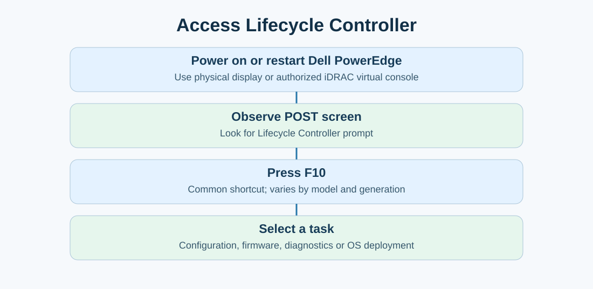
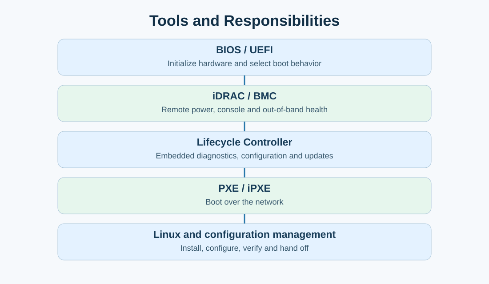
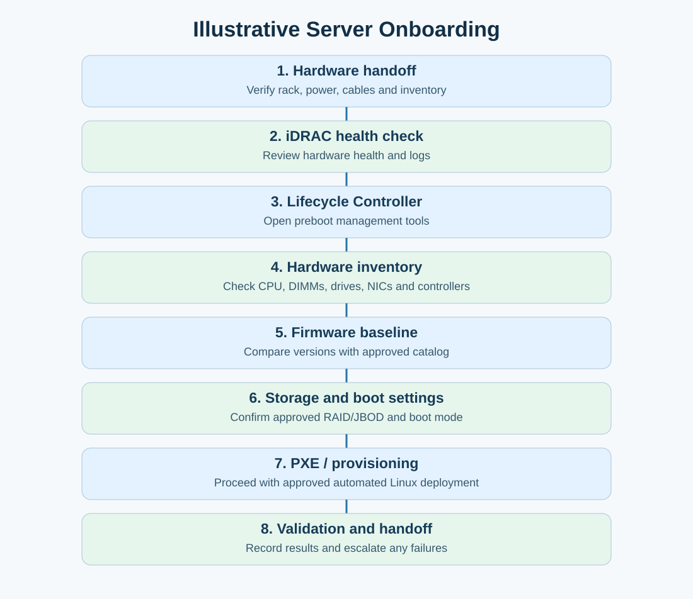
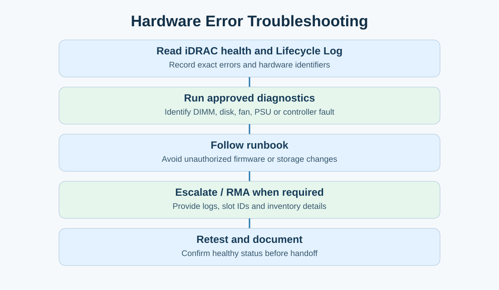

# Dell Lifecycle Controller — Complete Study Notes

**Focus:** Vultr Server Onboarding Specialist interview preparation  
**Languages:** English + Roman Urdu  
**Platform:** Supported Dell PowerEdge servers  
**Important:** All diagrams are original educational illustrations, **not actual Dell interface screenshots**. Menu names, access options, and capabilities vary by model, firmware generation, licensing, and company runbook.

## 1. What is Dell Lifecycle Controller?

**English:** Dell Lifecycle Controller (LC) is an embedded server deployment and management environment on supported Dell PowerEdge systems. It helps with pre-OS configuration, firmware maintenance, diagnostics, hardware inventory and guided OS deployment. Linux does not need to be installed first.

**Roman Urdu:** Dell Lifecycle Controller server ke andar built-in management environment hota hai. Naye server par Linux install hone se pehle aap hardware settings, diagnostics, firmware aur deployment-related tasks perform kar sakte hain.

**Scenario:** A new PowerEdge server is racked and powered on but has no OS. You need to verify health, check approved firmware versions and prepare provisioning. Lifecycle Controller can help.

## 2. Accessing Lifecycle Controller

1. **Power on or restart** the Dell PowerEdge server.
2. **Observe POST/startup screen** from local console or authorized iDRAC virtual console.
3. **Press F10** when the Lifecycle Controller prompt appears on supported models.
4. **Wait for the interface** to load; select the appropriate menu.
5. **Follow approved runbook** before changing settings or applying updates.

**Roman Urdu:** Server restart karein, POST screen dekhein, F10 prompt par key press karein. Agar aap remote hain to iDRAC virtual console use kar sakte hain. Settings bina authorization change na karein.

**Note:** F10 is common, not universal. Exact features vary by Dell generation.

## 3. What can it do?

| Function | English | Roman Urdu |
|---|---|---|
| Hardware configuration | Configure supported platform and device settings | Hardware ki supported settings configure karna |
| Firmware updates | Apply compatible BIOS/controller updates | Approved firmware update karna |
| Hardware diagnostics | Run preboot hardware tests | OS ke baghair hardware test karna |
| OS deployment | Guided deployment of supported operating systems | Linux/OS installation mein madad |
| Hardware inventory | Inspect installed components | CPU, RAM, disks, NICs ki details dekhna |
| Lifecycle logs | Inspect management and hardware events | Hardware events aur errors ki history dekhna |

## 4. BIOS vs iDRAC vs Lifecycle Controller vs Linux

| Tool | Primary role | Available before OS installation? |
|---|---|---|
| BIOS/UEFI | Hardware initialization and boot configuration | Yes |
| iDRAC | Out-of-band remote console, power, health and logs | Yes, with supported power/network access |
| Lifecycle Controller | Embedded preboot configuration, diagnostics, firmware, OS deployment | Yes |
| PXE/iPXE | Network boot environment | Yes |
| Linux OS | Runs services, commands and applications | Only after booting a Linux environment |

**Roman Urdu:** BIOS boot control karta hai. iDRAC remotely manage karta hai. Lifecycle Controller hardware setup aur maintenance mein help karta hai. PXE network se boot karwata hai. Linux installed system chalata hai.

## 5. Real-world onboarding example: step by step

### Step 1 — Hardware handoff
- Confirm server asset ID, rack position, power connections and cabling against the ticket.
- **Roman Urdu:** Rack, cables, power aur inventory match karein.

### Step 2 — Access iDRAC
- Use authorized management network and credentials. Review hardware health, Lifecycle Log and remote console.
- **Roman Urdu:** iDRAC se health aur errors dekhein.

### Step 3 — Launch Lifecycle Controller
- Open the remote console; restart only when authorized; enter LC at startup (often F10).
- **Roman Urdu:** Authorized window mein Lifecycle Controller open karein.

### Step 4 — Verify hardware inventory
- Check CPU, memory, drives, storage controller, NICs, fans and PSUs against expected configuration.
- **Roman Urdu:** Expected hardware aur actual hardware compare karein.

### Step 5 — Verify firmware baseline
- Record installed BIOS, iDRAC and controller versions. Compare with **approved** model-specific baseline.
- Do not update merely because a newer version exists. Confirm compatibility, dependencies, maintenance authorization and recovery plan.
- **Roman Urdu:** Firmware versions approved list se compare karein; random update na karein.

### Step 6 — Verify storage and boot configuration
- Confirm approved RAID/JBOD/HBA behavior, disk inventory, UEFI boot mode, and appropriate boot target.
- Storage configuration can destroy data: follow runbook and verify correct host.
- **Roman Urdu:** RAID/JBOD aur boot settings runbook ke mutabiq verify karein.

### Step 7 — Proceed with OS deployment
- Lifecycle Controller may support guided OS installation, but at scale the organization's process may use PXE/iPXE and centralized automation.
- Verify NIC link, provisioning VLAN, DHCP, boot services and installer as applicable.
- **Roman Urdu:** Cloud mein aksar centralized PXE/iPXE se Linux install hota hai.

### Step 8 — Validation and handoff
- Confirm hardware health, Linux boot, networking, approved configuration management, inventory, evidence and ticket updates.
- Escalate blockers before marking a server production-ready.
- **Roman Urdu:** Installation ke baad validation, logs aur handoff documentation complete karein.

## 6. Lifecycle Controller vs PXE/iPXE

| Lifecycle Controller | PXE/iPXE |
|---|---|
| Dell embedded preboot management/deployment environment | Network boot technology/software |
| Useful for diagnostics, configuration and guided OS setup | Useful for centralized automated installation at scale |
| Typically operated per server, though management workflows can integrate automation | Can be orchestrated across many vendors and servers |

**Remember:** PXE itself does not install Linux; the booted installer and provisioning automation perform installation.

## 7. Troubleshooting: hardware error before Linux installation

**Scenario:** A newly racked server displays a hardware error during POST.

1. Access iDRAC; check hardware health and Lifecycle Log.
2. Record exact error message, service tag/asset reference, component and slot (keep identifiers in approved internal records).
3. Use supported Lifecycle Controller diagnostics where appropriate.
4. Determine whether the issue is memory, disk/backplane, fan, PSU or controller related.
5. Follow the approved runbook; do not reseat components or update firmware without authorization.
6. Coordinate with remote hands/hardware team and use the DOA/RMA process if necessary.
7. Retest, preserve evidence, update ticket and hand off only after successful validation.

**Roman Urdu:** Agar OS install hone se pehle hardware error aaye, iDRAC logs check karein, Lifecycle Controller diagnostics run karein, faulty component identify karein, authorized team ko escalate karein, aur fix ke baad dobara test karein.

## 8. Interview questions and sample answers

**Q1. What is Dell Lifecycle Controller?**  
> Dell Lifecycle Controller is an embedded management and deployment environment on supported PowerEdge servers. It supports hardware configuration, diagnostics, firmware maintenance, inventory and OS deployment without requiring an installed operating system.

**Q2. How do you access it?**  
> On many PowerEdge models I can press F10 during startup. If authorized remote access is available, I can use the iDRAC virtual console to reach the same preboot environment.

**Q3. Difference between iDRAC and Lifecycle Controller?**  
> iDRAC provides out-of-band management, remote console, power control and hardware health. Lifecycle Controller provides embedded preboot tools for configuration, diagnostics, firmware and deployment. They complement one another.

**Q4. Can it update firmware without Linux installed?**  
> Yes, supported firmware updates can be performed in the embedded preboot environment, subject to approved versions, compatibility and change procedures.

**Q5. New server reports hardware error before OS install. What do you do?**  
> I would review iDRAC health and Lifecycle Logs, run approved diagnostics, record the exact fault, follow the runbook, and coordinate with hardware or remote-hands teams if replacement is required. After correction I would retest and document validation before handoff.

**Q6. Why use PXE instead of manually using Lifecycle Controller for every server?**  
> PXE/iPXE supports repeatable centralized network boot and automated OS deployment across many servers. Lifecycle Controller remains useful for platform-level maintenance and troubleshooting.

## 9. Interview practice

**Question:** A PowerEdge server has no Linux installed. You need to run diagnostics and check firmware. What tool can you use?  
**Answer:** Dell Lifecycle Controller (and iDRAC for remote health/log access).

**Question:** A server has a newer firmware release available. Should you immediately install it?  
**Answer:** No. Verify the approved baseline, model compatibility, prerequisites, change authorization, reboot impact and rollback/recovery plan.

## 10. Final revision checklist

- [ ] Define Lifecycle Controller in one or two sentences.
- [ ] Explain F10 access and iDRAC virtual console.
- [ ] Distinguish BIOS, iDRAC, Lifecycle Controller and PXE.
- [ ] Explain firmware baseline verification.
- [ ] Explain pre-OS hardware diagnostics.
- [ ] Explain guided OS deployment vs automated PXE provisioning.
- [ ] Describe an error-handling runbook with evidence and escalation.
- [ ] Mention post-install validation and ticket/inventory handoff.

## 11. Thirty-second interview response

> Dell Lifecycle Controller is an embedded management environment on supported PowerEdge servers. I can use it before the operating system is installed to review hardware, run diagnostics, manage approved firmware updates and assist with deployment. During onboarding I would use it alongside iDRAC to verify the hardware baseline, troubleshoot faults and document the results, then proceed with the company's approved Linux provisioning and validation workflow.

**Roman Urdu quick memory:**  
**iDRAC = remote management** → **Lifecycle Controller = preboot configuration/diagnostics/firmware** → **PXE/iPXE = network boot** → **Linux = operating system** → **Validation = production handoff**.
