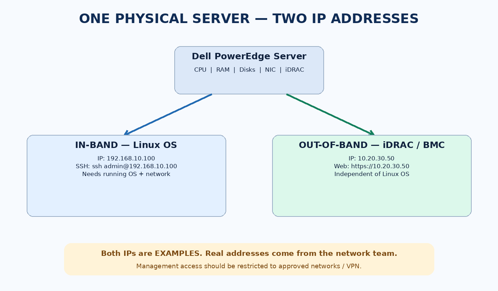
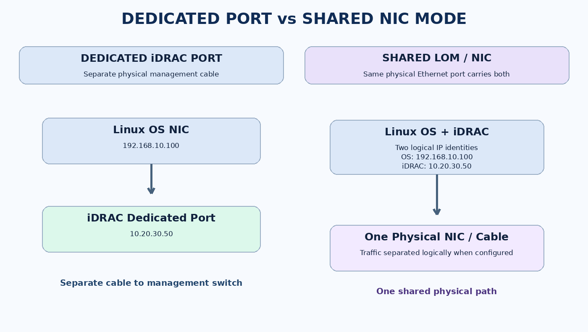
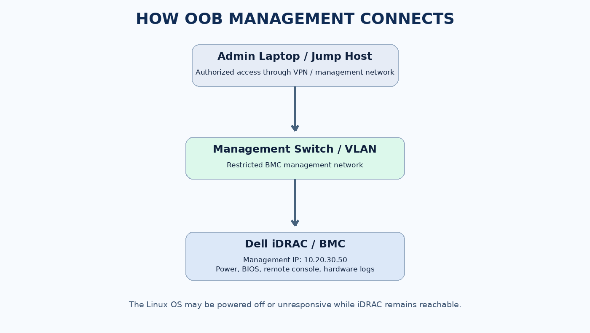

# Out-of-Band (OOB) Management IP — Complete Study Notes

**Vultr Server Onboarding Specialist Interview Preparation**  
**Language:** English + Roman Urdu  
**Example hardware:** Dell PowerEdge with iDRAC  
**Important:** IPs, VLANs and network topology below are illustrative, **not Vultr's actual addresses or procedures**.

## Table of Contents
1. What is an OOB IP?
2. Picture 1 — One server, two IP addresses
3. In-band vs out-of-band
4. How to access both addresses
5. Picture 2 — Dedicated vs shared network ports
6. Where does the management IP come from?
7. Picture 3 — OOB network path
8. What happens when Linux crashes?
9. Practical troubleshooting workflow
10. OOB security and production precautions
11. Dell iDRAC, HPE iLO, BMC and IPMI
12. Common interview questions and model answers
13. Quick self-test and glossary
14. Vendor references

---

## 1. What is an OOB IP?

**English:** An Out-of-Band management IP is assigned to the physical server's **Baseboard Management Controller (BMC)**, such as **Dell iDRAC** or **HPE iLO**. It lets authorized administrators manage hardware without relying on the host operating system.

**Roman Urdu:** Khalid bhai, OOB IP woh alag management IP hota hai jo server ke **iDRAC/BMC** ko diya jata hai. Linux OS crash bhi ho jaye to, agar BMC ko standby power aur management network connectivity mil rahi ho, aap hardware management tak pohanch sakte hain.

**Key distinction:** An OOB IP is not a special fixed IP range. It may be an organization-assigned private IPv4 address, IPv6 address, or another address approved for the management network.

## 2. Picture 1 — One server, two IP addresses



| Function | Example IP | Endpoint | Typical access |
|---|---|---|---|
| In-band / Linux OS | `192.168.10.100` | Linux network stack | SSH, applications, monitoring |
| Out-of-band / iDRAC | `10.20.30.50` | Hardware BMC | HTTPS web UI, remote console, power, health logs |

**Roman Urdu:** Ek hi physical server ke do alag IP ho sakte hain. Pehla Linux OS ka, doosra iDRAC ka. Dono ka purpose alag hai. Zaroori nahi ke in dono IPs ka subnet same ho.

## 3. In-band vs out-of-band

| Question | In-band | Out-of-band |
|---|---|---|
| Depends on running Linux OS? | Usually yes | No |
| Access method | SSH to Linux IP | HTTPS or authorized management tools to BMC IP |
| Can see BIOS/POST? | Not normally over SSH | Remote console can show boot/POST |
| Remote power control? | OS commands require OS responsiveness | BMC can perform authorized power operations |
| Network path | OS/application network | Dedicated or logically separated management network |
| When Linux crashes? | SSH may stop | BMC may remain available |

**Caution:** OOB is independent of the OS, **not** independent of electricity, BMC hardware, cables, switch, routing, ACLs or credentials.

## 4. How to access both addresses

### A. Linux OS (in-band)

```bash
ssh admin@192.168.10.100
```

This requires the server's Linux OS, SSH service and network path to work.

### B. Dell iDRAC (out-of-band)

From an **authorized** admin workstation or jump host, open:

```text
https://10.20.30.50
```

Log in with approved credentials (never store passwords in plain-text study notes). Depending on permissions and license, use the web interface to inspect hardware health, event logs, power state, and remote console.

**Roman Urdu:** Agar `ssh admin@192.168.10.100` fail ho raha hai, iska matlab yeh **zaroori nahi** ke server bilkul dead hai. Aap authorized management network se `https://10.20.30.50` check kar sakte hain. Lekin iDRAC khud unreachable ho to management VLAN, cable, BMC IP aur ACL check karna hoga.

## 5. Picture 2 — Dedicated vs shared network ports



### Dedicated iDRAC port

- A separate physical management port and cable are used.
- Management traffic can be isolated from host production traffic.
- The iDRAC IP remains separate from the OS IP.
- The management switch, VLAN and security controls must still be correct.

### Shared LOM / shared NIC mode

- BMC and OS can use the **same physical Ethernet port**.
- Their network identities and IPs are still distinct in typical supported configurations.
- Depending on design, VLANs or other controls separate management traffic.
- Support and configuration depend on server model and firmware.

**Roman Urdu:** Dedicated ka matlab **alag physical cable/port**. Shared ka matlab **ek physical port share**, lekin Linux aur iDRAC ka management alag hota hai. **Alag IP hona = hamesha alag cable hona nahi.**

## 6. Where does the OOB management IP come from?

### Option 1: Static IP

An infrastructure/network team assigns an approved management IP, subnet mask/prefix, gateway and optional DNS settings. An authorized administrator configures them on the BMC.

Example (illustrative):

```text
BMC IP address : 10.20.30.50
Subnet mask    : 255.255.255.0
Gateway        : 10.20.30.1
NIC selection  : Dedicated
```

### Option 2: DHCP

The iDRAC/BMC can obtain its address from a DHCP server on the management network if configured for DHCP. Some organizations use DHCP reservations for stable addressing.

**Roman Urdu:** OOB IP **network team assign karti hai**, ya management VLAN ka DHCP server deta hai. Aap apni marzi se production iDRAC ka IP change nahi karenge. Approved IP plan aur runbook follow karenge.

**Note:** `10.20.30.50` and `192.168.10.100` are both private IPs. There is no universal rule that the OOB address must start with `10.`.

## 7. Picture 3 — OOB network path



A typical conceptual path:

```text
Authorized Admin Laptop / Jump Host
               |
         VPN / Access Policy
               |
     Management Switch / VLAN
               |
       iDRAC / BMC IP
          10.20.30.50
               |
      Physical Server Hardware
```

The OS may be down, but this path can still work **if the BMC is powered and the management network is healthy**.

## 8. Real-world scenario — Linux crashes

**Situation:** A Dell PowerEdge server was installed in a data center. Linux was running on `192.168.10.100`, but now SSH times out.

**Safe investigation:**

1. Verify you are targeting the correct server and approved maintenance/ticket scope.
2. Check whether the OS IP is reachable from the expected network; consider firewall/routing, not only OS failure.
3. Access approved iDRAC IP `10.20.30.50` via authorized management network.
4. Inspect power state, hardware health and System Event Log (SEL)/Lifecycle logs.
5. Use remote console to inspect POST, boot progress or kernel panic evidence.
6. Document findings and escalate if hardware faults or network problems are suspected.
7. **Do not power cycle a production server without authorization**, because it may interrupt customer workloads.

**Roman Urdu:** Linux SSH na chale to pehle evidence collect karein. iDRAC se boot screen, hardware logs aur power status dekh sakte hain. Bina approval reboot karna theek nahi.

## 9. Practical troubleshooting: OOB IP unreachable

**Symptom:** `https://10.20.30.50` does not open.

| Check | What it tells you |
|---|---|
| Correct BMC IP and asset record? | Avoids troubleshooting the wrong server |
| VPN/jump host access? | Confirms admin is on authorized path |
| DNS (if using a hostname)? | Identifies resolution errors |
| Ping or HTTPS connectivity, if allowed? | Distinguishes reachability from web UI problems; ping may be blocked |
| Dedicated/shared NIC selection? | Confirms BMC is listening on intended port |
| Cable, switch port, link LEDs? | Identifies physical path problems |
| Management VLAN and switch configuration? | Identifies layer-2 segmentation errors |
| Routing, gateway and ACL/firewall? | Identifies layer-3 and security policy problems |
| BMC power/health? | Detects controller or standby-power problems |

**Commands from an authorized workstation:**

```bash
ping -c 3 10.20.30.50
curl -kI --connect-timeout 5 https://10.20.30.50
ip route get 10.20.30.50
```

`curl -k` is shown only as a **diagnostic example** where a certificate is not trusted; do not normalize bypassing TLS verification in production. Use a trusted certificate and approved tooling whenever possible. Also, a blocked ping does **not** prove the BMC is down.

**Windows PowerShell:**

```powershell
Test-NetConnection 10.20.30.50 -Port 443
```

**Roman Urdu:** Troubleshooting hamesha layers mein karein: sahi IP → access/VPN → cable/port → VLAN → route/firewall → BMC status. Evidence collect karke approved procedure follow karein.

## 10. Security and production precautions

- Keep BMC access on a **restricted management network**, not openly exposed to the public internet.
- Use approved VPN, jump host, access control, MFA where supported, and least-privilege accounts.
- Prefer HTTPS with trusted certificates and secure management protocols.
- Avoid default credentials and never include passwords in tickets, Markdown, or screenshots.
- Follow change management for BMC IP changes, firmware updates and power operations.
- Document serial number, rack, management IP/VLAN, connectivity test and approved handoff; use secure references for credentials.

## 11. Key terms

| Term | Meaning | Roman Urdu |
|---|---|---|
| BMC | Baseboard Management Controller | Server ka independent hardware management controller |
| iDRAC | Dell's remote access controller | Dell server ki remote management technology |
| iLO | HPE Integrated Lights-Out | HPE server ki remote management technology |
| IPMI | Intelligent Platform Management Interface | Hardware management ka interface standard |
| OOB | Out-of-Band | OS se independent management path |
| LOM | LAN on Motherboard | Motherboard par built-in network interface |
| VLAN | Virtual LAN | Network ko logically separate karna |
| DHCP | Dynamic Host Configuration Protocol | Automatically IP assign karne ka protocol |

## 12. Interview practice

### Q1. Which IP is used for OOB management?

**English model answer:** "Out-of-band management uses an IP assigned to the server's BMC, such as Dell iDRAC. This is normally different from the host Linux IP and is reached over a restricted management network. It lets us access hardware even if the operating system is unavailable."

**Roman Urdu:** OOB ke liye iDRAC/BMC ka management IP use hota hai, Linux ka SSH IP nahi.

### Q2. Does a separate OOB IP always require a separate cable?

**Answer:** "No. Dedicated management uses a separate port, but supported shared-LOM configurations can carry BMC and OS traffic on the same physical Ethernet connection."

**Roman Urdu:** Alag IP ka matlab lazmi alag cable nahi.

### Q3. Can iDRAC work when Linux is down?

**Answer:** "Yes, provided the BMC has standby power, functioning hardware and management-network connectivity."

### Q4. How would you troubleshoot an unreachable iDRAC?

**Answer:** "I would verify the asset and assigned management IP, confirm authorized network access, check NIC selection and link, then examine the management VLAN, DHCP/static configuration, routing, ACLs and BMC health. I would document evidence and coordinate with remote hands as needed."

### Q5. Is an OOB IP always in the `10.0.0.0/8` range?

**Answer:** "No. The organization determines its management address plan. OOB can use different approved private IPv4 ranges or IPv6."

### Q6. Why is OOB useful for server onboarding?

**Answer:** "We can check hardware health, power state, BIOS/UEFI, firmware and remote boot progress before the OS is installed, and troubleshoot failures without relying on SSH."

## 13. Quick self-test

1. Linux IP = `192.168.10.100`; iDRAC IP = `10.20.30.50`. Which one do you use for SSH? **Linux IP.**
2. Which one do you open in a browser to access iDRAC? **BMC IP over HTTPS, if authorized.**
3. Linux crashes. Must iDRAC also be down? **No.**
4. Does shared LOM mean Linux and BMC are the same software? **No.**
5. Can DHCP assign the BMC address? **Yes, if configured.**
6. Should you reboot a production server immediately when SSH fails? **No; follow incident/change authorization.**

## 14. Official Dell references

- [Dell iDRAC9 — Configuring Network Settings](https://www.dell.com/support/manuals/en-us/poweredge-c6620/idrac9_7.xx_ug/configuring-the-network-settings?guid=guid-61a19d20-ad0b-41f8-87e6-dbad9a8c2170)
- [Dell iDRAC9 — Modifying Network Settings](https://www.dell.com/support/manuals/en-fm/xc7525-core/idrac9_7.xx_ug/modifying-network-settings-using-web-interface?guid=guid-4c0fa2b0-73ca-48f3-8584-0f0101e2cccf&lang=en-us)
- [Dell Technologies — Management Networks (PDF)](https://infohub.delltechnologies.com/static/media/9470f3d2-76fc-4fae-be37-dda3bd6ef572.pdf)

---

**One-sentence interview memory aid:** **In-band = Linux OS IP / SSH; Out-of-band = BMC management IP / iDRAC; separate IP does not always mean separate physical cable.**
