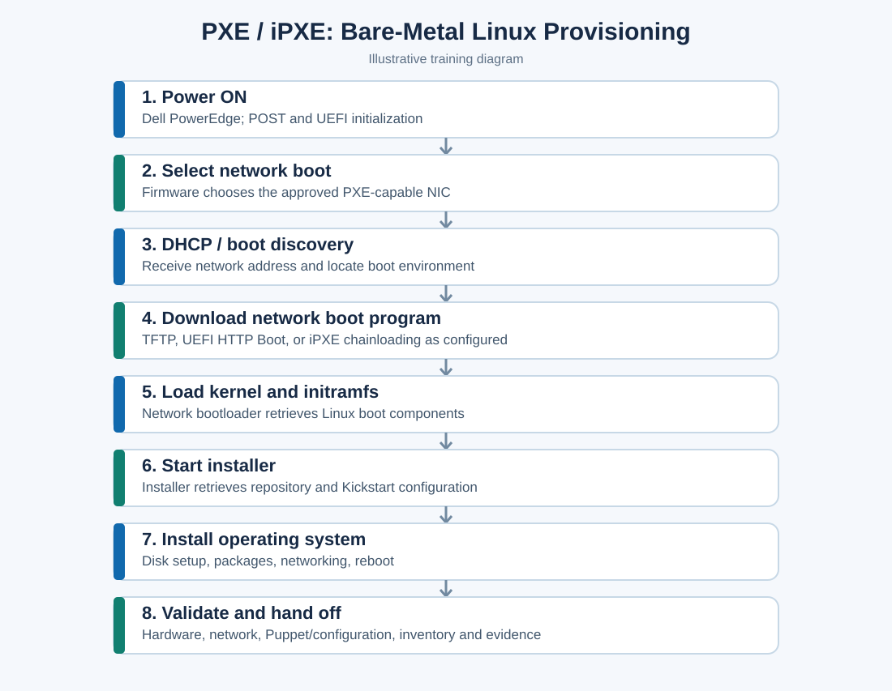
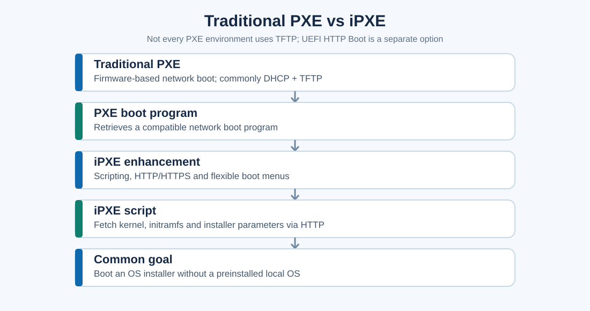
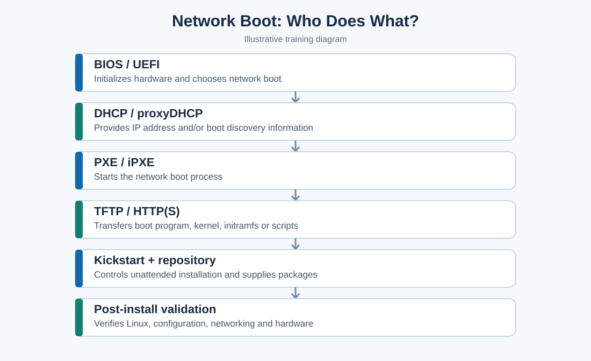
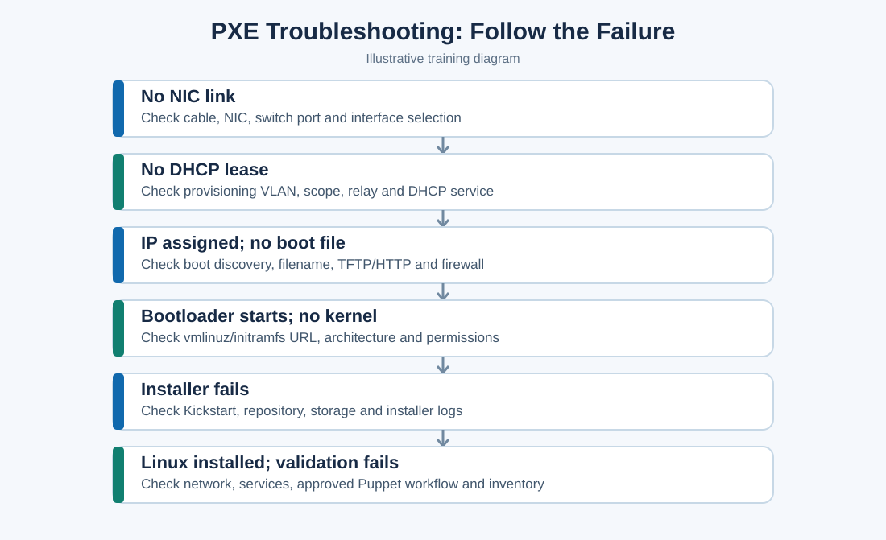

# PXE and iPXE — Complete Server Onboarding Study Notes

**Audience:** Linux / bare-metal server onboarding interview preparation  
**Language:** English + Roman Urdu  
**Scope:** Educational, vendor-neutral examples. The IP addresses, VLANs, file paths and procedures are **illustrative**, not Vultr internal runbooks.

## Table of contents

1. PXE definition and why it matters
2. Physical server and PXE boot
3. Complete eight-step PXE workflow
4. What is iPXE?
5. PXE vs iPXE comparison
6. Real-world example and sample iPXE script
7. Kickstart and sample configuration
8. DHCP, PXE, TFTP, HTTP and Kickstart relationships
9. PXE troubleshooting step by step
10. Linux commands and evidence collection
11. Interview questions and answers
12. Practice scenario and revision checklist

---

## 1. What is PXE?

**PXE = Preboot Execution Environment.** PXE lets a physical computer/server boot from the network rather than relying on a preinstalled OS on its local disk.

**Roman Urdu:** PXE aik technology hai jis se naya server local disk par Linux installed na hone ke bawajood network se boot kar sakta hai. Data center mein bohat saare servers ko USB se manually install karna slow hota hai; PXE automated provisioning ka boot phase shuru karne mein madad karta hai.

**Example:** A newly racked Dell PowerEdge has CPU, RAM, NIC and drives, but no OS. PXE can boot the Linux installer across the network. PXE **does not itself install Linux**; the installer and provisioning system do.

## 2. Physical server and PXE boot

A new physical server boots into BIOS/UEFI firmware, which performs initialization and selects a boot device. If network boot is selected, the firmware uses a PXE-capable NIC or a supported UEFI network boot implementation.

**Roman Urdu:** Server power ON → BIOS/UEFI hardware check → PXE NIC select → DHCP aur network boot → Linux installer.



## 3. Complete PXE boot workflow (eight steps)

### Step 1 — Power ON and POST

The server powers on, UEFI initializes hardware and POST checks components. **Roman Urdu:** CPU, RAM aur basic hardware initialize aur check hota hai.

### Step 2 — Select PXE boot

Firmware follows the approved boot order and starts network boot on the intended NIC. Confirm correct UEFI/legacy mode and compatible bootloader. **Roman Urdu:** BIOS/UEFI mein correct NIC aur network boot option verify karein.

### Step 3 — DHCP and boot discovery

The PXE client requests network configuration. DHCP can supply the address; boot server details may come from DHCP options, proxyDHCP or another provisioning mechanism. Example:

| Item | Training example |
|---|---|
| Provisioning VLAN | VLAN 100 |
| DHCP server | `192.168.10.10` |
| Boot server | `192.168.10.20` |
| New server address | `192.168.10.100` |
| Target OS | Rocky Linux 9 |

**Roman Urdu:** DHCP server IP deta hai, aur provisioning environment boot files ka rasta discover karwata hai.

### Step 4 — Retrieve boot program

Classic PXE often uses TFTP for the initial network boot program. iPXE supports HTTP(S) and scripting. Some modern UEFI firmware also implements HTTP Boot independently of iPXE. **Roman Urdu:** Bootloader network se download hota hai.

### Step 5 — Load Linux kernel and initramfs

The bootloader loads `vmlinuz` (kernel) and `initrd.img` (initial RAM disk). **Roman Urdu:** Linux installer start hone ke liye required boot files load hoti hain.

### Step 6 — Start Linux installer

The installer uses boot parameters to locate its installation repository and optional Kickstart file. **Roman Urdu:** Installer packages aur automated installation instructions retrieve karta hai.

### Step 7 — Automated installation

The installer prepares storage and installs Linux based on the approved installation configuration. The server typically reboots afterward. **Roman Urdu:** Disk configuration, packages aur networking set hoti hain.

### Step 8 — Validation and handoff

Check installed OS, NICs, disks, BMC health, network, required services, approved configuration-management workflow, inventory and ticket evidence before handoff. **Roman Urdu:** Linux boot ho jana hi production-ready hona nahi; validation aur documentation bhi zaroori hain.

## 4. What is iPXE?

**iPXE** is an open-source network boot firmware/bootloader that extends classic PXE workflows with HTTP(S), scripting and flexible boot menus. It can be chainloaded by a PXE implementation or used through other supported boot methods.

**Roman Urdu:** PXE basic network boot ka mechanism hai. iPXE isko zyada flexible banata hai: HTTP se files download, scripts run aur different servers ke liye boot choices select ki ja sakti hain.



## 5. PXE vs iPXE

| Feature | Traditional PXE | iPXE |
|---|---|---|
| Network boot | Yes | Yes |
| DHCP integration | Yes | Yes |
| TFTP | Common | Supported |
| HTTP(S) | Not part of classic PXE (UEFI HTTP Boot is separate) | Supported |
| Scripting | Limited/basic | Advanced scripting |
| Dynamic boot menus | Depends on boot program | Flexible |
| Automated provisioning | With supporting services | With supporting services |

## 6. Real-world iPXE example

**Training setup:** Boot server `192.168.10.20`; script URL `http://192.168.10.20/boot.ipxe`.

Sample `boot.ipxe`:

```ipxe
#!ipxe

dhcp

kernel http://192.168.10.20/images/vmlinuz inst.repo=http://192.168.10.20/rocky9/ inst.ks=http://192.168.10.20/ks/server.cfg
initrd http://192.168.10.20/images/initrd.img
boot
```

| Line | Meaning | Roman Urdu |
|---|---|---|
| `#!ipxe` | Script header | iPXE script ki pehchan |
| `dhcp` | Obtain network configuration | IP configuration hasil karein |
| `kernel` | Download kernel and set installer arguments | Kernel aur installation parameters load karein |
| `inst.repo=` | Installer package source | Installation packages ka address |
| `inst.ks=` | Kickstart configuration URL | Automated instructions ka address |
| `initrd` | Download initial RAM disk | Initial RAM disk load karein |
| `boot` | Start boot | Boot shuru karein |

**Note:** These URLs are examples; real files must exist and match the firmware architecture and installer. iPXE syntax and firmware mode should be validated in a test lab before deployment.

## 7. What is Kickstart?

Kickstart is an automated installation method for RHEL-family Linux distributions, including Rocky Linux. It describes installation choices such as packages, users, storage and networking.

**Roman Urdu:** Kickstart aik file hai jo installer ko batati hai ke Linux kis tarah install karna hai; manual questions kam ho jaate hain.

Illustrative Kickstart snippet **(not production-ready; destructive storage commands; do not run on an existing machine)**:

```kickstart
#version=RHEL9
text
url --url="http://192.168.10.20/rocky9/"
lang en_US.UTF-8
keyboard us
timezone America/Chicago --utc
rootpw --lock
user --name=labadmin --groups=wheel --iscrypted --password=<password-hash>
network --bootproto=dhcp --device=link --activate
bootloader --location=mbr
clearpart --all --initlabel
autopart
reboot
%packages
@^minimal-environment
%end
```

**Safety notes:** Replace the password placeholder with a valid hash; validate bootloader/storage directives against UEFI and disk layout; `clearpart --all` **erases disk partitions**. Always use an isolated test VM or disposable lab host and a validated, approved Kickstart.

## 8. How the services connect



| Component | Responsibility | Roman Urdu |
|---|---|---|
| BIOS / UEFI | Initialize and select boot method | Boot option choose karta hai |
| DHCP | Network configuration and possibly boot discovery | IP aur boot info mein madad |
| PXE / iPXE | Start network boot | Network boot shuru karta hai |
| TFTP / HTTP(S) | Transfer boot files | Boot files download karwata hai |
| Kickstart | Automate installation | Linux installation automate karta hai |
| Post-install tooling | Apply approved configuration and checks | Validation aur configuration |

**Memory trick:** DHCP gives networking → PXE/iPXE starts network boot → TFTP/HTTP provides boot files → Kickstart guides Linux installation.

## 9. Real-world PXE troubleshooting

**Interview scenario:** A newly racked Dell PowerEdge fails to PXE boot. Troubleshoot by locating the failing stage instead of changing random settings.



### A. No NIC link

- Verify physical cable and NIC port.
- Check switch port link state and correct port.
- Confirm correct PXE NIC in UEFI.
- **Roman Urdu:** Sab se pehle physical connection aur correct NIC verify karein.

### B. No DHCP address

- Check provisioning VLAN and switch-port membership.
- Check DHCP scope, DHCP server and DHCP relay.
- Confirm request reaches the right network segment.
- **Roman Urdu:** IP nahi mil raha to VLAN, DHCP aur relay check karein.

### C. IP assigned but boot file unavailable

- Check boot filename, boot discovery and UEFI architecture compatibility.
- Verify TFTP or HTTP server and firewall reachability.
- **Roman Urdu:** IP mil gaya, ab boot file ka path aur download service verify karein.

### D. Bootloader starts but kernel fails

- Verify kernel/initramfs URLs and file permissions.
- Check HTTP response, web server logs and file integrity.
- **Roman Urdu:** `vmlinuz` ya `initrd.img` ka URL aur server access check karein.

### E. Installer starts but fails

- Review Kickstart syntax, repository URL, storage layout and installer logs.
- **Roman Urdu:** Ab masla installation stage par hai, DHCP par zaroori nahi.

### F. Installation succeeds but validation fails

- Verify OS network, NICs, storage, services, approved Puppet/configuration workflow and inventory.
- **Roman Urdu:** OS install ho gaya lekin handoff se pehle health aur configuration validate karein.

### Strong interview answer

> I would identify the exact stage where PXE is failing. First I would check the physical NIC link and BIOS/UEFI network boot settings. If there is no IP address, I would check the provisioning VLAN, DHCP scope and relay. If an IP is assigned but the boot program cannot load, I would verify boot-file configuration and TFTP or HTTP availability. If the installer starts but fails, I would inspect installation logs, Kickstart and repository access. I would document my findings and escalate to the appropriate team when needed.

## 10. Linux commands for a practice lab

These commands are for an **already running Linux host or provisioning server**, not a blank server before the OS boots.

```bash
# View IP addresses and NIC state
ip -br addr
ip link show

# View routing table
ip route

# View NetworkManager and DHCP information (if NetworkManager is used)
nmcli device status
nmcli -f GENERAL.DEVICE,IP4,DHCP4 device show

# View relevant service logs on NetworkManager-based systems
journalctl -b -u NetworkManager

# Test boot files from a reachable Linux workstation (example URLs)
curl -I http://192.168.10.20/images/vmlinuz
curl -I http://192.168.10.20/images/initrd.img
curl -I http://192.168.10.20/boot.ipxe

# View web server logs (paths vary by distro and web server)
sudo journalctl -u httpd --since '30 minutes ago'
```

**Evidence to capture:** Server asset tag, NIC MAC, VLAN, DHCP result, UEFI boot screen, boot filename/URL, HTTP error code, installer log, and ticket number. Avoid recording secrets or passwords in screenshots.

## 11. Interview questions and answers

**Q1. What does PXE stand for?**  
Preboot Execution Environment.

**Q2. Can a server PXE boot without Linux installed?**  
Yes. PXE operates before the local OS is installed.

**Q3. Does DHCP install Linux?**  
No. DHCP supplies network configuration and can assist boot discovery; the installer installs Linux.

**Q4. What is iPXE?**  
iPXE is an advanced open-source network boot implementation with HTTP(S) and scripting support.

**Q5. What is Kickstart?**  
A configuration-driven way to automate installation of RHEL-family Linux.

**Q6. Can network boot work without TFTP?**  
Yes. iPXE or UEFI HTTP Boot can support HTTP-based network boot workflows.

**Q7. A server gets an IP but cannot download its boot file. What next?**  
Check boot discovery, filename, compatible bootloader, TFTP/HTTP service, firewall and connectivity.

**Q8. What is the difference between PXE and Kickstart?**  
PXE starts network boot; Kickstart instructs the Linux installer.

**Q9. What is `vmlinuz`?**  
The compressed Linux kernel image used in the boot process.

**Q10. What is `initrd.img` / initramfs?**  
An initial RAM-based filesystem that helps the kernel start the installation environment.

**Q11. What if the installer cannot reach `inst.repo`?**  
Check DNS/IP routing, URL, HTTP service, repository contents and firewall.

**Q12. What would you document before handoff?**  
Hardware identity, NIC/MAC, firmware/boot mode, installation result, network configuration, validation evidence, ticket and inventory status.

## 12. Practice scenario and revision checklist

**Scenario:** A server obtains `192.168.10.100` and downloads `boot.ipxe`, but fails to download `vmlinuz`.

**Correct reasoning:** DHCP address assignment and initial script download worked. Investigate the `vmlinuz` URL, HTTP server, permissions, file availability and connectivity. Do not begin by blaming DHCP.

### Checklist

- [ ] I can explain PXE in English and Roman Urdu.
- [ ] I can describe all eight onboarding steps.
- [ ] I understand how DHCP relates to PXE.
- [ ] I can explain the difference between PXE and iPXE.
- [ ] I know what kernel and initramfs do.
- [ ] I can explain Kickstart without claiming production experience I do not have.
- [ ] I can troubleshoot by failure stage.
- [ ] I know when to collect evidence and escalate.
- [ ] I can describe validation before production handoff.

**45-second interview answer:**

> PXE is a network boot technology used to start a server without a preinstalled operating system. During bare-metal onboarding, the server initializes through BIOS or UEFI, receives network configuration through DHCP, and retrieves the boot environment. iPXE can make this process more flexible through HTTP and scripting. The Linux installer can then use Kickstart for automated installation. After installation, I would validate the operating system, network, hardware and required configuration before documenting and handing the server off.

**Roman Urdu summary:** PXE network se boot start karta hai. DHCP IP deta hai. iPXE HTTP aur scripts se process flexible banata hai. Kickstart Linux install automate karta hai. End mein validation aur documentation zaroori hai.
