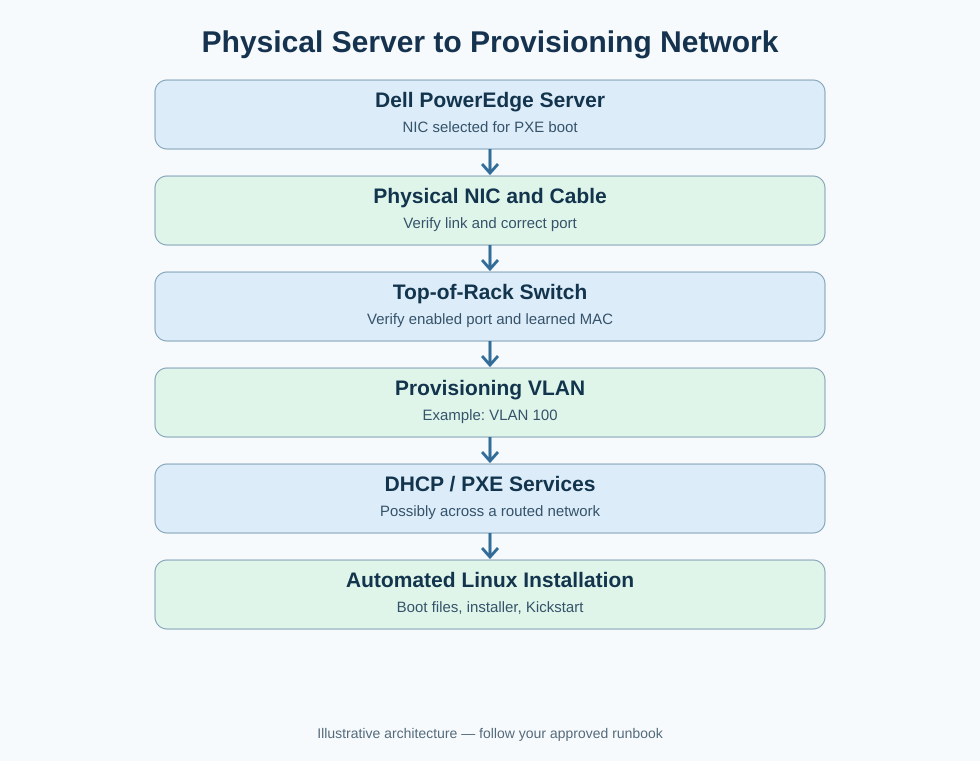
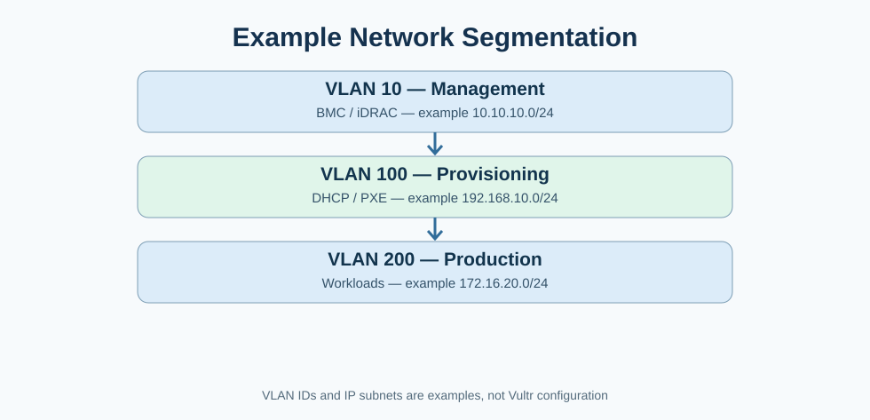
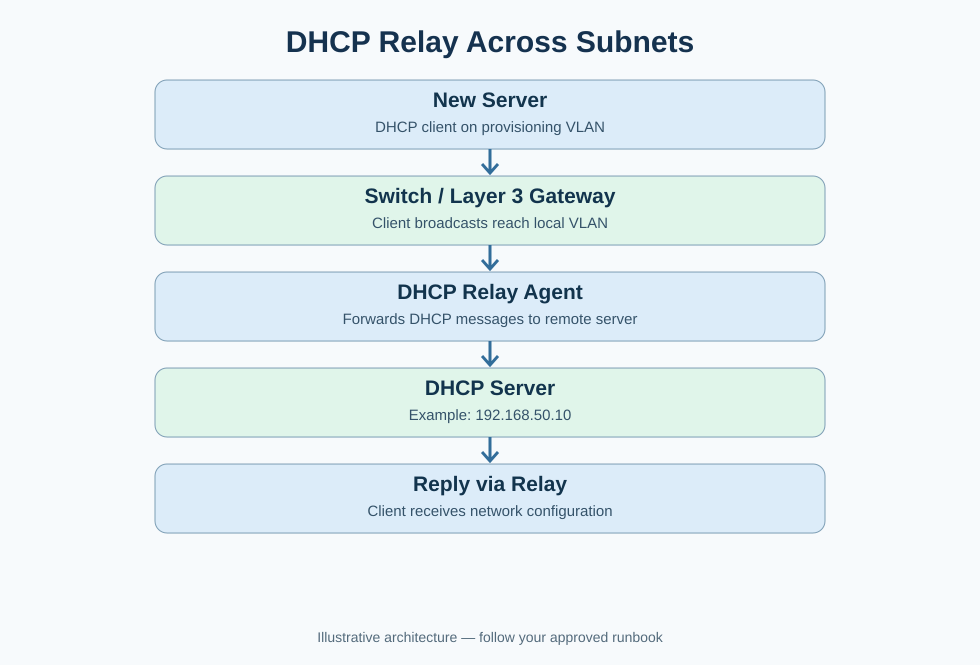
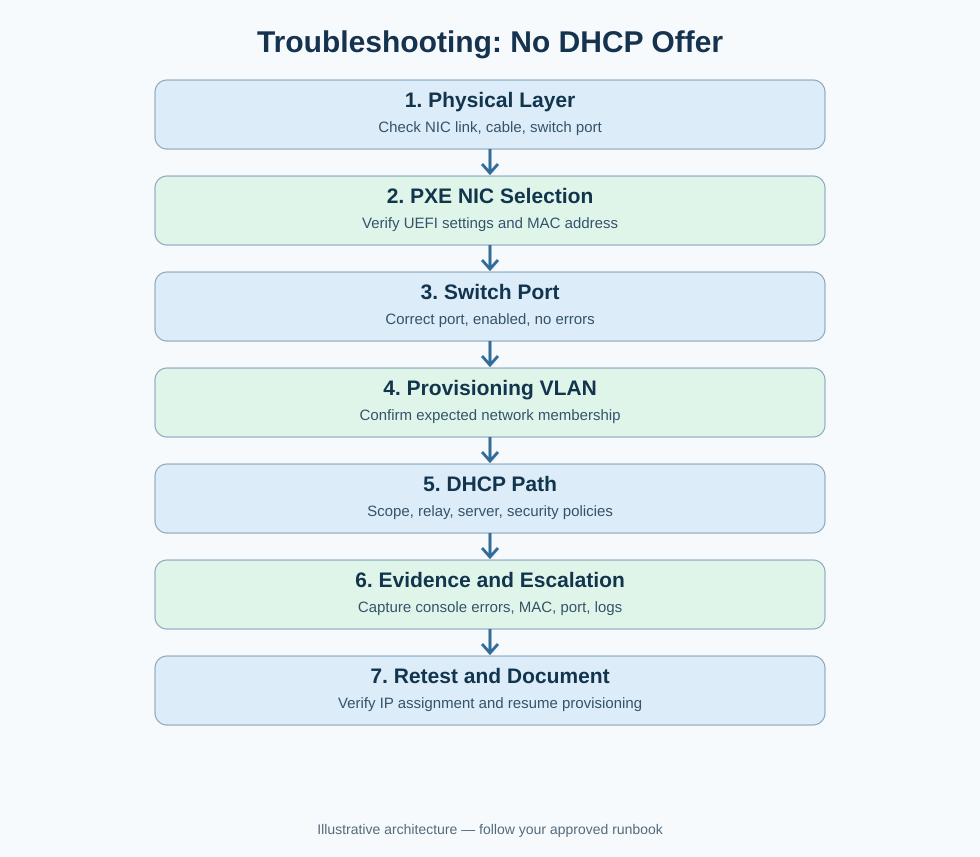
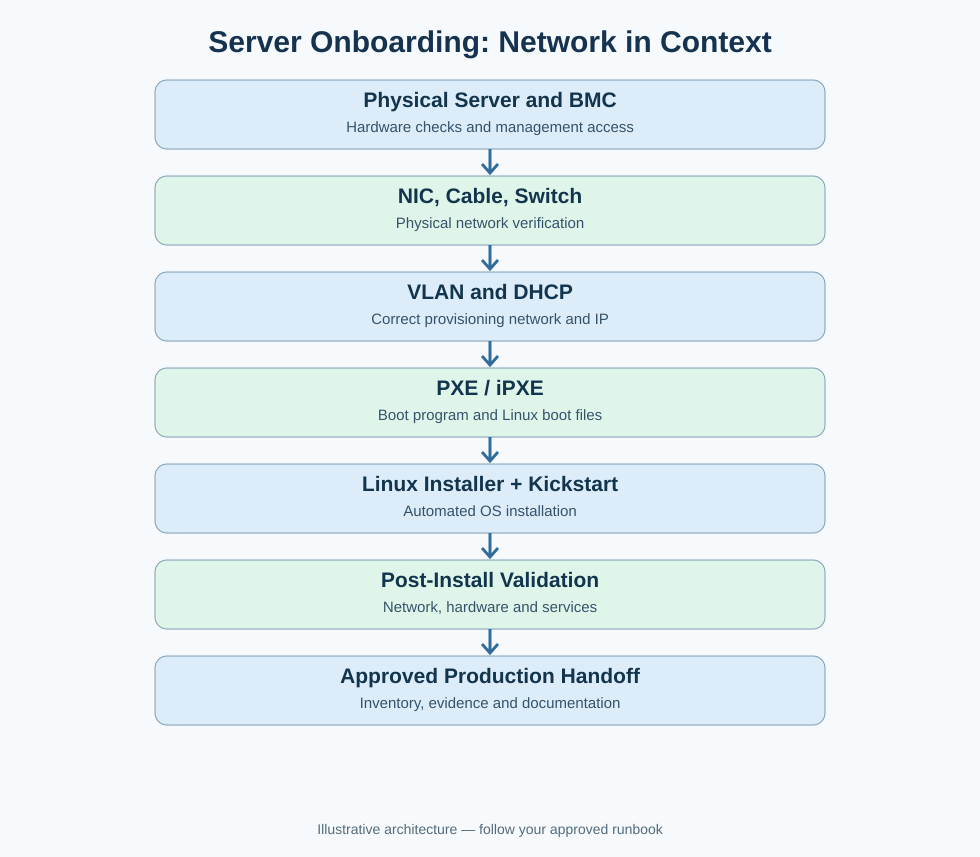

# Network Step in Bare-Metal Server Onboarding

**Complete Study Notes — English + Roman Urdu | Vultr Interview Preparation**

> Educational lab examples only. VLAN IDs, addresses, interfaces, and workflows are illustrative; they are not confirmed Vultr settings. Follow the organization's approved runbooks and change controls.

## Table of Contents

1. What is the network step?
2. Complete physical-to-provisioning network path
3. Step 1 — Verify the physical NIC
4. Step 2 — Understand and verify the switch
5. Step 3 — VLANs and network segmentation
6. Step 4 — DHCP and DHCP relay
7. Step 5 — Linux network verification commands
8. Troubleshooting: no DHCP offer during PXE
9. Complete server onboarding flow
10. Interview-ready answers
11. Practice questions and revision checklist

---

## 1. What is the network step?

**English:** The network step ensures a newly racked physical server is connected to the correct network and can reach the services required for automated provisioning. It includes checking the NIC, cabling, switch port, VLAN, DHCP path, and boot-service connectivity.

**Roman Urdu:** Jab naya Dell PowerEdge server rack mein lagta hai, to sirf power ON hona kaafi nahi. Hamein check karna hota hai ke NIC, cable, switch port, VLAN aur DHCP sab sahi kaam kar rahe hain, taake server network se Linux install kar sake.

**Verification questions:**
- Is the correct NIC connected and showing physical carrier?
- Is the cable connected to the expected switch port?
- Is the switch port enabled and on the correct provisioning VLAN?
- Can DHCP requests reach the server, possibly through a relay?
- Can the machine retrieve PXE/iPXE boot files?

## 2. Complete physical-to-provisioning network path



```text
Dell PowerEdge Server
       |
Physical NIC (example: port 1)
       |
Ethernet / fiber cable
       |
Top-of-Rack Switch (example: Ethernet1/10)
       |
Provisioning VLAN (example: VLAN 100)
       |
DHCP and PXE services (may be routed)
       |
Linux installation
```

**Roman Urdu:** Server ka traffic NIC se cable ke through switch tak jata hai. Switch port provisioning VLAN ka member hota hai. Phir server DHCP aur PXE services se communicate karta hai. DHCP server doosre subnet mein bhi ho sakta hai; us surat mein DHCP relay useful hota hai.

## 3. Step 1 — Verify the physical NIC

**NIC = Network Interface Card.** It provides the physical or logical network interface through which the server communicates.

Example port assignment (not universal):

```text
NIC Port 1  -> Provisioning network
NIC Port 2  -> Production network
iDRAC Port  -> Out-of-band management network
```

### Checklist

1. Verify correct NIC port is connected.
2. Check cable seating and cable type.
3. Check physical carrier/link at the server and switch.
4. Verify NIC MAC address against asset inventory.
5. Confirm selected PXE NIC in BIOS/UEFI.

**Roman Urdu:** Agar physical link hi nahi hai, to pehle NIC, cable aur switch port check karein. Is stage par DHCP ko blame karna Quick hoga.

**Important:** Some BMCs use a dedicated management NIC, while others can share a physical port. Follow the actual hardware design.

## 4. Step 2 — Understand and verify the switch

A network switch forwards Ethernet frames based on learned MAC addresses. In a data center, servers often connect to a **Top-of-Rack (ToR)** switch.

```text
Dell Server -> Cable -> ToR Switch Port Ethernet1/10 -> Provisioning VLAN
```

Check:

- Switch port is administratively enabled.
- Physical link is operational.
- Correct port and VLAN are assigned.
- Expected MAC address is learned on the port.
- No significant errors, port-security blocks, or other restrictions.

**Roman Urdu:** Switch ek local network mein devices ko connect karta hai. Server onboarding engineer network team ke saath port aur VLAN verify karta hai. Har organization mein onboarding specialist ko switch configuration change karne ki permission nahi hoti.

## 5. Step 3 — VLANs and network segmentation

**VLAN = Virtual Local Area Network.** VLANs separate Layer 2 broadcast domains over shared switching infrastructure.



| Example VLAN | Purpose | Example subnet |
|---|---|---|
| VLAN 10 | BMC / iDRAC management | `10.10.10.0/24` |
| VLAN 100 | DHCP / PXE provisioning | `192.168.10.0/24` |
| VLAN 200 | Production workloads | `172.16.20.0/24` |

**Important:** VLAN IDs and IP subnets are separate concepts, even when a network design maps them together.

**Roman Urdu:** Management, provisioning aur production traffic ko alag logical networks mein rakhna security aur operations ke liye useful ho sakta hai. Agar server ka switch port galat VLAN mein ho, to NIC link UP hone ke bawajood correct DHCP service tak request nahi pohanch sakti.

**Interview phrase:** *Physical link UP does not guarantee correct Layer 2 or Layer 3 connectivity.*

## 6. Step 4 — DHCP and DHCP relay

DHCP commonly provides an IP address, subnet mask, gateway, DNS, and lease. A PXE client can also discover boot resources through DHCP-related options, proxyDHCP, or other provisioning mechanisms.



### Why relay?

A new client often starts DHCPv4 discovery with a broadcast. Routers generally do not forward Layer 2 broadcasts between subnets. A DHCP relay forwards DHCP messages between the client network and a DHCP server on another subnet.

**Roman Urdu:** Agar provisioning VLAN aur DHCP server alag subnets mein hain, to relay DHCP messages ko forward kar sakta hai. Relay galat ho to server ko IP nahi milta, chahe cable aur NIC bilkul theek hon.

### DORA review

1. **Discover:** Client searches for DHCP service.
2. **Offer:** DHCP server offers an address.
3. **Request:** Client requests that address.
4. **Acknowledge:** Server confirms the lease.

DHCPv4 normally uses **UDP 67 (server)** and **UDP 68 (client)**.

## 7. Step 5 — Network verification after Linux installation

> These commands require a running Linux environment. Before OS installation, use BIOS/UEFI screens, BMC remote console, switch-side checks, DHCP logs, and provisioning logs.

### A. Check IP addresses

```bash
ip -br addr
```

Illustrative output:

```text
lo       UNKNOWN 127.0.0.1/8
eno1     UP      192.168.10.100/24
```

### B. Check interface administrative state

```bash
ip -br link
```

**Note:** Administrative `UP` alone does not prove that physical carrier is detected.

### C. Check physical link and speed

```bash
sudo ethtool eno1
```

Illustrative fields:

```text
Link detected: yes
Speed: 10000Mb/s
```

### D. Check default route

```bash
ip route
```

Example:

```text
default via 192.168.10.1 dev eno1
192.168.10.0/24 dev eno1 proto kernel scope link
```

### E. Test gateway reachability

```bash
ping -c 4 192.168.10.1
```

### F. Test provisioning HTTP service

```bash
curl -I http://192.168.10.20/
```

An HTTP response may indicate the web service is reachable, but does **not** prove the required boot file exists. Test the actual approved boot-file URL when troubleshooting.

### G. Check NetworkManager

```bash
nmcli device status
nmcli connection show
```

### H. Check NIC driver and firmware

```bash
sudo ethtool -i eno1
```

**Roman Urdu:** `ip` se IP aur routes, `ethtool` se physical link aur driver/firmware, `nmcli` se NetworkManager aur `curl` se provisioning HTTP connectivity verify kar sakte hain. Interface name `eno1` example hai; apne server par actual naam use karein.

## 8. Real-world troubleshooting: PXE reports no DHCP offer

**Scenario:** A new Dell PowerEdge server powers on, the NIC link is UP, but PXE boot reports no DHCP offer.



### Troubleshooting sequence

1. **Physical connectivity:** Check correct NIC, cable, link LEDs and switch-side link.
2. **PXE interface:** Confirm the correct NIC/MAC is selected in BIOS/UEFI.
3. **Switch port:** Confirm expected port, administrative state, MAC learning, errors and restrictions.
4. **Provisioning VLAN:** Confirm VLAN assignment and relevant tagged/untagged configuration according to the design.
5. **DHCP path:** Check DHCP scope, server health, relay, ACLs, security controls, and whether Discover packets arrive.
6. **Evidence:** Capture BMC console errors, NIC MAC, switch port, VLAN, timestamps, and DHCP logs.
7. **Escalation:** Work with networking or provisioning teams for changes outside your permissions.
8. **Retest:** Confirm IP assignment, PXE boot, and document the result.

### Troubleshooting by symptom

| Symptom | Likely area to investigate |
|---|---|
| No NIC link | Cable, NIC, switch port, transceiver |
| Link UP, no DHCP offer | VLAN, DHCP scope, relay, network policy |
| IP assigned, boot file missing | Boot discovery settings, TFTP/HTTP path |
| Boot files downloaded, installer fails | Kernel/initramfs, repository, Kickstart, storage |
| Linux installed, no network | Interface configuration, routing, DNS, VLAN |

**Roman Urdu:** Layer by layer check karein: physical connection -> correct NIC -> switch -> VLAN -> DHCP -> PXE -> installer. Agar IP mil chuka hai, to har failure ko DHCP issue nahi samajhna chahiye.

## 9. Complete server onboarding flow



```text
Physical Server
    ↓
NIC + Cable + Switch
    ↓
Provisioning VLAN
    ↓
DHCP / DHCP Relay
    ↓
PXE / iPXE
    ↓
Linux Installer + Kickstart
    ↓
Post-install Validation
    ↓
Production Handoff (after approval)
```

**Key distinction:** Network readiness is necessary for provisioning but is not, by itself, proof the server is production-ready.

## 10. Interview-ready answers

### Q1. What networking checks do you perform during bare-metal server onboarding?

> During bare-metal server onboarding, I verify the physical network connections, including the correct NIC, cable, switch port, and link status. Then I confirm the expected provisioning VLAN and DHCP connectivity. If the server cannot obtain an IP address, I check NIC selection, switch-port configuration, DHCP scope, and relay path. Once the network is working, I verify PXE provisioning connectivity, document the results, and coordinate with the networking team when escalation is needed.

### Q2. The NIC link is UP, but the server gets no IP. What next?

> A link-up state confirms physical carrier, but not correct VLAN or DHCP connectivity. I would verify the provisioning VLAN, switch-port configuration, DHCP scope, relay, and available DHCP logs. I would collect the server MAC address and console errors before escalating if necessary.

### Q3. What is a provisioning VLAN?

> A provisioning VLAN is a logical network segment used to provide network access to automated server deployment services, such as DHCP and PXE. Its exact design and access rules depend on the organization's network architecture.

### Q4. What is a DHCP relay?

> A DHCP relay forwards DHCP messages between clients and a DHCP server on another subnet, allowing centralized DHCP services to support multiple networks.

### Q5. Why do we check the NIC MAC address?

> The MAC address helps identify the intended network interface and correlate the server with switch MAC tables, DHCP logs, provisioning records, and hardware inventory.

### Q6. Can you run `ip addr` before Linux is installed?

> Not in the normal installed Linux environment. Before installation, I would use firmware screens, BMC remote console, and network-side tools. A booted live Linux or installer environment may also provide Linux tools if available.

### Q7. Does a successful DHCP lease mean PXE is working?

> No. DHCP address allocation can succeed while boot-file discovery, TFTP/HTTP access, kernel retrieval, or installation still fails.

## 11. Practice questions and revision checklist

### Self-test

1. Explain the physical path from Dell server NIC to provisioning services.
2. What is the difference between NIC administrative state and physical link?
3. Why can the wrong VLAN prevent DHCP even when link is UP?
4. Why is DHCP relay needed in some data centers?
5. What do `ip -br addr`, `ip route`, `ethtool`, and `nmcli` show?
6. A server receives an IP but cannot download `vmlinuz`. What should you check?
7. When should you escalate to the networking team?

### Revision checklist

- [ ] I can explain NIC -> cable -> switch -> VLAN -> DHCP -> PXE.
- [ ] I know why a physical link does not guarantee DHCP connectivity.
- [ ] I can explain provisioning, management, and production VLANs.
- [ ] I can explain DHCP relay and DORA.
- [ ] I know when Linux commands can be used.
- [ ] I can troubleshoot a missing DHCP offer step by step.
- [ ] I can give the interview answer without claiming production experience I do not have.

---

**Memory line:** `NIC -> Cable -> Switch -> VLAN -> DHCP -> PXE/iPXE -> Linux Installer -> Validation -> Handoff`

**Roman Urdu:** Har step verify karein, logs aur evidence save karein, approved runbook follow karein, aur bina permission network settings change na karein.
