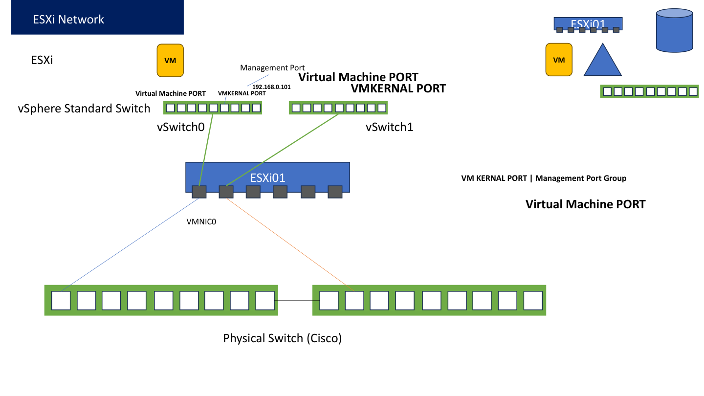

# 01 - How to Create a Virtual Switch

## Study notes

A vSphere Standard Switch (vSS) forwards Ethernet frames on one ESXi host. VM vNICs and VMkernel adapters attach through port groups. An uplink connects that switch to an upstream network. The standard switch itself does not receive an IP address or provide DHCP/routing.

Roman Urdu: vSwitch ESXi ke andar software switch hai. VM ya host traffic ko forward karta hai. IP VMkernel adapter ya guest OS ko milta hai, switch ko nahi. Har host ka standard switch independently configure hota hai.

Class reference: Network Part-I, pages 2-4; class lab diagram, page 1.

## Task - Create vSwitch-LabNet

1. Sign in to ESXi Host Client.
2. Click Networking in the left menu.
3. Open Virtual switches.
4. Click Add standard virtual switch.
5. Enter vSwitch-LabNet as the name.
6. Set MTU to 1500.
7. If the dialog permits no uplink, leave it without an uplink for now.
8. If the UI requires/selects an uplink, choose verified unused vmnic4. Chapter 02 then becomes a verification exercise; do not add it twice.
9. Leave security and shaping at their defaults for this task.
10. Click Add/Save and wait for the task to complete.
11. Select the new switch and inspect its summary/topology.

Roman Urdu: Switch pehle banayein. Agar wizard uplink bhi maangta hai to vmnic4 isi waqt add kar sakte hain. Existing management switch select karke edit na karein.

## Expected result and evidence

- vSwitch-LabNet appears in Virtual switches.
- MTU is 1500.
- It has either no uplink yet or only vmnic4, depending on your UI flow.
- Take a screenshot with the switch name and MTU visible.

## Check your understanding

Q: Can two VMs communicate on the same host without an uplink?
A: Yes, when the virtual switching, VLAN and guest IP settings allow it. External connectivity needs an appropriate upstream path. A switch without an uplink can be useful for isolated host-local networks.

Roman Urdu: Uplink na ho tab bhi suitable same-host VMs baat kar sakti hain. Bahar ki machine tak pohanchne ke liye uplink chahiye.

## If the name already exists

Inspect the existing object. If it belongs to this exercise, continue from its actual configuration. Do not delete a working switch merely to repeat a creation step.
