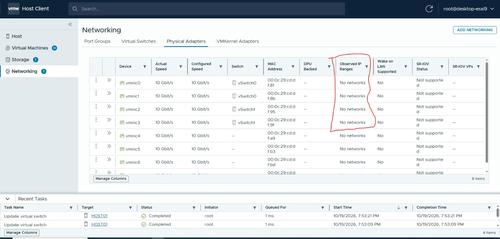
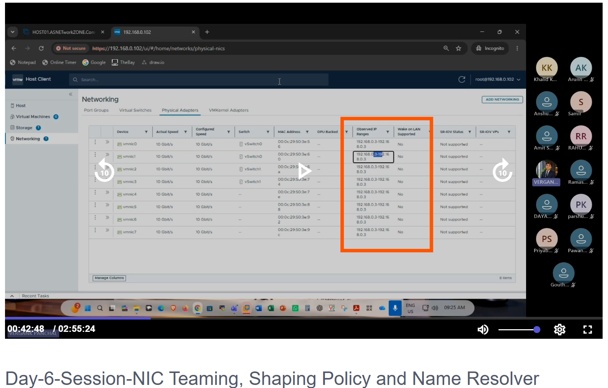

# ESXi Host Networking - Complete Study Notes

English + Roman Urdu. See README.md for reading order.

# 00 - Preparation and Network Plan

## Your verified starting point

Your screenshots show desktop-esxi9, vmk0 10.0.0.10/24, gateway 10.0.0.1, DNS 75.75.75.75 and 75.75.76.76. The physical-adapter screenshot shows vmnic0/vmnic1 on vSwitch0, vmnic2/vmnic3 on vSwitch1, and vmnic4-vmnic7 unassigned at that moment. vmk1 already exists. Current assignments must be checked before changing anything.

Roman Urdu: Purane screenshot mein yeh configuration thi. Abhi ki screen dobara check karein. Management ke vmnic0/vmnic1, vSwitch0 aur vmk0 ko is practice mein change nahi karna.




## Separate exercise values

| Object | Proposed value |
|---|---|
| Standard switch | vSwitch-LabNet |
| First uplink | vmnic4, only if unused now |
| Second uplink | vmnic5, only if unused now |
| VMkernel port group | PG-Lab-VMkernel |
| VMkernel IPv4 | 172.16.50.10/24 |
| Guest VM port group | PG-Lab-VMs |
| Nested guest VM-A | 172.16.50.20/24 |
| External test endpoint | 172.16.50.30/24 |
| VLAN ID on both groups | 0 (untagged) |
| MTU | 1500 throughout |
| Gateway for isolated test | None on test guests; preserve ESXi's existing default gateway |

These are proposed values, not IPs copied from your teacher. Verify 172.16.50.0/24 is unused and non-overlapping. If it is already used, choose another unused subnet and consistently replace all example addresses.

Roman Urdu: Naye IPs practice ke liye hain. Teacher ka 192.168.0.x copy karna zaroori nahi. Dono port groups VLAN 0 par honge, is liye woh isolated from each other nahi hain. Alag names security separation nahi dete.

## Required test environment

- ESXi Host Client access and the local Workstation console for the ESXi VM.
- Two currently unused ESXi adapters; one works for chapters 1-4, two are required for chapter 5 onward.
- One small Linux guest inside ESXi for VM port-group and shaping tests.
- One separate Linux test endpoint directly in Workstation, on the same lab network. Use existing lightweight guests where possible; your desktop RAM is limited.
- iperf3 on both Linux test machines for the bandwidth lab. Install only in the guests, not ESXi.

If nested guests cannot boot on your hardware, you can complete switch/VMkernel configuration and host ping tests, but mark VM and shaping performance tests as pending.

## Task 0.1 - Record configuration

1. Open https://10.0.0.10/ui/ and sign in.
2. Capture Networking -> Virtual switches, Physical adapters, Port groups and VMkernel adapters.
3. Confirm vmnic4 and vmnic5 show no switch assignment.
4. Write down their full MAC addresses, link status, and current Workstation networks.
5. Keep the ESXi VM console open in Workstation.

## Task 0.2 - Map Workstation adapters by MAC

1. In Workstation select the ESXi VM -> Settings.
2. Select each candidate Network Adapter and inspect Advanced -> MAC Address, where available.
3. Match its MAC to ESXi vmnic4 or vmnic5. Do not assume Network Adapter 5 always means vmnic4.
4. Use an isolated network named LAB-ESXI-NET. A Workstation LAN Segment is suitable for VMs on the same Workstation host.
5. Connect both mapped ESXi adapters and the external test endpoint to that same segment.
6. Enable Connected and Connect at power on. If LAN segment creation needs the VM powered off, shut ESXi down cleanly first, change the settings and boot it again.

Roman Urdu: Dono uplinks ek hi logical network tak pohanchne chahiye. Do unrelated NAT ya host-only networks ko ek team mein na milayein. Surface is isolated segment ka member automatically nahi hai; management browser apne 10.0.0.x network par rahega.

| ESXi adapter | Full MAC | Workstation adapter | Workstation network |
|---|---|---|---|
| vmnic4 | Record actual | Record actual | LAB-ESXI-NET |
| vmnic5 | Record actual | Record actual | LAB-ESXI-NET |

## Expected result

You have verified unused uplinks, a non-overlapping subnet, and a separate test network. The management page at 10.0.0.10 still opens.


---

# 01 - How to Create a Virtual Switch

## Study notes

A vSphere Standard Switch (vSS) forwards Ethernet frames on one ESXi host. VM vNICs and VMkernel adapters attach through port groups. An uplink connects that switch to an upstream network. The standard switch itself does not receive an IP address or provide DHCP/routing.

Roman Urdu: vSwitch ESXi ke andar software switch hai. VM ya host traffic ko forward karta hai. IP VMkernel adapter ya guest OS ko milta hai, switch ko nahi. Har host ka standard switch independently configure hota hai.

Class reference: Network Part-I, pages 2-4; class lab diagram, page 1.


## Task - Create vSwitch-LabNet

1. Sign in to ESXi Host Client.
2. Click Networking in the left menu.
3. Open Virtual switches.
4. Click Add standard virtual switch.
5. Enter vSwitch-LabNet as the name.
6. Set MTU to 1500.
7. If the dialog permits no uplink, leave it without an uplink for now.
8. If the UI requires/selects an uplink, choose verified unused vmnic4. Chapter 02 then becomes a verification exercise; do not add it twice.
9. Leave security and shaping at their defaults for this task.
10. Click Add/Save and wait for the task to complete.
11. Select the new switch and inspect its summary/topology.

Roman Urdu: Switch pehle banayein. Agar wizard uplink bhi maangta hai to vmnic4 isi waqt add kar sakte hain. Existing management switch select karke edit na karein.

## Expected result and evidence

- vSwitch-LabNet appears in Virtual switches.
- MTU is 1500.
- It has either no uplink yet or only vmnic4, depending on your UI flow.
- Take a screenshot with the switch name and MTU visible.

## Check your understanding

Q: Can two VMs communicate on the same host without an uplink?
A: Yes, when the virtual switching, VLAN and guest IP settings allow it. External connectivity needs an appropriate upstream path. A switch without an uplink can be useful for isolated host-local networks.

Roman Urdu: Uplink na ho tab bhi suitable same-host VMs baat kar sakti hain. Bahar ki machine tak pohanchne ke liye uplink chahiye.

## If the name already exists

Inspect the existing object. If it belongs to this exercise, continue from its actual configuration. Do not delete a working switch merely to repeat a creation step.


---

# 02 - How to Add the First Uplink

## Study notes

An uplink is an ESXi vmnic assigned to the standard switch. One vmnic cannot simultaneously belong to two standard switches. In your nested lab, ESXi sees virtual Workstation NICs as its physical adapters; their reported 10 Gbit/s is not proof of 10 Gbit/s end-to-end throughput.

Roman Urdu: Uplink switch ka bahar jane wala rasta hai. Nested lab mein yeh Workstation ke virtual adapter se bana hota hai. Asal speed physical NIC, CPU aur doosre resources par depend karegi.

## Task - Attach vmnic4

1. Open Networking -> Physical adapters and verify vmnic4's MAC and current assignment.
2. Confirm its Workstation adapter is connected to LAB-ESXI-NET.
3. Open Virtual switches -> vSwitch-LabNet -> Edit settings.
4. Locate Uplink / Uplinks and choose Add uplink if shown.
5. Select vmnic4. If it is already attached from chapter 01, keep it and continue.
6. Save the settings.
7. Reopen the switch summary and Physical adapters view.

## Expected result

| Check | Expected |
|---|---|
| Physical adapter assignment | vmnic4 -> vSwitch-LabNet |
| Link | Up / connected |
| Switch MTU | 1500 |
| Management access | Still available at 10.0.0.10 |

Capture the switch topology and vmnic4 row. No IP configuration is needed on vmnic4.

## Interpreting Observed IP Ranges

Your teacher's screenshot contains an observed range; your screenshot says No networks. This is traffic-derived information and is separate from configured VMkernel addresses. Do not change an IP merely to populate this column. Use chapter 03's ping test to establish connectivity.



Roman Urdu: Observed IP Ranges adapter ka assigned IP nahi. No networks akela network failure prove nahi karta. vmk ka actual IP VMkernel Adapters mein dekhein.

## Troubleshooting

- Adapter absent in dropdown: check whether another switch already owns it.
- Link down: check Workstation Connected and MAC mapping.
- No external connectivity yet: a switch and uplink alone do not create an IP endpoint; create VMkernel and configure a peer in chapter 03.


---

# 03 - How to Create a VMkernel Port Group and Adapter

## Study notes

The port group carries policy; the VMkernel adapter (vmkN) provides the ESXi host's network interface and IP. They are separate objects. Host functions include management, IP storage and vMotion. Enabling a service is different from merely creating the adapter. vMotion is a function using a VMkernel interface, not another name for VMkernel.

Roman Urdu: Port group policy deta hai, VMkernel adapter host ko IP deta hai. vmk0 management ke liye pehle se hai. Naya vmk banane se vMotion ya storage datastore automatically configure nahi hota.

Class reference: Network Part-I, page 4; class lab diagram, page 1.

## Task A - Add the host port group

1. Open Networking -> Port groups.
2. Click Add port group.
3. Name: PG-Lab-VMkernel.
4. Virtual switch: vSwitch-LabNet.
5. VLAN ID: 0.
6. Save.

## Task B - Add the VMkernel adapter

1. Open Networking -> VMkernel adapters.
2. Click Add VMkernel adapter, or Add networking -> VMkernel adapter if that is the route shown.
3. Choose existing PG-Lab-VMkernel. If the wizard also supports creating a port group, do not create a duplicate; choose the existing one.
4. Select IPv4 and Static configuration.
5. Enter IP address 172.16.50.10.
6. Enter subnet mask 255.255.255.0.
7. MTU: 1500. TCP/IP stack: Default.
8. Leave additional service checkboxes unselected for this general IP-storage connectivity exercise. NFS/iSCSI does not require a generic storage service checkbox.
9. Preserve the existing host default gateway 10.0.0.1; do not replace it with an invented storage gateway.
10. Save and record the assigned vmk number. Because vmk1 exists, it may be vmk2, but use the actual value.
11. Open the new adapter -> IP Settings and verify the address.

Roman Urdu: Is lab mein naya vmk 172.16.50.10 hoga. Pehle wala vmk0 10.0.0.10 waise hi rehna chahiye. Same subnet ke test ke liye naya gateway zaroori nahi.

## Task C - Configure the external endpoint

1. Open the separate Linux endpoint VM directly in Workstation.
2. Attach its adapter to LAB-ESXI-NET.
3. In its network settings set IPv4 manual: 172.16.50.30, mask 255.255.255.0 (/24).
4. For this isolated interface leave gateway and DNS blank. Keep any separate management/NAT interface clearly identified.
5. Apply settings, then verify:

```bash
ip -br address
ip route
ping -c 4 172.16.50.10
```

## Task D - Test from ESXi

If ESXi Shell/SSH is available, run this with the actual new vmk number:

```sh
# Replace vmk2 if your assigned number differs.
vmkping -I vmk2 172.16.50.30
```

If SSH is disabled, enable it temporarily through Host -> Manage -> Services -> TSM-SSH -> Start, or use the local console's troubleshooting options. Stop temporary SSH access after testing if it was previously disabled.

## Expected result

The new vmk has 172.16.50.10/24; ping works to the external peer; vmk0 and browser management remain available. Capture IP Settings and both ping outputs. A successful ping proves basic IP connectivity, not a mounted NFS datastore or an iSCSI session.

## Troubleshooting

If ping fails, check peer firewall, MAC mapping, same Workstation segment, IP mask and VLAN 0. A peer attached to VMnet8 while the uplink is on a LAN segment will not share the intended Layer 2 path.


---

# 04 - How to Create a Virtual Machine Port Group

## Study notes

A VM port group is a connection point for guest vNICs. The guest's IP address is configured inside its operating system or by DHCP, not on the port group. Do not attach a guest to the VMkernel port group; use a separate VM port group.

Roman Urdu: VM port group guest machines ke network cards ko connect karta hai. Guest ka IP uske OS mein set hota hai. Port group ka naam IP address ya DHCP server nahi banata.

## Task A - Create PG-Lab-VMs

1. Open Networking -> Port groups -> Add port group.
2. Name: PG-Lab-VMs.
3. Virtual switch: vSwitch-LabNet.
4. VLAN ID: 0.
5. Save.
6. Verify this group and PG-Lab-VMkernel both belong to vSwitch-LabNet.

Both use VLAN 0, so they share the untagged Layer 2 network in this lab. To create actual segmentation, a later exercise needs distinct VLANs and compatible upstream tagging, or separate isolated switches/networks.

## Task B - Attach a guest VM

1. Select a small existing Linux test VM inside ESXi. If none exists, create a small guest and install Linux before continuing; OS installation is a prerequisite rather than a completed step in this bundle.
2. Open Virtual machines -> VM-A -> Edit settings.
3. Add a Network Adapter if required, or select its dedicated lab adapter.
4. Network / Port group: PG-Lab-VMs.
5. Enable Connected and Connect at power on, where shown.
6. Save and power on the guest.
7. In the guest OS set the lab interface to 172.16.50.20/24, without a gateway for this isolated subnet.
8. Verify:

```bash
ip -br address
ping -c 4 172.16.50.10
ping -c 4 172.16.50.30
```

Roman Urdu: VM-A ka IP .20, ESXi lab vmk ka .10 aur bahar test endpoint ka .30 hai. Pehle host vmk aur phir external endpoint ping karein.

## Expected result

- VM-A's lab adapter shows PG-Lab-VMs.
- Guest IP is .20/24.
- Both pings receive replies, subject to peer ICMP firewall settings.
- Capture port-group properties, VM adapter assignment and guest ping output.

## Nested lab considerations

If .10 responds but .30 does not, check the outer Workstation path. Guest MAC forwarding through a nested hypervisor can require additional configuration depending on the outer virtualization/network setup. Do not blindly enable every security option on ESXi; first distinguish host-local connectivity from the external path. Workstation LAN segments are on one Workstation host, not automatically stretched across separate PCs.

## Revision

Changing a guest's port group changes its network attachment. It does not automatically change a manually configured guest IP. Keep its IP subnet compatible with its new network.


---

# 05 - How to Add Additional Uplinks

This chapter extends chapter 02: the first uplink provides one path; the second makes teaming practice possible.

## Task - Add vmnic5 to the same switch

1. Confirm vmnic5 is currently unused and record its MAC.
2. Match that MAC to the ESXi VM's Workstation adapter.
3. Attach it to the same LAB-ESXI-NET segment as vmnic4.
4. Confirm Connected and Connect at power on.
5. In ESXi open Networking -> Virtual switches -> vSwitch-LabNet -> Edit settings.
6. Add uplink -> select vmnic5.
7. Keep vmnic4 attached.
8. Save and inspect the switch summary.
9. Open Teaming and failover and record whether the UI placed the new adapter in Active, Standby or Unused. Do not assume its default position.

Roman Urdu: Doosra adapter add karna aur usay Active banana alag checks hain. Dono uplinks same network/VLAN tak pohanchne chahiye, warna failover ke baad connection toot sakta hai.

## Expected result

| Adapter | Switch | Outer network |
|---|---|---|
| vmnic4 | vSwitch-LabNet | LAB-ESXI-NET |
| vmnic5 | vSwitch-LabNet | LAB-ESXI-NET |

Capture both uplinks in one screenshot, then repeat VM-A -> 172.16.50.30 ping.

## Important distinction

Two virtual uplinks can demonstrate ESXi policy and failover behavior. If both ultimately rely on the same desktop physical NIC, Windows host and router, they do not provide independent hardware redundancy or double physical network speed.

Roman Urdu: Lab mein do virtual wires hain, lekin desktop ya uska physical NIC fail ho to dono paths band ho sakte hain. Real production redundancy ke liye independent physical paths plan kiye jate hain.

## If a third adapter is available

You may add another verified unused adapter to the same network later using the same method. This lab only needs vmnic4 and vmnic5; keep unused candidates unassigned rather than moving management uplinks.


---

# 06A - NIC Teaming and Failover

## Study notes

NIC teaming uses multiple uplinks on a switch. Failover policies control which paths may carry traffic. Under the default originating virtual port policy, one virtual port normally uses one selected uplink at a time; adding two links is not a promise that one transfer doubles in speed.

Roman Urdu: Teaming mein multiple uplinks mil kar available paths dete hain. Har ek VM ka traffic lazmi nahi ke dono NICs par half-half jaye. Active/standby redundancy practice ko samajhna sab se asaan hai.

Class reference: Network Part-II, pages 3-7. See chapter 09 for corrections to the slide wording.

## Task A - Configure active/standby

1. Open vSwitch-LabNet -> Edit settings -> Teaming and failover.
2. Load balancing: Route based on originating virtual port ID.
3. Network failure detection: Link status only.
4. Notify switches: Yes.
5. Failback: Yes for this exercise.
6. Move vmnic4 into Active adapters.
7. Move vmnic5 into Standby adapters.
8. Save.
9. Inspect both lab port groups. Their teaming policy should inherit the switch policy; remove unintended lab-group overrides so this task tests the switch setting.

| State | Meaning |
|---|---|
| Active | Eligible to carry normal traffic |
| Standby | Available when active paths fail |
| Unused | Not eligible under this policy, including failover |

Roman Urdu: Unused ka matlab corporate mein kabhi use nahi hota nahi hai. Is specific policy mein adapter traffic aur failover ke liye use nahi hoga.

## Task B - Test a real external failover path

1. From the external Workstation endpoint start a continuous ping to VM-A:

```bash
ping 172.16.50.20
```

2. Also confirm that endpoint reaches 172.16.50.10.
3. In the ESXi VM's Workstation settings, use the previously recorded MAC mapping to locate vmnic4's adapter.
4. Clear Connected for only that lab adapter. Do not remove the adapter device and do not disconnect management adapters.
5. Watch the ping. Brief loss may occur; traffic should recover through vmnic5 when the link-down is detected and the backup path works.
6. Check ESXi Physical adapters: vmnic4 should show down.
7. Re-enable Connected for the same adapter.
8. Confirm both paths are up and ping remains successful.
9. Stop ping with Ctrl+C and capture before/during/after results.

A ping between VM-A and the vmk on the same ESXi switch can stay inside the host and is not sufficient evidence of uplink failover. Use the external endpoint.

Roman Urdu: Failover test mein traffic host se bahar jana chahiye. Same-host ping se physical uplink ka failover prove nahi hota. Workstation Connected toggle se lab link fail simulate karein; Windows physical Ethernet disable na karein.

## Task C - Configure active/active

1. Return to Teaming and failover.
2. Keep the originating virtual port policy.
3. Move vmnic5 from Standby to Active so both lab uplinks are Active.
4. Save and verify both lab port groups inherit the policy.
5. Repeat the external ping test, disconnecting only one lab uplink at a time and restoring it before another test.
6. For observing distribution, use multiple guest vNICs/VMs and adapter counters. One ping or one transfer may remain on one uplink.

## Port-group override exercise

On PG-Lab-VMkernel only, you may temporarily enable the teaming override and set vmnic5 Active, vmnic4 Standby. Verify the VM group still inherits the switch policy. Restore inheritance afterward. Overrides apply to that group, not every group on the switch.

## Policy choices

Use originating virtual port for this lab. IP hash needs coordinated upstream static aggregation on a standard-switch design and is not a simple first-IP/second-IP failover mode. Explicit failover order prioritizes eligible uplinks; it is not application-aware DRS. LACP is not supported on a standard switch. Physical NIC load balancing belongs to distributed switches.

## Pass criteria

Both adapters are assigned correctly, active/standby failover works through the external endpoint, both adapters are restored, and the final chosen policy is recorded. A fixed failover time is not guaranteed; measure your observed result.


---

# 06B - Traffic Shaping on a Standard Switch

## Study notes

Traffic shaping controls the sending rate. On a vSphere Standard Switch it controls outbound traffic from the attached virtual adapter (for example, VM-A transmitting toward the network). Do not interpret this as an inbound/download limiter for the guest. A port-group policy is applied per attached virtual adapter, not as a single shared budget for the entire group.

Roman Urdu: VM-A se bahar jane wale data par limit test karenge. Download direction par wahi limit assume nahi karni. Har adapter ki shaping hoti hai; poore switch ki total speed ko ek hi number par cap samajhna sahi nahi.

Class reference: Network Part-II, page 9.

| Field | Meaning | Lab value if UI shows Kbit/s and KB |
|---|---|---|
| Average bandwidth | Sustained target rate over time | 10000 Kbit/s = 10 Mbit/s |
| Peak bandwidth | Upper burst rate | 20000 Kbit/s = 20 Mbit/s |
| Burst size | Credit/budget of burst data | 1024 KB |

Burst size is an amount of data, not remaining bandwidth and not a rate. Read the UI unit labels before entering values. APIs may express rates in bits/s and size in bytes; do not copy UI numbers unchanged into an API.

Roman Urdu: Average routine rate limit hai. Peak short burst ki maximum rate hai. Burst size batata hai kitna extra data budget available ho sakta hai. Yeh ping/HTTP/AD ke fixed separate categories nahi hain.

## Prerequisites

VM-A .20 is inside ESXi on PG-Lab-VMs. Endpoint .30 is a separate VM directly in Workstation on LAB-ESXI-NET. Both should already ping successfully. iperf3 must be installed on both; use the OS package repository when internet access is available, then test over the isolated lab interface.

Ubuntu/Debian guest example:

```bash
sudo apt update
sudo apt install iperf3
```

Rocky/RHEL-family guest example (requires a repository providing iperf3):

```bash
sudo dnf install iperf3
```

Allow TCP 5201 in the endpoint guest firewall, scoped to the lab interface/source if possible. Do not disable the entire firewall. On a firewalld guest, identify the zone of the lab interface before adding 5201/tcp to that zone. Keep results on the test subnet; a second NAT interface is only for package installation.

## Task A - Record baseline

1. Check that traffic shaping is disabled on vSwitch-LabNet and PG-Lab-VMs, or record and temporarily remove only lab policies that would affect the test.
2. On endpoint .30 run:

```bash
iperf3 -s -B 172.16.50.30
```

3. On VM-A run:

```bash
iperf3 -c 172.16.50.30 -B 172.16.50.20 -t 30
```

4. Record the sender/receiver rate. The baseline should exceed 10 Mbit/s to demonstrate the proposed cap. If it does not, resolve the bottleneck or choose a lower supported shaping limit.

## Task B - Enable shaping only for the test VM port group

1. Open Networking -> Port groups -> PG-Lab-VMs -> Edit settings.
2. Expand Traffic shaping.
3. Enable Override / Override switch settings if shown.
4. Set Status / Enabled to Enabled.
5. Enter Average 10000 Kbit/s, Peak 20000 Kbit/s, Burst size 1024 KB, matching actual displayed units.
6. Save and reopen to verify persistence.
7. Leave management and PG-Lab-VMkernel shaping unchanged.

If your UI exposes shaping at switch level instead, the learning path is Virtual switches -> vSwitch-LabNet -> Edit settings -> Traffic shaping. That affects inheriting lab groups; record the wider scope. Prefer the VM group override for this exercise.

## Task C - Measure shaped transmission

On VM-A run:

```bash
iperf3 -c 172.16.50.30 -B 172.16.50.20 -t 60 -i 1
```

Observe early burst behavior and the longer sustained rate. Expect roughly 10 Mbit/s sustained when shaping is the limiting factor, with protocol overhead and implementation effects. Do not expect an exact number or guarantee that every first interval reaches 20 Mbit/s.

Optional reverse-direction test:

```bash
iperf3 -c 172.16.50.30 -B 172.16.50.20 -t 30 -R
```

This sends bulk data from endpoint to VM-A. With only VM-A's outbound policy configured, it need not show the same bulk-data cap. TCP acknowledgments and other bottlenecks still affect measured results.

## Task D - Restore and compare

1. Disable the PG-Lab-VMs shaping override or restore its prior policy. If the parent has shaping enabled, inheriting it will not disable shaping; inspect both levels.
2. Run the original 30-second test again.
3. Verify the measured throughput recovers toward baseline.
4. Stop the endpoint server with Ctrl+C and remove any temporary firewall exception created solely for this test.

| Test | Measured Mbit/s | Notes |
|---|---|---|
| Baseline, VM-A sends | Fill after testing | No shaping |
| Shaped, VM-A sends | Fill after testing | Average 10, peak 20 |
| Reverse, optional | Fill after testing | Different direction |
| Restored baseline | Fill after testing | Policy restored |

## Success criteria

Save the policy screenshot and actual performance outputs. Ping proves reachability, not bandwidth. Shaping caps consumption; it does not reserve bandwidth, speed up a slow path or guarantee a minimum rate.


---

# 07 - Verification, Troubleshooting and Rollback

## Read-only ESXi checks

Run through local shell or temporarily enabled SSH. These commands inspect configuration; they do not create the lab.

```sh
esxcli network nic list
esxcli network vswitch standard list
esxcli network vswitch standard portgroup list
esxcli network ip interface list
esxcli network ip interface ipv4 get
esxcli network vswitch standard policy failover get -v vSwitch-LabNet
esxcli network vswitch standard portgroup policy failover get -p PG-Lab-VMs
esxcli network vswitch standard portgroup policy shaping get -p PG-Lab-VMs
```

If a subcommand differs on your release, use its --help and confirm in the Host Client rather than changing configuration to match this text.

## Evidence checklist

- [ ] Baseline management screenshot, vmk0 10.0.0.10.
- [ ] vmnic4/vmnic5 MAC-to-Workstation mapping.
- [ ] New switch name and MTU.
- [ ] First uplink attached and connected.
- [ ] VMkernel group and actual vmk number/IP.
- [ ] VM group and guest adapter assignment.
- [ ] External VM-A and VMkernel ping outputs.
- [ ] Two-uplink switch summary.
- [ ] Active/standby screenshot and external failover results.
- [ ] Active/active screenshot and restored links.
- [ ] Shaping settings plus baseline/shaped/restored iperf3 measurements.

These are tasks to capture, not claims that the lab already passed.

## Troubleshooting table

| Symptom | Likely checks |
|---|---|
| Cannot add vmnic | Another switch owns it; confirm assignment |
| Physical adapter down | Workstation connection, MAC mapping, outer segment |
| Host-local ping succeeds, external fails | Outer mapping, peer firewall, nested MAC forwarding |
| All lab pings fail | Guest IP/mask, VM port group, VLAN mismatch, vmk status |
| Failover fails | Second adapter on different network, port-group override, standby link down |
| No loss during same-host test | Test may not use uplink; use external peer |
| Shaping no effect | Wrong group/direction, inheritance, baseline already below cap |
| Reverse also slow | Outer bottleneck, endpoint shaping, CPU, TCP behavior |
| No networks in observed range | Not assigned-IP evidence; use vmk IP settings and ping |
| No internet on lab guest | Expected on isolated no-gateway subnet |
| Two uplinks, one busy | Normal for one virtual port under originating-port policy |

Roman Urdu: Problem ko layer-wise check karein: link, outer mapping, VLAN, IP/mask, firewall, phir application. Har failure par gateway ya management IP change karna sahi approach nahi.

## Recovery

If management access is lost unexpectedly, use the local Workstation console. Review the actual changes and restore the recorded management assignments; do not reset all ESXi networking as a first response. This bundle intentionally creates separate lab objects.

## Cleanup in dependency order

1. Restore the disconnected Workstation lab adapters.
2. Stop iperf3 and remove temporary endpoint firewall rules.
3. Restore shaping and teaming to the recorded pre-test lab settings.
4. Move the lab guest vNIC to its original appropriate port group, or remove its dedicated lab vNIC. Record/restore the guest IP separately.
5. Delete only the new lab VMkernel adapter by its actual number. Confirm it is not vmk0 or the pre-existing vmk1.
6. Delete PG-Lab-VMkernel and PG-Lab-VMs once unused.
7. Delete vSwitch-LabNet, releasing its uplinks.
8. Restore original Workstation network mapping if desired; delete the temporary segment only when unused.
9. Stop SSH if you enabled it temporarily. Verify 10.0.0.10 management access.

Roman Urdu: Pehle dependent adapters/VM attachments hataein, phir port groups aur aakhir mein switch. Existing vSwitch1 ya vmk1 ko lab ka hissa samajh kar delete na karein.


---

# 08 - Revision Questions and Answers

1. **Where is the ESXi host IP assigned?** On a VMkernel adapter. Roman Urdu: Host IP vmk par hota hai.
2. **Does a vSwitch need an IP?** No. It forwards Layer 2 frames. Roman Urdu: Switch ko forwarding ke liye IP assign nahi karte.
3. **What is a port group?** A network attachment/policy grouping, including VLAN and policy inheritance. Roman Urdu: Network connection aur policies ka group.
4. **VM port group vs VMkernel group?** Guest vNIC attachment versus ESXi host interface attachment. Roman Urdu: Guest ke liye VM group, host ke liye vmk group.
5. **What is an uplink?** A vmnic assigned to a switch for upstream connectivity. Roman Urdu: Bahar jane ka network path.
6. **Can two standard switches share the same vmnic?** Not simultaneously. Roman Urdu: Ek vmnic aik waqt mein aik standard switch par.
7. **Does the port group assign a guest IP?** No; configure it in the guest or use reachable DHCP. Roman Urdu: Guest IP OS ya DHCP deta hai.
8. **Are two differently named groups isolated?** Names alone do not isolate traffic. Roman Urdu: Sirf naam alag hone se network isolate nahi hota.
9. **What does VLAN 0 mean here?** Untagged traffic. Roman Urdu: Is lab mein VLAN tag add nahi karte.
10. **What does MTU 1500 describe?** For Ethernet IP traffic, the Layer 3 packet size limit carried as payload, not the complete on-wire frame including all Layer 2 overhead. Roman Urdu: Poore frame ka total size 1500 samajhna sahi nahi.
11. **Is vMotion a VMkernel adapter?** It is a host function that uses VMkernel networking. Roman Urdu: vMotion aik kaam hai jo vmk use karta hai.
12. **Active vs standby?** Active can carry normal traffic; standby takes over when eligible active paths fail. Roman Urdu: Standby backup path hai.
13. **Unused?** Excluded by that policy, including failover. Roman Urdu: Is policy mein eligible nahi.
14. **Does active/active double one download?** No automatic guarantee. Roman Urdu: Single transfer ki speed double hona lazmi nahi.
15. **Why use an external failover peer?** Host-local traffic can bypass uplinks. Roman Urdu: Bahar wala peer uplink path test karta hai.
16. **Bandwidth vs throughput?** Capacity versus achieved rate. Roman Urdu: Maximum gunjaish aur asal transfer rate.
17. **Average vs peak?** Sustained rate target versus burst ceiling. Roman Urdu: Routine limit aur temporary upper limit.
18. **Burst size?** Data quantity budget, not a bandwidth rate. Roman Urdu: Extra data ka budget.
19. **Can ping measure bandwidth?** No; use a throughput tool such as iperf3. Roman Urdu: Ping reachability dikhata hai.
20. **Does No networks mean vmk has no IP?** No; inspect the VMkernel IPv4 settings. Roman Urdu: Observed range aur configured IP alag cheezen hain.
21. **Can a standard switch run LACP?** No; do not enable an upstream LACP bundle for this lab. Roman Urdu: Is standard-switch exercise mein LACP nahi.
22. **What remains unchanged in this exercise?** Your existing management path and previously configured switch/VMkernel objects. Roman Urdu: Naye objects par practice karni hai.

## Final assignment

Rebuild the separate lab network from these notes, record actual adapter numbers, prove external failover, and compare measured shaping results. Explain each object aloud without reading its definition. Mark incomplete performance tasks as pending rather than inventing results.


---

# 09 - Sources and Clarifications

## Attached class PDFs used

| File | Pages used | Contribution |
|---|---|---|
| 06 ESXi Network Part-I.pdf | 2-5 | Standard switches, pNICs, groups and VLANs |
| 06 ESXi Network Part-II.pdf | 3-7, 9 | Teaming, failover states and shaping |
| 06 VMware ESXi Network Lab.pdf | 1 | Teacher network topology |

Original copies are under class_reference. The other attached class PDFs were inventoried; they concern setup, introductions, storage, AD, DNS and other subjects outside the six requested networking topics.

## Screenshot provenance

- user_physical_adapters.png: your desktop-esxi9 physical-adapter view uploaded as image(20261020-010501).png.
- user_vmk0.png: your actual management IPv4 settings uploaded as image(20261020-010900).png.
- teacher_observed_ranges.png: teacher screenshot uploaded as image(20261020-010433).png.
- class_network_topology.png: rendered page 1 of the attached class network lab PDF.

These images are references from the supplied material. They are not screenshots of the new practice switch or successful tests. Earlier screenshots outside the available files have not been reconstructed or represented as included.

## Corrections to read alongside the class slides

| Slide wording / possible interpretation | Clarification |
|---|---|
| Originating port called physical-layer load balancing | Selection is based on virtual switch port ID; avoid teaching it as an OSI-layer algorithm |
| IP hash described as first IP failing then second coming up | IP hash selects an uplink using source/destination addresses; it is not sequential IP failover |
| Explicit failover described as application layer / DRS | It prioritizes eligible uplinks and does not perform application-aware load balancing |
| Unused described as not used at corporate level | Unused is a per-policy exclusion and can be intentional in enterprise configurations |
| All failures detected within a fixed 3-10 seconds | Detection/recovery varies; link-state and upstream failures are different cases |
| Burst bandwidth described as remaining bandwidth | Burst size is a data budget, not a rate or a remaining-bandwidth counter |
| Average for ping, peak for HTTP/AD | These rate settings are not application-specific categories |
| Every port group automatically communicates | VLAN, subnet, security and topology determine actual connectivity |

Roman Urdu: Teacher ki slides learning foundation hain. Upar technical meanings clarify kiye gaye hain taa-ke interview ya real lab mein ghalat mental model na bane.

## Official supporting references

Accessed 20 October 2026 UTC. UI labels may differ between the class ESXi 8 material and your ESXi 9 Host Client.

- [Broadcom: How to configure NIC teaming](https://knowledge.broadcom.com/external/article?legacyId=1004088) - uplink membership, policies and configuration.
- [Broadcom: Understanding IP hash load balancing](https://knowledge.broadcom.com/external/article/321396/understanding-ip-hash-load-balancing.html) - policy behavior.
- [Broadcom: Bandwidth limitation through traffic shaping](https://knowledge.broadcom.com/external/article/429833/limiting-bandwidth-for-vsphere-replicati.html) - UI rate and burst units.
- [Broadcom API: HostNetworkTrafficShapingPolicy](https://developer.broadcom.com/xapis/virtual-infrastructure-json-api/latest/data-structures/HostNetworkTrafficShapingPolicy/) - API units differ from UI units.
- [Broadcom: Observed IP ranges on healthy uplinks](https://knowledge.broadcom.com/external/article/433047/observed-ip-ranges-shows-no-networks-for.html) - observed range is not configured host IP.
- [Broadcom: New-VMHostNetworkAdapter](https://developer.broadcom.com/powercli/latest/vmware.vimautomation.core/commands/new-vmhostnetworkadapter/) - VMkernel/port group/switch association.

## Scope

This bundle teaches standard-switch host networking. It does not configure NFS/iSCSI targets, vMotion migration, distributed switches, LACP, routing or production VLAN infrastructure. Those require separate labs and prerequisites. The example 172.16.50.x network is newly proposed, not a claim about your existing configuration.
