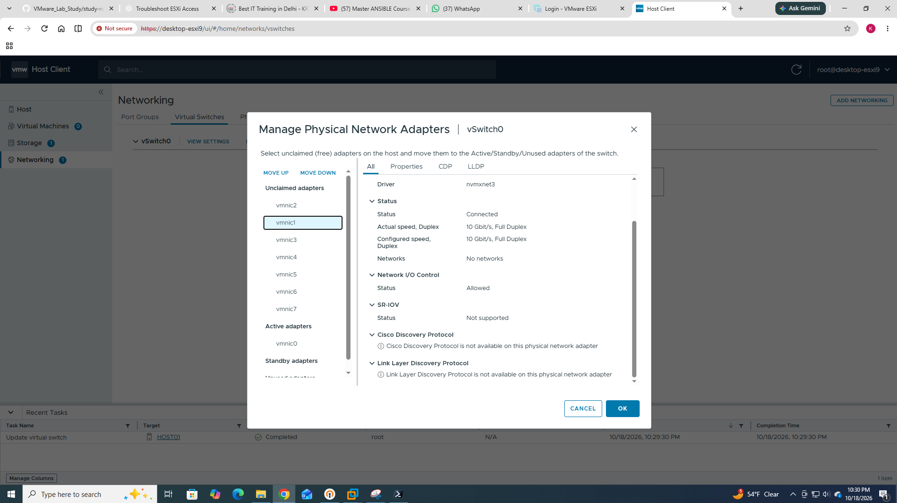
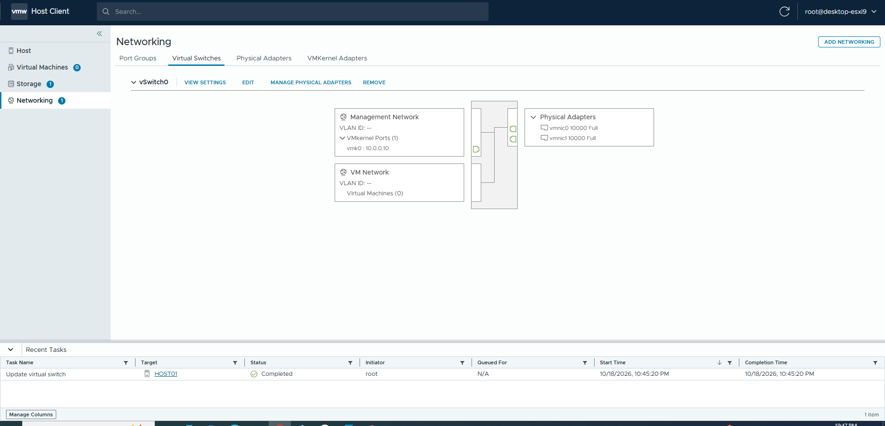
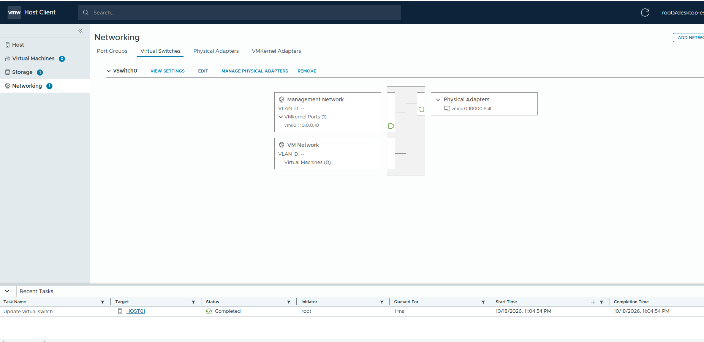

# Chapter 03 — Physical Adapters and Uplinks

> **Lab baseline (confirmed from screenshot):** `desktop-esxi9`, `vSwitch0`, `vmnic0` (reported 10000 Full), Management Network `vmk0` / `10.0.0.10`, VM Network with zero VMs, VLAN shown as `--`. This is a different host from `desktop-esxi8` / `10.0.0.11`. Do not assume that uninspected settings are configured as described in the examples.

> **Safety:** Viewing pages and using read-only commands is safe. Changing management uplinks, port groups, VLANs, or vmk0 IP may cut off remote access. Have ESXi console access and a rollback plan before changes.

## Learning objectives
Understand `vmnic`, link state, link speed/duplex, uplinks and redundancy, especially nested networking.

## Core terms
- **vmnic0:** adapter interface name ESXi assigned; virtualized inside nested ESXi is possible.
- **Uplink:** a vmnic assigned to a vSwitch to reach networks beyond the host.
- **Link status:** whether the interface believes a link is connected.
- **Speed / duplex:** reported link characteristics, not benchmark results.

Your screenshot shows `vmnic0 10000 Full` as the uplink for `vSwitch0`. The screenshot **does not prove** there are multiple active uplinks or redundancy.

## Nested ESXi note
```text
Guest VM --> ESXi9 vSwitch0 --> ESXi9 vmnic0 (virtual NIC)
  --> VMware Workstation virtual networking --> Desktop host NIC --> LAN
```
Workstation network mode (Bridged/NAT/Host-only), any nested promiscuous/MAC behavior, and external VLAN design affect connectivity. Your screenshot alone does not tell us the Workstation mode.

## Read-only GUI lab
1. Networking → **Physical adapters**.
2. Record device name, status, speed, duplex, driver and MAC (omit MAC from public GitHub notes if desired).
3. Return to **Virtual switches**, identify the assigned uplinks.
4. Compare the host's connected devices with your diagram.

## Optional ESXi shell commands (read-only; only if shell access is already enabled)
```sh
esxcli network nic list
esxcli network nic get -n vmnic0
```
**Why:** `list` enumerates adapters and state; `get` describes one adapter. Interpret `Link Status`, `Speed`, `Duplex`, `Driver`, `MAC Address`—do not mistake link speed for measured throughput. Command fields vary by ESXi build.

## Roman Urdu
`vmnic0` ESXi ka uplink adapter hai. Agar ESXi VMware Workstation ke andar chal raha ho to yeh guest OS ko diya gaya virtual adapter ho sakta hai. 10000 Full ka matlab reported 10 Gbps full-duplex link, internet speed guarantee nahi.

## Questions
1. How is a vmnic different from a VM's vNIC?
2. Why might one uplink be a single point of failure?
3. What would you verify before setting up NIC teaming?


---
## Completed practical lab — Adding and removing a second active uplink
The teacher's PDF (page 4) explains that multiple physical NICs can support NIC teaming and redundancy. In this nested lab, the `vmnic` adapters presented to ESXi are VMware virtual NICs. **We confirmed membership changes, not an automatic failover result.**

### Step 1 — Inspect the unclaimed adapter

The selected `vmnic1` was **Unclaimed**, using driver `nvmxnet3`, and reported **Connected, 10 Gbit/s, Full Duplex**. **Meaning:** ESXi sees a connected virtual link; this does not prove it reaches the same upstream network as `vmnic0`.

### Step 2 — Move the adapter to Active

Use **MOVE UP** until the adapter appears under **Active adapters**. `(New) vmnic1` means the assignment is pending and not yet applied; do not interpret it as saved.

### Step 3 — Verify the saved uplink assignment



`vmnic0` and `vmnic1` both appeared on `vSwitch0`. This verifies the configured uplinks. It does **not** prove 20 Gbps throughput on a single flow, balanced traffic, or working failover. Those depend on the teaming policy and upstream connectivity.

### Step 4 — Remove vmnic1 administratively

The user removed `vmnic1` through **Manage Physical Network Adapters**; afterward, `vSwitch0` showed only `vmnic0`. **This is configuration removal, not failover testing.** Real failover testing leaves both uplinks configured, then simulates a link fault while monitoring connectivity.

### What must be checked before a genuine failover exercise?
- Inspect **Teaming and failover** policy and whether port-group overrides are present.
- Check both VMware Workstation virtual NIC connection modes and Layer-2 connectivity.
- Have console recovery before touching management networking.
- Run `ping -t 10.0.0.10` from Windows while performing a controlled **link-level** test, and record packet loss and recovery.

```sh
esxcli network nic list
esxcli network nic get -n vmnic0
```
**Why:** First command inventories NICs (link, speed, duplex, driver); second examines one NIC in more detail. These outputs have **not yet been captured** for this lab.
