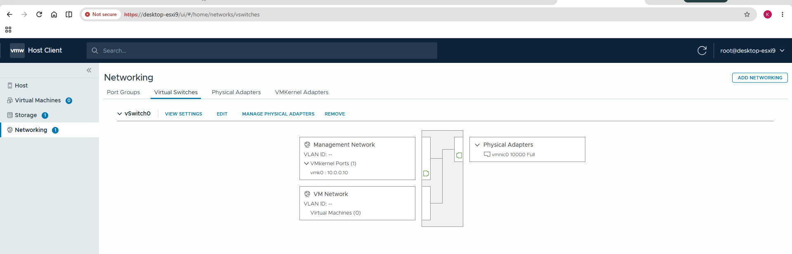
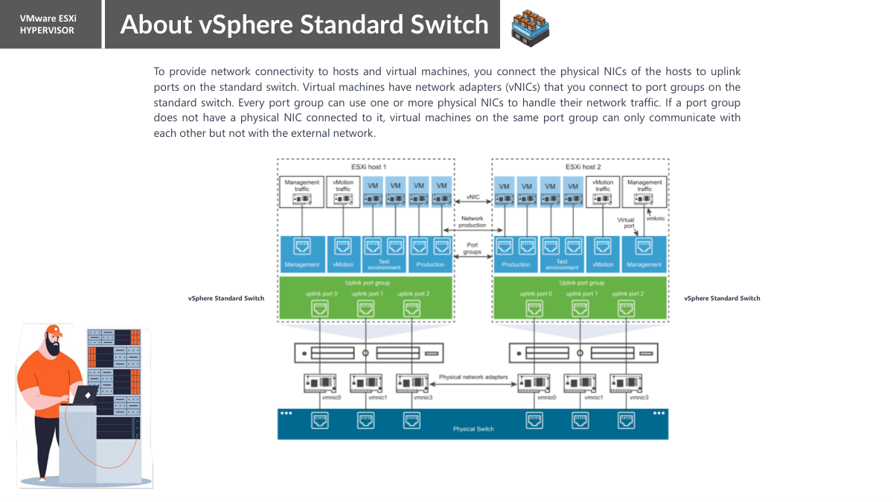

# Chapter 01 — Virtual Switches (Roman Urdu)

> **Aapke lab ka confirmed baseline:** `desktop-esxi9`, `vSwitch0`, `vmnic0` (screen par `10000 Full`), `Management Network` par `vmk0 = 10.0.0.10`, `VM Network` par 0 VMs aur VLAN ke saamne `--` nazar aa raha hai. Yeh `desktop-esxi8 = 10.0.0.11` se alag host hai. Jo settings abhi inspect nahin ki gayin, unhein confirmed na samjhein.

> **Hifazati ehtiyat:** Read-only inspection theek hai. Management uplink, VLAN, port group ya `vmk0` IP change karne se remote access band ho sakta hai. Changes se pehle local/VM console aur rollback plan zaroor hona chahiye.

## Is chapter mein kya seekhenge?
Physical Ethernet switch aur ESXi standard virtual switch ka farq, Layer 2 frame forwarding, uplink ka role, aur apne `vSwitch0` ka connection samjhenge.



## Switch kya hota hai?
**Physical Ethernet switch** hardware device hoti hai jis par multiple devices Ethernet cables se connect hote hain. Switch MAC address ki madad se frame sahi port ki taraf bhejta hai. **Standard virtual switch (vSS)** ESXi host ke andar software-based switching ka kaam karta hai. Is mein VM ki virtual NIC aur VMkernel interface apne port group ke zariye attach hote hain. Optional physical uplink (`vmnic`) switch ko external LAN se connect karta hai.

Agar do virtual machines isi ESXi host par aur compatible Layer-2 network/VLAN mein hon, to unka traffic aksar host ke andar hi switch ho jata hai; external uplink zaroori nahin hota. Security policies ko bhi dekhna hota hai.

```text
ESXi host: desktop-esxi9
VM ka vNIC ----> [VM Network port group] ----------+
Management vmk0 -> [Management Network port group] +--> [vSwitch0] --> [vmnic0] --> External LAN
```

## Aapke screenshot mein kya nazar aa raha hai?
- **`vSwitch0`:** Standard virtual switch ka naam. Switch khud koi management IP nahin hota.
- **`Management Network`:** Management ka port group. Is mein `vmk0` show ho raha hai, jiska IP `10.0.0.10` hai.
- **`VM Network`:** VMs ko connect karne wala port group. Abhi `Virtual Machines (0)` show ho raha hai; is se network faulty sabit nahin hota.
- **`vmnic0`:** Uplink adapter. Nested ESXi mein yeh VMware Workstation se mila *virtual hardware adapter* bhi ho sakta hai.
- **`10000 Full`:** Link 10,000 Mb/s full duplex report kar raha hai; yeh actual measured speed ya Internet speed nahin.
- **`VLAN ID: --`:** Display se actual configured VLAN ID ki final tasdeeq nahin hoti.

## vSS aur vDS mein farq
| Cheez | Standard vSwitch (vSS) | Distributed Switch (vDS) |
|---|---|---|
| Management | Har ESXi host par alag | vCenter se central management |
| Home lab | Standalone ESXi par mumkin | vCenter aur munasib licensing/support chahiye |
| Multiple hosts | Settings separately repeat karni padti hain | Shared distributed configuration hoti hai |

## Practical lab — Sirf check karna hai
1. `https://desktop-esxi9/ui` open karke login karein.
2. **Networking → Virtual switches** par jayen aur `vSwitch0` expand karein.
3. Port groups, VMkernel interfaces, uplinks, link speed aur VLAN display likh lein.
4. **View settings** khol kar MTU, Security aur NIC teaming policies ko observe karein, agar display hon. Koi setting change na karein.
5. Screenshot save karein aur compare karein ke management IP vSwitch ka hai ya `vmk0` ka.

## Outputs ko kaise samjhein?
- **`vSwitch0`:** Switch object ka label, IP address nahin.
- **`vmk0: 10.0.0.10`:** ESXi host management interface ka IP.
- **`vmnic0 10000 Full`:** Reported network-link property; speed-test ka result nahin.

## Practice / Interview sawalat
1. Kya ek hi host ke same-network VMs ko communicate karne ke liye physical uplink lazmi hai?
2. `10.0.0.10` IP `vSwitch0` ka hai ya `vmk0` ka? Kyun?
3. `10000 Full` ka matlab hamesha 10 Gbps effective throughput kyun nahin hota?


---

## Teacher PDF — vSS explanation (pages 2–3)



Teacher ke page 3 par har ESXi host ka apna **vSphere Standard Switch** diagram hai. Host ke andar VM ki vNIC port group se attach hoti hai; uplink port vmnic ko external physical switch tak connect karta hai. Teacher ke explanation ke mutabiq bina physical uplink ke same host aur same Layer-2 port-group par VMs aapas mein communicate kar sakti hain, lekin external network tak direct raasta nahi hota. Yeh statement tab samjhein jab koi doosra routing ya bridging path configured na ho.

### Lab screenshot — shuru ki configuration


**Observe:** `desktop-esxi9` par `vSwitch0`, `Management Network` ke under `vmk0 = 10.0.0.10`, `VM Network`, aur `vmnic0` available thay. Workstation ke nested VM mein `vmnic` naam ESXi guest ko dikhne wala virtualized Ethernet adapter bhi ho sakta hai, zaroori nahi ke direct physical PCI NIC ho.

**Practice:** `Networking > Virtual Switches > vSwitch0 > View Settings` se switch aur MTU read-only verify karein. ESXi Shell mein `esxcli network vswitch standard list` command switch, MTU, port groups, uplink ke related fields dekhne ke liye hai. Har field ka matlab observed machine par output aane ke baad record karein.

