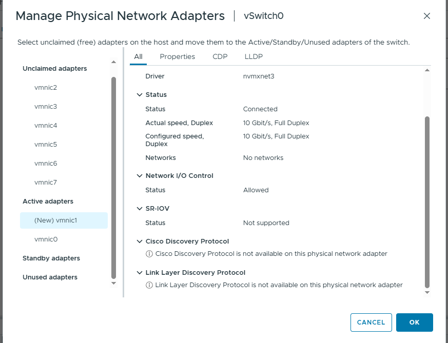
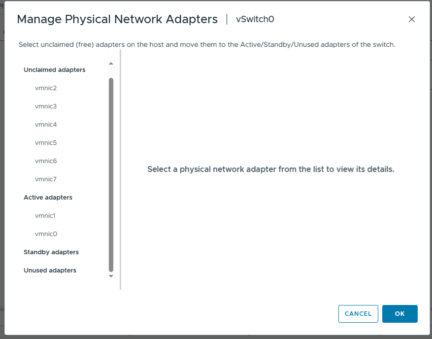

# Chapter 03 — Physical Adapters aur Uplinks (Roman Urdu)

> **Aapke lab ka confirmed baseline:** `desktop-esxi9`, `vSwitch0`, `vmnic0` (screen par `10000 Full`), `Management Network` par `vmk0 = 10.0.0.10`, `VM Network` par 0 VMs aur VLAN ke saamne `--` nazar aa raha hai. Yeh `desktop-esxi8 = 10.0.0.11` se alag host hai. Jo settings abhi inspect nahin ki gayin, unhein confirmed na samjhein.

> **Hifazati ehtiyat:** Read-only inspection theek hai. Management uplink, VLAN, port group ya `vmk0` IP change karne se remote access band ho sakta hai. Changes se pehle local/VM console aur rollback plan zaroor hona chahiye.

## Is chapter mein kya seekhenge?
`vmnic`, uplink, link state, speed, duplex aur redundancy ko samjhenge, khaas tor par nested ESXi network ke hawale se.

## Basic terms
- **`vmnic0`:** ESXi ka adapter interface name. Nested ESXi ke andar yeh virtualized NIC bhi ho sakti hai.
- **Uplink:** Wo `vmnic` jo vSwitch ko ESXi host ke bahar ke network tak raasta deta hai.
- **Link Status:** Interface connected/up report ho raha hai ya down.
- **Speed:** NIC link ki negotiated/reported raftar, actual application throughput nahin.
- **Duplex:** Full duplex mein dono directions mein ek hi waqt mein send aur receive ho sakta hai.

Aapke screenshot mein `vSwitch0` ka uplink `vmnic0 10000 Full` hai. Screenshot se **multiple uplinks ya redundancy** confirm nahin hoti.

## Nested ESXi mein traffic ka flow
```text
Guest VM
  --> ESXi9 ka vSwitch0
  --> ESXi9 ka vmnic0 (guest ESXi ko mila virtual NIC)
  --> VMware Workstation ka virtual network
  --> Windows Desktop ka network adapter
  --> Physical LAN
```

Workstation ka mode **Bridged**, **NAT** ya **Host-only** ho sakta hai. In modes ka behavior alag hota hai. Kuch nested situations mein MAC-address/promiscuous settings bhi zaroori ho sakti hain. **Aapke abhi wale screenshot se Workstation network mode confirm nahin hota.**

## GUI lab — Koi changes nahin
1. **Networking → Physical adapters** kholein.
2. Har adapter ka device name, status, speed, duplex, driver aur MAC address note karein.
3. **Networking → Virtual switches** par wapas ja kar uplink assignment se compare karein.
4. Actual diagram mein verify karein ke uplink kis taraf jata hai.
5. Public GitHub notes se MAC address hide karna chahen to kar sakte hain.

## Optional ESXi Shell commands (read-only)
Agar ESXi shell access **pehle se available** hai to commands run kar sakte hain; sirf note banane ke liye shell enable karna zaroori nahin.

```sh
esxcli network nic list
esxcli network nic get -n vmnic0
```

### Pehli command kyun?
`esxcli network nic list` ESXi ke NICs enumerate karti hai. Output mein aam tor par **Name**, **Driver**, **Link**, **Speed**, **Duplex** aur **MAC Address** hota hai. Har column ka matlab samajh kar report karein.

### Doosri command kyun?
`esxcli network nic get -n vmnic0` sirf `vmnic0` ki detailed information dikhati hai. `-n vmnic0` ka matlab: adapter ka naam `vmnic0` select karo.

**Interpretation:** `Link Status: Up` connected link ka indication hai; `Speed: 10000` ko Internet speed-test na samjhein. Actual output ESXi build ke hisaab se farq ho sakta hai. Abhi humne aapke ESXi9 par yeh shell outputs collect nahin kiye.

## Redundancy kya hai?
Agar ek hi uplink ho aur woh fail ho jaye, to external connectivity ruk sakti hai. Multiple supported physical uplinks aur sahi teaming policies se redundancy mil sakti hai; lekin aapke lab mein is ki configuration ko abhi verify karna baqi hai.

## Practice / Interview sawalat
1. ESXi ka `vmnic` aur guest VM ka `vNIC` alag kaise hain?
2. Ek uplink single point of failure kyun ban sakta hai?
3. NIC teaming se pehle kin network settings ko verify karenge?


---

## Actual Practical Lab — Active uplinks add aur remove karna

Teacher page 4 ke mutabiq ESXi kai pNICs use kar sakta hai; multiple adapters se redundancy aur teaming possible hoti hai. **Important correction:** aapke screenshots ne administrative NIC configuration changes prove kiye; actual automatic failover ya traffic distribution ko live disconnect test se verify nahi kiya.

### Step 1 — Unclaimed `vmnic1`


`vmnic1` unclaimed tha; `Connected`, `10 Gbit/s Full Duplex`, driver `nvmxnet3` tha. **Connected** virtual link state hai; end-to-end access ki guarantee nahi.

### Step 2 — MOVE UP karna


`MOVE UP` se adapter `Active adapters` mein gaya. `(New)` ka matlab unsaved/pending addition.

### Step 3 — Saved configuration



`vmnic0` aur `vmnic1` dono visible thay. Ye switch ki uplink team membership prove karta hai, **20 Gbps aggregated single-flow throughput** nahi. Effective forwarding teaming policy aur upstream virtual network par depend karta hai.

### Step 4 — Administrative removal


`vmnic1` ko `Manage Physical Network Adapters` se remove kiya gaya; vSwitch0 par sirf `vmnic0` bacha. Isko **failover test** kehna technically correct nahi: failover mein assigned uplink ka *link* fail kiya jata hai, configuration se adapter remove nahi hota.

### NIC teaming: zaroori verification

- Teaming and failover policy check karni baqi hai (e.g., originating virtual port ID).
- Nested VMware Workstation ke adapters ke modes / same required L2 reachability check karni baqi hai.
- Redundancy prove karne ke liye `ping -t 10.0.0.10` ke sath ek connected uplink ka link failure test karna baqi hai.
- Management lockout avoid karne ke liye console access aur rollback zaroori hain.

**Useful read-only command:** `esxcli network nic list` — NIC names, admin/link status, speed, duplex aur driver dekhne ke liye. Sirf link up hone se end-to-end failover guarantee nahi hoti.

