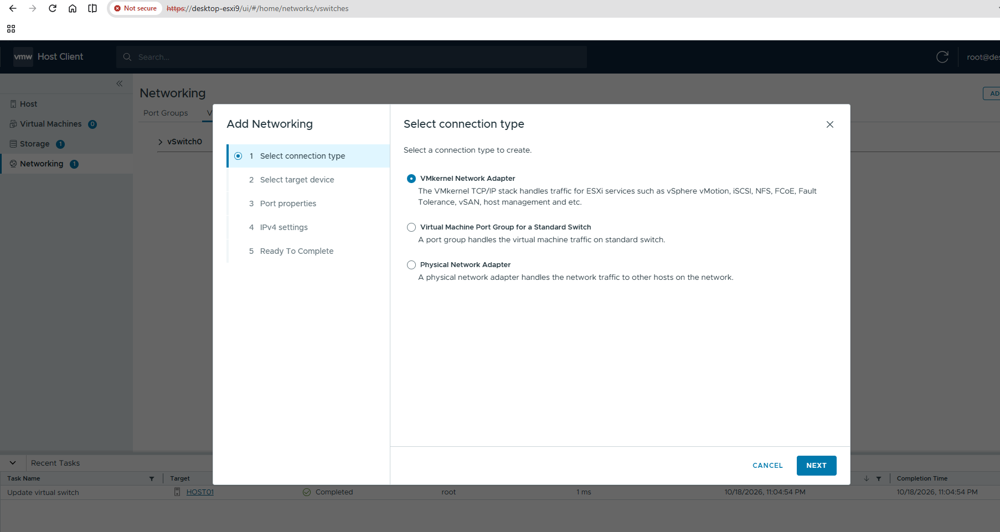
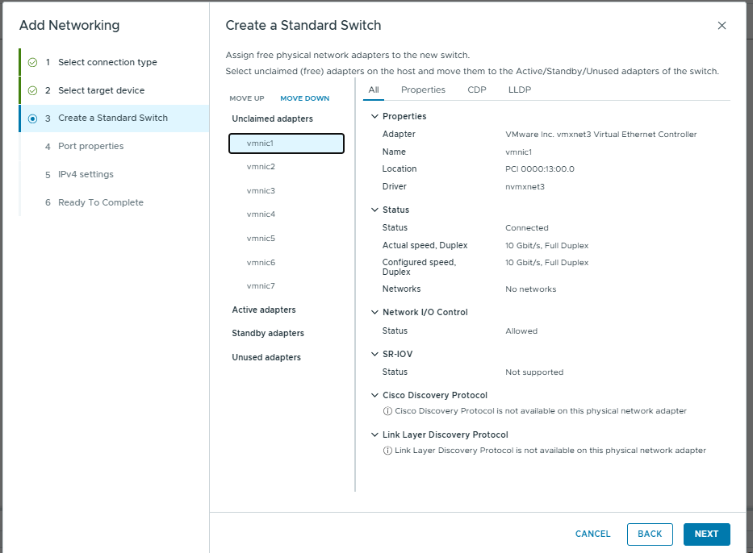
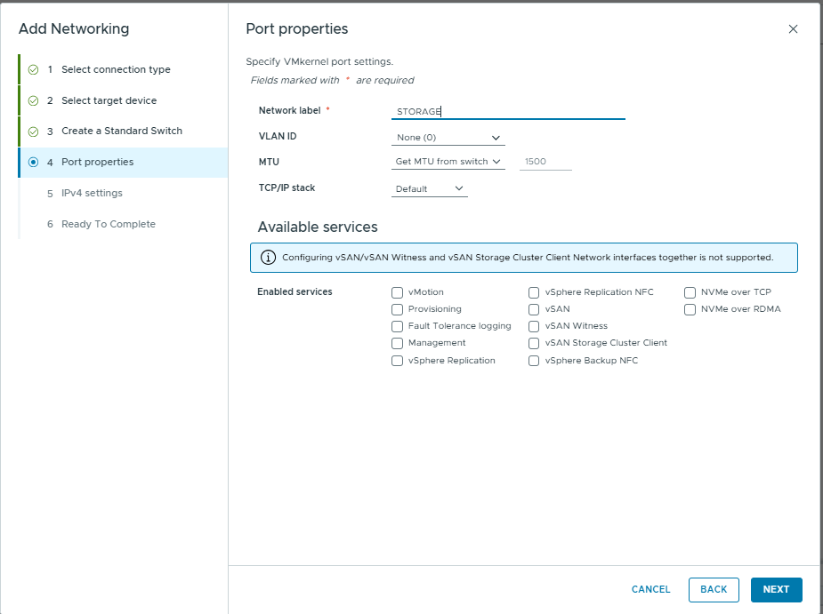
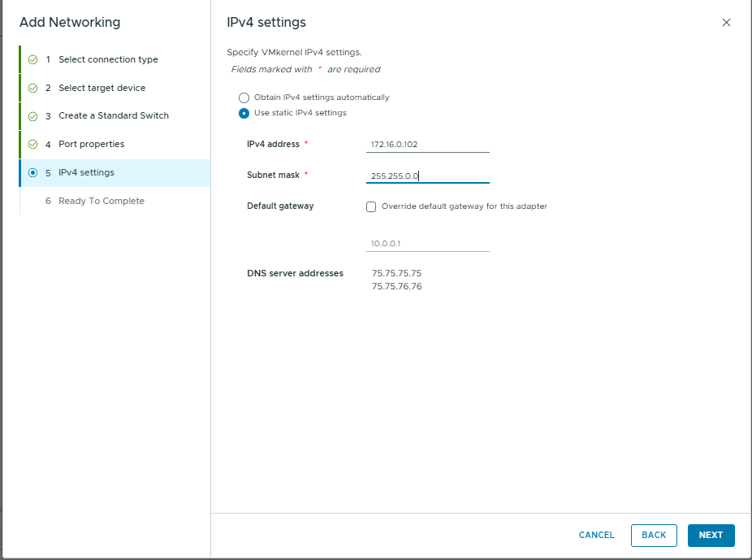

# Chapter 04 — VMkernel Adapters (Roman Urdu)

> **Aapke lab ka confirmed baseline:** `desktop-esxi9`, `vSwitch0`, `vmnic0` (screen par `10000 Full`), `Management Network` par `vmk0 = 10.0.0.10`, `VM Network` par 0 VMs aur VLAN ke saamne `--` nazar aa raha hai. Yeh `desktop-esxi8 = 10.0.0.11` se alag host hai. Jo settings abhi inspect nahin ki gayin, unhein confirmed na samjhein.

> **Hifazati ehtiyat:** Read-only inspection theek hai. Management uplink, VLAN, port group ya `vmk0` IP change karne se remote access band ho sakta hai. Changes se pehle local/VM console aur rollback plan zaroor hona chahiye.

## Is chapter mein kya seekhenge?
`vmk` interfaces, management traffic, IP addressing aur default gateway ka role samjhenge.

## VMkernel Adapter kya hai?
**VMkernel network adapter** ESXi host ka khud ka IP-enabled interface hota hai. Is par management, vMotion, kuch storage-network services aur doosri configured VMkernel services chal sakti hain. Yeh **guest VM ke andar ka vNIC nahin** hota.

**Confirmed:** `desktop-esxi9` par `vmk0` `Management Network` port group ke andar hai aur `10.0.0.10` show ho raha hai.

**Abhi confirm nahin:** Subnet mask/prefix, gateway, aur koi doosre vmk adapters, aur enabled services.

```text
Windows Browser
    --> LAN / Workstation Networking
    --> vmnic0 uplink --> vSwitch0
    --> Management Network --> vmk0 (10.0.0.10)
    --> ESXi Host Client
```

## VMkernel aur VM NIC ka farq
- **VMkernel interface (`vmk0`):** ESXi host ko khud network services dene ke liye.
- **Guest `vNIC`:** Linux/Windows guest OS ko virtual network interface dene ke liye.
- **`vSwitch0`:** Layer 2 switching, apna management IP nahin.

## GUI lab — Read-only
1. **Networking → VMkernel adapters** par click karein.
2. `vmk0` select karke IP, prefix/subnet, TCP/IP stack aur enabled services note karein.
3. Jahan display hon wahan host ka default gateway aur DNS server information bhi record karein.
4. Screenshot save karein. Public repo mein sensitive infrastructure details ko zarurat par redact karein.

## Optional ESXi Shell commands
```sh
esxcli network ip interface list
esxcli network ip interface ipv4 get
esxcli network ip route ipv4 list
esxcli network ip dns server list
```

### Command aur output ka matlab
| Command | Kyun chalate hain? | Output ka matlab |
|---|---|---|
| `... interface list` | ESXi host interfaces check karne ko | `vmk0`, status aur details |
| `... interface ipv4 get` | IPv4 addresses/masks dekhne ko | Har vmk ki IP configuration |
| `... route ipv4 list` | Routing table aur default route dekhne ko | Destination, gateway, next-hop information |
| `... dns server list` | Configured DNS servers check karne ko | ESXi kis DNS server ko use karta hai |

**Default route `0.0.0.0/0` ka matlab:** Jo destination direct local subnet mein nahin, us ka traffic aam tor par default gateway ko forward hota hai. Yeh general example hai; aapke ESXi9 ki actual routing-table output abhi available nahin.

## Ehtiyat
Bina console access ke management IP, gateway ya VLAN change mat karein. Galat IP ya network change se remote Host Client disconnect ho sakta hai.

## Practice / Interview sawalat
1. VMkernel adapter aur guest VM ka `vNIC` kaise alag hain?
2. `vmk0` kin services ke liye use ho sakta hai?
3. Doosre subnet se ESXi manage karte waqt gateway kyun important hai?


---

## Actual Practical Lab — STORAGE vSwitch1 aur vmk1

Teacher PDF page 4 mein VMkernel ko host-level services ke liye describe kiya gaya hai, jaise iSCSI/NFS management ya vMotion. **Hamare screenshots** dedicated storage-purpose network ki configuration dikhate hain; iSCSI ya NFS datastore connection abhi confirm nahi hua.

### Step 1 — VMkernel network adapter select


**Kyun?** Storage ke liye ESXi host ko `vmk` IP endpoint dena tha, VM ka vNIC nahi.

### Step 2 — Naya Standard Switch aur free uplink



`vmnic1` ko naye switch ke Active uplink mein move kiya. Ek uplink aik waqt mein do independent standard switches ka physical uplink nahi ban sakta; isliye `vmnic1` ko `vSwitch0` se remove karna logical tha.

### Step 3 — Port properties


- Label `STORAGE`: interface purpose identify karta hai.
- VLAN None (0): untagged, isolated VLAN ki guarantee nahi.
- MTU 1500: safe default jab tak end-to-end jumbo frames verify na hon.
- Default TCP/IP stack: is lab mein yahi select hai.
- Storage-related checkbox services shown **unchecked**: is screenshot se iSCSI/NFS datastore configured hone ka claim nahi banta.

### Step 4 — IPv4 address


`172.16.0.102` / `255.255.0.0` (yaani `/16`) static IPv4 address hai. Default gateway override unchecked hai. **Storage remote endpoint 172.16.0.0/16 mein accessible hai ya nahi**, abhi verify nahi hua. Management default route `10.0.0.1` ko be-wajah replace na karein.

### Step 5 — Verify created switch and topology


Screenshot se `vSwitch1` par `STORAGE` ke under `vmk1: 172.16.0.102` aur `vmnic1 10000 Full` confirm hai.

### Commands aur meanings

```bash
esxcli network vswitch standard list
esxcli network ip interface list
esxcli network ip interface ipv4 get
esxcli network nic list
```

- `vswitch standard list`: `vSwitch1` aur uske uplinks/MTU check.
- `ip interface list`: VMkernel interfaces, port group aur interface MTU.
- `ip interface ipv4 get`: vmk0/vmk1 IP aur subnet.
- `network nic list`: vmnic1 link state.

**Storage server IP known hone ke baad:** `vmkping -I vmk1 <storage-server-ip>` chalayein. Agar dono endpoints MTU 1500 hain to simple ping se pehle basic reachability verify karein. Abhi storage server ka IP maloom nahi, isliye fake success output include nahi kiya.

