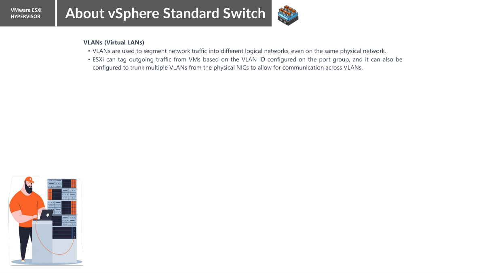

# Chapter 05 — VLANs aur Traffic Flow (Roman Urdu)

> **Aapke lab ka confirmed baseline:** `desktop-esxi9`, `vSwitch0`, `vmnic0` (screen par `10000 Full`), `Management Network` par `vmk0 = 10.0.0.10`, `VM Network` par 0 VMs aur VLAN ke saamne `--` nazar aa raha hai. Yeh `desktop-esxi8 = 10.0.0.11` se alag host hai. Jo settings abhi inspect nahin ki gayin, unhein confirmed na samjhein.

> **Hifazati ehtiyat:** Read-only inspection theek hai. Management uplink, VLAN, port group ya `vmk0` IP change karne se remote access band ho sakta hai. Changes se pehle local/VM console aur rollback plan zaroor hona chahiye.

## Is chapter mein kya seekhenge?
VM-to-VM traffic, VM se LAN traffic aur Windows desktop se ESXi management tak traffic ko trace karna; MAC forwarding, IP routing aur VLAN tagging ka farq samajhna.

## Traffic ke teen examples
**A. Ek host, same port group/VLAN:** `VM-A frame → uska vNIC → Port Group → vSwitch → VM-B ka vNIC`. Aam tor par traffic host ke andar hi rehta hai; external uplink zaroori nahin (policies aur configuration allow karni chahiye).

**B. Guest VM se external LAN:** `VM vNIC → VM Network → vSwitch0 → vmnic0 → VMware Workstation networking (agar nested ho) → external LAN`. Agar destination alag IP subnet mein hai to routing ki Demand hogi; route exactly kahan hota hai network topology par depend karega.

**C. Windows se ESXi management:** `Windows desktop → LAN → ESXi uplink → vSwitch0 → Management Network → vmk0 (10.0.0.10) → HTTPS service`.

## DNS, Switching, Routing aur VLAN mein farq
| Technology | Yeh kis sawal ka jawab deti hai? | Misal |
|---|---|---|
| DNS / hosts file | Is hostname ka IP kya hai? | `desktop-esxi9 → 10.0.0.10` (local mapping check karna baqi) |
| Layer 2 switching | Frame kis Ethernet port ko bhejna hai? | MAC address forwarding |
| Layer 3 routing | Doosre subnet ka IP kaise reach hoga? | Default gateway |
| VLAN | Traffic ka logical Layer 2 segment kaunsa hai? | VLAN 20 (sirf misal) |

## VLAN ki practical misal — Abhi apply na karein
Sochiye management network VLAN 10 par ho aur VMs VLAN 20 par. Is design mein sahi ESXi port group settings aur compatible upstream switch/VLAN configuration chahiye. Agar aap management ko unsupported VLAN mein move kar dein to Host Client unreachable ho sakta hai.

## Windows PowerShell lab
```powershell
ping 10.0.0.10
Test-NetConnection 10.0.0.10 -Port 443
tracert 10.0.0.10
```

### In commands ko kyun use karte hain?
- **`ping`** ICMP Echo Request bhejta hai; reply mila to basic reachability confirm. Timeout ka matlab hamesha offline nahin, ICMP block bhi ho sakta hai.
- **`Test-NetConnection ... -Port 443`** HTTPS port par TCP connection test karta hai. `TcpTestSucceeded: True` sirf TCP connectivity confirm karta hai, full login page nahin.
- **`tracert`** Layer-3 hops ka andaaza lagane mein madad karta hai. Normal Layer-2 physical switch ya vSwitch har hop ke tor par show nahin hota.

**Note:** Abhi ESXi9 ke liye in commands ke actual outputs collect nahin hue. Inhein expected commands samjhein, observed successful tests nahin.

## Practice / Interview sawalat
1. Kya `tracert` har vSwitch aur physical switch show karta hai?
2. Routing kab zaroori hoti hai?
3. Kya ek hi host par do VMs external uplink ke baghair communicate kar sakti hain?


---

## Teacher page 5 — VLAN aur hamara lab



Teacher ke mutabiq VLANs ek physical network par logical segmentation provide karte hain aur ESXi port group VLAN ID ki bunyaad par frames tag kar sakta hai. Unke page mein VLAN trunk ka bhi zikr hai. **Hamare stage mein VLAN tags configure nahi kiye gaye**: `SERVERS`, `VM Network`, `STORAGE` screenshots mein `None (0)` / `--` dikh raha hai.

### Conceptual packet paths

- Windows 10.0.0.213 → management 10.0.0.10 → `vmk0` → `Management Network` → `vSwitch0` → `vmnic0` (traffic flow logical sketch; exact Workstation bridge/physical hops inspect nahi hue).
- Future VM → `SERVERS` → `vSwitch0` → `vmnic0` → upstream network, agar valid connectivity configured ho.
- Storage-purpose host traffic → `vmk1 172.16.0.102` → `STORAGE` → `vSwitch1` → `vmnic1` → as-yet-unverified storage endpoint.

Aik port group ka naam `SERVERS` rakhna VLAN isolation establish nahi karta. True VLAN segregation ke liye port-group ID, Workstation nested bridging aur upstream VLAN handling compatible honi chahiye.

