# Windows Server 2025 DNS Lab — Part 1

## Scope and stopping point / Is bundle ki had

Evidence-based record of the VM creation, Windows installation, hostname change, static IPv4 setup, and successful network tests completed on October 19–20, 2026 (America/Chicago). **DNS Server role has NOT been installed.** DNS zones, records, forwarding, AD, and the other two planned VMs are future work.

Yeh notes ab tak ki completed lab ka record hain: VM creation, Windows installation, hostname, static IP aur tests. **DNS role abhi install nahi hua.** Baqi 2 VMs aur DNS configuration baad mein karenge.

## Final confirmed configuration

| Item | Value |
|---|---|
| Hypervisor | VMware Workstation Pro 25H2 on Intel Windows desktop |
| Workstation VM display name | DNS-Win2025 |
| Guest computer name | DNS01 |
| Workstation Library folder | DNS (existing; move into folder instructed, final placement unconfirmed) |
| Host files directory | `D:\VMware-Labs\DNS\DNS-Win2025` |
| Installed edition | Windows Server 2025 Standard (Desktop Experience) |
| Memory | 4096 MB / 4 GB |
| CPU | 1 processor × 2 cores = 2 vCPUs |
| Disk | 80 GB, split into multiple files; NVMe |
| Network | One adapter, NAT / VMnet8 |
| Workgroup | WORKGROUP |
| IPv4 / mask | 192.168.23.10 / 255.255.255.0 |
| Gateway | 192.168.23.2 |
| Preferred DNS (current temporary setting) | 192.168.23.2 |
| Alternate DNS | Blank |
| VMware DHCP pool | 192.168.23.128–192.168.23.254 |
| Guest DHCP | Disabled after static setup |
| DNS Server role | Not installed |

ISO supplied by the user:

```text
D:\vmware\00 Tool & Application and Operating System\Windows Server\SWDVD9_WinSrvSTDCORE2025_24H2.16_64Bit_English_DC_STD_MLF_RTMUpdJan26_X24-26760.iso
```

## How to use these notes

Extract the ZIP first. Open this Markdown file with a viewer that supports relative images; keep the screenshots folder beside it. Screenshots are originals, not reconstructed UI. Initial, incorrect, superseded, and teacher-reference screens are explicitly labeled. Do not reproduce an old setting just because it appears in an image.

ZIP extract karke Markdown kholein; screenshots folder saath rakhein. Ghalat/purani/reference screens ko label kia gaya hai. Final settings table aur corrected instructions follow karein.

## Step-by-step lab / Mukammal completed steps

### 01. Installation media

**English:** Locate the Windows Server 2025 ISO on the desktop host.

**Roman Urdu:** Desktop host par Windows Server 2025 ki ISO locate karein.


### 02. Start the VM wizard

**English:** In VMware Workstation choose File → New Virtual Machine.

**Roman Urdu:** VMware Workstation mein File → New Virtual Machine kholein.


### 03. Configuration type

**English:** Select Typical and click Next.

**Roman Urdu:** Typical select karke Next karein.


### 04. Install the OS later

**English:** Choose I will install the operating system later. This lets us configure hardware before booting.

**Roman Urdu:** I will install the operating system later select karein, taake pehle hardware configure ho.

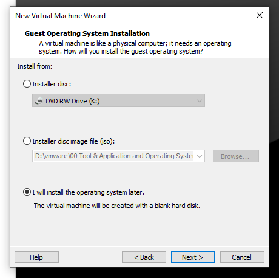

### 05. Correction: guest OS

**English:** This screenshot records an incorrect ESX selection. Do not use it for this Windows VM; use the next corrected screen.

**Roman Urdu:** Yeh ESX ki ghalat selection ka record hai. Windows VM ke liye agli corrected screen follow karein.


### 06. Correct guest OS

**English:** Choose Microsoft Windows and Windows Server 2025.

**Roman Urdu:** Microsoft Windows aur Windows Server 2025 select karein.


### 07. Name and location: initial screen

**English:** Replace the default name/location using the next screen.

**Roman Urdu:** Default naam aur location ko agli screen ke mutabiq change karein.

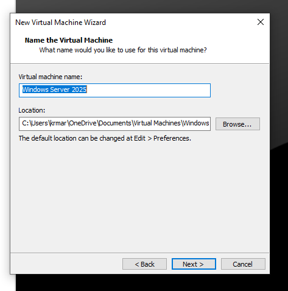

### 08. VM name and files

**English:** Name: DNS-Win2025. Location: D:\VMware-Labs\DNS\DNS-Win2025.

**Roman Urdu:** Naam DNS-Win2025 aur files ki location D:\VMware-Labs\DNS\DNS-Win2025 rakhein.

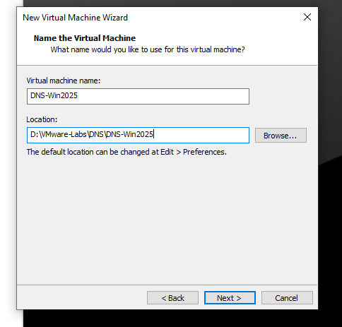

### 09. Disk: initial setting

**English:** The initial disk size was 60 GB; our final setting is 80 GB, split into multiple files.

**Roman Urdu:** Shuru mein disk 60 GB thi; final setting 80 GB aur split into multiple files hai.

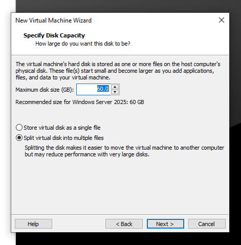

### 10. Review: disk correction needed

**English:** This earlier review still shows 60 GB. Return to the disk page and set 80 GB before finishing.

**Roman Urdu:** Is purane review mein 60 GB hai. Finish se pehle wapas ja kar 80 GB karein.

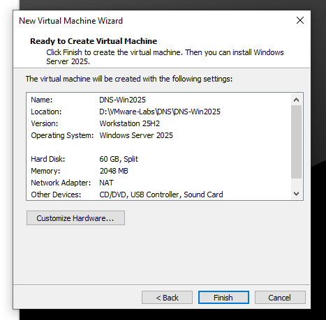

### 11. Teacher reference

**English:** Class reference only. Teacher hardware and NIC choices are not the final settings for this VM.

**Roman Urdu:** Sirf class reference: teacher ki RAM, disk aur NIC settings ko is VM ki final settings na samjhein.

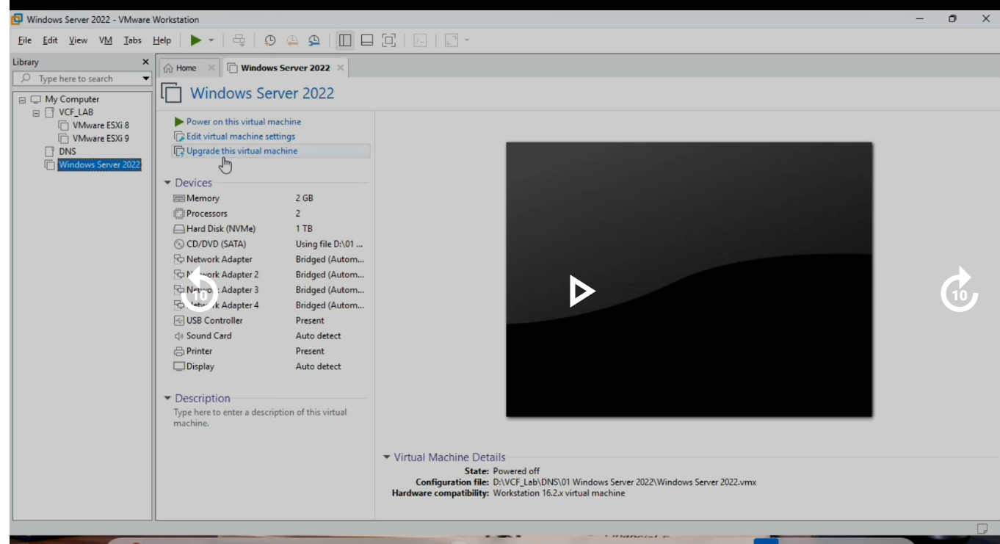

### 12. Memory

**English:** In Customize Hardware set memory to 4096 MB (4 GB). This screen records the earlier 2 GB state.

**Roman Urdu:** Customize Hardware mein RAM 4096 MB yani 4 GB karein; is screen mein pehle wali 2 GB state hai.


### 13. Processors

**English:** Set 1 processor with 2 cores: total 2 vCPUs. Leave virtualization engine checkboxes unchecked for this Windows DNS lab.

**Roman Urdu:** 1 processor aur 2 cores rakhein: total 2 vCPUs. Is Windows DNS lab mein virtualization engine checkboxes unchecked rakhein.


### 14. CD/DVD source

**English:** Select Use ISO image file rather than the physical drive.

**Roman Urdu:** CD/DVD mein Use ISO image file select karein.


### 15. Attach ISO

**English:** Browse to the ISO listed in the environment table. Enable Connect at power on.

**Roman Urdu:** Environment table wali ISO browse karein aur Connect at power on tick karein.


### 16. ISO evidence: additional view

**English:** Additional capture of the attached ISO; the full filename is recorded above.

**Roman Urdu:** Attached ISO ka mazeed screenshot; poora filename upar record hai.

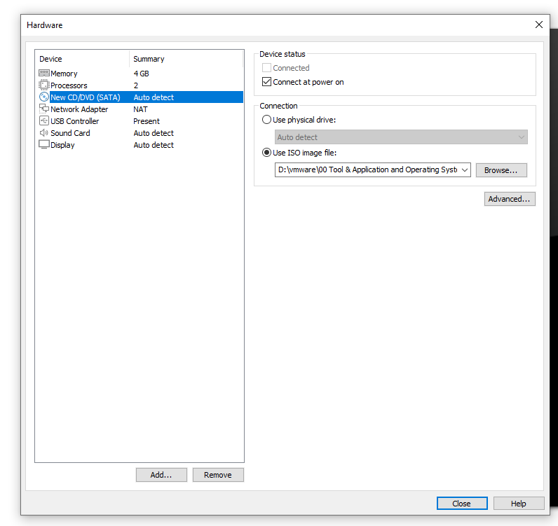

### 17. Network adapter

**English:** Select NAT for this phase. The VM uses VMware VMnet8.

**Roman Urdu:** Is phase mein NAT select karein. VM VMware VMnet8 use karegi.

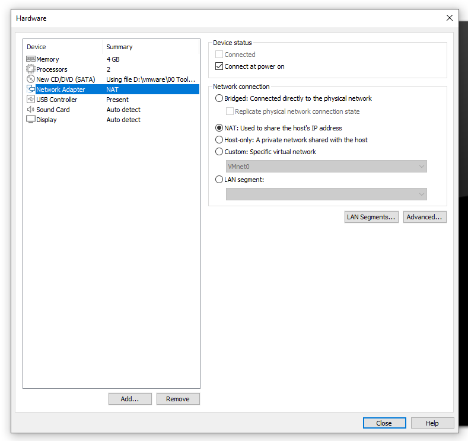

### 18. Final hardware review

**English:** Verify 4 GB RAM, 2 processor cores, and 80 GB disk before finishing.

**Roman Urdu:** Finish se pehle 4 GB RAM, 2 cores aur 80 GB disk verify karein.

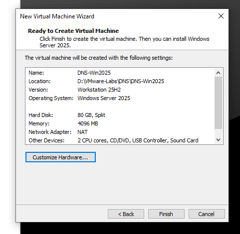

### 19. Final review: second capture

**English:** Confirm the final summary and click Finish.

**Roman Urdu:** Final summary confirm karke Finish click karein.


### 20. Superseded screenshot

**English:** User identified this upload as the wrong image. Retained in the evidence archive only; do not follow it.

**Roman Urdu:** User ne is upload ko wrong image kaha tha. Sirf archive mein hai; isay follow na karein.

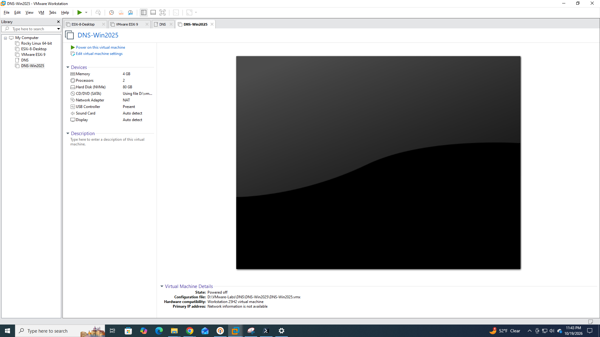

### 21. VM created

**English:** The VM has been created. Power on the VM to begin installation.

**Roman Urdu:** VM create ho gayi. Installation ke liye power on karein.


### 22. Missed ISO boot prompt

**English:** The keypress prompt was missed and boot fell through to PXE. This is a boot-selection issue, not evidence of a broken ISO.

**Roman Urdu:** Keypress prompt miss hua aur VM PXE par chali gayi. Yeh boot selection ka masla tha.


### 23. Recover through EFI Boot Manager

**English:** Select EFI VMware Virtual SATA CDROM Drive (1.0), press Enter, then promptly press Space when asked to boot from CD/DVD.

**Roman Urdu:** EFI VMware Virtual SATA CDROM Drive (1.0) select karke Enter karein; CD/DVD prompt par foran Space dabayein.


### 24. Windows Setup boot entry

**English:** At Windows Setup [EMS Enabled], press Enter.

**Roman Urdu:** Windows Setup [EMS Enabled] par Enter dabayein.

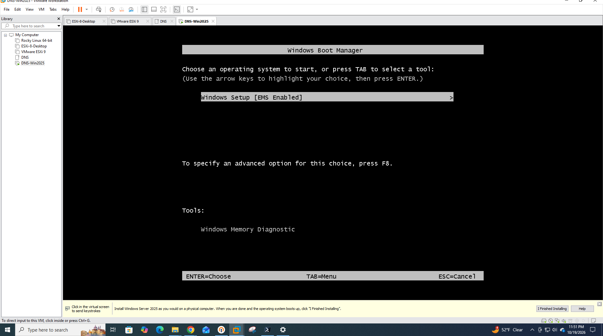

### 25. Language and regional format

**English:** Keep English (United States) for language and time/currency, then Next.

**Roman Urdu:** Language aur time/currency English (United States) rehne dein aur Next karein.


### 26. Keyboard

**English:** Keep US keyboard and click Next.

**Roman Urdu:** US keyboard rehne dein aur Next karein.

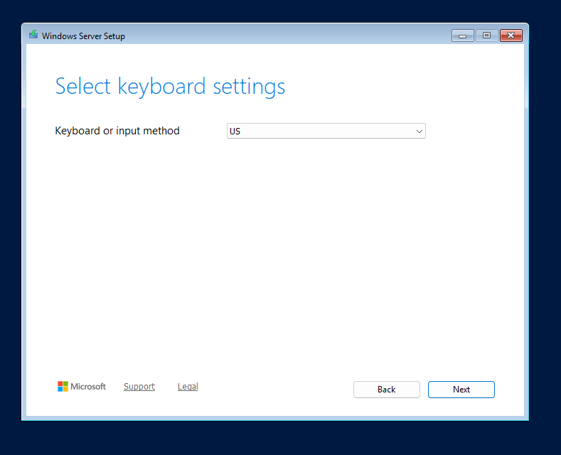

### 27. Installation option

**English:** Select Install Windows Server and acknowledge deletion for the new blank VM disk, then Next.

**Roman Urdu:** Install Windows Server select karein aur new blank VM disk ke deletion acknowledgment ko tick karke Next karein.


### 28. Select edition

**English:** Choose Windows Server 2025 Standard (Desktop Experience), the second option. Plain Standard is Server Core.

**Roman Urdu:** Doosra option Windows Server 2025 Standard (Desktop Experience) select karein. Sirf Standard wala option Server Core hai.

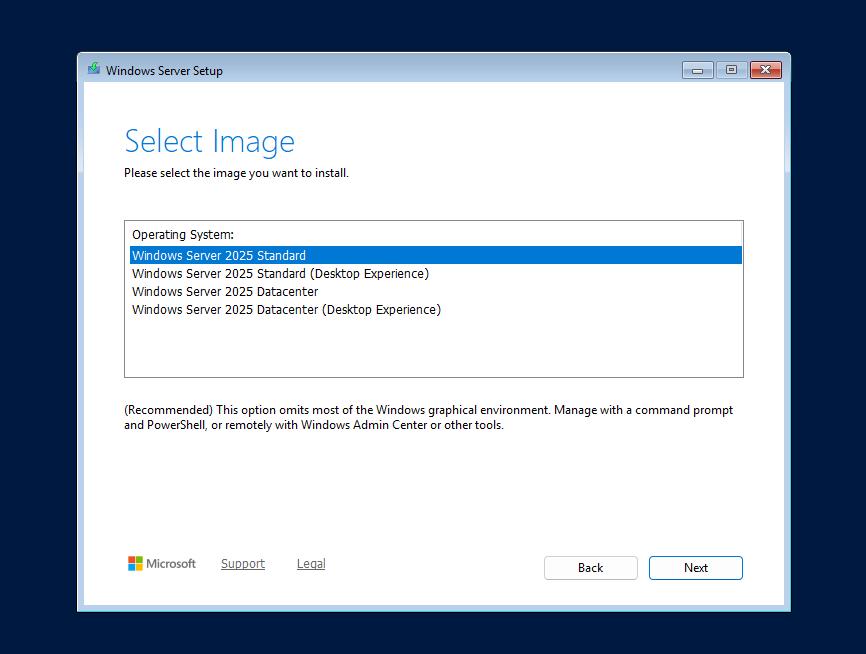

### 29. License terms

**English:** Read the terms and click Accept to proceed if you agree.

**Roman Urdu:** Terms parhein aur razamandi par Accept click karein.

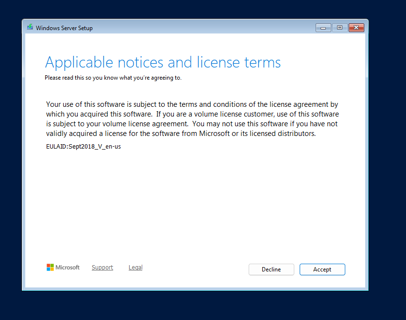

### 30. Installation disk

**English:** Select Disk 0 Unallocated Space, 80.0 GB. Click Next; Setup creates the required partitions.

**Roman Urdu:** Disk 0 Unallocated Space, 80.0 GB select karke Next karein; Setup zaroori partitions bana dega.

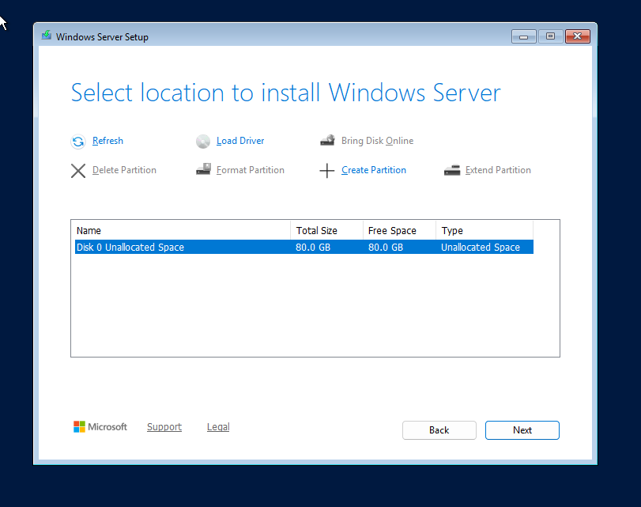

### 31. Ready to install

**English:** Verify Standard (Desktop Experience) and Keep nothing. Click Install. Allow automatic restarts. On subsequent CD/DVD boot prompts do not press a key.

**Roman Urdu:** Standard (Desktop Experience) aur Keep nothing verify karke Install karein. Automatic restarts hone dein; dobara CD/DVD prompt aaye to key na dabayein.

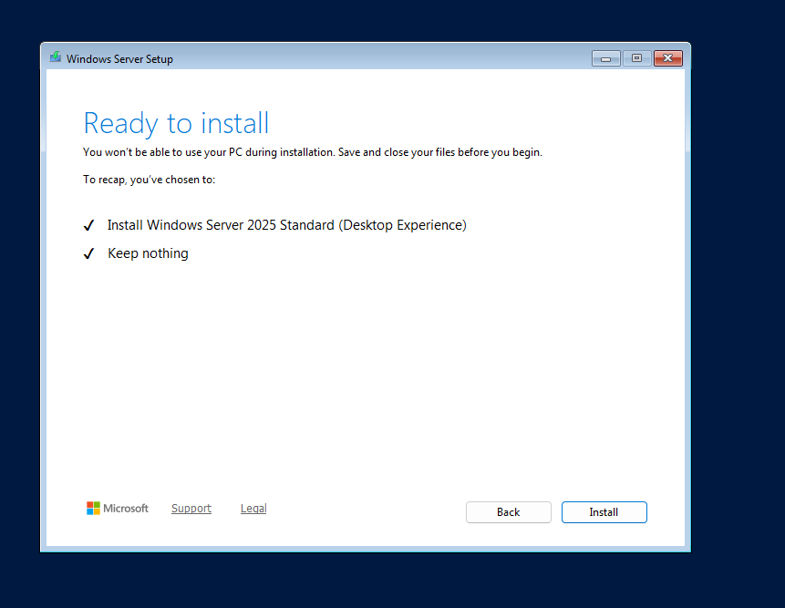

### 32. Workstation Library organization

**English:** DNS is a Library folder; DNS-Win2025 is the VM. The earlier assistant interpretation of the folder icon was incorrect.

**Roman Urdu:** DNS Library ka folder hai aur DNS-Win2025 VM hai. Pehle folder icon ko VM samajhna ghalat tha.


### 33. Folder menu and grouping

**English:** An existing DNS folder was confirmed by the user. Close the menu with Esc; drag DNS-Win2025 onto DNS to group it. Completion was instructed but not confirmed by a later folder screenshot.

**Roman Urdu:** User ne existing DNS folder confirm kia. Esc se menu band karke DNS-Win2025 ko DNS par drag karein. Grouping ka final screenshot abhi confirm nahi hua.


### 34. Administrator password

**English:** Enter and confirm your own Administrator password; click Finish. Do not record the password in study notes.

**Roman Urdu:** Apna Administrator password dono fields mein likhein aur Finish karein. Password study notes mein na likhein.


### 35. First sign-in

**English:** Click inside the VM and press Ctrl+Alt+Insert to send Ctrl+Alt+Delete to the guest. Sign in as Administrator.

**Roman Urdu:** VM mein click karke Ctrl+Alt+Insert dabayein; guest ko Ctrl+Alt+Delete milega. Administrator se login karein.

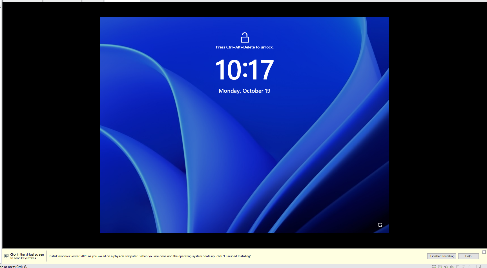

### 36. Diagnostic data

**English:** Select Required only, then Accept.

**Roman Urdu:** Required only select karke Accept karein.

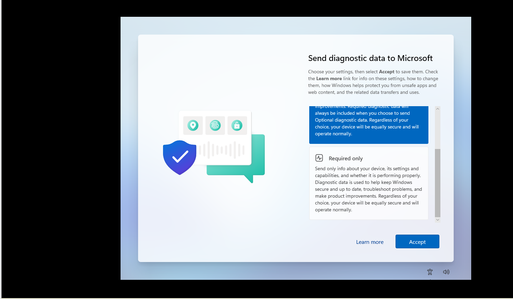

### 37. Server Manager

**English:** Dismiss the Windows Admin Center/Azure Arc informational popup; optionally tick Do not show again. Open Local Server.

**Roman Urdu:** Windows Admin Center/Azure Arc popup band karein; chahein to Do not show again tick karein. Local Server kholein.


### 38. Inspect initial server state

**English:** The server is in WORKGROUP; Ethernet0 uses DHCP. Click the blue computer-name link.

**Roman Urdu:** Server WORKGROUP mein hai aur Ethernet0 DHCP use kar raha hai. Blue computer name par click karein.

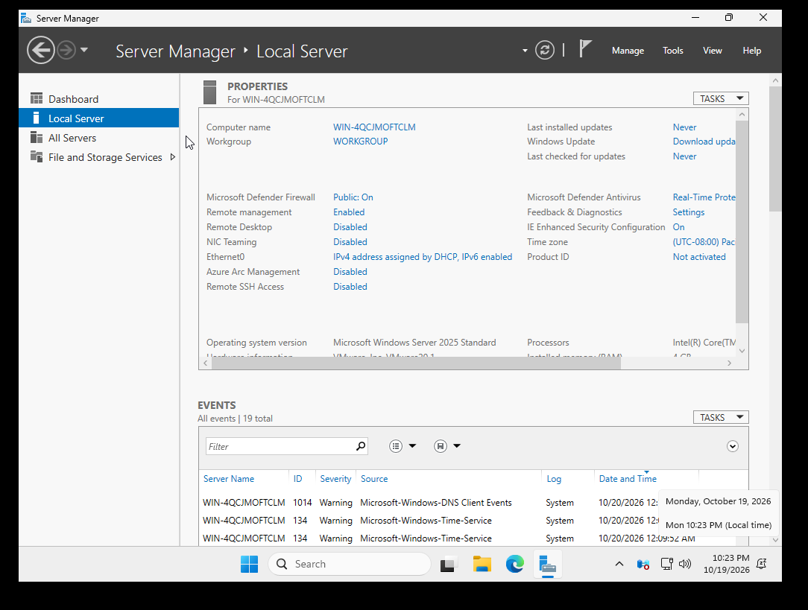

### 39. Open rename dialog

**English:** In System Properties → Computer Name, click Change. Leave Computer description blank.

**Roman Urdu:** System Properties → Computer Name mein Change click karein. Description blank rehne dein.


### 40. Set hostname

**English:** Replace the generated computer name with DNS01. Keep Workgroup: WORKGROUP and click OK.

**Roman Urdu:** Generated computer name ki jagah DNS01 likhein. Workgroup WORKGROUP rehne dein aur OK karein.


### 41. Restart for rename

**English:** Acknowledge restart, close System Properties, and choose Restart Now. Sign in again.

**Roman Urdu:** Restart message par OK karein, System Properties close karein aur Restart Now karein. Dobara login karein.

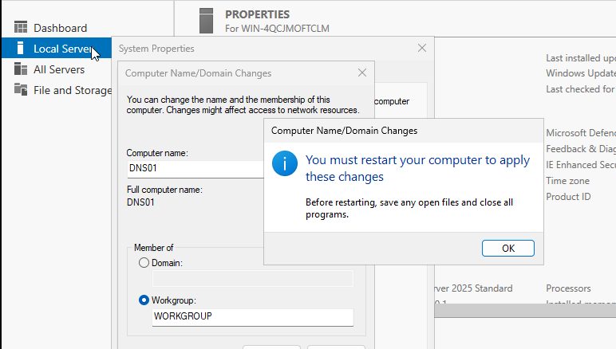

### 42. Verify hostname

**English:** Local Server now shows DNS01. Open CMD and run ipconfig /all.

**Roman Urdu:** Local Server mein DNS01 confirm hai. CMD khol kar ipconfig /all chalayein.


### 43. DHCP baseline

**English:** Observed IP 192.168.23.128/24, gateway and DNS 192.168.23.2, DHCP server 192.168.23.254.

**Roman Urdu:** Pehla IP 192.168.23.128/24, gateway/DNS 192.168.23.2 aur DHCP server 192.168.23.254 tha.

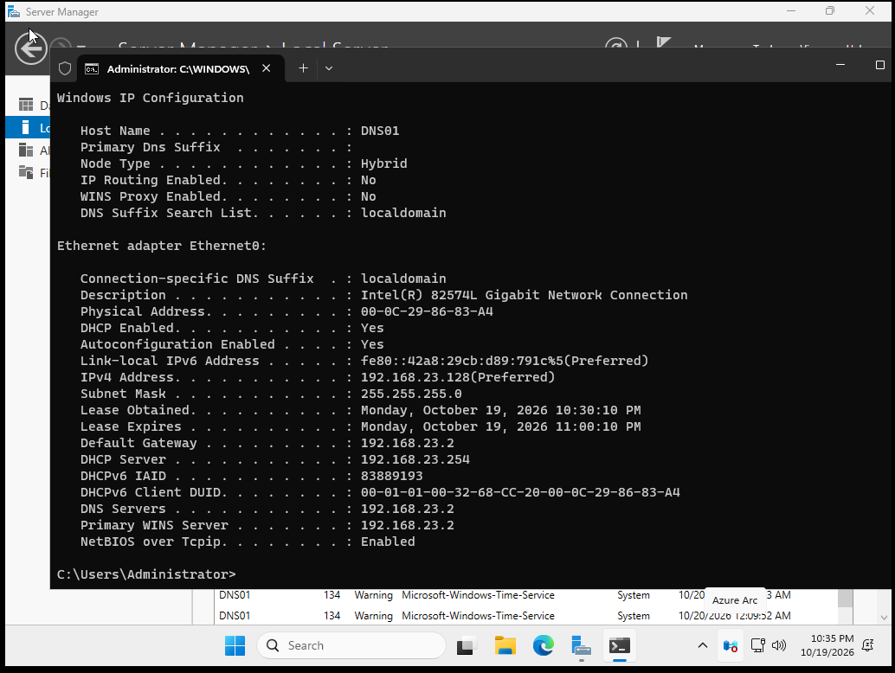

### 44. Inspect VMnet8

**English:** Release input with Ctrl+Alt. Open Edit → Virtual Network Editor. Select VMnet8 (NAT), then DHCP Settings. Do not change the VMware network.

**Roman Urdu:** Ctrl+Alt se input release karein. Edit → Virtual Network Editor mein VMnet8 (NAT) select karke DHCP Settings kholein. VMware network change na karein.

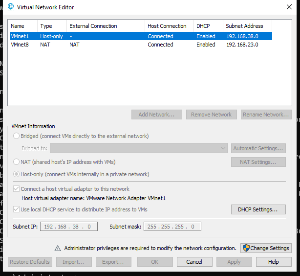

### 45. Record DHCP pool

**English:** VMnet8 subnet is 192.168.23.0/24; pool is 192.168.23.128–192.168.23.254. Plan 192.168.23.10 outside the pool. Outside-pool does not itself guarantee an address is unused by another static VM.

**Roman Urdu:** VMnet8 subnet 192.168.23.0/24 aur DHCP range .128 se .254 hai. .10 pool se bahar choose kia. Pool se bahar hone se doosri static VM par unused hona guarantee nahi hota.


### 46. Network Connections

**English:** Close VMware network dialogs with Cancel. Inside DNS01 run ncpa.cpl. Right-click Ethernet0 → Properties.

**Roman Urdu:** VMware network dialogs Cancel se band karein. DNS01 ke andar ncpa.cpl chalayein. Ethernet0 par right-click → Properties karein.


### 47. IPv4 Properties

**English:** Select Internet Protocol Version 4 (TCP/IPv4) → Properties. Choose manual IP and manual DNS.

**Roman Urdu:** Internet Protocol Version 4 (TCP/IPv4) → Properties kholein aur manual IP/DNS select karein.


### 48. Catch the IP typo

**English:** This screen has 192.168.231.10, which is wrong for this /24 network. Correct the third octet from 231 to 23. Set mask 255.255.255.0, gateway 192.168.23.2, preferred DNS 192.168.23.2; alternate DNS blank. Click OK → Close.

**Roman Urdu:** Is screen par 192.168.231.10 ghalat hai. Teesra octet 231 se 23 karein. Mask 255.255.255.0, gateway aur preferred DNS 192.168.23.2 rakhein; alternate blank. OK → Close karein.

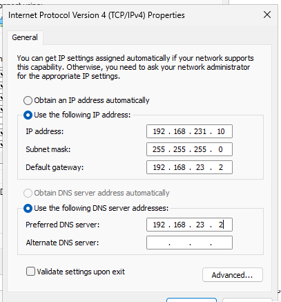

### 49. Verify static configuration

**English:** Run ipconfig /all: DNS01, DHCP Enabled: No, IPv4 192.168.23.10 (Preferred), /24 mask, gateway/DNS .2.

**Roman Urdu:** ipconfig /all se DNS01, DHCP Enabled: No, IP 192.168.23.10 (Preferred), /24 mask aur gateway/DNS .2 verify hua.

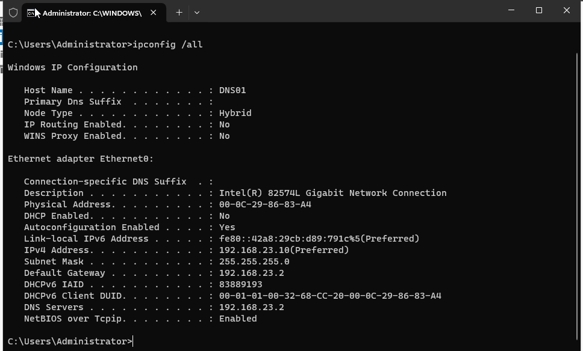

### 50. Connectivity and name resolution

**English:** Run ping 192.168.23.2 and nslookup microsoft.com. The capture shows 3 ping replies, 0% loss, then Ctrl+C; lookup returned IPv4/IPv6 answers. Server: Unknown means the resolver name was not obtained, while this query still succeeded.

**Roman Urdu:** ping 192.168.23.2 aur nslookup microsoft.com chalayein. Screenshot mein 3 replies aur 0% loss ke baad Ctrl+C hai. Lookup ne IPv4/IPv6 answers diye. Server: Unknown ke bawajood query successful hui.

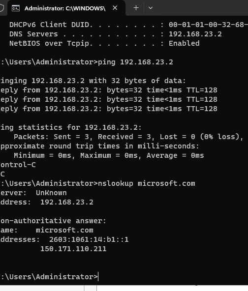

## Commands used and their purpose

```cmd
ipconfig /all
ping 192.168.23.2
nslookup microsoft.com
```

| Command / shortcut | Purpose / Maqsad |
|---|---|
| `ipconfig /all` | Inspect hostname, DHCP, IP, mask, gateway and DNS / tamam network details |
| `ncpa.cpl` | Open Network Connections / network adapters ki window |
| `ping 192.168.23.2` | Test the NAT gateway using ICMP / gateway tak connectivity |
| `nslookup microsoft.com` | Ask the configured DNS resolver for name resolution / naam se IP hasil karna |
| Ctrl+Alt | Release VMware keyboard/mouse capture / mouse host par wapas |
| Ctrl+Alt+Insert | Send secure attention sequence to guest / VM ki login screen unlock |

## Concepts to remember / Yaad rakhne wali baatein

- **VM display name vs hostname:** DNS-Win2025 identifies the VM in Workstation; DNS01 identifies Windows inside the VM. They can differ. / Workstation ka naam aur Windows ka computer name alag ho sakte hain.
- **Library folder vs disk folder:** Library DNS groups VM entries; the D: folder holds VM files. Dragging an entry into a Library folder is organization, not a disk-file migration. / Library folder grouping karta hai, D: folder files store karta hai.
- **NAT:** This VM uses private VMnet8 addressing and the host's NAT service for outbound access. The .2 gateway is VMware's gateway here, not the home router 10.0.0.1. / Is network mein .2 VMware gateway hai.
- **Static IP:** A manually assigned stable address. DNS servers need a predictable address for clients. / DNS clients ke liye server ka stable IP zaroori hai.
- **DHCP pool:** The range dynamically offered to guests. We selected .10 outside that range and observed it as Preferred after applying. / DHCP pool se bahar .10 choose kia aur apply ke baad Preferred verify hua.
- **Subnet:** With 255.255.255.0, 192.168.23.10 and .2 share a subnet; 192.168.231.10 does not. / Teesray octet ki typo ne network badal dia tha.
- **DNS client vs DNS server:** The guest can resolve names using VMware DNS without having the Windows DNS Server role. / Naam resolve hona DNS Server role install hone ka saboot nahi.
- **Desktop Experience vs Core:** Desktop Experience supplies the GUI used in this lab. / Is lab ki graphical windows Desktop Experience ki wajah se hain.
- **Tests prove limited things:** Gateway replies confirm gateway reachability; the lookup confirms that query succeeded. They do not prove all internet services or future DNS zones work. / Har test apni specific cheez verify karta hai.

## Troubleshooting record

| Symptom | Cause / finding | Resolution |
|---|---|---|
| PXE boot after power-on | Missed CD/DVD keypress | EFI Boot Manager → SATA CDROM → key at prompt |
| First edition selected had no desktop | Plain Standard is Core | Selected Standard (Desktop Experience) |
| Disk showed 60 GB | Earlier wizard value | Corrected to 80 GB before creation |
| IP entered as 192.168.231.10 | Third-octet typo | Changed to 192.168.23.10 |
| nslookup says Server: Unknown | Resolver name not obtained | Query still returned answers; no failure inferred |
| DNS folder mistaken for VM | Icon interpretation error | User confirmed folder; no duplicate folder needed |

## Completion checklist

- [x] VM created and Windows installed.
- [x] Administrator sign-in successful.
- [x] Hostname DNS01 applied after restart.
- [x] Static IP 192.168.23.10/24 verified; DHCP No.
- [x] Gateway .2 reachable, 0% loss in captured test.
- [x] microsoft.com lookup succeeded through .2.
- [ ] Verify final placement of VM under Library DNS folder.
- [ ] Install/verify VMware Tools (not evidenced in this session).
- [ ] Review guest time zone (screens showed Pacific; Chicago uses Central).
- [ ] Install Windows DNS Server role and management tools.
- [ ] Configure and test zones/records and forwarding according to class topology.
- [ ] Create remaining two VMs after confirming their class roles.

## Where to resume / Agla starting point

Power on DNS-Win2025 and sign in as Administrator. Open **Server Manager → Manage → Add Roles and Features** and share the first wizard screen. We will continue one screen at a time. Keep current preferred DNS 192.168.23.2 until the DNS service and its intended resolution path are ready; later configuration will be documented in Part 2. No domain join or AD promotion has been performed.

DNS-Win2025 power on karke Administrator se login karein. **Server Manager → Manage → Add Roles and Features** kholein aur screenshot bhejein. Abhi preferred DNS .2 hi hai. DNS role aur configuration Part 2 mein karenge. Domain join ya AD promotion abhi nahi hua.

## Evidence and privacy

All 50 Windows-lab screenshots shared from 04:05:34 through 05:54:46 UTC are preserved, including the teacher reference and the image explicitly marked wrong. The notes distinguish those from final evidence. Earlier ESXi/RDP screenshots belong to separate labs and are not included. Password text is not recorded; the password-entry screenshot contains masked fields. Review host paths and network details before publishing publicly.
