# DNS01 — Primary DNS Server Configuration

## Concept overview

A primary DNS zone is the writable, authoritative source of DNS records. It provides the original data used to resolve names and supply secondary copies. In this lab, DNS01 stores VCPLAB.Com and the reverse zone; A, PTR and CNAME records are maintained here, and DNS02 receives copies through zone transfers.


Step-by-step lab record • 21 October 2026

Scope: standard primary DNS zone, reverse zone, A/PTR records, CNAME and verification. DNS02 secondary and DNS03 stub configuration will be separate.

## Lab settings

| Server | IP | Planned zone role |
| --- | --- | --- |
| DNS01 | 192.168.0.121 | Primary — configured |
| DNS02 | 192.168.0.122 | Secondary — verified |
| DNS03 | 192.168.0.123 | Stub — verified |

Network: VMnet2 host-only, 192.168.0.0/24; gateway blank. Zone: VCPLAB.Com. DNS01 remains a workgroup server in this workflow; DNS suffix configuration is separate from domain joining.

## Terms to remember

| Term | Meaning |
| --- | --- |
| Primary zone | Writable authoritative copy |
| A | Host name to IPv4 address |
| PTR | IP address to DNS name in a reverse zone |
| CNAME | Alias name to canonical DNS name |
| NS | Authoritative name server for the zone |
| SOA | Zone authority, serial and refresh metadata |
| Zone transfer | Copies zone data to another DNS server |

## 1. Open DNS Manager

Server Manager → Tools → DNS. Alternatively, press Win + R, enter `dnsmgmt.msc`, and press Enter. Expand DNS01 → Forward Lookup Zones. The zone list was initially empty.

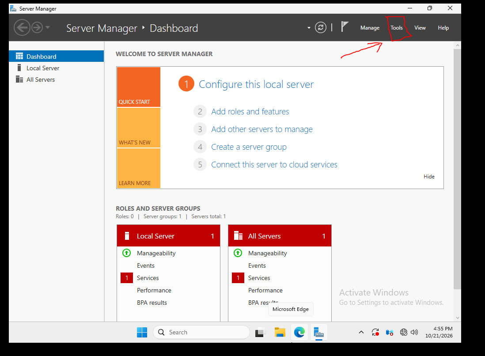


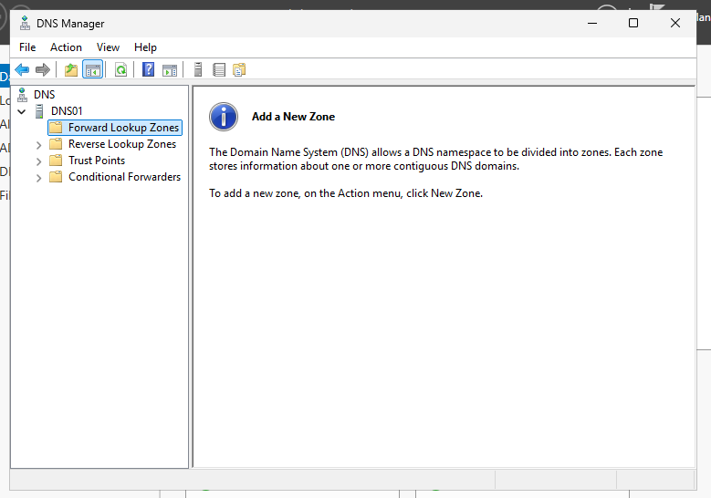

## 2. Create the standard primary forward zone

Right-click Forward Lookup Zones → New Zone → Next. Select Primary zone. Leave Store the zone in Active Directory unchecked (unavailable in this lab). Enter zone name **VCPLAB.Com**. Choose Create a new file with this file name: **VCPLAB.Com.dns**. Select **Allow both nonsecure and secure dynamic updates** to match the isolated classroom lab. This accepts unauthenticated updates; it is a lab choice, not a secure production default. Review Standard Primary / Forward / VCPLAB.Com.dns, then click Finish.


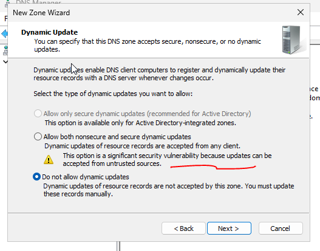


## 3. Inspect the zone and zone file

Select VCPLAB.Com. The screenshots show SOA, NS pointing to dns01.vcplab.com, and a dns01 A record pointing to 192.168.0.121. Forward Lookup Zones shows Standard Primary and Running. Win + E opens File Explorer; browse to C:\Windows\System32\dns. VCPLAB.Com.dns appears after zone creation. Before creation it was absent. Manage records in DNS Manager for this lab.

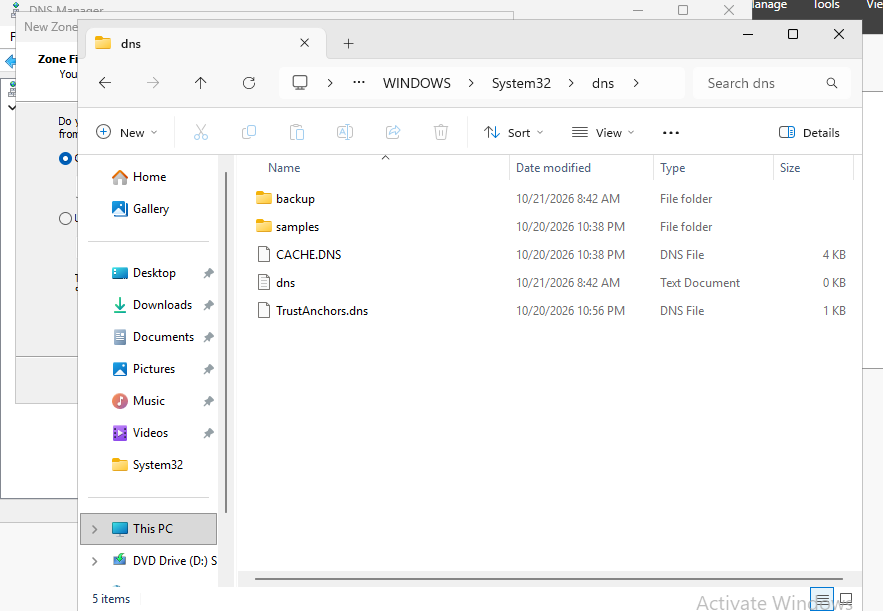

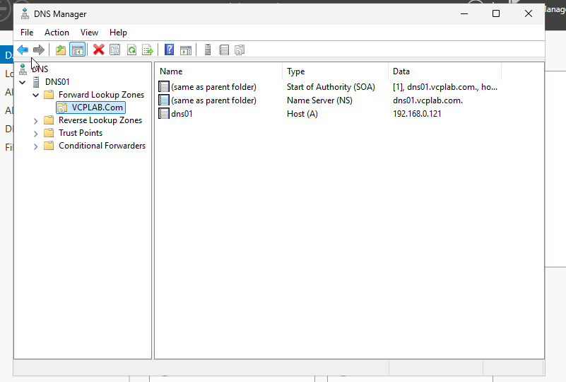


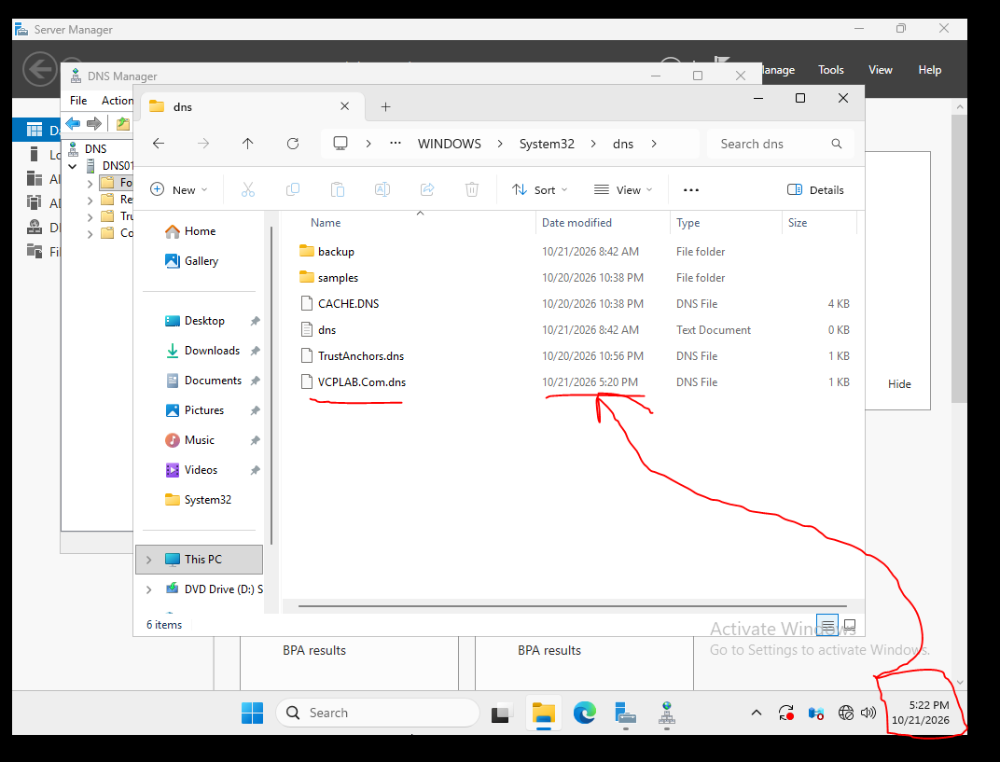

## 4. Create the IPv4 reverse zone and DNS01 PTR

The next 12 screenshots are **teacher references**, not captures of your machine. You reported following them on DNS01. Right-click Reverse Lookup Zones → New Zone → Next → Primary zone → IPv4 Reverse Lookup Zone. Enter Network ID **192.168.0** for the /24 lab network. The reverse zone becomes **0.168.192.in-addr.arpa**. Keep new file **0.168.192.in-addr.arpa.dns**. Follow the classroom dynamic-update choice, review and Finish. Open VCPLAB.Com → dns01 A record → Properties → check Update associated pointer (PTR) record → Apply / OK. Refresh the reverse zone. The desired mapping in your lab is 192.168.0.121 → dns01.vcplab.com. Teacher hostnames shown in these images must be replaced with your DNS01 naming.

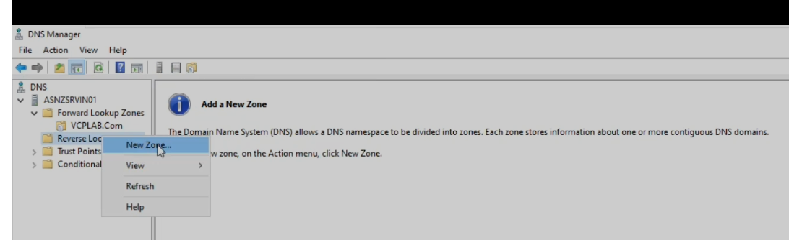


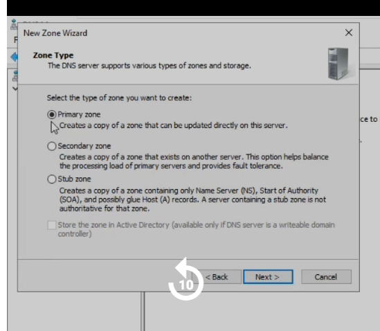

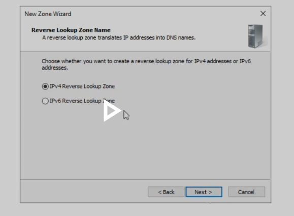


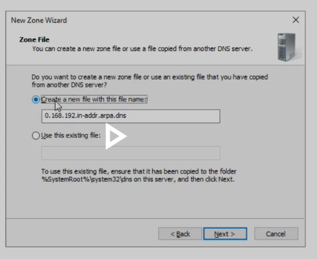


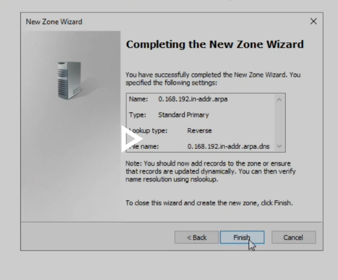

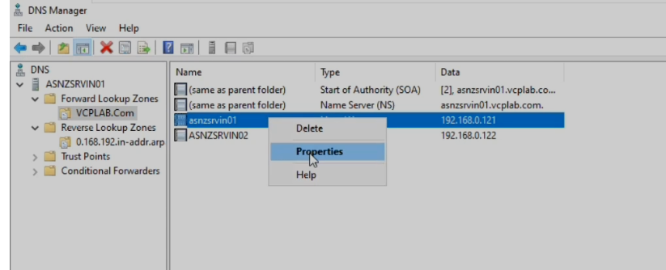

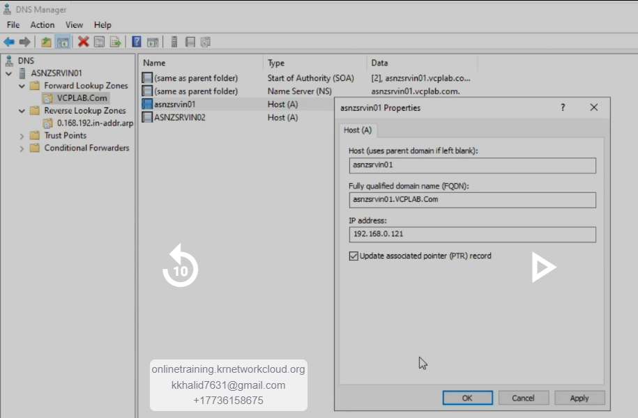


## 5. Verify DNS01 and understand the initial errors

Run `nslookup dns01.vcplab.com. 192.168.0.121`. An early test returned Non-existent domain. A later exact-name test with the final dot returned 192.168.0.121 but still displayed an initial timeout and Server: Unknown. After your PTR work, your screenshot shows DNS01.vcplab.com as the server and the correct answer without a timeout. A missing PTR can explain an unknown server name; it does not by itself prove the cause of every timeout or NXDOMAIN. Internet is not needed for these local queries. The final dot makes the query name absolute.


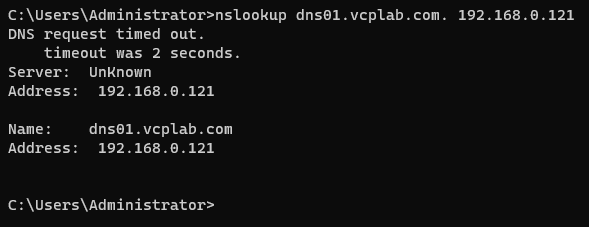


## 6. Add DNS02 and DNS03 host records on DNS01

In DNS01 → Forward Lookup Zones → VCPLAB.Com, right-click → New Host (A or AAAA). Enter DNS02 / 192.168.0.122 and check Create associated pointer (PTR) record. Add Host → OK. Repeat for DNS03 / 192.168.0.123 → Add Host → OK → Done. One screenshot contained **19.168.0.123**, which was corrected to **192.168.0.123** before the verified final list. Adding these records does not create a secondary or stub zone on the other machines.

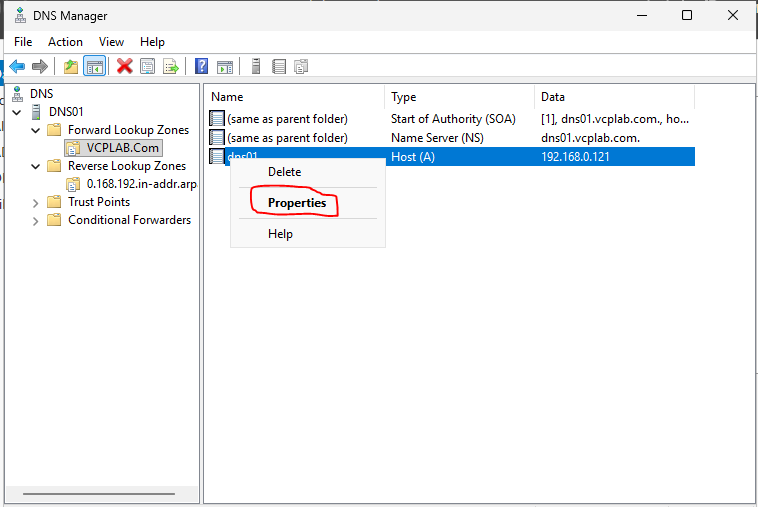

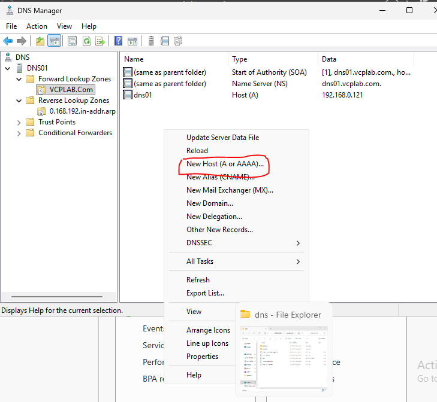

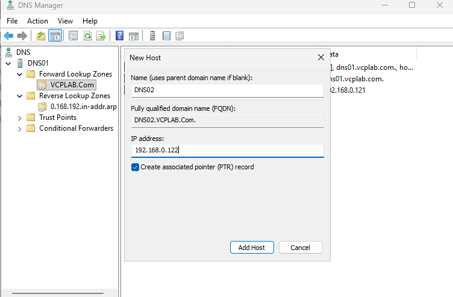


## 7. Refresh and remove redundant PTR entries

Refresh the reverse zone before assuming a PTR is missing. An earlier view did not show DNS02; a refreshed view showed DNS02 and DNS03 twice, with target names differing only in capitalization. Remove one redundant entry for each IP while retaining one correct PTR. The final screenshot confirms one PTR each for .121, .122 and .123. DNS names are case-insensitive, so either capitalization is valid. Do not add another PTR when the correct one already exists.

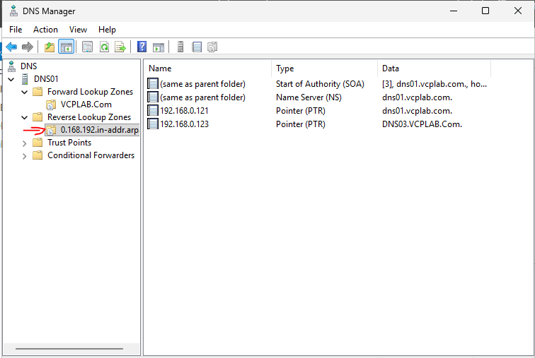

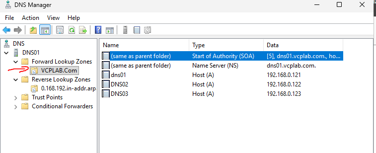


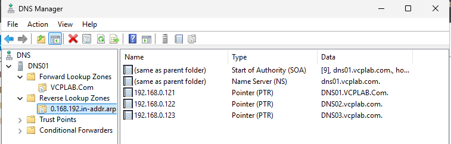

## 8. Create the DNS CNAME alias

In VCPLAB.Com, right-click → New Alias (CNAME). Enter alias name **DNS**. Click Browse → DNS01 → Forward Lookup Zones → VCPLAB.Com → select dns01 → OK, then OK to create the alias. The final record is **dns.vcplab.com → dns01.vcplab.com**. A CNAME stores a target DNS name, not an IP. The target A record supplies 192.168.0.121.

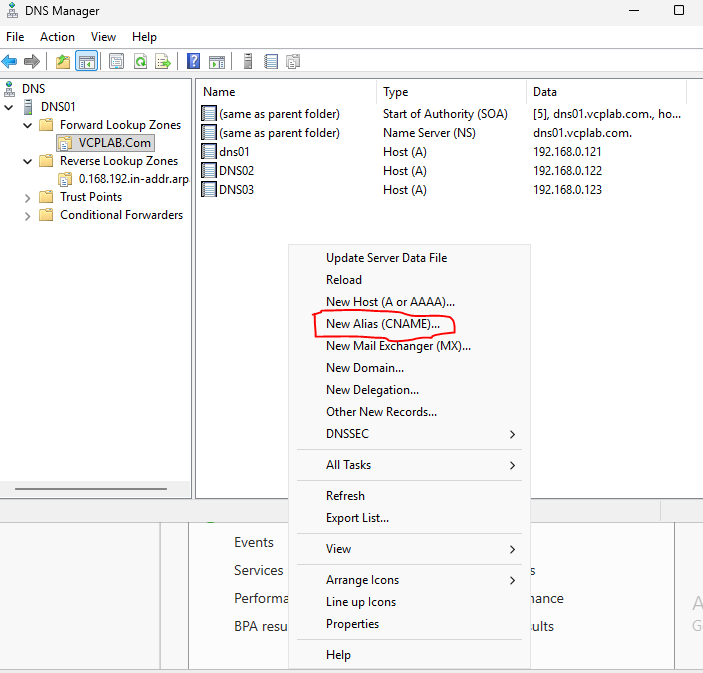

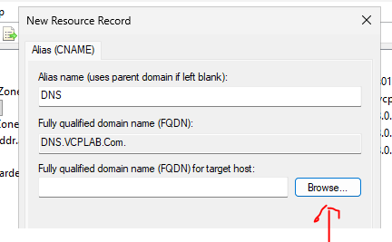

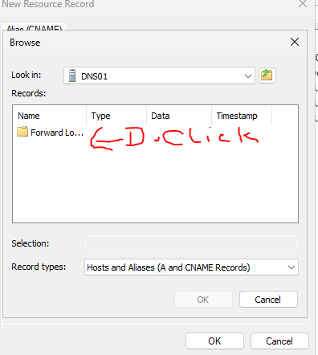


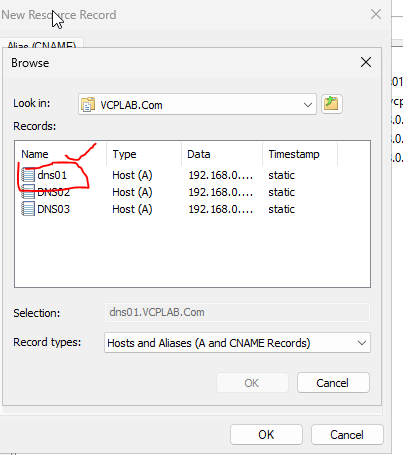


## 9. Verify the alias and host records

Run **nslookup dns.vcplab.com. 192.168.0.121**. Your final output shows Name dns01.vcplab.com, Address 192.168.0.121, Aliases dns.vcplab.com. Earlier commands queried dns01 or the zone name vcplab.com and therefore did not test the alias. Separate tests through DNS01 verified dns02 → 192.168.0.122 and 192.168.0.122 → DNS02.vcplab.com. These prove records on DNS01, not that DNS02 is serving the zone.

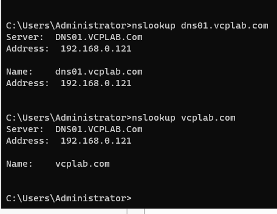

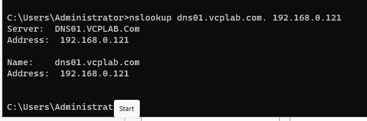

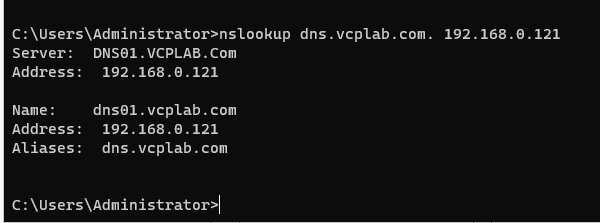

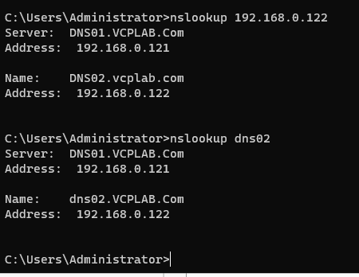

## 10. Continue with secondary DNS

The earlier incomplete transfer setup is superseded by the completed procedure in ../02_Secondary_DNS. DNS02 and DNS03 lookup verification succeeded later in the lab. DNS01 was subsequently signed and unsigned for the DNSSEC exercise; its final forward zone is unsigned. See Chapter 05.

## Repeat these verification commands

```powershell
nslookup dns01.vcplab.com. 192.168.0.121
nslookup dns02.vcplab.com. 192.168.0.121
nslookup dns03.vcplab.com. 192.168.0.121
nslookup 192.168.0.121 192.168.0.121
nslookup 192.168.0.122 192.168.0.121
nslookup 192.168.0.123 192.168.0.121
nslookup dns.vcplab.com. 192.168.0.121
```

Expected A answers: .121 / .122 / .123 respectively. Expected PTR targets: DNS01 / DNS02 / DNS03 in VCPLAB.Com. Expected alias target: DNS01, .121. These commands form a repeat checklist; screenshots do not document every command above being run.


## Current lab checkpoint / Maujooda halat

DNS01 primary, DNS02 secondary, and DNS03 stub all returned successful lab lookups. KRNC.org conditional forwarding is configured but not resolution-tested. VCPLAB.Com was signed, then unsigned; no trust-anchor import or DNSSEC validation test was shown.
