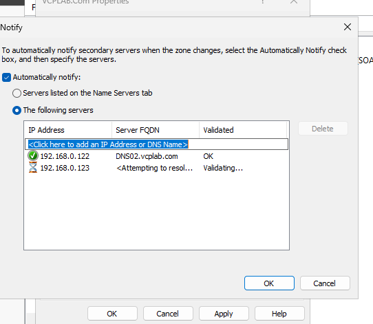
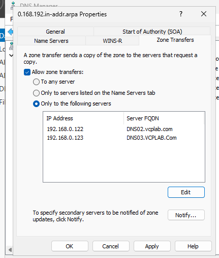
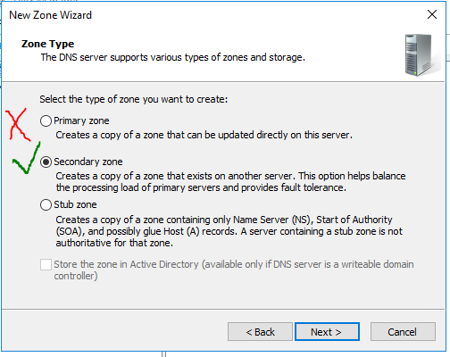
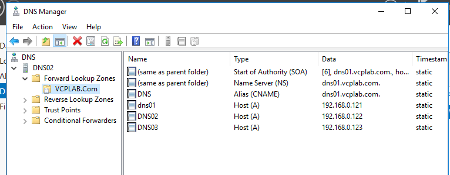
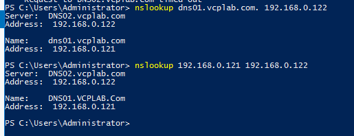

# DNS02 — Secondary DNS lab

## Lab values

| Server | Address | Role |
| --- | --- | --- |
| DNS01 | 192.168.0.121 | Standard primary |
| DNS02 | 192.168.0.122 | Secondary |
| DNS03 | 192.168.0.123 | Stub / resolving server |

VMnet2 host-only: 192.168.0.0/24. Forward zone: VCPLAB.Com. Reverse zone: 0.168.192.in-addr.arpa. Internet is unnecessary for these local lookups. A DNS suffix does not join a computer to an AD domain. This lab uses file-backed zones, not AD-integrated zones.

## What and why

A secondary zone is a full, read-only authoritative copy obtained by zone transfer. Edit records on DNS01; DNS02 receives changes. Forward and reverse zones are separate and require separate setup.

## 1. Check the records on DNS01

Confirm A records DNS01=.121, DNS02=.122, DNS03=.123, the DNS alias pointing to dns01.vcplab.com, and the three PTR records. The primary chapter covers creating these records.

## 2. Authorize transfers on DNS01

1. Open DNS Manager → DNS01 → Forward Lookup Zones.
2. Right-click VCPLAB.Com → Properties → Zone Transfers.
3. Check Allow zone transfers; choose Only to the following servers.
4. Enter 192.168.0.122 and 192.168.0.123; commit each address.
5. Click Notify. Enable automatic notification; select the following servers and add both addresses.
6. Confirm with OK → Apply → OK.
7. Repeat transfer authorization for reverse zone 0.168.192.in-addr.arpa.
8. Configure reverse-zone Notify similarly if following the teacher's notification setup. Its Notify dialog was not captured.

DNS01's own .121 address is unnecessary in its outgoing transfer destination list. On DNS02, .121 WILL be the master address. Notify prompts a secondary to check for changes; it is not proof that a transfer completed. The .123 entry was included to match the classroom configuration; a stub does not receive a full secondary copy.

## 3. Create the forward secondary zone on DNS02

1. Expand DNS02 → right-click Forward Lookup Zones → New Zone.
2. Next → Secondary zone → Next.
3. Enter VCPLAB.Com exactly.
4. Add master DNS server 192.168.0.121; confirm validation OK.
5. Next → Finish. Refresh and open the zone.
6. Confirm SOA, NS, three A records and the DNS CNAME appear.

## 4. Create the reverse secondary zone

1. DNS02 → Reverse Lookup Zones → New Zone.
2. Select Secondary zone, then IPv4.
3. Enter Network ID 192.168.0, producing 0.168.192.in-addr.arpa. If the wizard asks directly for the zone name, enter that complete reverse-zone name.
4. Use master 192.168.0.121 → Next → Finish → Refresh.
5. Confirm PTR records .121, .122 and .123 appear. Intermediate reverse-wizard pages were not captured; the resulting records were.

## 5. Verify directly against DNS02

```powershell
nslookup dns01.vcplab.com. 192.168.0.122
nslookup 192.168.0.121 192.168.0.122
```

Both succeeded in screenshot 033333: the responding server is DNS02 at .122; the results are DNS01 and .121. This verifies forward and reverse service from DNS02, not a failure/recovery scenario.

## Troubleshooting

If no records arrive, check exact zone name, master .121, primary transfer permissions for .122, network reachability, DNS service and TCP 53. DNS queries also use UDP 53. Refresh the console or request Transfer from Master from the secondary-zone context menu. Compare SOA serials when diagnosing stale data. Keep edits on the primary.


## Screenshot walkthrough

Follow the numbered procedure above; these images preserve the captured stages. Missing wizard pages are not evidence of the exact settings chosen.

## 025824 — DNS01 forward-zone Properties


## 030026 — Zone Transfers selection


## 030452 — Transfer destination editing; validation incomplete


## 030512 — Both destination addresses


## 030616 — Notify button


## 030802 — Notify validation in progress



## 030924 — Notify destinations validate OK


## 031013 — Forward settings before Apply


## 031343 — Reverse-zone transfer destinations



## 031455 — Primary PTR records


## 031518 — Primary forward records


## 031936 — DNS02 New Zone


## 032017 — Wizard welcome


## 032134 — Secondary selected



## 032222 — Forward zone name


## 032410 — DNS01 master validated


## 032454 — Forward secondary summary


## 032546 — Forward records transferred



## 032756 — Reverse PTR records transferred


## 033333 — Forward and reverse queries pass against DNS02


