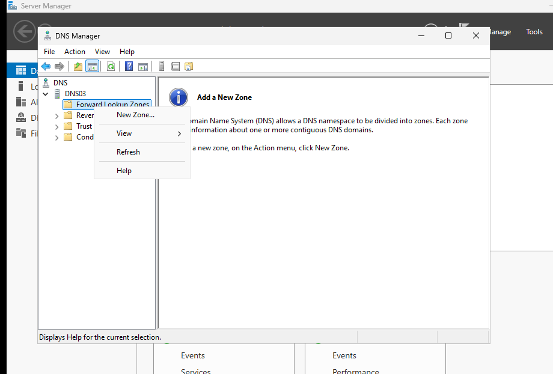
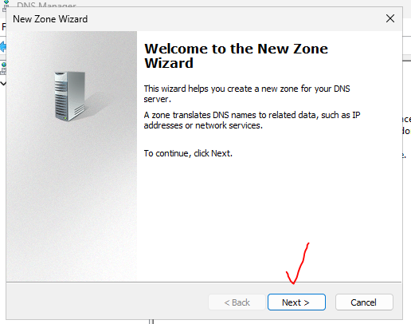
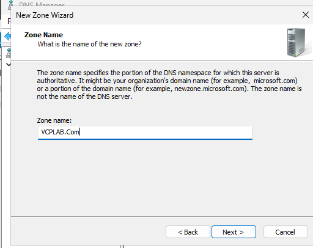
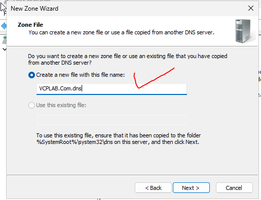
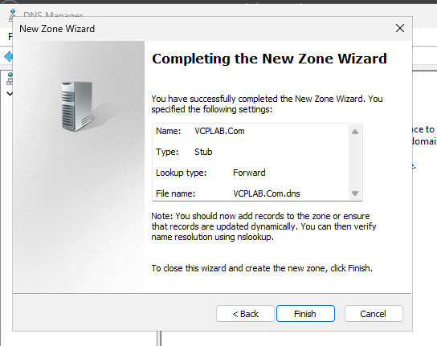
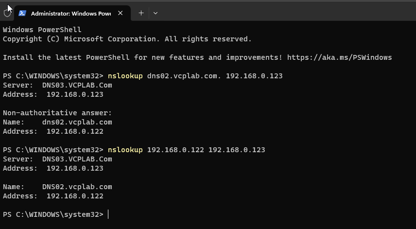

# DNS03 — Stub zone lab

## Lab values

| Server | Address | Role |
| --- | --- | --- |
| DNS01 | 192.168.0.121 | Standard primary |
| DNS02 | 192.168.0.122 | Secondary |
| DNS03 | 192.168.0.123 | Stub / resolving server |

VMnet2 host-only: 192.168.0.0/24. Forward zone: VCPLAB.Com. Reverse zone: 0.168.192.in-addr.arpa. Internet is unnecessary for these local lookups. A DNS suffix does not join a computer to an AD domain. This lab uses file-backed zones, not AD-integrated zones.

## What and why

A stub zone retains SOA, NS and necessary address records identifying authoritative DNS servers. It does not copy every host, alias or PTR. It helps a resolver find the servers responsible for a namespace and refresh that information. It is not a replacement for a full secondary replica.

## 1. Create the forward stub

1. On DNS03, open DNS Manager → Forward Lookup Zones → New Zone.
2. Next → Stub zone. AD storage is unavailable in this workgroup exercise.
3. Enter VCPLAB.Com.
4. Choose Create a new file: VCPLAB.Com.dns.
5. Enter master 192.168.0.121; confirm validation OK.
6. Next → review Stub / Forward → Finish → Refresh.
7. Confirm SOA, NS pointing to dns01.vcplab.com, and dns01 A record .121. The missing DNS02/DNS03 A and DNS CNAME records are expected here.

## 2. Create the reverse stub

1. Right-click Reverse Lookup Zones → New Zone → Stub zone.
2. Select IPv4 and Network ID 192.168.0 (or enter zone name 0.168.192.in-addr.arpa if requested).
3. Accept a new zone file and use master 192.168.0.121.
4. Finish and refresh. The captured final view shows SOA and NS; the reverse wizard itself was not shared.
5. Do not expect the full list of PTR records in a stub.

## 3. Verify resolving through DNS03

```powershell
nslookup dns02.vcplab.com. 192.168.0.123
nslookup 192.168.0.122 192.168.0.123
```

Screenshot 034759 confirms both queries succeeded through DNS03 .123, returning DNS02 and .122. The forward output says Non-authoritative answer, consistent with recursive resolution rather than DNS03 holding a complete authoritative zone. The screenshot does not prove the packet path or exclude cached answers.

## Troubleshooting

Check master .121, NS target and its address, network/DNS service, and that recursion is enabled for resolving clients. Test the same name directly against DNS01. A stub server's dependence on reachable authoritative servers differs from a secondary holding its own complete copy.


## Screenshot walkthrough

Follow the numbered procedure above; these images preserve the captured stages. Missing wizard pages are not evidence of the exact settings chosen.

## 033557 — DNS03 New Zone



## 033643 — Wizard welcome



## 033722 — Stub selected


## 033806 — VCPLAB.Com name



## 033935 — New stub file



## 034036 — DNS01 master validates OK


## 034058 — Forward stub summary



## 034304 — Forward stub records


## 034336 — Reverse stub final records


## 034759 — DNS03 forward and reverse tests pass


