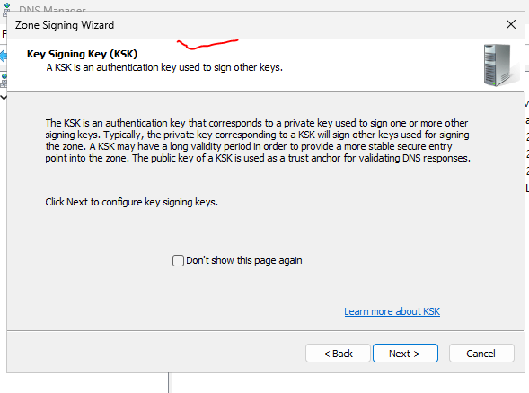
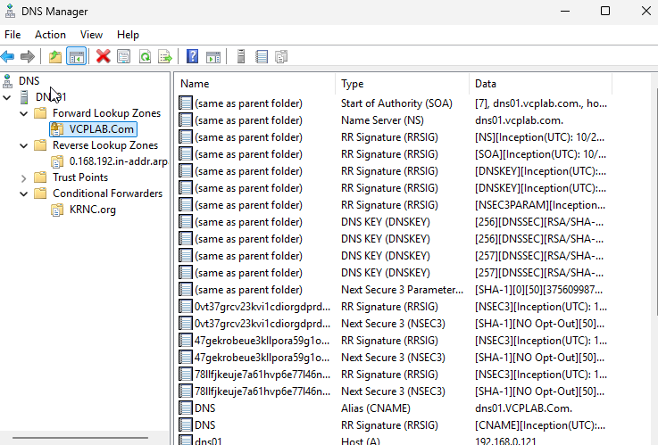

# Trust Points aur DNSSEC (Roman Urdu)

## Bunyadi tasawwur

DNSSEC digital signatures se DNS data ki authenticity aur signed data ki tabdeeli check karne mein madad deta hai. Trust Point trusted key ya digest rakhta hai jahan se validation shuru hoti hai. Authoritative server records sign karta aur validating resolver trusted chain se signatures check karta hai. Queries encrypt nahin hotin. Signing, anchor import aur validation alag steps hain; is lab mein signing aur unsigning demonstrate hui.


## Kya aur kyun

DNSSEC digital signatures se DNS data ka asal source, integrity aur kisi name/record ke na hone ka authenticated saboot check karne mein madad deta hai. Traffic encrypt nahin karta. Trust Point mein trusted DNSKEY/DS anchor hota hai jahan se validation ka bharosa shuru hota hai. Ye AD domain trust nahin. Signing data par signatures banata hai; validation trusted anchor tak chain check karti hai.

| Cheez | Kaam |
| --- | --- |
| KSK | DNSKEY record set sign karta hai; public maloomat se trust establish ho sakta hai |
| ZSK | Doosray record sets sign karta hai |
| DNSKEY | Public key |
| RRSIG | Record set ki signature |
| NSEC3 | Hashed names ke zariye authenticated non-existence ka saboot |

## 1. DNS01 par signing shuru karein

1. DNS Manager → DNS01 → Forward Lookup Zones → VCPLAB.Com.
2. Right-click → DNSSEC → Sign the Zone.
3. DNSSEC introduction → Next.
4. Customize zone signing parameters → Next.
5. KSK information page → Next.
6. KSK list mein Add karein aur key configure karein.

## 2. Settings review aur signing

Summary mein DNS01 Key Master, KSK RSA/SHA-256, 2048 bits, Microsoft Software Key Storage Provider aur DNSKEY signature validity 168 hours nazar aati hai. Darmiyani key, ZSK, NSEC3 aur rollover pages share nahin huay. Un ki exact settings assume na karein; repeat karte waqt teacher ki settings follow aur capture karein.

1. Summary ki tamam values review karein.
2. Next se signing shuru karein aur successful wizard complete karein.
3. Refresh karein. 042002 mein DNSKEY, RRSIG aur NSEC3 records hain, jo signed zone ka saboot hain.

Ye client/resolver validation ka saboot nahin. Reverse zone signing bhi share nahin hui.

## 3. Trust Point import — sirf samjhane ke liye, abhi kiya nahin

Future validation lab mein zone signed rehna chahiye. Trusted source se public anchor file validating server par lein. DNS Manager → Trust Points par right-click → Import → keyset ya dsset file select karein. Private signing keys ko trust anchor samajh kar transfer na karein.

Sirf example, jab asal verified file mil jaye:

```powershell
Import-DnsServerTrustAnchor -KeySetFile 'C:\DNSKeys\keyset-VCPLAB.Com'
Get-DnsServerTrustPoint
Get-DnsServerTrustAnchor -Name 'VCPLAB.Com'
```

Ye file lab mein create/verify nahin hui. RRSIG nazar aana ya DNSSEC records mangna validation ki kamyabi nahin. Alag isolated test mein resolver ki validation aur invalid signed data reject karna verify karna baqi hai.

## 4. Zone unsign karna — complete

1. VCPLAB.Com par right-click → DNSSEC → Unsign the Zone.
2. Warning parhein: DNSSEC records remove honge aur process ke duran updates nahin hongi.
3. Next karein aur wizard complete karein.
4. Refresh. 042249 mein original SOA, NS, A aur CNAME baqi hain, DNSSEC records remove ho chuke hain.

Final halat: zone unsigned hai. Trust Point import aur DNSSEC validation abhi demonstrate nahin hui. Future validation se pehle zone dobara sign aur trust anchor ka plan tayyar karein.


## Screenshots ka silsila

Upar diye gaye steps follow karein. Ye tasaveer capture kiye gaye stages dikhati hain. Jo wizard pages share nahin huay un ki exact settings confirm nahin hain.

## 040944 — Zone DNSSEC menu


## 041031 — Sign the Zone


## 041149 — DNSSEC introduction


## 041216 — Customize signing parameters


## 041320 — KSK explanation



## 041424 — Add KSK; list initially empty


## 041931 — Signing summary


## 042002 — Signed zone records



## 042153 — Zone context menu before unsigning


## 042217 — Unsign wizard warning


## 042249 — Final unsigned zone


