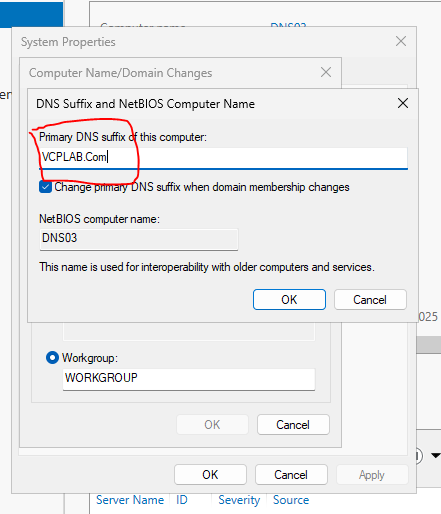
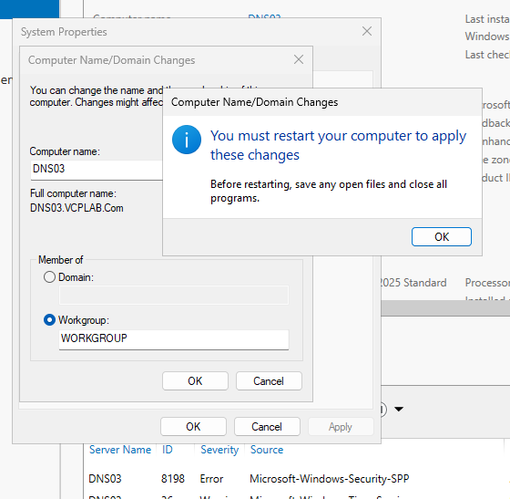

# DNS03 — DNS Suffix Study Notes

Lab record: 21 October 2026

Yeh notes DNS03 par primary DNS suffix set karne ke classroom steps hain. Neechay network values aap ke lab ki reference settings hain; in steps mein IP settings change nahi hoti.

Primary DNS suffix host name ke saath mil kar full computer name banata hai: **DNS03 + VCPLAB.Com = DNS03.VCPLAB.Com**. Sirf suffix set karne se Active Directory domain join, DNS zone create, ya DNS record ki mojoodgi confirm nahi hoti. DNS03 WORKGROUP mein rehta hai.

## Lab reference

| Setting | Value |
| --- | --- |
| Computer | DNS03 |
| Operating system | Windows Server 2025 Standard (Desktop Experience) |
| Primary DNS suffix | VCPLAB.Com |
| Full computer name | DNS03.VCPLAB.Com |
| Membership | WORKGROUP |
| IPv4 address | 192.168.0.123 |
| Subnet mask | 255.255.255.0 |
| Default gateway | Blank |
| Preferred DNS server | 192.168.0.123 |
| Alternate DNS server | 192.168.0.121 |

## Step 1: Local Server kholen

DNS03 par **Server Manager** kholen aur left menu mein **Local Server** par click karein.


## Step 2: Computer properties kholen

Properties mein neelay rang ke computer name **DNS03** par click karein.


## Step 3: Computer name ki settings kholen

**System Properties → Computer Name** tab mein **Change…** par click karein.


## Step 4: DNS suffix ki settings kholen

Computer name **DNS03** aur membership **Workgroup: WORKGROUP** hi rakhein. **More…** par click karein.


## Step 5: Primary DNS suffix likhein

**Primary DNS suffix of this computer** mein **VCPLAB.Com** likhein. NetBIOS computer name **DNS03** rakhein. Screenshot ki tarah **Change primary DNS suffix when domain membership changes** checked rehne dein. **OK** karein, phir Computer Name/Domain Changes mein bhi **OK** karein.



## Step 6: DNS03 restart karein

Restart ki notification par **OK** karein. System Properties band karke **Restart Now** select karein. DNS03 virtual machine restart karein aur dobara sign in karein.



## Step 7: Result verify karein

DNS03 ke andar Command Prompt ya PowerShell kholen aur command chalayein:

```powershell
ipconfig /all
```

**Host Name: DNS03**, **Primary DNS Suffix: VCPLAB.Com**, aur **DNS Suffix Search List: VCPLAB.Com** check karein. Aakhri screenshot mein yeh values confirm hain.


## Quick repeat checklist

Server Manager → Local Server → DNS03 → Change → More → VCPLAB.Com → OK → OK → restart DNS03 → `ipconfig /all`.

## Agar result mukhtalif ho

- Suffix blank ho to **Change → More** mein entry check karein, apply karein aur restart karein.
- Domain controller contact error aaye to dekhein ke **Domain** select to nahi kiya. Is procedure mein **WORKGROUP** aur **More…** use hota hai.
- DNS names mein capital aur small letters ka farq nahi: `VCPLAB.Com` aur `vcplab.com` aik hi naam hain.
- Suffix verify hone ka matlab computer ki setting confirm hona hai. DNS resolution aur zones alag verify honge.
